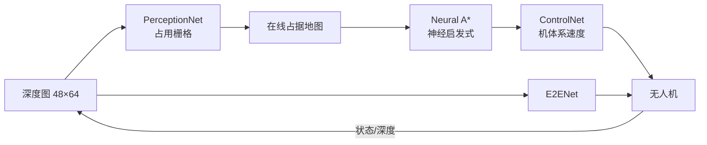

# 任务分析

## 1. 任务背景

无人机在低空物流、巡检、救援等场景中，必须在**未知、拥挤、可能动态**的环境中
安全地从起点飞到目标点。经典方案把问题拆成“建图—规划—控制”三段，每段用
手工设计的算法；近年来，学习型方法尝试用神经网络替代其中一段或全部。

本课程大作业要求：

1. 选择一项低空载具任务，在仿真中完成，并录制 GIF 演示；
2. 感知、规划、控制、端到端算法**必须使用神经网络**；
3. 每个模块支持 `launch` 启动，入口统一为 `main.*`；
4. 在 Ubuntu 20.04 + ROS Noetic（或 Humble）上可运行；
5. 文档需给出仿真步骤、公式、算法流程、源码解析，并用 mkdocs 发布。

## 2. 问题定义

设世界坐标系为 ROS REP-103（\(x\) 前、\(y\) 左、\(z\) 上），无人机状态

\[
\mathbf{s}_k = \left(\mathbf{p}_k, \mathbf{v}_k, \psi_k\right),
\qquad
\mathbf{p}_k \in \mathbb{R}^3,\;
\mathbf{v}_k \in \mathbb{R}^2,\;
\psi_k \in [-\pi,\pi)
\]

其中 \(\mathbf{p}_k=(x_k,y_k,z_k)\) 为位置，\(\mathbf{v}_k\) 为水平速度，\(\psi_k\) 为偏航角。
机载深度相机给出 \(D_k\in\mathbb{R}^{48\times64}\)，目标点 \(\mathbf{g}\in\mathbb{R}^3\)。
策略 \(\pi\) 输出机体系速度指令 \(\mathbf{u}_k=(v_x,v_y)\)：

\[
\mathbf{u}_k = \pi\left(D_k, \mathbf{g}, \mathbf{s}_k\right),
\qquad
\|\mathbf{u}_k\| \le v_{\max}=1.5\ \text{m/s}
\]

评价目标：在 \(T_{\max}=65\ \text{s}\) 内到达目标（容差 1.4 m），全程
\(\text{clearance}(\mathbf{p}_k)\ge r_{\text{drone}}=0.32\ \text{m}\)。

## 3. 为什么选择“分层 + 端到端”双方案

课程要求四个模块都必须是神经网络，但“端到端”和“感知/规划/控制”在概念上是
两种不同的系统组织方式。为了同时覆盖要求与可解释性，本项目实现：

- **分层链路（full）**：感知 → 规划 → 控制，三段可单独评测、可解释、可替换；
- **端到端链路（e2e）**：深度图 + 目标直接回归速度，作为对照与消融。

两条链路共享同一个仿真器、同一套数据采集与训练框架，便于公平比较。

## 4. 评价指标

| 指标 | 定义 | 单位 |
| --- | --- | --- |
| 成功率 `success_rate` | 到达目标且未碰撞的回合比例 | — |
| 碰撞率 `collision_rate` | 与障碍物距离小于 \(r\) 的回合比例 | — |
| 路径长度 `path_length` | 轨迹累计弧长 | m |
| 最小间隙 `min_clearance` | 全程 \(\min_k \text{clearance}(\mathbf{p}_k)\) | m |
| 到达时间 `duration` | 从起点到判定到达的仿真时间 | s |
| 规划耗时 `plan_ms` | 单次 A\*（含神经启发式推理）平均耗时 | ms |
| 推理耗时 `infer_ms` | 单帧网络前向平均耗时 | ms |
| 重规划次数 `replans` | 在线地图触发 A\* 的次数 | 次 |

成功率与碰撞率按场景、按随机种子统计；时间类指标取均值。
所有实验默认 3 个随机种子（`--seeds 3`），种子只影响动态障碍相位与感知噪声。

## 5. 难点与应对

| 难点 | 表现 | 应对 |
| --- | --- | --- |
| 无 GPU、无 PyTorch | 无法直接训练 CNN | 手写 NumPy 自动微分 + Adam，float32 |
| 深度图 → 地图的几何一致性 | 早期投影方位角被二次除法压缩，地图坍缩 | 统一相机模型，单元测试验证投影落点 |
| 模仿学习分布偏移 | 控制器只学会“直飞”，大侧向误差失效 | DAgger 式目标增广 + 随机重标注 |
| 端到端忽略障碍 | 深度输入被网络无视，恒速前飞 | 强斥力教师标签 + 近障碍恢复样本 |
| 窄走廊切角 | 纯追踪在 90° 门洞处撞墙 | 折线投影 lookahead + 门洞加宽 + 路径简化 |
| 动态障碍被“冻结” | 仿真时间未推进 | 每步同步 `world.t = drone.t` |

这些问题的定位过程与修复细节写在各个模块页与 [常见问题](faq.md) 中。
