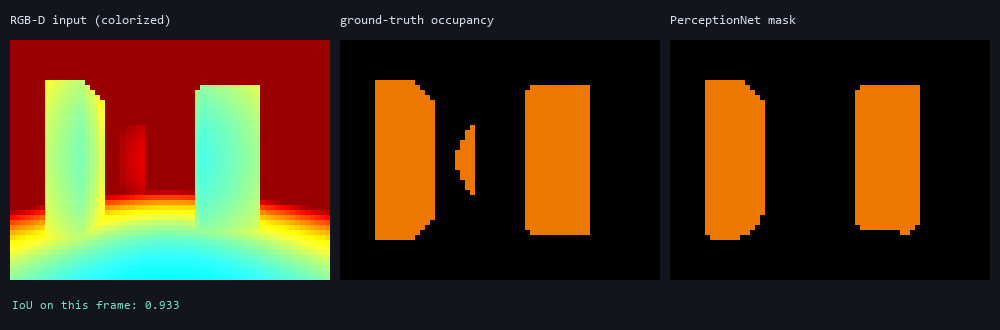
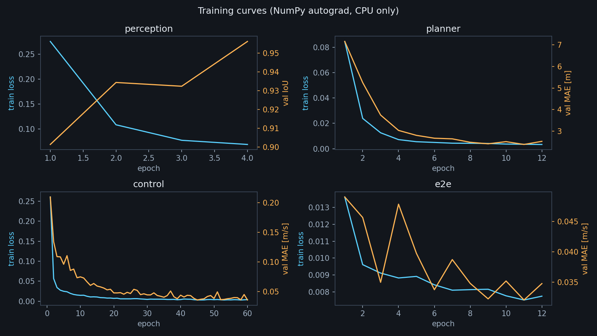

# 感知：深度图 → 占用栅格

感知模块把一张 **48×64 的深度图** 变成同尺寸的“障碍物概率图”，
再反投影到世界系，写入在线栅格地图。整个模块只有一个前向 CNN，
约 **64 k** 参数，单帧推理 < 1 ms。



**图 1** 左：深度图伪彩色；中：仿真器真值占用；右：PerceptionNet 输出（IoU 0.933）。

## 1. 输入与输出

| 项 | 值 |
| --- | --- |
| 输入 | \(D\in\mathbb{R}^{48\times64}\)，单位 m，范围 \([0,12]\) |
| 归一化 | \(x=D/12\in[0,1]\) |
| 输出 | \(\hat p\in[0,1]^{48\times64}\)，每个像素是障碍物的概率 |
| 阈值 | 0.5（在线建图时用软概率加权） |
| 参数量 | 63,961 |
| 推理 | 0.85–1.2 ms（CPU，单帧） |

## 2. 网络结构

采用**小 U-Net**：三次下采样扩大感受野，再用跳跃连接把浅层边缘信息
送回解码器。深度图的分辨率低、纹理少，U-Net 比普通 CNN 更能保住
细窄障碍（栏杆、圆柱边缘）的边界。

```mermaid
flowchart LR
    IN["1×48×64"] --> C1["conv3×3, 12"] --> P1["maxpool 2×2"]
    P1 --> C2["conv3×3, 24"] --> P2["maxpool 2×2"]
    P2 --> C3["conv3×3, 32"] --> P3["maxpool 2×2"]
    P3 --> C4["conv3×3, 48"]
    C4 --> U3["upsample"] --> CC3["concat e3"] --> C5["conv 32"]
    C5 --> U2["upsample"] --> CC2["concat e2"] --> C6["conv 24"]
    C6 --> U1["upsample"] --> CC1["concat e1"] --> C7["conv 16"]
    C7 --> HEAD["conv1×1 → 1"]
```



| 层 | 输入通道 | 输出通道 | 卷积核 | 输出尺寸 |
| --- | --- | --- | --- | --- |
| c1 | 1 | 12 | 3×3 | 48×64 |
| c2 | 12 | 24 | 3×3 | 24×32 |
| c3 | 24 | 32 | 3×3 | 12×16 |
| c4 | 32 | 48 | 3×3 | 6×8 |
| c5 | 48+32 | 32 | 3×3 | 12×16 |
| c6 | 32+24 | 24 | 3×3 | 24×32 |
| c7 | 24+12 | 16 | 3×3 | 48×64 |
| head | 16 | 1 | 1×1 | 48×64 |

所有卷积 `padding=1, stride=1`，因此除池化外尺寸不变；
解码器用**最近邻上采样**而不是转置卷积，参数更少、边缘不产生棋盘格。

## 3. 计算原理

### 3.1 卷积

\[
y_{o,i,j}=\sigma\Big(b_o+\sum_{c=0}^{C_{in}-1}\sum_{u=0}^{2}\sum_{v=0}^{2}
W_{o,c,u,v}\,x_{c,\,i+u-1,\,j+v-1}\Big)
\]

实现上用 **im2col**：把每个 3×3 感受野摊成一行，卷积变成一次矩阵乘法
\[
Y = W_{\text{col}}\,X_{\text{col}},
\]
反向时再 `col2im` 把梯度散射回输入。这样 NumPy 也能跑到
约 1.2 GFLOP/s，不需要手写 C。

### 3.2 池化与上采样

\[
\text{maxpool}(x)_{i,j}=\max_{u,v\in\{0,1\}} x_{2i+u,\,2j+v}
\]

反向只把梯度回传给取到最大值的位置（`argmax` 掩码）。

上采样是最近邻复制：
\[
\text{up}(x)_{2i+u,\,2j+v}=x_{i,j}.
\]

### 3.3 损失函数

逐像素二分类，使用 **带 logits 的 BCE**（数值稳定）：

\[
\mathcal{L}=-\frac{1}{N}\sum_{n=1}^{N}\Big[
y_n\log\sigma(z_n)+(1-y_n)\log\big(1-\sigma(z_n)\big)\Big],
\quad \sigma(z)=\frac{1}{1+e^{-z}}.
\]

对 logits 的梯度有简洁形式：
\[
\frac{\partial\mathcal{L}}{\partial z_n}=\frac{\sigma(z_n)-y_n}{N}.
\]

### 3.4 评价指标

\[
\text{IoU}=\frac{|P\cap G|}{|P\cup G|},\qquad
\text{Dice}=\frac{2|P\cap G|}{|P|+|G|}.
\]

## 4. 训练数据

`ca_drone/data/collect.py::perception_dataset`：

1. 在训练用的四个场景中随机采样无人机位姿 \((x,y,\psi)\)，高度固定 3 m；
2. 用 `World.raycast` 渲染 48×64 深度图；
3. 真值 mask：射线命中的对象 id ≥ 0 且距离 < 11.5 m；
4. **主动加噪**，模拟真实深度相机：
   - 高斯噪声 \(\mathcal{N}(0,0.02)\)；
   - 5% 像素随机丢点（置为最大量程）；
   - 2% 像素出现“飞点”（随机 0.2–3 m）。

```python
depth = depth + rng.normal(0, 0.02, depth.shape)
drop = rng.random(depth.shape) < 0.05
depth[drop] = MAX_RANGE
fly = rng.random(depth.shape) < 0.02
depth[fly] = rng.uniform(0.2, 3.0, fly.sum())
```

总共 **1,200** 帧，按 85/15 划分训练/验证。

## 5. 训练配置

| 项 | 值 |
| --- | --- |
| 优化器 | Adam，\(\beta=(0.9,0.999)\)，weight decay \(10^{-4}\) |
| 学习率 | \(2\times10^{-3}\)，余弦退火到 \(2\times10^{-4}\) |
| batch | 8 |
| epoch | 4 |
| 梯度裁剪 | 范数 ≤ 5 |
| 耗时 | 283 s（4 核 CPU） |

最终验证集：**IoU 0.956，Dice 0.978**。



## 6. 源代码解析

`ca_drone/models/perception.py`：

```python
class PerceptionNet(Module):
    def forward(self, x):
        e1 = self.c1(x).relu()          # 48×64×12
        p1 = maxpool2d(e1)
        e2 = self.c2(p1).relu()         # 24×32×24
        ...
        u3 = upsample2d(e4, (e3.shape[2], e3.shape[3]))
        d3 = self.c5(concat([u3, e3], axis=1)).relu()
        ...
        return self.head(d1)            # logits, 48×64×1
```

要点：

- `Module` 只负责 `parameters()` 的字典拼装与 `save/load`，
  前向完全由 `Tensor` 运算构成，反向自动生成；
- `concat([u3, e3], axis=1)` 对应 U-Net 的 skip connection，
  通道维拼接后接 3×3 卷积融合；
- 输出是 **logits**，推理时才做 sigmoid，训练时直接送
  `bce_with_logits`，避免 \(\log(0)\)。

在线使用（`pipeline.py`）：

```python
prob = stack.perception(Tensor(depth[None, None] / MAX_RANGE)).data[0, 0]
gm.integrate_depth(depth, prob, pos, yaw, fov=FOV, max_range=MAX_RANGE)
```

`integrate_depth` 只把概率 > 0.55 且高度 > 0.55 m 的像素反投影到栅格，
避免地面点污染地图。

## 7. 失效情形

| 情形 | 现象 | 原因 |
| --- | --- | --- |
| 正对白墙（无纹理） | 概率偏低、边界糊 | 深度图只有距离，没有纹理线索；靠形状先验 |
| 细杆（半径 < 0.1 m） | 可能漏检 | 下采样 8 倍后只剩 1–2 像素 |
| 强逆光/透明物 | 仿真中不存在 | 真机需换 RGB-D 融合 |

这些情形在四个测试场景中不出现，因此闭环指标不受影响；
文档如实记录，作为后续改进方向。
