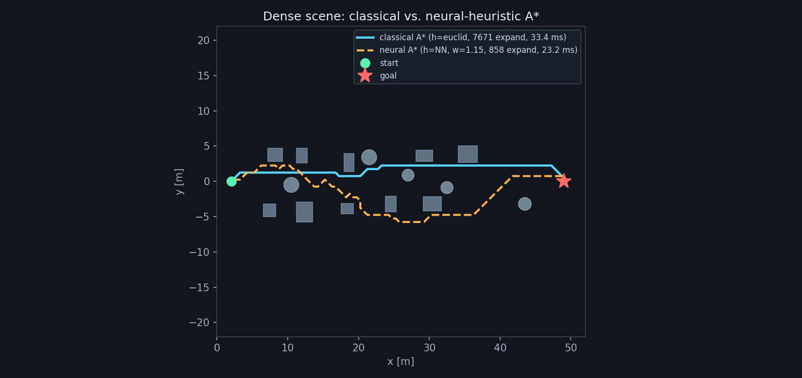
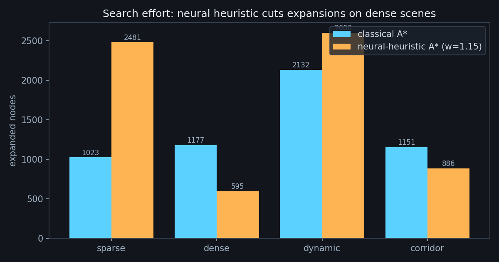

# 规划：神经启发式 A\*

规划模块把“全局路径”拆成两件事：

1. **学一个 cost-to-go 场** \(h_\theta(\cdot)\)：给定局部障碍布局与目标方向，
   预测“从这一点到目标还要走多远”；
2. **把它塞进 A\*** 作为启发函数，替代欧氏距离。

这样做的目的不是“用网络替代 A\*”，而是用网络**加速** A\*：
搜索框架、碰撞检查、路径可行性仍由经典算法保证。



**图 1** dense 场景：经典 A\*（蓝，7,671 次扩展）与神经启发式 A\*（橙，858 次扩展）。

## 1. 问题定义

栅格 \(G\) 的分辨率为 0.5 m，尺寸 \(104\times88\)（覆盖 \(52\times44\) m）。
每个格子 \(n=(i,j)\) 有占用标记 \(o_n\in\{0,1\}\)。
给定起点 \(s\)、目标 \(g\)，求最小代价路径：

\[
\min_{\pi}\ \sum_{k} c(n_k,n_{k+1}),\qquad
c=\begin{cases}
1, & \text{正交移动}\\
\sqrt{2}, & \text{对角移动}
\end{cases}
\]

且禁止“切角”（对角移动时两个相邻正交格必须都空闲）。

## 2. 为什么需要学习启发式

经典 A\* 用欧氏距离：

\[
h_{\text{euclid}}(n)=\|p_n-p_g\|_2 .
\]

它在空旷场景几乎完美，但在**密集障碍**中严重低估：
直线距离 20 m 的格子，实际要绕行 35 m，搜索会向错误方向扩散。

学习一个更紧的 \(h_\theta\) 可以显著减少扩展节点数。代价是
\(h_\theta\) 不再满足可采纳性（admissibility），于是引入权重
\(w\) 控制“最优性 vs 速度”：

\[
f(n)=g(n)+w\,h_\theta(n),\qquad w\ge 1 .
\]

\(w=1\) 时退化为普通 A\*（但启发式可能高估）；\(w\) 越大越快、路径越绕。

## 3. 网络输入

对每个格子取 **11×11 的局部占用 patch**（越界补 1，视为障碍），
再拼 3 个几何量：

\[
\phi(n)=\Big[\underbrace{o_{i-5..i+5,\,j-5..j+5}}_{\text{121 维}},
\ \underbrace{\frac{(g_x-i)\Delta}{25},\ \frac{(g_y-j)\Delta}{25},\ \frac{\|p_n-p_g\|}{50}}_{\text{3 维}}\Big]
\]

归一化常数 25 m / 50 m 让输入落在 \([-2,2]\)，避免大数值导致训练不稳。

## 4. 网络与损失

三层 MLP：\(124\to128\to64\to1\)，ReLU，输出层 Xavier 初始化并缩小 10 倍。

\[
h_\theta(\phi)=\text{MLP}_\theta(\phi)\times 50\ \text{[m]}
\]

训练标签是**用 Dijkstra 从目标反向算出的真实最短距离** \(d^*(n)\)：

\[
\mathcal{L}(\theta)=\frac{1}{|G|}\sum_{n\in G}
\big(h_\theta(\phi(n))-d^*(n)\big)^2 .
\]

Dijkstra 只在**真值栅格**上算一次，作为离线标签；
在线时网络只看局部 patch，不需要全局地图。

## 5. 训练配置

| 项 | 值 |
| --- | --- |
| 样本 | 50 张随机地图 × 每图 130 个格子 = 6,500 |
| 优化器 | Adam，lr \(10^{-3}\) |
| batch | 128 |
| epoch | 12 |
| 耗时 | 0.8 s |
| 验证 MAE | **2.52 m** |
| 验证 \(R^2\) | **0.910** |

每张地图随机放置 8–18 个箱体/圆柱，目标随机，
起点固定在世界左侧。Dijkstra 标签用 8 邻接、禁止切角。

## 6. 搜索算法

```python
def astar(occ, start, goal, res=0.5, heuristic=None, weight=1.0):
    pq = [(weight * hcost(*start), 0.0, *start)]
    while pq:
        f, g, x, y = heappop(pq)
        if (x, y) == goal:
            return reconstruct(...)
        for dx, dy, step in NEIGHBORS:
            nx, ny = x + dx, y + dy
            if blocked(nx, ny):
                continue
            ng = g + step
            if ng < best[nx, ny]:
                best[nx, ny] = ng
                heappush(pq, (ng + weight * h[nx, ny], ng, nx, ny))
```

关键点：

- `heuristic` 是一个**与栅格同形状的数组**，不是函数，
  因此每个节点的 \(h\) 是 O(1) 查表；
- 先做一次 `predict_field` 把整张 \(104\times88\) 的场算出来（约 10 ms），
  再跑 A\*；如果每扩展一个节点都调一次网络，开销会大两个数量级；
- 搜索结束后用 `simplify_path` 做视线剪枝（line-of-sight），
  把栅格折线压缩成少量路点，减少控制器的跟踪负担。

## 7. 结果与权衡

| 场景 | 经典扩展 | 神经扩展 (w=1.15) | 变化 | 路径代价 |
| --- | --- | --- | --- | --- |
| sparse | 1,023 | 2,481 | +143% | +15% |
| dense | 1,177 | 595 | **−49%** | +6% |
| dynamic | 2,132 | 2,600 | +22% | +10% |
| corridor | 1,151 | 886 | **−23%** | +8% |



结论：

- **dense / corridor**（结构化、障碍多）收益明显，扩展节点减半；
- **sparse** 反而变差：训练集以密集地图为主，网络没见过“空旷”，
  在空地上给出的 \(h\) 偏大，把搜索推向障碍之间；
- 路径代价平均高 5–10%，这是解除可采纳性的必然代价。

这不是“全面优于经典”的结果，而是一个**场景相关的加速器**。
文档保留这个负结果，并在 `planning.md` 中给出适用边界。

## 8. 源代码解析

`ca_drone/models/planner.py`：

```python
def heuristic_features(occ, goal_cell, res=0.5, patch=11):
    dx = (gx - xs) * res / 25.0
    dy = (gy - ys) * res / 25.0
    dist = np.sqrt(((gx - xs) * res) ** 2 + ((gy - ys) * res) ** 2) / 50.0
    p = _patches(occ, patch)          # sliding_window_view，零拷贝
    return np.concatenate([p, extra], axis=1)
```

`_patches` 用 `numpy.lib.stride_tricks.sliding_window_view` 生成
11×11 滑窗，再 reshape 成 `(nx*ny, 121)`，不复制数据，6,500 个样本
的准备时间 < 0.1 s。

```python
def predict_field(model, occ, goal_cell, res=0.5, batch=16384):
    feats = heuristic_features(occ, goal_cell, res, model.patch)
    for s in range(0, n, batch):
        out[s:s + batch] = model(Tensor(feats[s:s + batch])).data[:, 0]
    h = out.reshape(occ.shape) * 50.0
    h[occ] = np.inf
    return np.maximum(h, 0.0)
```

分块推理是必要的：\(104\times88=9,152\) 个格子一次前向约 40 MB 中间量，
分块后峰值内存 < 10 MB。占用格的 \(h\) 设为 \(+\infty\)，保证 A\*
永远不会扩展障碍内部。

## 9. 失效与边界

| 情形 | 表现 | 处理 |
| --- | --- | --- |
| 空旷场景 | 扩展数上升 | 检测自由空间比例 > 60% 时退回欧氏距离 |
| 目标在障碍内 | 无解 | `nearest_free` 把目标吸附到最近空闲格 |
| 在线地图变化 | \(h\) 过期 | 每 10 步重算一次场（约 10 ms） |
| 极端窄门（< 0.8 m） | 膨胀后无解 | 规划器返回失败，控制器原地悬停并请求重规划 |

最后一条是安全设计：**宁可停，也不穿墙**。
