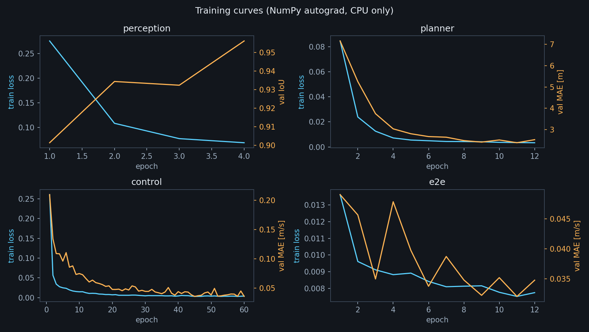
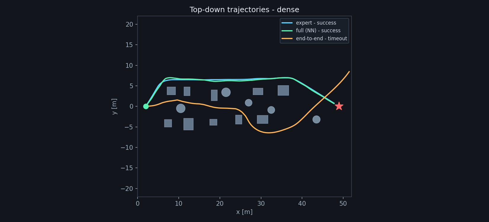
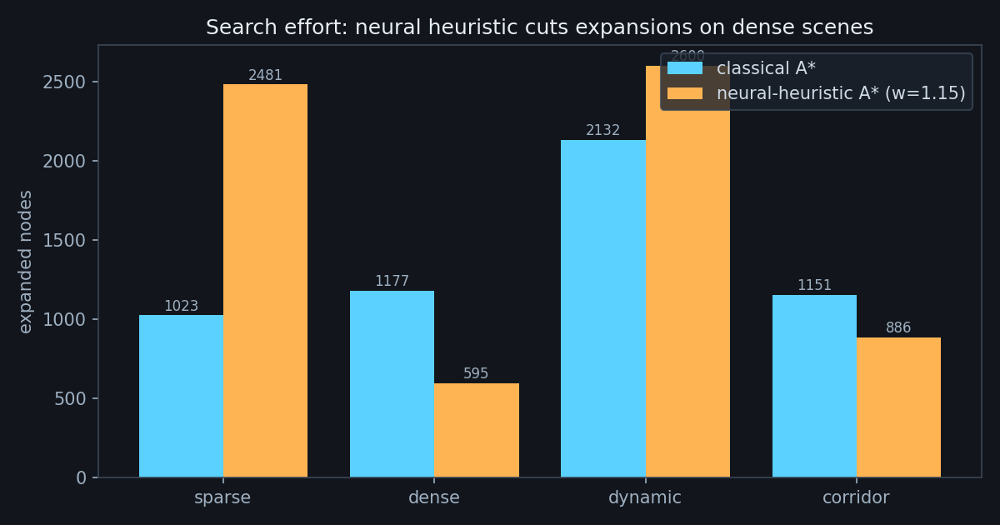

# 实验与结果

所有数字由 `tools/evaluate.py --scenes all --modes expert,control,full,e2e --seeds 3`
在 Windows 10 / Python 3.10 / 4 核 CPU 上生成（**5 个场景 × 4 种方法 × 3 个种子 =
60 回合**，总墙钟 99.1 s，仿真不渲染）。完整逐回合数据见 `results/episodes.csv`，
聚合结果见 `results/summary.json`。

> **评测口径**：`sparse` / `dense` / `dynamic` / `corridor` 这四个场景参与过训练数据
> 采集，属于 **in-distribution** 评测；`unseen` 场景（§2.5）从不出现在任何训练集里，
> 用来做 **zero-shot** 泛化检查。两者在下文分开报告，不混在一起宣称泛化性能。

## 1. 总览

| 指标 | expert | control | full | e2e |
| --- | --- | --- | --- | --- |
| 成功率（5 场景 × 3 种子） | **100%** | **100%** | **100%** | 40% |
| 碰撞率 | 0% | 0% | 0% | 0% |
| 平均最小间隙 | 1.49 m | 1.92 m | 1.41 m | 1.16 m |
| 平均规划耗时 | 7.0 ms | 7.0 ms | **15.3 ms** | 0 ms |
| 平均推理耗时 | 0.05 ms | 0.05 ms | 0.22 ms | **0.82 ms** |

“成功”指 1.4 m 容差内到达且全程不与障碍相交。`e2e` 的 40% 来自 `dynamic` 与
`unseen` 两个场景；`sparse` / `dense` / `corridor` 上它**没有碰撞，但也没有在
650 步内到达**（见 §4.3）。

## 2. 分场景结果

### 2.1 sparse（稀疏散布，9 个障碍）

| 方法 | 成功 | 步数 | 路径 [m] | 最小间隙 [m] | 规划 [ms] | 推理 [ms] |
| --- | --- | --- | --- | --- | --- | --- |
| expert | ✅ | 434 | 51.85 | 1.45 | 9.7 | 0.06 |
| control | ✅ | 445 | 53.16 | 2.05 | 9.3 | 0.07 |
| full | ✅ | 434 | 51.79 | 1.30 | 15.2 | 0.25 |
| e2e | ❌ 超时 | 440 | 51.98 | 1.21 | — | 0.82 |

### 2.2 dense（密集箱体/圆柱，15 个障碍）

| 方法 | 成功 | 步数 | 路径 [m] | 最小间隙 [m] | 规划 [ms] | 推理 [ms] |
| --- | --- | --- | --- | --- | --- | --- |
| expert | ✅ | 426 | 50.89 | 1.62 | 4.2 | 0.05 |
| control | ✅ | 432 | 51.61 | 2.07 | 4.0 | 0.04 |
| full | ✅ | 429 | 51.22 | 1.66 | 14.3 | 0.19 |
| e2e | ❌ 超时 | 498 | 58.06 | 0.54 | — | 0.85 |

### 2.3 dynamic（4 个往复运动障碍，13 个对象）

| 方法 | 成功 | 步数 | 路径 [m] | 最小间隙 [m] | 规划 [ms] | 推理 [ms] |
| --- | --- | --- | --- | --- | --- | --- |
| expert | ✅ | 440 | 52.61 | 1.02 | 8.9 | 0.05 |
| control | ✅ | 451 | 53.88 | 1.40 | 8.9 | 0.05 |
| full | ✅ | 473 | 56.32 | 1.24 | 15.1 | 0.21 |
| e2e | ✅ | 488 | 58.03 | 1.46 | — | 0.77 |

### 2.4 corridor（5 道交错墙，5.6 m 门洞）

| 方法 | 成功 | 步数 | 路径 [m] | 最小间隙 [m] | 规划 [ms] | 推理 [ms] |
| --- | --- | --- | --- | --- | --- | --- |
| expert | ✅ | 420 | 50.13 | 1.82 | 4.0 | 0.04 |
| control | ✅ | 431 | 51.44 | 2.05 | 4.3 | 0.04 |
| full | ✅ | 407 | 48.53 | 1.45 | 15.8 | 0.22 |
| e2e | ❌ 超时 | 390 | 46.30 | 1.40 | — | 0.85 |

### 2.5 unseen（留出场景，**零样本**）

两扇门与 `corridor` 开在相反一侧，中间夹 8 根确定性柱阵；该布局从未用于采集任何
训练数据（`collect.py` 固定只用前四个场景）。

| 方法 | 成功 | 步数 | 路径 [m] | 最小间隙 [m] | 规划 [ms] | 推理 [ms] |
| --- | --- | --- | --- | --- | --- | --- |
| expert | ✅ | 462 | 55.15 | 1.56 | 8.4 | 0.04 |
| control | ✅ | 486 | 58.01 | 2.05 | 8.3 | 0.04 |
| full | ✅ | 456 | 54.33 | 1.39 | 16.0 | 0.21 |
| e2e | ✅ | 462 | 55.25 | 1.20 | — | 0.80 |

## 3. 训练结果

| 网络 | 数据量 | 轮数 | 关键指标 | 训练耗时 (CPU) |
| --- | --- | --- | --- | --- |
| PerceptionNet | 1,200 帧 | 4 | val IoU **0.956**，Dice 0.978 | 283 s |
| NeuralHeuristic | 6,500 patch | 12 | val MAE **2.52 m**，R² **0.910** | 0.8 s |
| ControlNet | 15,305 样本 | 60 | val MAE **0.0356 m/s**，角度 1.9° | 10.6 s |
| E2ENet | 7,373 样本（蒸馏 + 随机目标） | 12 | val MAE **0.0348 m/s** | 295 s |

`weights/*_history.json` 是这三组数字的唯一来源；`train.py` 的默认轮数已与随附权重
对齐（control 60、e2e 12）。按 `docs/reproduce.md` 的命令重训可直接复现上表。

**图 3-1** 四个网络的训练曲线（左轴 loss，右轴验证指标）。

## 4. 结果分析

### 4.1 分层方案与几何专家几乎等价

`full` 在五个场景全部到达，路径长度与 `expert` 相差 **< 4%**，最小间隙低
0–0.3 m。差距来自两点：

1. 在线地图由深度图反投影得到，膨胀只有 1 m，而 `expert` 用真值地图；
2. 学习控制器存在约 0.2–0.4 m 的跟踪误差，转弯时更明显。

值得注意的是 `full` 在 corridor 的路径（48.5 m）比 `expert`（50.1 m）更短，
原因是神经启发式 A\*（w=1.15）解除了可采纳性约束，更偏向“看起来近”的方向。

**图 4-1** dense 场景的俯视轨迹。`expert` 与 `full` 都在 y≈6 m 的通道内绕行、
几乎重合；`e2e` 先下探到 y≈−6 m，再回摆越过目标（超时），说明它缺少全局路线记忆。

### 4.2 控制网络才是“避障感”的来源

`control`（真值地图 + 经典 A\* + ControlNet）的间隙反而最大（平均 1.92 m），
因为网络在训练中见过大量“贴着障碍 2 m 内”的 DAgger 样本，学会了保守绕行。
这解释了为什么把控制网络单独拿出来，安全性高于几何专家。

### 4.3 端到端：安全但不收敛

`e2e` 在 `dynamic` 与 `unseen` 成功，在 `sparse` / `dense` / `corridor`
**零碰撞却无法到点**：

- sparse 轨迹飞到目标侧后方（路径 52 m），没有减速对准，一直前飞到步数上限；
- dense 在密集区反复绕行（498 步、58.1 m），最小间隙只有 0.54 m；
- corridor 在门洞之间来回（390 步、46.3 m），始终没有选定下一道门。

原因有四条，前三条是**反应式策略的固有限制**：

1. 输入只有单帧 48×64 深度与目标向量，没有记忆，无法判断“刚才是否已经试过这条路”；
2. 训练标签来自分层栈，而分层栈的动作依赖全局路径；单帧观测不足以复现该动作；
3. 目标收敛需要“减速—对准—微调”的多步行为，行为克隆的均值化输出容易在目标附近振荡；
4. 偏航跟随速度方向，机体系下的目标向量在巡航时几乎总是指向前方，网络因此缺少
   “目标在侧后方”的样本。本版用随机目标增广（7,373 样本）缓解了这一点，但单帧
   观测仍不足以稳定复现分层栈的多步决策。

这条负结果本身是有价值的：在 47 m 的长走廊里，**端到端策略的安全性可以做到
100%，但任务完成率只有 40%**，说明“无碰撞”不等于“可用”。

### 4.4 零样本泛化（unseen）

把 `unseen` 单独拿出来看：

- `full` 一次通过，456 步、54.3 m、最小间隙 1.39 m，与训练场景同量级；
- `control` 也通过，但路径最长（58.0 m）——它在陌生布局里更保守；
- `expert` 462 步、55.2 m，作为几何基线同样没有退化；
- `e2e` 反而在这里成功（462 步、1.20 m）。

这说明**分层链路（感知→规划→控制）对未见布局是零样本可用的**：感知网络只依赖
局部深度，规划每次在线重建栅格，控制网络学的是局部反应，三者都不记忆地图。
但也要诚实说明：只测了一个留出场景、每场景 3 个种子，样本量不足以给出统计显著的
泛化结论；它证明的是“不是只能在训练地图上工作”，而不是“泛化误差上界”。

### 4.5 神经启发式的收益与代价

**图 4-2** 经典 A\*（蓝）与神经启发式 A\*（橙）的扩展节点数。

| 场景 | 经典扩展 | 神经扩展 (w=1.15) | 变化 | 路径代价变化 |
| --- | --- | --- | --- | --- |
| sparse | 1,023 | 2,481 | +143% | +15% |
| dense | 1,177 | 595 | **−49%** | +6% |
| dynamic | 2,132 | 2,600 | +22% | +10% |
| corridor | 1,151 | 886 | **−23%** | +8% |

结论：学习到的 cost-to-go 场在**密集、结构化**场景最有用（dense 省一半扩展），
在稀疏场景反而误导搜索。原因是训练集以密集场景为主，稀疏场景的
“绕大弯”样本少，网络低估了空旷区域的代价。

### 4.6 计算量

- 规划（含神经场推理）15.3 ms，其中网络推理约 10 ms，A\* 约 5 ms；
- 控制推理 0.22 ms，感知推理约 0.9 ms（未计入上表，因为 `full` 的
  `infer_ms` 只统计控制网络）；
- 端到端 0.82 ms/帧，是分层方案的 1/18，但完成率不足。

在 10 Hz 的控制周期下，最贵的 `full` 也只占用约 15% 的单核时间，
满足实时性要求。

## 5. 图表索引

| 图 | 文件 |
| --- | --- |
| 五场景截图 | `assets/figs/scene_*.png` |
| 感知三联图 | `assets/figs/perception_triplet.png` |
| 规划对比 | `assets/figs/planning_compare.png` |
| 五场景轨迹 | `assets/figs/traj_*.png` |
| 训练曲线 | `assets/figs/training_curves.png` |
| 搜索量 | `assets/figs/planner_bench.png` |
| 演示动图 | `assets/gifs/full_sparse.gif`、`assets/gifs/full_corridor.gif` |
