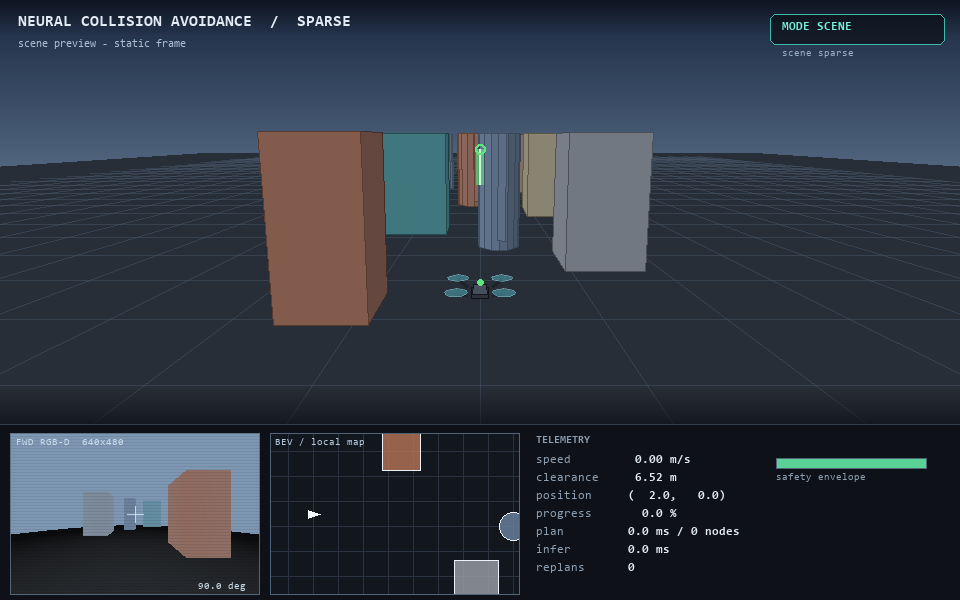
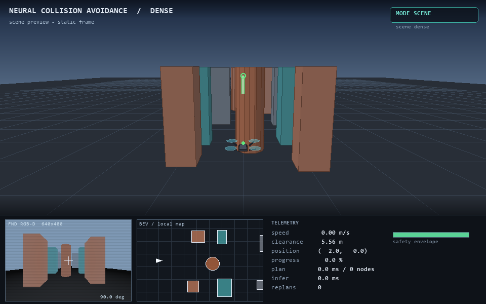
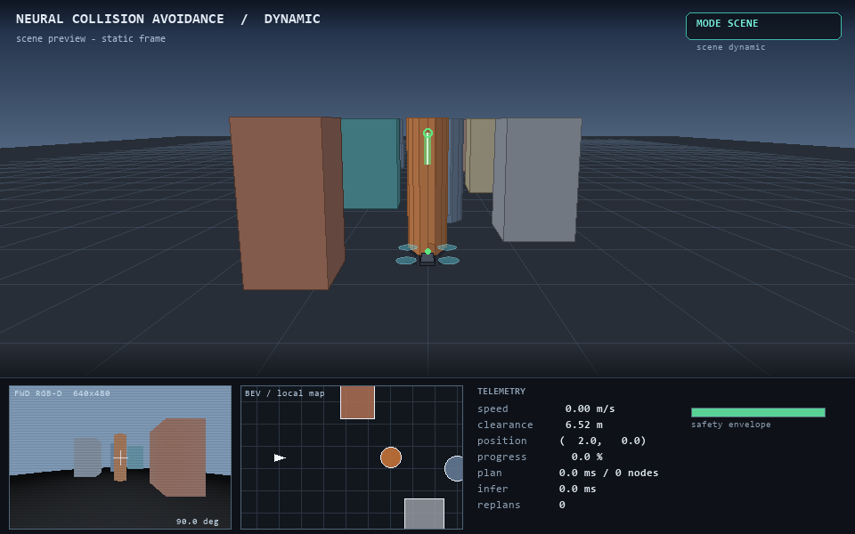
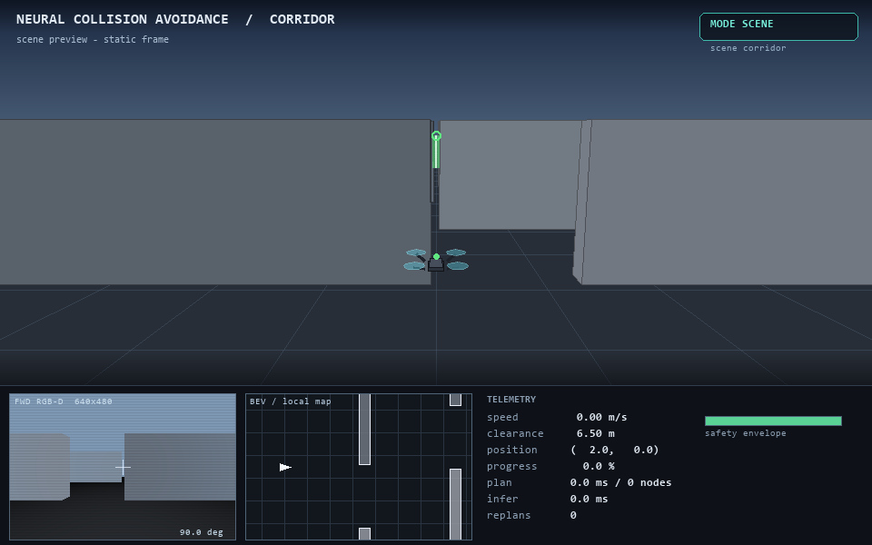
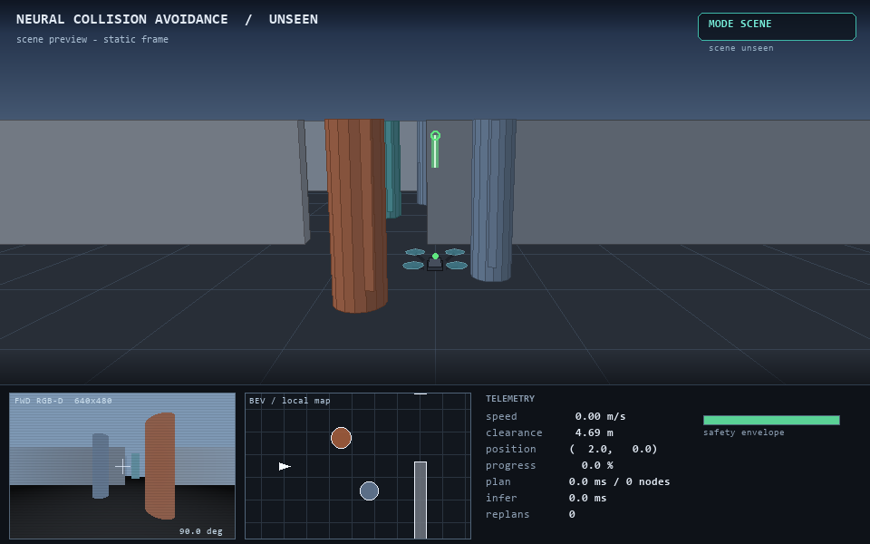

# 场景与坐标

## 1. 世界参数

| 参数 | 值 |
| --- | --- |
| 世界范围 | \(x\in[0,52]\)，\(y\in[-22,22]\)，\(z\in[0,12]\) m |
| 起点 | \((2,0,3)\) |
| 终点 | \((49,0,3)\) |
| 飞行高度 | \(z=3\) m（定高） |
| 无人机半径 | 0.32 m |
| 最大速度 | 1.5 m/s（控制限幅 1.2 m/s） |
| 控制频率 | 10 Hz |
| 到达容差 | 1.4 m |
| 回合上限 | 650 步（65 s） |

## 2. 五个场景

### 2.1 sparse（稀疏）

9 个静态障碍：6 个长方体 + 3 个圆柱，沿 \(x\) 轴均匀分布，
横向交错。用于验证基本的“看见—绕开—回到航线”。


{: .figure-caption }

### 2.2 dense（密集）

7 组、每组左右各一个随机长方体（约 85% 生成概率），
再加若干圆柱，最小通道宽度约 2.5 m。用于测试局部避障与路径重规划。


{: .figure-caption }

### 2.3 dynamic（动态）

在 sparse 基础上增加 4 个正弦往返的动障碍：

| 障碍 | 位置 | 振幅 | 角频率 | 相位 |
| --- | --- | ---: | ---: | ---: |
| 圆柱 | \(x=12\) | 6.0 m | 0.55 | 0.0 |
| 圆柱 | \(x=24\) | 7.0 m | 0.42 | 1.4 |
| 长方体 | \(x=31\) | 4.5 m | 0.70 | 2.2 |
| 圆柱 | \(x=39\) | 5.5 m | 0.50 | 3.1 |

用于验证在线地图的“遗忘”机制与重规划频率是否足够。


{: .figure-caption }

### 2.4 corridor（走廊）

5 道交错墙，门洞宽 5.6 m，墙厚 1.0 m：

| 墙 \(x\) | 门中心 \(y\) | 门范围 |
| ---: | ---: | --- |
| 9 | −2.6 | \([-5.4,-1.0]\) |
| 17 | +2.6 | \([1.0,5.4]\) |
| 25 | −2.6 | \([-5.4,-1.0]\) |
| 33 | +2.6 | \([1.0,5.4]\) |
| 41 | −2.2 | \([-5.0,-0.6]\) |

这是最难的场景：需要全局规划，且控制器的转向滞后会放大切角误差。
早期版本门洞只有 4.4 m，专家控制器也会撞墙；加宽到 5.6 m 后，
问题从“不可能通过”变成“跟踪精度问题”，才有评测意义。


{: .figure-caption }

### 2.5 unseen（留出场景，零样本）

`unseen` **不参与任何训练数据采集**：`ca_drone/data/collect.py` 的四个数据集都把
场景名写死为前四个，新增场景不会自动进入训练集。它用于回答“网络是不是只记住了
训练地图”：

- 两扇门开在与 corridor **相反**的一侧（\(x=14\) 门中心 \(+3.4\)，
  \(x=30\) 门中心 \(-3.4\)），门宽 6.0 m；
- 门之间夹 8 根确定性柱阵（半径 0.7–1.0 m），迫使规划器做非对称绕行；
- 布局固定、无随机、无动障碍，保证任何机器上可复现。


{: .figure-caption }

## 3. 坐标与可视化约定

- 追尾视图：相机在无人机后上方，看向机头方向；
- BEV：以无人机为中心的 20 m×20 m 局部俯视图，青色折线为当前规划路径，
  箭头为速度方向；
- RGB-D 面板：深度伪彩色（近处亮、远处暗），十字为准星；
- 遥测面板：速度、到最近障碍间隙、位置、进度、规划/推理耗时、重规划次数。

## 4. 如何新增场景

在 `ca_drone/sim/world.py` 中新增 `_my_scene()`，返回 `World` 对象，
并注册到末尾的 `SCENES` 字典：

```python
def _my_scene() -> World:
    objs = [_box(10, 0, 3.0, 3.0, color="brick")]
    return World("my_scene", np.array([2.0, 0.0, 3.0]),
                 np.array([49.0, 0.0, 3.0]), objs)

SCENES["my_scene"] = _my_scene
```

随后 `python main.py --scene my_scene` 即可使用；若要加入批量评测，
在 `tools/evaluate.py` 的 `SCENES` 列表中追加名称。
