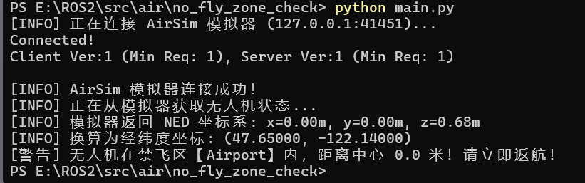
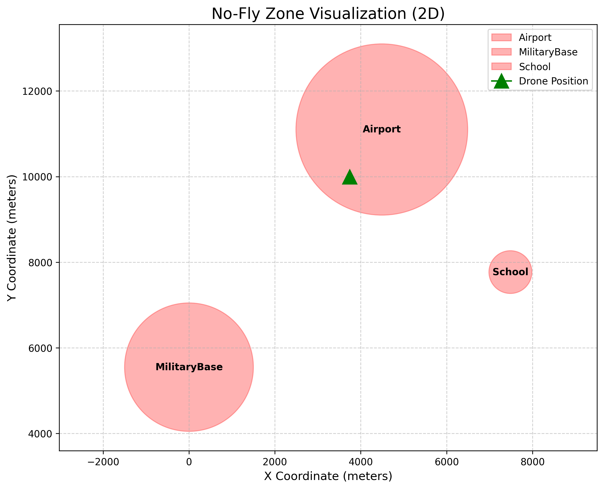

# 禁飞区检测模块

## 功能说明

本模块为无人机配送场景提供**禁飞区安全校验**功能。用户输入取货点和送货点的经纬度坐标，模块自动判断这两个点是否落在预设的禁飞区范围内。

## 运行环境

- Python 3.10
- 需要配合 AirSim 1.8.1 模拟器运行
- 第三方库：`airsim`、`matplotlib`

## 运行步骤

需要配合 AirSim 模拟器运行：
    cd src/air/no_fly_zone_check
    python main.py

## 运行效果

程序启动后连接 AirSim 模拟器，获取无人机位置并进行检测。

**说明**：上图为本地启动 AirSim 1.8.1 模拟器并成功连接后的运行结果。

## 2D 可视化

无需启动 AirSim，直接生成禁飞区平面图（红圈为禁飞区，绿色三角为无人机位置）：

    cd src/air/no_fly_zone_check
    python visualize.py

