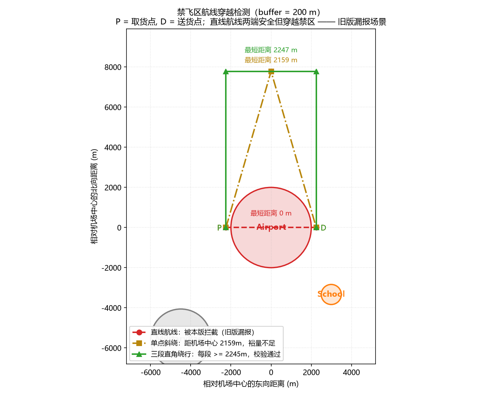
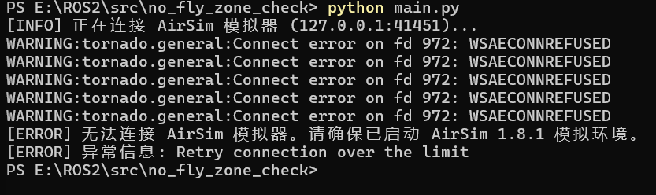

# 禁飞区检测模块

## 功能说明

本模块为无人机配送场景提供**禁飞区安全校验**功能。用户输入取货点和送货点的经纬度坐标，模块自动判断这两个点是否落在预设的禁飞区范围内。

## 应用场景

在无人机执行配送任务前，需要确认航线起止点不会进入敏感区域（如机场、军事基地、学校上空）。本模块提供了一种基于球面距离的快速检测方法。

## 航线穿越校验（v2 修复）

旧版本存在一个安全隐患：**只检查起降点两个端点**是否在禁飞区内，而不检查两点之间的航线。当取货点和送货点都安全、但直线航线正好穿越禁飞区时（例如正对机场跑道方向飞行），旧版本会误判为"安全"放行。

v2 版本新增了逐段航线检测（`nfz_core.check_path` / `check_mission`）：

1. 将航线按相邻航路点分段，对每一段计算**禁飞区中心到该大圆航线段的最短球面距离**；
2. 最短距离 ≤ 禁区半径 + 安全裕量 `buffer` 即判违规；
3. 投影落在线段外时自动退化为到端点的距离，不会误报延长线上的禁区。

同时修复了 NED → 经纬度换算的坐标系误差：旧版将 x/y 用同一比例折算，忽略了经度方向 1° = 111.32·cos(φ) km，在北纬 47.65° 处经度换算偏大约 33%；新版按方向分别换算（`nfz_core.ned_to_gps`）。

上图中，红色直线航线的两端点距机场中心约 2.2 km（端点安全），但航线本身穿过机场禁区——旧版漏报、本版拦截（最短距离 0.4 m）；绿色三段直角绕行航线每段距禁区中心 ≥ 2247 m，校验通过。

## 算法原理

使用 **Haversine 公式** 计算两个经纬度坐标之间的球面距离，公式如下：

$$
a = \sin^2\left(\frac{\Delta\varphi}{2}\right) + \cos\varphi_1 \cdot \cos\varphi_2 \cdot \sin^2\left(\frac{\Delta\lambda}{2}\right)
$$

$$
c = 2 \cdot atan2\left(\sqrt{a}, \sqrt{1-a}\right)
$$

$$
d = R \cdot c
$$

其中：

- φ₁、φ₂ 为两点的纬度（弧度）
- Δφ、Δλ 为两点纬度和经度的差值
- R 为地球平均半径，取值 6371000 米
- d 为最终距离（米）

**航线段最短距离**采用大圆交叉距离（cross-track）公式：

$$
d_{xt} = \arcsin\left(\sin\frac{d_{13}}{R}\cdot\sin(\theta_{13}-\theta_{12})\right)\cdot R
$$

其中 d₁₃ 为起点 A 到禁区中心 C 的距离，θ₁₂/θ₁₃ 为 A→B 与 A→C 的初始方位角。投影沿线距离 d_at 落在 [0, d₁₂] 内时取 |d_xt|，否则取到较近端点的距离。

## 使用方法

需要配合 AirSim 模拟器运行：

    cd src/air/no_fly_zone_check
    python main.py

无模拟器时自动转入离线演示模式（也可 `python main.py --offline` 强制）。

单元测试（19 项，覆盖旧版漏报回归、球面几何已知答案、NED 换算修正）：

    cd src/air/no_fly_zone_check
    python -m pytest test/test_nfz_core.py -v

## 运行效果

程序启动后会尝试连接 AirSim 模拟器。

**说明**：上图为本地启动 AirSim 1.8.1 模拟器并成功连接后的运行结果，获取到无人机位置并完成禁飞区检测