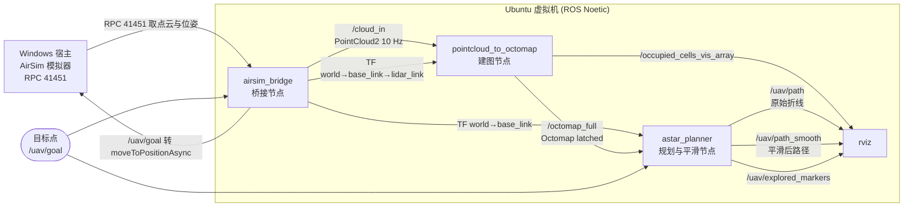

# 空域载具的八叉树三维寻路：背景与总体方案

本页是「空域载具八叉树三维寻路」系列的第一篇，回答两个问题：**为什么要做三维寻路**，
以及**整个系统是怎么搭起来的**。后续每一篇再从建图、规划、平滑、跟踪逐层展开。

对应总纲第 1 节「背景与目标」与第 2 节「系统总体方案」。

---

## 1. 背景与目标

### 1.1 二维地图在空域为什么不够用

地面移动机器人的导航几乎都建立在二维占据栅格上：把三维世界投影到地面，
每个格子只有"占据 / 空闲 / 未知"三种状态。这个做法在空域会立刻失效，原因有三条：

* **高度信息被压掉了。** 投影之后，"楼顶上方 3 m 处"和"楼顶正下方"落在地图上同一个格子里。
  无人机可以上抬 5 m 从楼顶飞过，也可以下压从桥洞穿过，二维地图表达不出这两种选择。
* **障碍不是二维连通的。** 空域里常见"下面有通道、上面有障碍"的结构（高架桥、树冠、
  多层室内）。二维栅格倾向于把这类结构整体标成障碍，于是本来有解的场景被判定为无解。
* **安全裕度不能靠"膨胀"表达。** 二维膨胀是一个圆盘，而三维里绕障的方向是球面，
  竖直方向的余量和水平方向的余量需要分别看待。

因此本项目从第一步就放弃二维投影，直接在三维占据结构上做搜索。

### 1.2 三维障碍表示的三种方式

| 表示方式 | 内存 | 单点查询 | 分辨率 | 增量更新 | 适合场景 |
|---|---|---|---|---|---|
| 稀疏点云 | 与点数成正比，最省 | 只能最近邻，不能直接判"空" | 无（离散） | 追加即可，删除很难 | 只做可视化、只做局部避障 |
| 均匀栅格（voxel grid） | 与体积成正比，$O(N^3)$ | $O(1)$，常数最小 | 单一，全局一致 | 简单，直接写格子 | 小范围、高分辨率固定场景 |
| 八叉树（octree） | 按需分配，空区域不占内存 | $O(\log N)$，树遍历 | 多分辨率，近密远疏 | 支持按节点分裂/合并 | 大范围、在线增长的三维地图 |

对"无人机边飞边建图"这个用法，前两种都不合适：点云判不了"空"（射线没打到的方向既可能是空，
也可能只是没扫到），均匀栅格在 0.3 m 分辨率下稍微一大就爆内存。所以选八叉树。

### 1.3 为什么本项目选八叉树

具体算一笔账。本项目默认分辨率 0.3 m，离线验证场景是一个 20×20×6 m 的房间：

* 均匀栅格：$67 \times 67 \times 20 \approx 8.98$ 万个体素，其中绝大多数是空气，也被完整分配；
* 八叉树：同一场景扫满一圈之后，**自由叶节点约 1.8 万个**（实测 17945 / 19366，随传感器巡游
  时序略有浮动），只有栅格法的五分之一，因为大片空区域合并成了大节点。

除了省内存，八叉树还顺手解决了三件事：

1. **多分辨率天然可用。** 空旷处一个大节点一步跨过去，障碍附近自动细分到 0.3 m。
   这正好对应"远处不必看得那么细"的物理直觉。
2. **射线投射与概率更新是现成的。** octomap 1.9.8 的 `insertPointCloud()` 一次调用就完成了
   "沿射线标记空闲 → 终点标记占用 → log-odds 累加"，不用自己写体素遍历。
3. **与 ROS 生态直接互通。** `octomap_msgs/Octomap` 是标准消息，RViz 能直接显示，
   后面第 6 节要讲的 ROS 2 对照也建立在同一套消息上。

代价是查询变慢：找一个点落在哪个叶节点上是 $O(\log N)$ 的树遍历，
而且"邻居"不再是"下标加一"，这是 A\* 一节要专门处理的难点。

### 1.4 目标与交付形态

目标不是"实现一个算法"，而是**一条从传感器到飞行的完整闭环链路，且每一步都能在本机复现**：

| 交付物 | 内容 |
|---|---|
| 功能包 | `octree_uav_3d_pathfinding`（ROS Noetic，catkin）：桥接、建图、规划、跟踪四个节点 + 一个自检入口 |
| 算法库 | A\* 与平滑算法与 ROS 解耦（只依赖 octomap 与 STL），可用 gtest 离线单元测试 |
| 文档 | 本系列六篇：环境、载具、建图、规划、平滑、跟踪 |
| 实验 | 离线端到端场景（20×20×6 m 房间 + 5 个障碍）与 AirSim 真机链路，两组数据都进文档 |

**已经测出来的指标**（离线场景，目标点 $(7.5, -7.5, 2.0)$，设定速度 3.0 m/s）：

| 指标 | 样条被碰撞复检接受 | 样条被复检拒绝（退回折线） |
|---|---|---|
| 航点数 | 73 | 10 ~ 11 |
| 路径长度 `path` | 33.52 m | 36.3 ~ 37.2 m |
| 实际飞行路程 `flown` | 31.80 ~ 31.95 m | 32.1 ~ 32.3 m |
| 耗时 `duration` | 10.59 ~ 10.65 s | 10.7 ~ 10.8 s |
| 平均速度 `mean_speed` | 3.00 m/s | 3.00 m/s |
| 最大偏航 `max_dev` | 0.41 m | 1.25 ~ 1.26 m |

同一套参数会落到两种形态，差别只在安全裕度复检是否放行样条——这件事本身就说明
"平滑必须在膨胀后的地图上复检"，详见《安全裕度与路径平滑》。

### 1.5 边界与非目标

说清楚不做什么，比说清楚做什么更能界定这套系统的适用范围：

* **不做 SLAM。** 位姿直接取自模拟器真值（`getMultirotorState()`），不估计、不回环。
  换成真实载具时，这一层要换成 VIO / 激光里程计。
* **不做动力学控制。** 底层由 AirSim 内置的位置控制器执行（`moveToPositionAsync`），
  本项目只负责给出几何路径与航点序列；姿态、推力分配不在范围内。
* **不追求最优。** `heuristic_weight > 1` 可切加权 A\*；跨分辨率邻居用 $k_{\max}$ 截断，
  是保守近似（只可能绕远，不会穿墙）。这些取舍在对应页面里都写明了。
* **不做动态障碍。** 地图是增量更新的，但规划不预测移动障碍的未来位置，
  也没有滚动重规划的时间保证。

---

## 2. 系统总体方案

### 2.1 五个阶段

| 阶段 | 做什么 | 关键产出 | 对应文档 |
|---|---|---|---|
| ① 环境与载具 | 宿主 Windows 跑 AirSim，客户机 Ubuntu 跑 ROS，两者走 VMnet8 + RPC 41451 | 可达的模拟器、`/cloud_in`、`world → base_link → lidar_link` 的 TF | [环境配置与前置准备](./env_setup.md)、[AirSim 载具与位置控制](./flight_control.md) |
| ② 建图 | 点云做坐标变换、射线投射、log-odds 更新，增量构建八叉树 | `/octomap_full`（latched）、`/occupied_cells_vis_array` | [点云转八叉树占用地图](./occupancy_mapping.md) |
| ③ 全局规划 | 在八叉树上做 A\*，跨分辨率 26 邻域、欧氏代价与启发 | `/uav/path`、`/uav/explored_markers` | [八叉树上的 A\* 全局寻路](./astar_planning.md) |
| ④ 安全裕度与平滑 | 影子树膨胀（硬约束）+ 间隙惩罚（软偏好）、捷径化 + 三次样条，平滑后复检 | `/uav/path_smooth`、对比指标 | [安全裕度与路径平滑](./path_smoothing.md) |
| ⑤ 路径跟踪与闭环 | 沿路径逐点下发目标，状态机处理起飞、航点切换、到位与失败 | 实际飞行的 `flown` / `max_dev` | [路径跟踪与闭环飞行](./path_following.md) |

五个阶段是**串行依赖**的：没有 TF 就建不了图，没有图就规划不了，没有路径就无从跟踪。
所以排障时总是从最上游开始查（这正是环境自检节点 `main.py` 存在的理由）。

后三个阶段都在 `astar_planner` 之后，但 ③④ 是同一个节点内部的两段处理，⑤ 是另一个节点：
它订阅路径话题，把航点序列逐条转成 AirSim 的目标点，并据此统计实际飞行指标。

### 2.2 节点与话题总图

`roslaunch octree_uav_3d_pathfinding main.launch` 会启动下图里的数据链路节点：

整条链路上只有两个 C++ 节点（建图与规划），桥接是 Python，其余是 RViz。
图上没有画出的还有一个自检节点 `uav_env_check`（`main.py`，`check:=true`），
启动后连 AirSim RPC、订阅 `/cloud_in` 把链路走一遍，跑完自动退出。

> **一个容易踩的坑**：`/uav/goal` 有**两个**订阅者——规划节点拿它当规划目标，
> 桥接节点也拿它当飞行目标。到了跟踪阶段，若跟踪节点把航点也发到 `/uav/goal`，
> 就变成"每发一个航点都触发一次重新规划"。所以跟踪节点必须改用单独的话题，
> 这一点在跟踪页里展开。

### 2.3 坐标系与 TF 约定

模拟器用 NED，ROS 用 ENU，两套约定在节点之间转换，这也是本模块排查问题时最先要确认的一处：

| 层级 | AirSim | ROS | 转换 |
|---|---|---|---|
| 世界系 | NED（北-东-地） | ENU（东-北-天） | $(e, n, u) = (y, x, -z)$ |
| 机体系 | FRD（前-右-下） | FLU（前-左-上） | $(x, y, z) = (x, -y, -z)$ |
| 姿态 | NED 四元数 | ENU 四元数 | 按基变换复合 |

约定三条，全模块一致遵守：

* **地图与路径一律在 `world` 下**，`world` 是 ENU 的右手系；
* **点云由模拟器直接给在雷达本体系**（`settings.json` 的 `DataFrame: SensorLocalFrame`），
  这样"本体系点云 + TF"就是通用做法，一次 TF 查询同时拿到变换和射线原点；
* **目标点用 ROS 世界系 ENU**，桥接节点负责在内部转成 NED 再调用 AirSim。

### 2.4 节拍与资源预算

| 环节 | 频率 | 备注 |
|---|---|---|
| 位姿（`/ground_truth/odom`） | 20 Hz | 轮询 `getMultirotorState()` |
| 点云（`/cloud_in`） | 10 Hz | 每帧约 9700 点 |
| 八叉树发布（`/octomap_full`） | 1 Hz | latched，新订阅者一连上就能拿到 |
| 规划 | 事件驱动 | 收到 `/uav/goal` 规划一次 |

建图是唯一的重负载环节：每帧约一万条射线，在虚拟机上逐点投射跟不上，所以默认
`resolution 0.3 m`、`max_range 30 m`、`point_stride 1`（样品间距已按 0.2 m 采，
小于体素尺寸，不能再抽稀，否则射线会从缝里穿过去）。

### 2.5 验收方式

分三层，越往下越贵：

| 层次 | 内容 | 是否需要模拟器 |
|---|---|---|
| 单元测试 | A\* 与平滑算法（`tests/test_astar.cpp`、`tests/test_smoothing.cpp`），含状态机与指标口径 | 否 |
| 离线端到端 | `mock_cloud_publisher.py` 造房间 → 建图 → 规划 → 平滑 → 假载具跟踪，一次跑完整链路 | 否 |
| 真机链路 | AirSim + 桥接 + 全部节点，测实际飞行与偏航 | 是 |

前两层是提交前的硬前提，第三层用于写文档里的飞行数据。离线场景的意义在于**把问题分开**：
链路出问题时不至于分不清是模拟器、桥接，还是建图/规划本身。

---

## 3. 系列页面与阅读顺序

| 顺序 | 页面 | 内容 | 对应总纲 |
|---|---|---|---|
| 1 | 本页 | 背景、目标、总体方案 | 第 1、2 节 |
| 2 | [环境配置与前置准备](./env_setup.md) | 虚拟机、ROS 依赖、模拟器启动、防火墙 | — |
| 3 | [AirSim 载具与位置控制](./flight_control.md) | 载具与雷达配置、坐标系换算、桥接节点 | — |
| 4 | [点云转八叉树占用地图](./occupancy_mapping.md) | 射线投射与 log-odds、建图节点 | 第 3 节 |
| 5 | [八叉树上的 A\* 全局寻路](./astar_planning.md) | 跨分辨率邻接、代价与启发、可通行性 | 第 4 节 |
| 6 | [安全裕度与路径平滑](./path_smoothing.md) | 影子树膨胀、间隙惩罚、捷径化与样条 | 第 5 节 |
| 7 | [路径跟踪与闭环飞行](./path_following.md) | 跟踪状态机、航点切换、飞行指标 | 第 7 节 |
| 8 | [与 ROS 2（Octomap、Nav2）的对应关系](./ros2_nav2.md) | 概念对照与迁移思路 | 第 6 节 |

---

## 参考

* [OctoMap 官网](https://octomap.github.io/)
* Hornung et al., *OctoMap: An Efficient Probabilistic 3D Mapping Framework Based on Octrees*,
  Autonomous Robots, 2013
* [AirSim 激光雷达文档](https://microsoft.github.io/AirSim/lidar/)
* 仓库内相关页面：[空域模拟器的 ROS 封装器](../ros_pkgs.md)、[建立虚拟机和空域载具之间的连接](../setup_and_connect.md)
