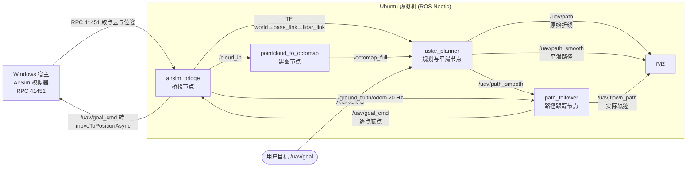
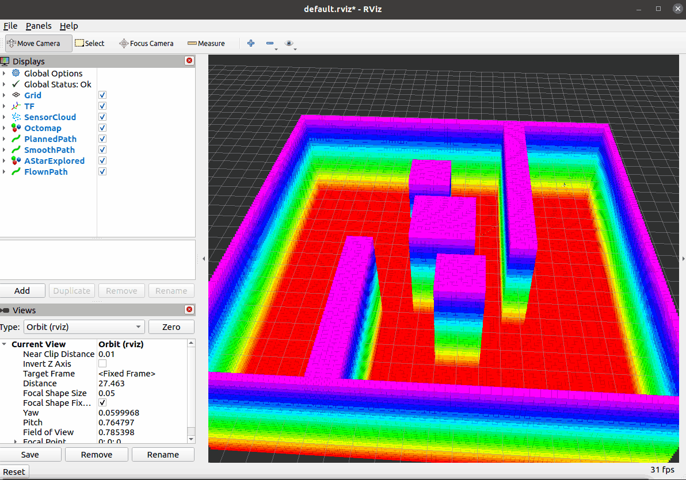

# 路径跟踪与闭环飞行

本文介绍空域载具八叉树三维寻路项目中的**闭环环节**：把前面几节规划出的路径
逐点交给控制器，让载具真的飞过去。

对应总纲第 7 节。

---

## 1. 运行节点与话题关系

本节新增一个节点 `path_follower`，其余节点沿用前几节。
`roslaunch octree_uav_3d_pathfinding full_demo.launch` 会启动下图除模拟器以外的全部节点：



### 1.1 各节点的职责

| 节点 | 可执行文件 | 本节相关的职责 |
|---|---|---|
| `airsim_bridge` | `scripts/airsim_bridge.py` | 发布 `/cloud_in`、`/ground_truth/odom` 与 TF；订阅**控制话题**，把航点转成 AirSim 的 `moveToPositionAsync` |
| `pointcloud_to_octomap` | `src/pointcloud_to_octomap.cpp` | 点云 → 八叉树地图（本节不涉及） |
| `astar_planner` | `src/astar_planner.cpp` | 订阅 `/uav/goal` 与地图，输出 `/uav/path` 与 `/uav/path_smooth` |
| `path_follower` | `src/path_follower.cpp` | 订阅路径与位姿，判断"该追哪个航点"，向控制话题逐点下发 |
| `rviz` | — | 显示两条规划路径与实际飞过的轨迹 |

### 1.2 话题

| 话题 | 方向 | 类型 | 说明 |
|---|---|---|---|
| `/uav/goal` | 用户 → 规划器 | `geometry_msgs/Point` | **只**触发规划，不直接控制飞行 |
| `/uav/goal_cmd` | 跟踪 → 桥接 | `geometry_msgs/Point` | 当前要飞的航点 |
| `/uav/path_smooth` | 规划 → 跟踪 | `nav_msgs/Path` | 要跟踪的路径（默认；可切 `/uav/path`） |
| `/ground_truth/odom` | 桥接 → 跟踪 | `nav_msgs/Odometry` | 位姿，20 Hz，位置是 ROS 世界系 ENU |
| `/uav/follow_status` | 跟踪 → RViz | `std_msgs/String` | `IDLE` / `FOLLOWING i/N` / `DONE` |
| `/uav/flown_path` | 跟踪 → RViz | `nav_msgs/Path` | 实际飞过的轨迹，与规划路径同屏对比 |

---

## 2. 需要先解决的一个结构性问题

**`/uav/goal` 被两个节点同时订阅**：规划器订阅它来规划，桥接节点订阅它来飞。
如果跟踪节点也往 `/uav/goal` 逐点发航点，就会出现：

```
path_follower 发航点 → /uav/goal → astar_planner 重新规划 → 发布新路径
                                → airsim_bridge 飞向该航点
path_follower 收到新路径 → 从第 0 点重新开始 → 又发航点 → …
```

每次重规划都要跑一遍 A\*，路径还会因为起点变化而抖动，载具飞不出去。

解决办法是**把两种语义拆成两个话题**：

| 话题 | 谁发布 | 谁订阅 | 语义 |
|---|---|---|---|
| `/uav/goal` | 用户 | `astar_planner` | "为我规划到这里的路径" |
| `/uav/goal_cmd` | `path_follower` | `airsim_bridge` | "飞到这个航点" |

实现上只改了桥接节点的一处 —— 话题名从硬编码改成参数，默认值保持 `/uav/goal`：

```python
self.goal_topic = rospy.get_param('~goal_topic', '/uav/goal')
rospy.Subscriber(self.goal_topic, Point, self.goal_cb, queue_size=1)
```

`full_demo.launch` 把它设成 `/uav/goal_cmd`。**默认值不变，前三节启动方式与行为都不受影响。**

---

## 3. 状态机

跟踪逻辑全部放在 `include/octree_uav_3d_pathfinding/path_follow_core.h`，
是**不依赖 ROS 的纯函数**，因此可以离线单测；`src/path_follower.cpp` 只做消息转换与发布。

```text
        ┌──────────────────────────────────────────┐
        │                                          │
   ┌────▼────┐  收到路径(pts>=2)  ┌───────────┐   │
   │  IDLE   ├──────────────────►│ FOLLOWING │   │
   └─────────┘                   └─────┬─────┘   │ 收到新路径：
        ▲                              │         │ 复位到新路径
        │                  到达终点     │         │（不是重规划）
        │                              ▼         │
        └───────────────────────── ┌─────────┐   │
                                   │  DONE   │───┘
                                   └─────────┘
```

| 状态 | 行为 |
|---|---|
| `IDLE` | 等一条至少两个点的路径；不合格的路径（空、单点）被忽略 |
| `FOLLOWING` | 判断当前该追哪个航点并按需下发；到终点转 `DONE`；单点超时则跳过 |
| `DONE` | 停止下发。之后再收到位姿也不动作 |

**为什么收到新路径要从头开始**：规划器每规划一次都会发一条新路径（latched），
旧路径可能已经因为地图更新而失效，继续按旧下标追没有意义。

### 3.1 判定规则

```text
dist = ‖当前位置 − path[index]‖

若 index 是最后一个点：
    若 dist < finish_tolerance  → 到达，转 DONE
否则若 dist < lookahead         → index++，下发 path[index]
否则                            → 不动

若 距上次前进 > per_point_timeout：
    若 index 是最后一个点      → 直接结束（不跳过，否则永远到不了终点）
    否则                       → index++，计入 skipped，下发新航点
```

三个阈值的关系是本节的关键：

| 关系 | 后果 |
|---|---|
| `lookahead > finish_tolerance` | 载具在飞向前一点的过程中目标已被改写 → **连续飞行** |
| `lookahead ≤ finish_tolerance` | 退化成"每点停稳"，动图里一顿一顿（节点启动时会打 WARN 提醒） |
| 终点只认 `finish_tolerance` | 否则会在距终点 `lookahead` 处就判"到达"，最后 1.5 m 不飞 |

---

## 4. 两个取舍

### 4.1 前瞻跳点，而不是停稳再走

桥接节点只有**位置控制**（`moveToPositionAsync`：飞到一个点并减速停住），
没有速度或轨迹跟踪接口。所以"连续飞行"只能靠**提前改写目标**实现：

| 做法 | 结果 |
|---|---|
| 等 `dist < finish_tolerance` 再发下一点 | 每个点都减速停住，30 个航点就是 30 次启停 |
| **`dist < lookahead` 就发下一点** | 载具在飞行途中目标被改写，动作连续 |

**代价**：实际轨迹会比规划路径**切内角**（没到点就转向）。
这个代价是量化的 —— 节点统计 `max_dev`：实际轨迹到**规划折线**的最大距离。
注意是"到线段"而不是"到航点"：航点稀疏，到航点的距离会把正常切内角误判成大幅偏离。

### 4.2 不做飞行中重规划

飞行中地图持续生长，每张新地图都可能产出不同路径，跟着换会让载具抖动；
真正的重规划还需要"路径变化超过阈值才换"的一致性判据。本节只在收到新路径时复位，
不做主动重规划 —— 见 §7。

---

## 5. 参数

`config/params.yaml` 的 `path_follower` 组：

| 参数 | 默认 | 说明 |
|---|---|---|
| `path_topic` | `/uav/path_smooth` | 要跟踪的路径。切 `/uav/path` 可做"折线 vs 曲线"对照 |
| `odom_topic` | `/ground_truth/odom` | 位姿来源 |
| `goal_cmd_topic` | `/uav/goal_cmd` | 下发给控制器的航点 |
| `status_topic` | `/uav/follow_status` | 状态文本 |
| `flown_topic` | `/uav/flown_path` | 实际轨迹 |
| `lookahead` | 1.5 | 距当前航点该距离内切换下一点（m） |
| `finish_tolerance` | 0.5 | 到达终点的判定距离（m），约 2 倍地图分辨率 |
| `per_point_timeout` | 15.0 | 单点超时（s） |
| `publish_flown` | true | 是否发布实际轨迹 |

`airsim_bridge` 组新增：

| 参数 | 默认 | 说明 |
|---|---|---|
| `goal_topic` | `/uav/goal` | 默认与前几节一致；`full_demo.launch` 里设成 `/uav/goal_cmd` |

飞行速度仍由既有参数 `goal_velocity`（默认 3.0 m/s）决定。

---

## 6. 运行方法

```shell
# 编译
cd ~/uav_ws && catkin_make
source ~/uav_ws/devel/setup.bash

# 闭环飞行：完整链路（桥接 + 建图 + 规划 + 跟踪 + 自检 + RViz）
roslaunch octree_uav_3d_pathfinding full_demo.launch
```

### 6.1 用 mock 场景离线验证（不起模拟器）

`bridge:=false` 只是不启动桥接节点，它**不提供**点云与位姿。所以离线验证要另外起两个节点，
各占一个终端；否则没有 `/cloud_in`、没有 `/ground_truth/odom`，规划器和跟踪节点都不会动：

```shell
# 终端 1：roscore
roscore

# 终端 2：点云（巡游 40 秒填满地图，之后停在 (-7.5, 7.5)）
rosrun octree_uav_3d_pathfinding mock_cloud_publisher.py

# 终端 3：假载具（位姿来源）。起点对齐路径起点，避免多一段"飞向起点"
rosrun octree_uav_3d_pathfinding mock_uav_mover.py \
    _start_x:=-7.5 _start_y:=7.5 _start_z:=0.0

# 终端 4：链路本身
roslaunch octree_uav_3d_pathfinding full_demo.launch \
    bridge:=false check:=false body_frame:=lidar_link
```

> 若不传 `_start_x/_start_y`，假载具从 `(0, 0, 0)` 起飞，会先飞 22.5 m 到路径起点。
> 那段"接近段"不计入 `flown` 与 `duration`（见下表的 `approach` 字段），但会拉长总耗时。

### 6.2 下发目标点

飞行器起飞、扫描一段时间地图建起来之后，下发**一次**目标点即可，后续由跟踪节点接管：

```shell
rostopic pub -1 /uav/goal geometry_msgs/Point "{x: 7.5, y: -7.5, z: 2.0}"
```

到达终点后节点会打印统计：

```
follow: DONE | waypoints=73 reached=73 skipped=0 | path=33.52 m flown=31.95 m
        approach=0.00 m/0.00s | duration=10.65s | mean_speed=3.00 m/s | max_dev=0.41 m
  corner cutting: flown is 4.7% shorter than the path
```

| 字段 | 含义 |
|---|---|
| `waypoints` / `reached` / `skipped` | 路径点数、到达数、因超时跳过的数量 |
| `path` | 要跟踪的路径总长（m） |
| `flown` | **跟踪阶段**实际飞过的路程（m），不含接近段 |
| `approach` | 载具飞向路径起点的那一段：路程（m）/ 耗时（s） |
| `duration` | 进入跟踪阶段到到达终点（s），与 `flown` 覆盖同一段轨迹 |
| `mean_speed` | `flown / duration`，即真实平均速度；上限是 `goal_velocity` |
| `max_dev` | 实际轨迹到规划折线的最大距离（m），即 §4.1 里"切内角"的程度 |
| `corner cutting` | `path` 与 `flown` 的相对差；斜穿拐角省下的路。仅当 `flown < path` 时打印 |

两个口径必须分清：

* **`mean_speed` 的分子是 `flown` 而不是 `path`**。前瞻跳点会切内角，实际路程比规划路径短；
  用 `path / duration` 算出来的是"路径推进速率"，会**超过** `goal_velocity`
  （实测出现过 `37.22 / 10.90 = 3.41 m/s`，而设定速度是 3.0 m/s，物理上不可能）。
* **`max_dev` 只统计贴上路径之后的轨迹**。`index = 0` 表示载具还在飞向路径起点，
  那一段是"接近段"，本来就不在路径上；计入的话，一次从上一趟终点飞回新起点的
  22.5 m 直线会把 `max_dev` 拉到 5 m 以上，指标就失去意义。

`reached` 的口径是 `waypoints - skipped`：终点超时结束时，它仍被算作到达。

---

## 7. 验证

### 7.1 离线单元测试

`tests/test_path_follower.cpp`，只依赖 STL —— 不需要 ROS 运行时、不需要 octomap、不需要模拟器。
被测对象是 `path_follow_core.h` 里的纯函数。实测 **49 项检查全部通过**。

| 用例 | 验证内容 |
|---|---|
| 前瞻切换 | 进 `lookahead` 就切换并下发；起点在脚下时直接从 0 跳到 1 |
| **边界：恰好等于 `lookahead`** | **不切换**（用 `<` 而不是 `<=`） |
| 终点判定 | 最后一个点距 1.0 m（小于 `lookahead`）**不算到达**，只认 `finish_tolerance` |
| 超时 | 中间点超时跳过并计数；前进一次就重新计时 |
| **终点超时** | **直接结束，不计入 `skipped`**（否则永远到不了终点） |
| 新路径复位 | 复位后回到 `IDLE`、下标归零、`skipped` 与 `max_dev` 清零 |
| 退化输入 | 空路径 / 单点路径被忽略；重复点组成的退化线段不产生 NaN |
| 偏离度量 | 到**折线**而非到航点；折返路径同样正确；历史最大值只增不减 |

运行方式：

```shell
~/uav_ws/devel/lib/octree_uav_3d_pathfinding/test_path_follower
# 退出码 0 = 全部通过
```

### 7.2 离线整链路（mock 场景）

场景：`scripts/mock_cloud_publisher.py` 造的 20×20×6 m 房间 + 5 个障碍（两道错开的墙 + 三根柱子），
传感器巡游 40 秒填满地图后停在 `(-7.5, 7.5)`。目标点取其对角 `(7.5, -7.5, 2.0)`。

位姿由 `scripts/mock_uav_mover.py` 提供 —— 它是**只有运动学的桩**：匀速直线、到达即停、
不做碰撞判定。它替代的是桥接节点的位姿发布，不是飞行物理，所以这组数据只反映**跟踪逻辑**，
不反映真实飞行品质。

测量条件：

| 项 | 值 |
|---|---|
| 假载具起点 | `(-7.5, 7.5, 0.0)`（与路径起点对齐，接近段为 0） |
| `inflation_radius` | 0.6 |
| `smoothing` | true |
| `smoothing_shortcut` / `smoothing_spline` | true / true |
| `smoothing_samples_per_segment` | 8（默认） |
| `lookahead` / `finish_tolerance` / `per_point_timeout` | 1.5 m / 0.5 m / 15 s |
| `goal_velocity` | 3.0 m/s |
| 启动命令 | `full_demo.launch bridge:=false check:=false body_frame:=lidar_link` |

**起点必须对齐**：假载具默认起点是 `(0, 0, 0)`，此时它会先飞 22.5 m 到路径起点。
日志里 `approach` 字段单独给出这段，`flown` 与 `duration` 都只算跟踪阶段。

#### 航点数取决于样条是否通过复检

同一套参数跑出来的结果分两种形态，差别不在跟踪逻辑，而在 P5 的平滑结果：

| 形态 | 平滑输出 | 航点数 | `max_dev` |
|---|---|---|---|
| 样条被接受 | `102 -> 73 pts` | 73（加密） | 0.41 m（很贴路径） |
| 样条被复检拒绝 | `48 -> 11 pts`，退回捷径折线 | 10 ~ 11 | 1.25 ~ 1.26 m（切角多） |

样条是**拟合**，必须穿过每个航点，拐角处的航点贴在安全边界上时会被复检拒绝
（见 P5 文档 §6.3）。它是否通过取决于地图几何的细节，因此**不同次的运行可能落在不同形态**。

所以下面把两种形态的数据都列出来，并只用**形态内部**的数字做比较。

| 指标 | 样条被接受（73 点） | 样条被拒绝（10~11 点） |
|---|---|---|
| 到达 / 跳过 | 73 / 0 | 10~11 / 0 |
| `path` | 33.52 m | 36.3 ~ 37.2 m |
| `flown` | 31.80 ~ 31.95 m | 32.1 ~ 32.3 m |
| `approach` | 0.00 m / 0.00 s | 0.00 ~ 0.30 m |
| `duration` | 10.59 ~ 10.65 s | 10.7 ~ 10.8 s |
| `mean_speed` | 3.00 m/s | 3.00 m/s |
| `max_dev` | 0.41 m | 1.25 ~ 1.26 m |
| 切内角省下的路程 | 4.7% | 13% |

**稳定的是判定性的量**：`skipped = 0`（全部到达）、`mean_speed` 正好等于 `goal_velocity`、
`max_dev` 小于 `lookahead`。这三条在两种形态、多次运行里都成立。

**浮动的是路径形态相关的量**：航点数、`path`、`max_dev`。它们由"样条是否通过复检"
和"地图自由叶数"（实测 17945 与 19366）共同决定，复现时不必追求逐位相同 ——
按同形态的量对比即可。

`max_dev` 与航点密度直接相关：73 点的样条路径几乎逐点走到了，偏离 0.41 m；
10 点的折线只剩拐角，前瞻跳点会斜穿，偏离升到 1.25 m。

#### 跟折线 vs 跟曲线

同一场景、同一目标点，只改 `path_topic`。下表是**另一次运行**的对照
（同一张地图、同一个规划结果的两条路径；与该次运行同属"样条被拒绝"的形态，
见上面的两种形态表）：

| 指标 | 跟原始折线 `/uav/path` | 跟平滑路径 `/uav/path_smooth` |
|---|---|---|
| 航点数 | 48 | 11 |
| `path` | 37.86 m | 36.28 m |
| `flown` | 33.15 m | 32.10 m |
| `duration` | 11.05 s | 10.70 s |
| `mean_speed` | 3.00 m/s | 3.00 m/s |
| `max_dev` | 0.95 m | 1.26 m |

方向与预期一致：跟折线时 `max_dev` 更小（航点密，切角少），路径略长、耗时略久。

**但这组对照低估了平滑的收益，原因在测量手段**：`mock_uav_mover.py` 只有运动学
（匀速直线、无加减速、无转向耗时），所以"48 次转向"和"11 次转向"对它几乎没有区别 ——
耗时只差 0.35 s。真实载具有加速度与姿态响应，转向次数直接决定耗时与轨迹抖动，
差距会明显大于这里的读数。**这组数据能说明"`max_dev` 与航点密度的关系"，
不能用来量化"平滑在真实飞行中省多少时间"。**

### 7.3 闭环飞行动图

下面这段录自 §7.2 里**"样条被复检拒绝、11 航点"的那次运行**（不是 73 点那组），
属于**离线场景**（mock 点云 + 运动学假载具），不是 AirSim 真机：



能连续看到：地图建满 → 绿色/青色路径出现 → **黄色轨迹边飞边长** → 到达终点。

黄线与青线的间距就是该次运行的 `max_dev`（1.26 m）的直观形态：
前瞻跳点斜穿拐角，轨迹因此偏在路径内侧。

> 待补：AirSim 真机上的飞行动图。录制要求见 §8 第 5 条 —— 飞低、飞远、斜视视角。
> 真机与离线场景的差别在于**动力学**：假载具没有加减速与转向耗时，
> 所以这段动图只能说明跟踪逻辑跑通，不能说明真实飞行品质。

---

## 8. 实现中要注意的几点

| # | 事项 | 说明 |
|---|---|---|
| 1 | **不要在两个节点间共用 `/uav/goal`** | 见 §2：会导致"每发一个航点就重新规划" |
| 2 | **坐标只需要 ROS 世界系 ENU** | 世界系 z 偏移与 NED↔ENU 转换都在桥接节点内部完成，跟踪节点不要重复计算 |
| 3 | **目标点必须落在已扫描区域** | 可通行判定把"未知"当障碍，目标点在未扫描区时 A\* 直接失败。所以流程是"先扫描、再下发目标" |
| 4 | **航点被吸附到八叉树叶中心** | 终点不会精确等于下发值，判定要用容差 |
| 5 | **动图的拍摄要求** | 飞低、飞远、斜视视角：高度取 2~4 m，让载具处在障碍之间而非其上；路径跨越房间对角；单次飞行 15~25 s |

---

## 9. 进一步工作

| # | 项 | 说明 |
|---|---|---|
| 1 | 飞行中重规划 | 需要"路径变化超过阈值才换"的一致性判据，否则载具会跟着地图抖动 |
| 2 | 速度/加速度约束的轨迹跟踪 | 换用 `moveByVelocityAsync` 并引入动力学约束，替代"逐点位置控制 + 前瞻" |
| 3 | 局部避障 | 全局规划 + 地图更新已能覆盖演示场景；更紧的空间需要局部规划器 |
| 4 | 到达后的自动悬停与降落 | 当前只在终点停止下发航点，降落仍由操作者发起 |

---

## 10. 参考

* [nav_msgs/Path 消息定义](http://docs.ros.org/en/noetic/api/nav_msgs/html/msg/Path.html)
* [nav_msgs/Odometry 消息定义](http://docs.ros.org/en/noetic/api/nav_msgs/html/msg/Odometry.html)
* AirSim 多旋翼 API 文档（`moveToPositionAsync` 等）
* 模块源码：`src/air/octree_uav_3d_pathfinding/`

查看实际运行的节点与话题关系（第 1 节的图是静态版本）：

```shell
rosrun rqt_graph rqt_graph        # 节点—话题图
rostopic info /uav/goal           # 确认真实订阅者只有规划器
rostopic info /uav/goal_cmd       # 确认真实订阅者只有桥接节点
rosrun rqt_tf_tree rqt_tf_tree    # TF 树
```
