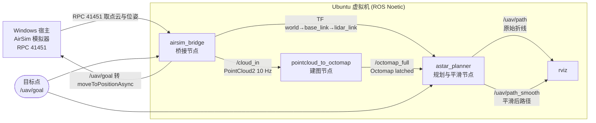
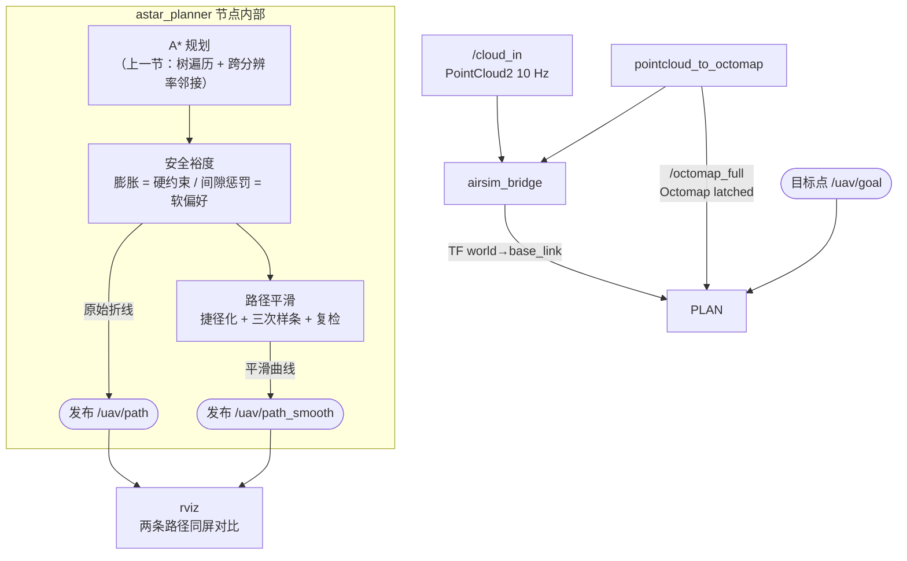
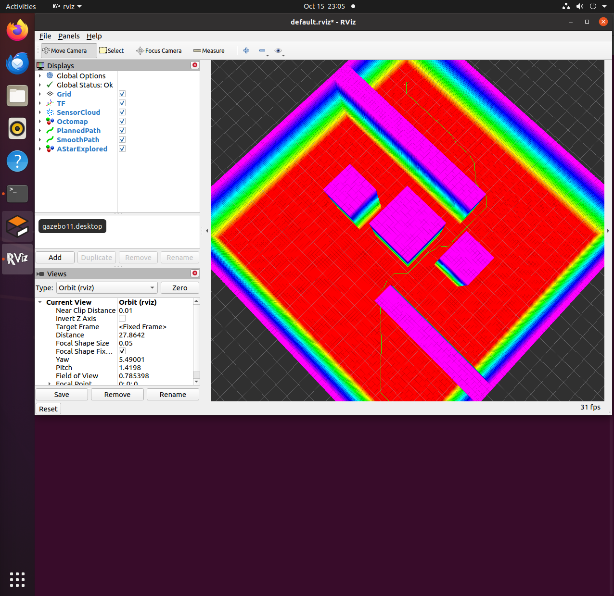
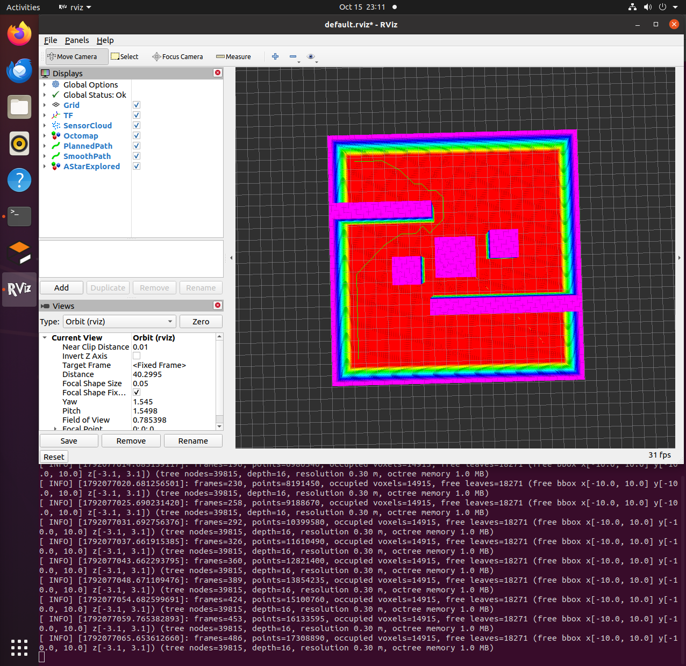
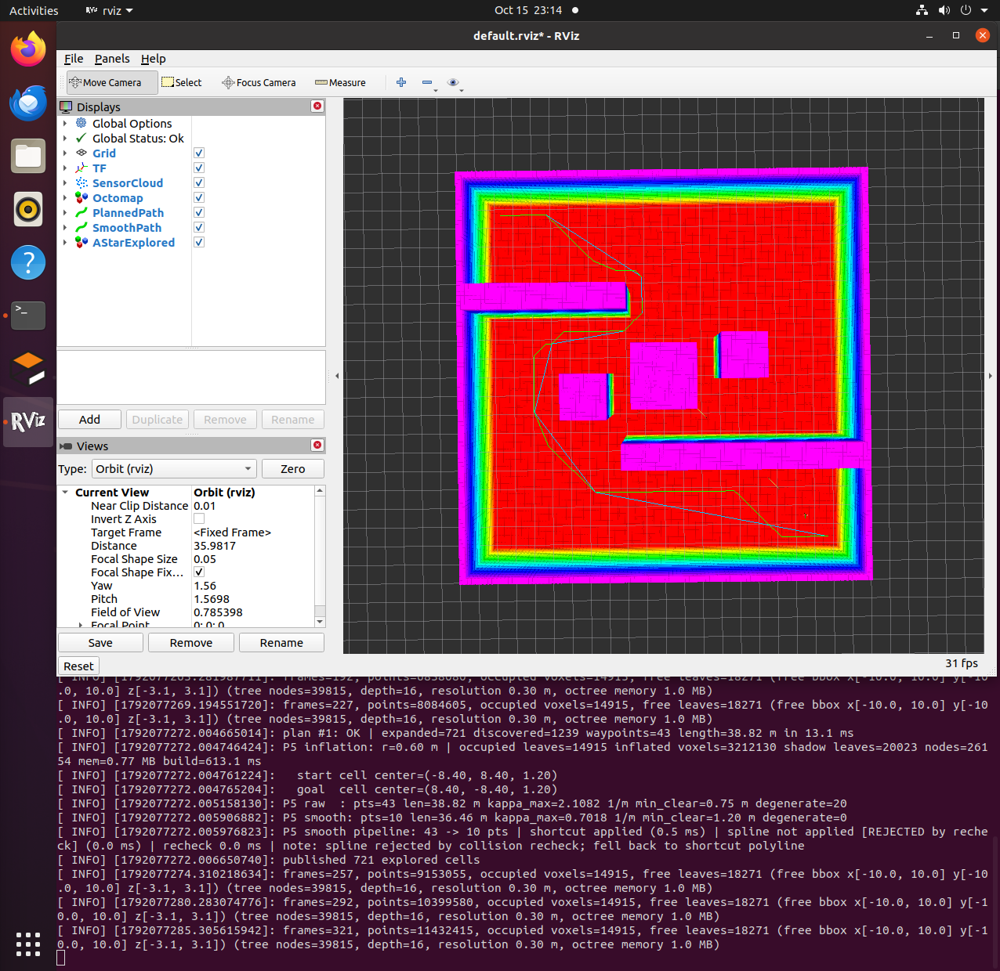

# 安全裕度与路径平滑

本文介绍空域载具八叉树三维寻路项目中的**后处理环节**：给上一节 A\* 规划出的路径
加上安全裕度，并把它平滑成控制器可以跟踪的光滑曲线。

对应总纲第 5 节「安全裕度与路径平滑」。

---

## 1. 运行节点与话题关系

本节的功能由 `astar_planner` 一个节点承担，它叠加在上一节的规划流程之上，
因此先交代整条链路。`roslaunch octree_uav_3d_pathfinding main.launch`
会启动下图除模拟器以外的全部节点：



整条链路上只有 `astar_planner` 一个节点是本项目新增的 **C++ 节点**，
其余为桥接（Python）、建图（C++）与 RViz。各节点与话题的完整说明见
上一节《八叉树上的 A\* 全局寻路》。

### 1.1 各节点的职责

| 节点 | 可执行文件 | 职责 |
|---|---|---|
| `airsim_bridge` | `scripts/airsim_bridge.py` | 通过 RPC 从宿主机 AirSim 取点云与位姿，发布 `/cloud_in`、`/ground_truth/odom`、`/uav/status` 与 TF；同时订阅 `/uav/goal`，把它转成 AirSim 的目标点调用 |
| `pointcloud_to_octomap` | `src/pointcloud_to_octomap.cpp` | 订阅 `/cloud_in`，用 TF 变换后用 `insertPointCloud()` 做射线投射，发布 `/octomap_full`（latched）与 `/occupied_cells_vis_array` |
| `astar_planner` | `src/astar_planner.cpp` | 订阅 `/octomap_full` 与 `/uav/goal`，查 TF 取起点，做 A\* 规划；开启开关后叠加安全裕度与路径平滑，发布 `/uav/path`、`/uav/path_smooth`、`/uav/explored_markers` |
| `rviz` | — | 显示点云、占用体素、两条路径与展开节点 |

### 1.2 本节的插入点

本节的两项功能都插在 `astar_planner` 内部，不新增节点、不新增输入话题：



**安全裕度作用于规划本身**（把"贴障碍"变成"不可通行"），
**平滑作用于规划输出**（把折线变成可跟踪的曲线）。
两者都受同一套可通行判定约束，所以平滑不会把路径拉回障碍旁。

两条路径**并存发布**，是为了在 RViz 里同屏对比平滑前后的差别：绿色是原始折线，
青色是平滑后的曲线。

### 1.3 话题与数据流

| 环节 | 话题 | 消息类型 | 说明 |
|---|---|---|---|
| 点云 | `/cloud_in` | `sensor_msgs/PointCloud2` | 桥接节点发布，约 10 Hz |
| 地图 | `/octomap_full` | `octomap_msgs/Octomap` | 建图节点以 latched 方式发布，晚连上的订阅者也能立刻收到 |
| 目标点 | `/uav/goal` | `geometry_msgs/Point` | 世界系 ENU。规划器与控制器都订阅它 |
| 路径 | `/uav/path` | `nav_msgs/Path` | 原始折线（A\* 输出），latched |
| 平滑路径 | `/uav/path_smooth` | `nav_msgs/Path` | 平滑后的路径，latched；与上面并存便于对比 |
| 展开节点 | `/uav/explored_markers` | `visualization_msgs/MarkerArray` | 按节点尺寸着色，用于观察跨分辨率行为 |

坐标系：TF 链是 `world → base_link → lidar_link`；`world` 为 ENU，桥接节点负责 NED↔ENU 转换。

### 1.4 发布一次目标点

```shell
rostopic pub -1 /uav/goal geometry_msgs/Point "{x: 8.0, y: 8.0, z: 2.0}"
```

该话题被两个节点订阅：`astar_planner` 收到后规划一条路径，`airsim_bridge` 收到后让载具飞过去。
若只想看规划结果而不希望载具移动，用 `bridge:=false` 启动：

```shell
roslaunch octree_uav_3d_pathfinding main.launch bridge:=false
```

---

## 2. 为什么需要这一节

A\* 输出的路径是**八叉树叶节点中心的序列**，直接拿它去飞有两个问题：

| 问题 | 具体表现 |
|---|---|
| **没有安全裕度** | 路径航点落在自由叶的**中心**上，代价是"两节点中心的距离"，所以路径可以贴近障碍物。它只是没有撞上，没有留余量 |
| **是折线，且航点疏密不均** | 空旷处一步跨过十几米，障碍附近一步 0.3 m。折线拐角处的曲率为无穷大，控制器无法跟踪；同时有大量共线的冗余航点 |

本节做两件事来对应这两个问题：**安全裕度**（膨胀 + 代价惩罚）与**路径平滑**（捷径化 + 三次样条）。

---

## 3. 关键认识：两种安全裕度不是平级的

一个容易想当然的做法是把"地图膨胀"和"代价惩罚"当作两个并列的手段，任选其一。
实际它们是"硬约束"与"软偏好"的关系，本节的设计都建立在这个区分上。

回到 A\* 的代价函数：

$$
\mathrm{cost}(n, n_b) = \lVert \boldsymbol{c}_{n_b} - \boldsymbol{c}_n \rVert_2
$$

路径航点是自由叶的中心，于是：

| 只做代价惩罚 | 只做地图膨胀 |
|---|---|
| 不产生硬保证。惩罚只让贴近障碍的边变贵，A\* 在别无选择时仍会贴过去——惩罚大只是"不划算"，不是"不允许" | 让**膨胀占用**成为不可通行，路径中心到**真障碍**的距离有了下界 \(r\)。这是硬保证 |

**结论：**

$$
\text{膨胀} \;\to\; \text{硬约束}, \qquad
\text{惩罚} \;\to\; \text{软偏好}
$$

惩罚要消费膨胀算出的间隙，两者共用同一份信息，而不是各算一套距离。实现上对应
`MapInflation`（产出）+ `clearance penalty`（消费）两个组件，而不是两个平级开关。

---

## 4. 安全裕度（一）：地图膨胀 —— 硬约束

### 4.1 影子树

把原树里每个**占用叶节点**沿轴向外扩 \(r\)，把外扩盒内的体素全部标进一棵
**影子树**：

```text
for 每个占用叶（中心 c、半边长 h）:
    盒子 = [c − h − r, c + h + r]
    把盒内的体素逐个标进影子树
```

于是"是否可通行"多了一道硬判定：

```cpp
bool isBlocked(const point3d& p);   // true = 落在安全裕度内，不可通行
```

**为什么用影子树而不是直接改原树**：

* 原树仍用于发 `/octomap_full` 和 RViz 可视化，前后占用体素一致
* 膨胀的信息是新增的，不改建图结果
* \(r = 0\) 时影子树为空、`isBlocked()` 恒为 `false`，整套代码退回上一节的行为
  （这是回归测试的锚点，见 §7）

### 4.2 膨胀必须"按键枚举"，不能自己算坐标

这里有一处容易出错的地方。octomap 的体素中心落在

$$
\text{center}(k) = (k + 0.5)\cdot \text{resolution}
$$

这组格点上。如果按"盒下界 + 半个体素"生成中心：

```cpp
// 错误做法：与键格错开半个体素
const point3d q(lo.x() + (i + 0.5) * res, ...);
```

得到的格点与键格**错开半个体素**，"写入影子树的体素"与"判定时命中的体素"
不是同一批。症状是**被膨胀的体素中心自己判不出阻塞**（实测间隙 0.45 m，期望 0.6 m）。

**正确做法是按整数键枚举**：

```cpp
OcTreeKey lo_key, hi_key;
tree.coordToKeyChecked(lo, lo_key);      // 先把盒的坐标范围落到键上
tree.coordToKeyChecked(hi, hi_key);
for (long long i = lo_key[0]; i <= hi_key[0]; ++i)      // 按整数键枚举
  for (long long j = lo_key[1]; j <= hi_key[1]; ++j)
    for (long long k = lo_key[2]; k <= hi_key[2]; ++k)
      tree.updateNode(OcTreeKey(i, j, k), true);        // 插入与判定走同一条路径
```

这样"插入的位置"与"判定时命中的位置"逐格一致。

### 4.3 \(r\) 取多大：安全性与可通过性的取舍

膨胀会不可逆地损失可通过空间：原来能走的窄缝，膨胀后可能消失。
所以 \(r\) 的选择是一个取舍：

| \(r\) | 效果 |
|---|---|
| \(0\) | 关闭膨胀，退回上一节行为（回归基线） |
| \(0.6\,\mathrm{m}\) | 推荐值（2 个体素）：路径中心到真障碍至少留 0.6 m |
| \(1.0\,\mathrm{m}\) | 更保守，窄通道可能被堵死，表现为"基线有解、加膨胀后无解" |

**"加膨胀后无解"是预期行为，不是缺陷**，它是安全裕度的代价。
实测的膨胀规模见 §7。

---

## 5. 安全裕度（二）：间隙惩罚 —— 软偏好

在膨胀给出硬下界之后，再用代价函数把路径**从障碍旁边推开一点**：

$$
\mathrm{cost}(n, n_b) = \lVert \boldsymbol{c}_{n_b} - \boldsymbol{c}_n \rVert_2
\cdot \left(1 + w \cdot \exp\!\left(-\frac{d(n_b)}{r_{\text{soft}}}\right)\right)
$$

其中 \(d(n_b)\) 是节点 \(n_b\) 到**膨胀边界**的间隙（m），由膨胀层提供。

* \(w = 0\)：代价等于上一节 —— 又一个回归锚点
* \(w > 0\)：离障碍越近的边越贵，A\* 倾向于走有余量的通道

**关于最优性**：惩罚只让 \(g\) 变大，所以启发函数仍可采纳
（\(w = 0\) 时保证最优）。但 \(w > 0\) 时**目标函数被重新定义**，
得到的是"新代价下的最优"，不是原目标下的次优解。

**间隙 \(d\) 的算法是近似**：从节点中心沿 6 个轴向按步长探测，数到第一次
命中膨胀占用为止，并按 `max_range` 截断。它代价低，对软偏好足够，
但不是精确的欧氏距离（真实最近点可能在对角方向）。

---

## 6. 路径平滑

两步，**顺序不能反**。

### 6.1 第一步：捷径化（shortcut）

贪心地把折线取直：

```text
for i in 0..n-1:
    for j from n-1 down to i+2:        # 从最远的候选试起，取直收益最大
        if 线段 p[i]→p[j] 无碰撞:
            保留 p[j]，丢掉 p[i+1..j-1]; break
```

**三个要点**：

1. **碰撞检测用的是规划器自己的可通行谓词**，它包含两层判定：
   **先查原树的占用与未知**（未知一律当障碍），**再叠加膨胀阻塞**。
   所以平滑也受安全裕度约束，不会把路径拉回障碍旁；规划与平滑共用同一套安全语义。
   这两层都必须有 —— 少了原树那一层，`inflation_radius = 0` 时谓词会退化成
   "任何位置都可行"，捷径化就会把路径直接取直、穿过障碍（§7 有用例覆盖）。
2. **采样步长必须小于分辨率**（默认 \(\text{resolution}/2\)）。
   否则线段会从两个占用体素的对角缝里穿过去。这是安全关键项，
   不是可以调大的性能参数（§7 有一条反例断言证明这一点）。
   因此 `smoothPath` **强制** \(0 < \text{step} < \text{resolution}\)：
   显式传入的值只要 ≥ 分辨率，就被限幅到 \(\text{resolution}/2\)，
   并在 `SmoothStats` 里标记、由节点打 WARN —— **不静默改参数，也不放行**。
3. **首尾两点保留**：它们是任务给定的起点与终点。

### 6.2 第二步：三次样条

在捷径化后的折线上做**自然三次样条插值**（曲线**过**航点）：

* 按累积弦长参数化
* 对三个坐标分量分别解一次**三对角方程组**（Thomas 算法），自然边界条件
* 逐段采样输出

不需要引入 Eigen 或第三方样条库。

### 6.3 拟合与逼近的取舍

| 路线 | 做法 | 优点 | 缺点 |
|---|---|---|---|
| **拟合** | 曲线**过**航点 | 贴合原折线 | 在拐角内侧向外偏离，可能侵入障碍 |
| 逼近 | 航点当**控制点** | 曲线在控制点凸包内，更平滑 | 不过航点，会切角 |

本实现选**拟合 + 复检 + 不过就退回折线**。第一优先级是不引入碰撞，
平滑度在其次。平滑是增强，不能变成引入碰撞。

**复检**：样条按 \(\text{res}/2\) 重采样，逐点**且逐段**检查；只要有一点越界，
就整条丢掉、退回捷径化折线，并在日志里说明"被复检拒绝"。

### 6.4 曲率计算与除零守卫

平滑后的路径要能衡量"有多光滑"，用**三点外接圆**公式：

$$
\kappa = \frac{2\,\lVert (\boldsymbol{p}_1 - \boldsymbol{p}_0) \times (\boldsymbol{p}_2 - \boldsymbol{p}_1) \rVert}
{\lVert \boldsymbol{p}_1 - \boldsymbol{p}_0 \rVert \cdot \lVert \boldsymbol{p}_2 - \boldsymbol{p}_1 \rVert \cdot \lVert \boldsymbol{p}_2 - \boldsymbol{p}_0 \rVert}
$$

**分母是三条边长的乘积**，共线、重复点、零长时都会逼近 0。守卫策略：

* 任一邻边长度 \(< \varepsilon\) → \(\kappa = 0\)
* 叉积模长 \(< \varepsilon\) → \(\kappa = 0\)（三点共线）
* 命中守卫时计数上报，不返回 NaN/inf

---

## 7. 验证

### 7.1 离线单元测试

`tests/test_smoothing.cpp`，只依赖 octomap 与 STL，不需要 ROS 与模拟器。
实测 **72 项检查全部通过**。

| 用例 | 验证内容 |
|---|---|
| **回归：\(r = 0\)** | `isBlocked()` 恒 false、间隙饱和、出界点行为与基线一致 |
| **可通行谓词（\(r = 0\) + 平滑）** | 占用点不可通行、已知空闲点可通行、未知点当障碍；两端点均为已知空闲时，捷径化不得跨过中间的障碍 |
| 捷径化：穿墙 | 给一条绕过墙的折线，取直会穿墙，必须拒绝 |
| 捷径化：采样步长 | **反例断言**：步长 1.0 m（> 墙厚 0.2 m）会钻过墙，证明步长是安全关键项 |
| 采样步长：限幅 | 显式传入 1.0 m（≥ 分辨率 0.3）被压到 0.15；默认路径不触发；**恰好等于分辨率也拦** |
| 曲率守卫 | 共线 / 重复点 → \(\kappa = 0\) 且不产生 NaN/inf；单位圆三点 → \(\kappa = 1.0\) |
| 样条 | 无障碍时被采纳、加密路径、过两端点；发布路径的点与线段全部无碰撞 |
| 膨胀：\(r = 0\) | 不建影子树、`isBlocked` 恒 false |
| 膨胀：\(r = 0.6\) | 体素中心自己被阻塞、0.5 m 内阻塞、1.5 m 外空闲 |
| 膨胀：规模 | 见下表 |
| 膨胀：只增不改 | 原树的占用叶数与节点数不变 |

### 7.2 膨胀规模实测（风险项：膨胀后树规模）

一面 \(6\times 6\,\mathrm{m}\) 的薄墙（面状分布，接近真实地图的形态）：

| \(r\) | 影子树叶数 | 写入体素数 | 影子树内存 | 相对原树内存 | 构建耗时 |
|---|---|---|---|---|---|
| 0.3 m | 1667 | 17424 | 0.0748 MB | ×3.54 | 7.3 ms |
| 0.6 m | 2278 | 57624 | 0.0846 MB | ×4.00 | 16.7 ms |
| 1.0 m | 1955 | 186624 | 0.0793 MB | ×3.75 | 42.6 ms |

体素数随 \(r\) 单调增长，但叶数不单调（\(r = 1.0\) 的叶数少于 \(r = 0.6\)）。
原因是影子树按八叉树规则剪枝：\(r = 1.0\) 的外扩盒边界与 0.3 m 分辨率的层级对得更齐，
更容易合并成大节点。所以测试断言"体素数单调"，而不是"叶数单调"。

### 7.3 路径指标对比（离线端到端实测）

实验平台：`scripts/mock_cloud_publisher.py` 造的离线场景 —— 房间 \(20\times20\times6\,\mathrm{m}\)，
内有 5 个从地面顶到天花板的障碍（两道错开的墙把空间切成走廊，外加三根柱子）。
传感器在房间四角依次驻留 10 秒填满地图，之后停在最后一个驻留点。
规划起点为传感器最终位置，目标点取其对角 \((7.5, -7.5, 0)\)，三组使用同一条目标点。

三组参数对照（每组重启规划节点 —— 参数只在节点启动时读取）：

| 配置 | 膨胀半径 \(r\) | 平滑 |
|---|---|---|
| 基线 | 0（关闭） | 关闭 |
| +膨胀 | 0.6 m | 关闭 |
| +膨胀+平滑 | 0.6 m | 开启（捷径化 + 样条） |

结果：

| 指标 | 基线 | +膨胀 | +膨胀+平滑 |
|---|---|---|---|
| 扩展节点数 | 4915 | **775** | 721 |
| 路径航点数 | 40 | 23 | **10** |
| 路径长度 | 29.71 m | 27.53 m | 36.46 m |
| 最大曲率 | 2.1082 1/m | 1.6667 1/m | **0.7018 1/m** |
| **到障碍的最小间隙** | **0.15 m** | **0.75 m** | **1.20 m** |
| 规划耗时 | 82.3 ms | 14.1 ms | 13.1 ms |

**膨胀的作用**（基线 → +膨胀）：

* 最小间隙 \(0.15 \to 0.75\,\mathrm{m}\)，抬到安全半径 \(r = 0.6\,\mathrm{m}\) 之上 —— 硬约束的直接效果
* 扩展节点数 \(4915 \to 775\)（−84%）：大量自由叶落进膨胀带后不再可通行，搜索空间变小
* 规划耗时 \(82.3 \to 14.1\,\mathrm{ms}\)，与搜索空间缩小一致
* 膨胀本身的开销是一次性的：`inflated voxels=3212130`、`shadow leaves=20023`、
  `nodes=261154`、内存 0.77 MB、建树 613 ms（建图后做一次，不随规划次数增长）

**平滑的作用**（+膨胀 → +膨胀+平滑）：

* 航点数 \(23 \to 10\)，最大曲率 \(2.1082 \to 0.7018\,\mathrm{1/m}\)（−67%）
* 最小间隙 \(0.75 \to 1.20\,\mathrm{m}\)，没有变差

**该场景下样条被复检拒绝**：

```
P5 smooth pipeline: 43 -> 10 pts | shortcut applied (0.5 ms)
                                 | spline not applied [REJECTED by recheck]
note: spline rejected by collision recheck; fell back to shortcut polyline
```

上表第三列因此是**捷径化折线**的指标，不含样条。原因与 §6.3 写的一致：样条是**拟合**
（必须穿过每个航点），捷径化后只剩 10 个航点，而拐角航点恰好贴在安全边界上
（最小间隙 0.75 m 即来自该点）；样条在拐角内侧会向外偏，于是侵入膨胀区。
复检此时按设计整条丢弃样条、退回折线 —— **安全性优先于平滑度**。

也就是说：平坦通道上的冗余航点被捷径化去掉了，而剩下的拐角样条过不去 ——
后者是**拟合路线的固有代价**，不是实现缺陷。改进方向见 §7.4。

**关于两组数据的可比性**：传感器是巡游的，发目标点的时刻不同，起点会落在不同的自由叶里
（基线为 `(-7.50, 7.50)`，后两组为 `(-8.40, 8.40)`）。所以**长度一列不宜横向比较**；
其余指标（最小间隙、曲率、航点数、扩展数）反映各自路径的形态，不受影响。

三组在同一场景、同一目标点下的 RViz 对比（离线验证场景，与上一节的图同源）：



基线组的路径贴着障碍与未知区走，最小间隙 0.15 m。



膨胀后路径离障碍明显更远，最小间隙 0.75 m。



绿色是原始路径（43 点），青色是平滑后路径（10 点捷径折线）。该场景下样条被复检拒绝。

### 7.4 进一步工作

本节实测暴露的两点，按性价比排序：

| # | 项 | 说明 |
|---|---|---|
| 1 | **拐角处保留航点再拟合** | 让样条不要在拐角被迫大幅弯曲，从而通过复检。这是让"拟合"路线真正可用的关键 |
| 2 | **改用逼近（B 样条）** | 航点当控制点，曲线落在控制点凸包内，不穿过拐角 —— 从根上避免"拐角外偏"（见 §6.3） |
| 3 | **最小捕捉的平滑** | 把平滑写成一个带约束的优化（目标是最小化曲率或加加速度，约束是全程离障碍 ≥ 安全半径），比"先折线再拟合"更彻底。代价是需要引入二次规划求解器 |
| 4 | **指标的精确化** | 目前的最小间隙沿 6 个轴向步进探测（偏乐观）。精确做法是对每个路径点做 26 邻域欧氏距离变换，代价高得多 |

---

## 8. 参数

`config/params.yaml` 的 `astar_planner` 组（默认值都设成"等价于上一节"）：

| 参数 | 默认 | 说明 |
|---|---|---|
| `inflation_radius` | `0.0` | 安全裕度半径（m）。0 = 关闭膨胀，行为等于上一节 |
| `inflation_resolution` | `0.0` | 影子树分辨率；0 = 与原树一致（推荐） |
| `clearance_penalty_weight` | `0.0` | 间隙惩罚权重 \(w\)。0 = 关闭惩罚 |
| `clearance_penalty_scale` | `0.0` | 惩罚衰减尺度 \(r_{\text{soft}}\)；0 = 取 `inflation_radius` |
| `smoothing` | `false` | 路径平滑总开关（默认关） |
| `smoothing_shortcut` | `true` | 是否做捷径化 |
| `smoothing_spline` | `true` | 是否做三次样条 |
| `smoothing_sample_step` | `0.0` | 碰撞检测步长；0 = `resolution/2`。**≥ 分辨率会被强制限幅到 `resolution/2` 并打 WARN**（见 §6.1） |
| `smoothing_samples_per_segment` | `8` | 样条每段采样点数 |
| `smooth_path_topic` | `/uav/path_smooth` | 平滑后路径话题，与 `/uav/path` 并存便于对比 |
| `metrics_log` | `true` | 打印路径长度 / 最大曲率 / 最小间隙 / 三段耗时 |
| `clearance_probe_range` | `2.0` | 最小间隙指标的探测上限（m） |

默认值全部"等价于上一节"的原因：

1. 上一节的验收场景可以原样重跑做回归；
2. 打开开关即可对比；
3. 避免合入后改变原有行为。

输出话题：

| 话题 | 类型 | 说明 |
|---|---|---|
| `/uav/path` | `nav_msgs/Path` | 原始折线（上一节的口径，不变） |
| `/uav/path_smooth` | `nav_msgs/Path` | 平滑后的路径，与上面并存便于 RViz 对比 |

---

## 9. 实现中踩到的坑（供参考）

### 9.1 判定"是否被占用"不能用"子节点槽位是否为空"

这个判据造成过两个看起来无关的现象。

octomap 在合并/剪枝时会把连片的空闲兄弟删掉，把占用状态留在父节点上。
所以下面这种自己写的下潜判据是错的：

```cpp
if (!nodeHasChildren(n)) return false;        // 错：当作"到底了，未被标占用"
if (!nodeChildExists(n, idx)) return false;   // 错：当作"该分支未分配"
```

它不能推出"该处未被标占用"。症状有两种：

* 膨胀层：被膨胀的体素中心自己判不出阻塞，测出的间隙偏小
* 上一节的常驻自检：`findLeaf self-check: 2000 个自由叶里 172 个查不回来`

**解法**：在**影子树**里直接用 octomap 自己的 `search()`。
影子树是逐个底层键插进去的，没有粗自由节点，
所以不存在"`search()` 遇到剪枝节点返回 NULL"的问题。

> 这不能照搬到主地图：上一节绕开 `search()` 的理由是成立的——
> 剪枝后的粗空闲节点会让 `search()` 返回 NULL，而 A\* 的路径要走这些大节点。
> 主地图的叶子查找需要两者结合。

### 9.2 八叉树遍历器的 key 与"叶子所在层的 key"不是同一个东西

`selfCheckLookup` 长期误报 `172/2000`，一度被当成"叶子查找有 bug"。
实际是**自检的比较基准错了**：它把遍历器报告的原生 key 直接和
"折算到叶子所在层的 key"相比，而遍历器的原生 key 把"该叶在父节点中的位置"留在低位。

实测的对应关系（树深 16）：

| 叶子深度 | 遍历器原生 key | 折算后 | 右移位数 |
|---|---|---|---|
| 13 | 32772 | 4096 | 3 = 16 − 13 |
| 15 | 32777 | 16388 | 1 = 16 − 15 |

**修法**：比较前把遍历器 key 也右移 `(树深 − 叶子深度)` 位。
改完后，两种测试地图共 **1519 个自由叶全部命中**（`KEY-DIFF = 0`）。

**结论**：自检报"大量失配、但功能看起来正常"时，要先怀疑自检本身。

### 9.3 手写 octomap 的编译命令必须同时链两个库

`liboctomath` 是**独立**的库。只写 `-loctomap` 会报：

```text
undefined reference to `octomath::Pose6D::transform(octomath::Vector3 const&)'
/opt/ros/noetic/lib/liboctomath.so.1.9: error adding symbols: DSO missing from command line
```

catkin 的 `OCTOMAP_LIBRARIES` 里两个都带，所以**工程内不会暴露**，
只有脱离 catkin 手写 `g++` 时才会踩到。正确写法：

```bash
g++ -std=c++11 -I/opt/ros/noetic/include foo.cpp \
    -L/opt/ros/noetic/lib -loctomap -loctomath -o foo
```

---

## 10. 参考

* [OctoMap 官网](https://octomap.github.io/)
* de Boor, *A Practical Guide to Splines*, Springer, 1978（B 样条与三对角求解）
* Mellinger & Kumar, *Minimum Snap Trajectory Generation and Control for Quadrotors*,
  ICRA 2011（更高级的平滑路线，本文只讲解、未实现）
* [nav_msgs/Path 消息定义](http://docs.ros.org/en/noetic/api/nav_msgs/html/msg/Path.html)
* 模块源码：`src/air/octree_uav_3d_pathfinding/`

查看实际运行的节点与话题关系（第 1 节的图是静态版本）：

```shell
rosrun rqt_graph rqt_graph        # 节点—话题图
rosrun rqt_tf_tree rqt_tf_tree    # TF 树
rostopic list                     # 所有话题
```

---

本文档及配套模块代码在编写过程中使用了 AI 大模型辅助（方案讨论、代码与文档起草、问题排查）。
全部内容经过实际运行验证：模块在 Ubuntu 20.04.6 + ROS Noetic 环境下编译通过，
离线单元测试（`test_smoothing`，59 项检查）全部通过。
作者对提交内容的正确性与完整性负全部责任。
