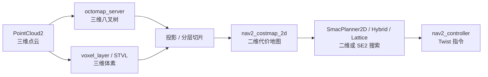
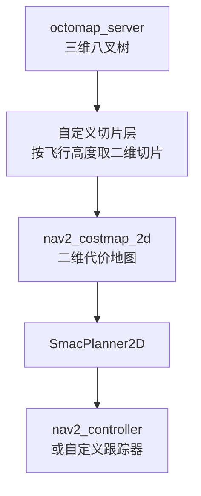

# 与 ROS 2（Octomap、Nav2）的对应关系

本项目跑在 **ROS 1 Noetic** 上，全部核心算法自研。但里面的每一个概念在 ROS 2 生态里
几乎都能找到对应组件——只是**能对应上，不等于能直接替换**。

本页做两件事：给出概念级对照表，再逐个说清"三维空域在 Nav2 里到底走到哪一步"。
所有组件名、插件清单与版本号均按官方文档核实（核实时间 2026-10，版本号随文标注）。

对应总纲第 6 节「与 ROS 2（Octomap、Nav2）的对应关系」。

---

## 1. 组件级对照

| 本项目实现 | ROS 2 生态对应 | 关系 |
|---|---|---|
| `pointcloud_to_octomap`（自研 C++ 节点） | `octomap_server`（`octomap_mapping` 仓库的 `ros2` 分支，2.3.1） | **功能等价**，可以直接替换 |
| `astar.h`（八叉树上的 A\*） | `nav2_smac_planner` 的 `SmacPlanner2D`（8 邻域格 A\*） | **不同维数**：都在栅格上搜，但 Smac 搜的是二维代价地图 |
| 影子树膨胀 + 间隙惩罚 | `nav2_costmap_2d` 的 `inflation_layer`（二维膨胀）、`voxel_layer` | **只部分等价**：二维膨胀是圆盘，三维是球面 |
| 捷径化 + 三次样条 + 膨胀图复检 | `nav2_smoother`（Simple Smoother / Savitzky-Golay Smoother）、`nav2_constrained_smoother` | **思路一致**，都在"规划之后、跟踪之前"平滑并校验 |
| `path_follower`（逐点跟踪 + 状态机） | `nav2_controller`（Regulated Pure Pursuit / MPPI / DWB / Graceful） | **接口不同**：Nav2 控制器输出 `Twist`，本项目输出 AirSim 目标点 |
| `/uav/goal`（`geometry_msgs/Point`） | `NavigateToPose` action（`nav2_msgs`） | Nav2 用带反馈的 action，本项目用一次性点消息 |
| `tf`（ROS 1） / `tf2` API | `tf2` | 本项目已在用 tf2 的 ROS 1 移植，迁移改动小 |
| 无 | `nav2_lifecycle_manager` | 本项目节点是普通 `ros::NodeHandle`，无生命周期管理 |
| `path_follower` 内部状态机 | `nav2_bt_navigator` + BehaviorTree.CPP | Nav2 用行为树编排"规划—跟随—恢复"，本项目用显式 `switch` |

表里最值得注意的是前四行：**概念都能对上，但 Nav2 的那一套默认是二维的**。
下一节把这个"二维"讲到具体位置。

---

## 2. 三维空域在 Nav2 中的现状

先说结论：**Nav2 没有官方的三维全局规划器，也没有三维代价地图**；三维感知进来之后，
高度信息在进入规划器之前就被压成了二维代价。三条证据：

### 2.1 规划器插件全是二维 / SE2

`nav2_smac_planner`（Humble 1.1.20，Jazzy 1.3.14）提供三个插件：

| 插件 | 搜索空间 | 碰撞模型 |
|---|---|---|
| `SmacPlanner2D` | 二维栅格，8 邻域 | 圆形足迹 / 半径 |
| `SmacPlannerHybrid` | SE2 $(x, y, \theta)$ | Dubins / Reeds-Shepp 运动基元 |
| `SmacPlannerLattice` | SE2 状态栅格 | 阿克曼 / 腿足 / 差速 / 全向控制集 |

它的 README 里有一句关键的话：3D 网格搜索是"**可以很容易地新增**的模板"（原文意为
*additional templates could be easily made and included for 3D grid search*）——
也就是说，这是**扩展点，不是现成功能**。NavFn（`nav2_navfn_planner`）与 Theta\*
（`nav2_theta_star_planner`）同样工作在二维代价地图上。

### 2.2 代价地图是二维的，三维信息靠"层"压平

Nav2 的代价地图是 `nav2_costmap_2d`：一张二维栅格，插件化地叠加不同的 layer。
三维传感器数据要进来，只有两条路：

* **`voxel_layer`**（Nav2 自带，底层用 `nav2_voxel_grid`）：把三维体素栅格**投影**成二维代价；
* **`spatio_temporal_voxel_layer`**（第三方，Steve Macenski 维护，LGPL v2.1；
  发布 humble 2.3.4 / jazzy 2.5.5 / kilted 2.6.2）：官方描述是
  *spatio-temporal 3D obstacle costmap*，作为 `nav2_costmap_2d` 的插件加载，
  支持体素的时间衰减，但**最终输出仍是二维代价**。

这条链路上，**"从上方飞过去"和"从下方钻过去"在 `PROJ` 这一步变成同一个格子**，
这正是本项目 §1.1 里描述的那类失效。

### 2.3 两个常见的名字并不存在

网上常出现的 `nav2_octomap`、`nav2_costmap_3d` 这两个包，在 ROS Index 上都查不到
（按包名检索返回 404）。八叉树在 ROS 2 里的官方入口是独立的 `octomap_mapping` 仓库：

* 仓库 `OctoMap/octomap_mapping`，分支 `ros2`，当前版本 **2.3.1**；
* 已发布到 **humble / jazzy / kilted / lyrical / rolling**，维护状态 `MAINTAINED`；
* 提供 `octomap_server`（增量建图、发布 `octomap_msgs/Octomap`、按需发布占用点云）与
  `octomap_saver`（存成 `.bt` / `.ot`）。

也就是说：**ROS 2 里"点云 → 八叉树"这一段是干净的、可用的；
"八叉树 → 三维规划"这一段，Nav2 没有提供。**

---

## 3. 迁移到 ROS 2 的思路

如果要把本项目搬到 Humble 上，按"改动量从小到大"可以分四步：

### 3.1 直接替换的一层

* **建图**：用 `octomap_server`（ros2）替换 `pointcloud_to_octomap`。接口几乎一致
  （订阅 `PointCloud2`、发布 `octomap_msgs/Octomap`），但要重写参数：
  ROS 1 的 `<rosparam>` 扁平结构要换成 ROS 2 的 YAML + `declare_parameter`，
  参数名也不尽相同（`resolution`、`pointcloud_min_z`、`filter_ground` 等）。
* **TF**：本项目已经用 tf2 的 API，ROS 2 侧主要是 `tf2_ros::Buffer` 构造与
  `TransformListener` 的写法差别，逻辑不用动。
* **消息**：`octomap_msgs`、`sensor_msgs/PointCloud2`、`nav_msgs/Path` 两边都有。

### 3.2 必须自己写的一层

* **三维规划器**。这没有现成插件可换：要么按 `nav2_core::GlobalPlanner` 写一个
  "消费八叉树、输出 `nav_msgs/Path`"的插件，同时自建一个能承载三维数据的代价结构；
  要么不接 Nav2 的 planner server，直接把本项目的 A\* 包成 ROS 2 节点。
* **控制器适配**。Nav2 控制器输出 `geometry_msgs/Twist`（速度指令），而 AirSim 多旋翼
  接受的是位置目标（`moveToPositionAsync`）。中间要加一层"速度指令 → 位置目标"的适配，
  或者改用 AirSim 的速度接口。
* **节点编排**。Nav2 靠生命周期节点 + 行为树启动和恢复；本项目的 `main.launch`
  是"一把梭"式启动，迁移时要决定是接入 Nav2 的 `bt_navigator`，
  还是保留自己的状态机（后者工作量小得多）。

### 3.3 一个现实的最小方案

如果目标只是"在 ROS 2 里跑通、并保留一部分高度信息"，最小方案是：

代价也很明确：**只在"巡航高度基本固定"的场景成立**。一旦需要上下绕行（本项目的主要场景），
切片就会把可行解切掉。所以本项目选择的是自研三维规划器，而不是把三维问题压成二维。

### 3.4 为什么本项目没直接上 Nav2

1. **教学目的**侧重原理：射线投射、log-odds、跨分辨率邻接、膨胀与复检，这些要自己写才讲得清；
2. **三维支持缺失**：如上，Nav2 的规划与代价地图都是二维的，而本项目的核心诉求就是高度方向；
3. **环境约束**：本项目环境是 Ubuntu 20.04 + ROS Noetic；Nav2 的 Humble 官方支持 22.04，
   在 20.04 上要靠源码编译或换发行版。

---

## 4. 补充：哪些地方值得反过来借鉴

自研不代表要拒绝生态里的好设计。下面三点是 Nav2 做得比本项目更成熟、值得借鉴的地方：

* **平滑放在独立服务里。** Nav2 把平滑从规划器里拆成 `nav2_smoother`（Task Server，
  按 `SmoothPath` 接口调用），可以按场景换插件；本项目目前把平滑做在 `astar_planner` 内部，
  靠参数开关切换，结构上更紧耦合。
* **行为树编排恢复逻辑。** "规划失败 → 清空代价地图 → 旋转脱困 → 重新规划"这类流程，
  用行为树表达比 `switch` 清楚得多。
* **生命周期管理。** 建图节点依赖 TF，而 TF 依赖桥接节点；Nav2 用生命周期节点把这种
  "启动顺序依赖"变成显式状态机，本项目目前靠"先起桥接"的约定。

---

## 参考

* [Nav2 官方文档](https://docs.nav2.org/)
* [nav2_smac_planner（含三个插件的说明与 3D 扩展点）](https://index.ros.org/p/nav2_smac_planner/)
* [nav2_smoother（SmoothPath Task Server）](https://index.ros.org/p/nav2_smoother/)
* [octomap_server（ROS 2 移植，octomap_mapping 的 ros2 分支）](https://index.ros.org/p/octomap_server/)
* [spatio_temporal_voxel_layer（第三方三维代价地图层）](https://index.ros.org/p/spatio_temporal_voxel_layer/)
* 仓库内相关页面：[点云转八叉树占用地图](./occupancy_mapping.md)、
  [八叉树上的 A\* 全局寻路](./astar_planning.md)
