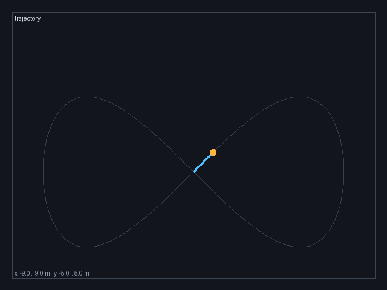

# 里程计轨迹动态 GIF

把 `/uav/odom` 的 `x,y` 轨迹渲染成逐点生长的动态 GIF，用于飞行演示、PR 和文档。



## 用法

```bash
python3 src/air/carlair_ros_bridge/scripts/odom_trajectory_gif.py \
  --input odom.csv \
  --output docs/img/air/carlair_ros_bridge/odom_trajectory.gif \
  --frames 36 --fps 12
```

没有数据时可以直接生成示例“8 字”轨迹：

```bash
python3 src/air/carlair_ros_bridge/scripts/odom_trajectory_gif.py --demo --output odom_trajectory.gif
```

CSV 至少包含 `x,y` 两列；非法行会被跳过。

## 参数

| 参数 | 默认 | 说明 |
|---|---|---|
| `--input` | 空 | 含 `x,y` 的 CSV；为空时用示例轨迹 |
| `--output` | `odom_trajectory.gif` | 输出 GIF |
| `--frames` | 36 | 动画帧数 |
| `--fps` | 12 | 播放帧率 |
| `--demo` | false | 强制使用示例轨迹 |

## 依赖

只依赖 `Pillow`，不需要 ROS、仿真器或 GPU。

```bash
python3 -m pip install Pillow
python3 tests/test_odom_trajectory_gif_local.py
# 6/6 通过
```
