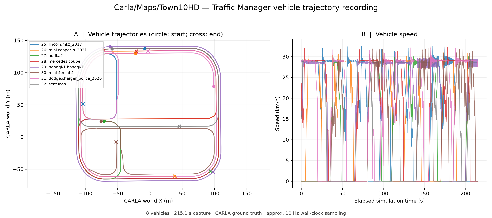
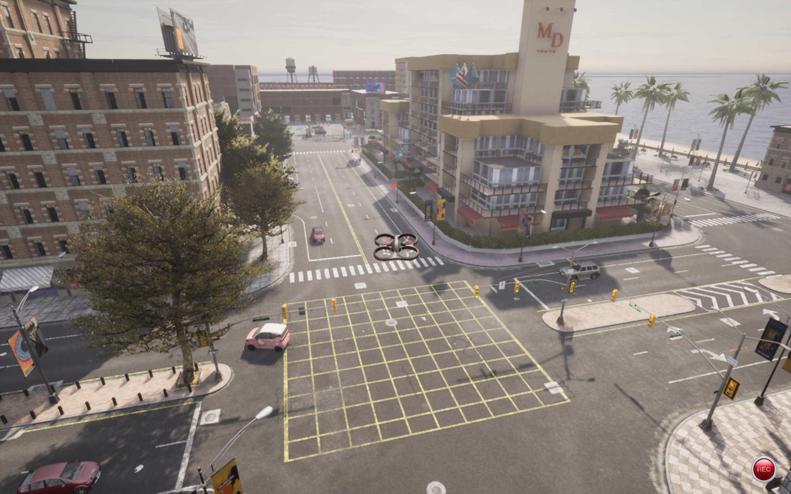

# Traffic Manager 车辆轨迹与 AirSim 跟随

本示例提供 Traffic Manager 车辆生成、轨迹记录、快照导出和可选的 AirSim 无人机跟随，默认跟随点位于车辆后方 12 米、上方 25 米。

**目标位置来自 CARLA 车辆坐标，尚未接入 YOLO 视觉闭环，也不能据此认定无人机动力学跟随已经验证通过。** 默认使用 `auto` 控制模式并保留当前朝向：模拟器飞控就绪时使用 AirSim 速度接口，否则使用增量位姿控制。

## 环境与入口

入口位于功能包 `tools/traffic`，安装路径为 `share/openhutb_yolo_mlp_control/tools/traffic`，直接使用模拟器 API。

- Windows：运行 OpenHUTB AIR 场景和匹配版本的 CARLA Python API；车辆生成与记录使用该环境。
- WSL2 Ubuntu 22.04 / Python 3.10：运行随包提供的 AirSim 客户端和可选的无人机跟随。
- 绘图依赖：`numpy`、`matplotlib`。AirSim 客户端依赖 `numpy`、`msgpack`。

Windows 使用 HUTB 2.10.0 随附、与本机 Python 版本匹配的 wheel。

下面的 PowerShell 命令从**仓库根目录**执行。首次获取源码可运行 `git clone https://github.com/OpenHUTB/ros2.git`，然后 `cd ros2`；测试未合并 PR 时应先检出对应 PR 分支。

```powershell
$repoDir = (git rev-parse --show-toplevel).Trim()
$toolsDir = Join-Path $repoDir 'src/air/openhutb_yolo_mlp_control/tools/traffic'
$env:HUTB_ROOT = Read-Host '输入本机 OpenHUTB 模拟器目录的完整路径'
$apiEnv = Join-Path $env:USERPROFILE '.venvs/openhutb_traffic_api'
python -m venv $apiEnv
$carlaPython = Join-Path $apiEnv 'Scripts/python.exe'
$pythonTag = (& $carlaPython -c "import sys; print('cp%d%d' % sys.version_info[:2])").Trim()
$wheels = @(Get-ChildItem (Join-Path $env:HUTB_ROOT 'PythonAPI/carla/dist') -Filter "hutb-*-$pythonTag-*-win_amd64.whl")
if ($wheels.Count -ne 1) { throw '请使用模拟器 wheel 所支持的 Python 版本，并核对 wheel 目录' }
& $carlaPython -m pip install --no-deps $wheels[0].FullName
$runDir = Join-Path $env:USERPROFILE ('OpenHUTB/traffic_runs/' + (Get-Date -Format 'yyyyMMdd_HHmmss'))
```

启动模拟器并加载地图。CARLA 默认地址为 `127.0.0.1:2000`，可通过 `--host`、`--port` 修改。

## 生成车辆与记录轨迹

第一个 PowerShell 终端生成 8 辆车并保持运行，按 `Ctrl+C` 清理**本进程创建的车辆**：

```powershell
& $carlaPython "$toolsDir/main.py" spawn --count 8
```

第二个 PowerShell 终端在仓库根目录记录车辆：

```powershell
$repoDir = (git rev-parse --show-toplevel).Trim()
$toolsDir = Join-Path $repoDir 'src/air/openhutb_yolo_mlp_control/tools/traffic'
$carlaPython = Join-Path $env:USERPROFILE '.venvs/openhutb_traffic_api/Scripts/python.exe'
$runDir = Join-Path $env:USERPROFILE ('OpenHUTB/traffic_runs/' + (Get-Date -Format 'yyyyMMdd_HHmmss'))
& $carlaPython "$toolsDir/main.py" record --output $runDir --duration 90
```

记录对象为本工具生成的车辆（`role_name=openhutb_traffic_demo`）。`--duration 0` 表示持续记录。另提供 `launch.ps1` 前台启动入口。

输出包括：

| 文件 | 内容 |
| --- | --- |
| `vehicle_trajectories.csv` | 时间戳、模拟帧号、车辆 ID、车型、位置、朝向和速度 |
| `metadata.json` | 当前地图、实际采集时长和记录数量 |
| `references.json` | 当前地图中用于校准的静态场景参考点 |
| `live.json` | 最新车辆状态，供可选的跟随入口读取 |

车辆 CSV 使用 CARLA 左手世界坐标，位置、朝向、速度单位分别为米、度、米每秒；按请求频率采样并跳过重复模拟帧。`metadata.json` 同时记录请求频率 `sampling_hz_requested` 和实测墙钟频率 `sampling_hz_actual`。

## 可选：生成轨迹快照

采集完成后，可在同一个 Windows Python 环境安装绘图依赖并导出 PNG、PDF 和每辆车的统计 CSV：

```powershell
& $carlaPython -m pip install numpy matplotlib
& $carlaPython "$toolsDir/plot_trajectories.py" --data $runDir
```



圆点和叉号分别表示记录起点和终点；速度曲线使用模拟时间与水平速度，行驶距离按相邻二维位置采样点累加。

## 可选：WSL 仿真跟随

记录入口使用 `--duration 0` 持续运行；无人机跟随默认运行 90 秒，结束时取消运动任务并恢复启动前的 API 控制状态。

在第二个 PowerShell 终端（保留 `$repoDir` 和 `$runDir`）打开定位到同一源码目录的 WSL 终端，并打印本次数据目录的 WSL 路径：

```powershell
wsl.exe -d Ubuntu-22.04 -e wslpath -u $runDir
wsl.exe -d Ubuntu-22.04 --cd $repoDir
```

随后在 WSL 中执行：

```bash
python3 -m venv "$HOME/.venvs/openhutb_traffic"
source "$HOME/.venvs/openhutb_traffic/bin/activate"
python -m pip install -r src/air/openhutb_yolo_mlp_control/tools/traffic/requirements.txt
export REPO_DIR="$(git rev-parse --show-toplevel)"
python -m pip install -e "$REPO_DIR/src/air/openhutb_yolo_mlp_control"
export TOOLS_DIR="$REPO_DIR/src/air/openhutb_yolo_mlp_control/tools/traffic"
read -r -p '输入上面 wslpath 输出的本次数据目录: ' TRAFFIC_DATA
export TRAFFIC_DATA
read -r -p '输入当前已验证可达的 Windows 主机 IP: ' AIRSIM_IP
export AIRSIM_IP
python - <<'PY'
import os, socket
with socket.create_connection((os.environ['AIRSIM_IP'], 41451), timeout=3):
    print('AirSim TCP reachable')
PY
python "$TOOLS_DIR/follow_vehicle.py" --data "$TRAFFIC_DATA" \
  --host "$AIRSIM_IP" --enable-follow-control --control-mode auto \
  --speed 12 --duration 90
```

入口不会自动起飞；速度模式要求飞控报告在空中，位姿模式使用校准坐标检查无人机高于目标车辆路面至少 2 米，不依赖未就绪飞控的 `landed_state`。该高度仅作启动检查，不代表已检测无人机下方地形；跟随前请先用模拟器或现有飞行入口将无人机置于安全高度。`auto` 会根据 `ready` 状态选择控制后端；可用 `--control-mode pose` 强制使用位姿模式，或用 `--control-mode velocity` 强制使用原生速度模式。速度模式以车辆速度作为前馈，并按位置误差修正速度指令。

脚本最多导出 20 个候选静态对象，至少匹配 5 个后校准 CARLA 与 AirSim 坐标，允许残差为 0.25 米，适用于坐标轴对齐、Z 方向相反的场景。默认选择附近移动车辆，可用 `--target-id` 指定。

`drone_follow.csv` 记录无人机、期望跟随点和实际导航点的 NED 坐标、水平误差、实际速度、阶段及速度指令；`follow_status.json` 保存实际后端和控制恢复状态。通过 `simGetCollisionInfo()` 检测到本轮新增碰撞、目标消失、地图改变或车辆数据超时会结束跟随；历史碰撞不作为本轮退出依据。默认保留地形、建筑及车辆碰撞退出；位姿更新产生的新接触也可能触发退出。显式 `--ignore-collision` 同时允许位姿穿越几何体并跳过碰撞报告退出，仅供隔离仿真诊断。`--speed`（默认 12 m/s）在原生速度模式下是 AirSim 世界坐标速度指令上限，在位姿模式下是每秒位姿更新步长上限；实际运动还受模拟器飞控状态、动力学和碰撞检查影响，不能保证达到该数值。追车时上限应高于目标车速并留出爬升与追赶余量；12 m/s 也不保证实际追上车辆。结束时恢复启动前的 API 控制状态。

可选的 `--avoid-obstacles` 使用 CARLA 场景射线查询检查前方通道，尝试短距离侧向或向上的中间航点；无可用路线时保持当前位置（`blocked`），查询失败时结束跟随。它依赖模拟器几何信息，不是 LiDAR／视觉感知，也不是八叉树全局规划；通道由离散射线采样，可能遗漏细小障碍，不能保证无碰撞或持续追上车辆。`--obstacle-margin` 默认 1.5 米，与 `--ignore-collision` 不可同时使用。

启用前，在独立的 Windows PowerShell 终端使用匹配模拟器的 CARLA Python 启动只读查询服务：

```powershell
$rayHost = Read-Host '输入已验证可从 WSL 访问的 Windows IP'
& $carlaPython "$toolsDir/obstacle_avoidance.py" --server --listen $rayHost
```

随后给上述 WSL 跟随命令加上 `--avoid-obstacles`；服务地址默认与 `--host` 相同，端口默认 41452，可用 `--obstacle-host` 和 `--obstacle-port` 修改。服务仅用于本地仿真测试，每次跟随重新启动一次。

另一个 WSL 终端设置相同的 `TRAFFIC_DATA` 后，可暂停、恢复或结束跟随：

```bash
# 暂停并保持位置
touch "$TRAFFIC_DATA/follow_pause"
# 恢复跟随
rm -f "$TRAFFIC_DATA/follow_pause"
# 结束跟随并释放控制
touch "$TRAFFIC_DATA/follow_exit"
```

也可按 `Ctrl+C` 结束跟随；恢复控制状态不执行降落或悬停，也不等同于键盘操控已验证恢复。若 `spawn` 被强制终止而有车辆残留，可在 Windows 运行 `& $carlaPython "$toolsDir/main.py" clean` 清理 `role_name=openhutb_traffic_demo` 的车辆。



图中展示场景车辆与无人机，静态截图不作为动力学跟随验证依据。

## 验证结果

Windows 11、Python 3.13.14、HUTB 2.10.0 / Town10HD 下完成车辆生成、记录与快照导出。在线复测确认 HUTB 当前构建 `ready=false`，`moveByVelocityAsync()` 和 `moveToPositionAsync()` 未产生可测水平位移；`auto` 因此选择 `pose` 后端，0.5 米空旷位姿更新在 0.2 秒内产生约 0.5 米位移。速度后端已通过本地单元测试，未将不可靠的原生速度接口作为 HUTB 在线验证结论。

本次修订在同一 HUTB 2.10.0 / Town10HD 实例完成 20 秒 `auto` 位姿跟随复测（`--speed 12 --avoid-obstacles`，保留碰撞检查）：记录 55 行，最高观测速度约 9.51 m/s，水平误差由 51.57 米降至 44.55 米，按时退出并恢复启动前的 API 控制状态。随后 60 秒复测记录 171 行，经历 `climb`、`avoid` 和 `follow` 阶段，按时退出并恢复控制；目标车中途停车，不能据此证明持续追上移动车辆。两轮均未替换飞控状态或碰撞报告。

位姿模式退出时恢复启动前的 API 控制状态，避免影响原有键盘接管设置。上述结果仅为有限场景复测，不代表完整车辆跟随或动力学速度跟随已经通过。

返回[文档目录](README.md)。

## 说明

本文档整理、代码重构和问题排查过程中使用了大模型辅助；提交者已检查全部内容并对最终结果负责。
