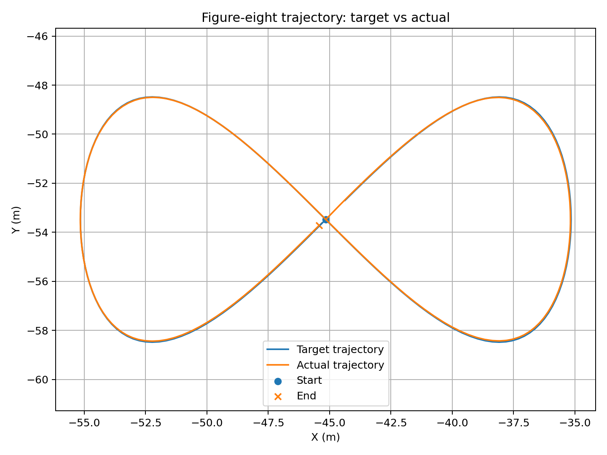
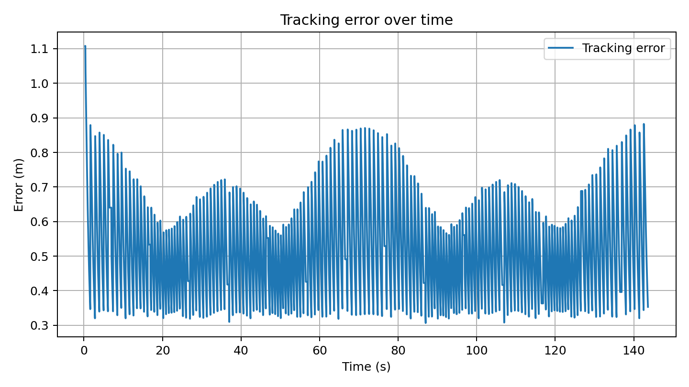
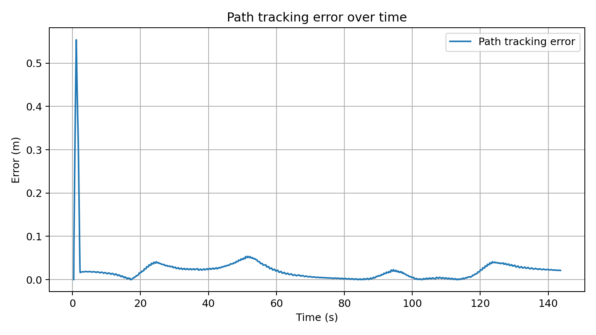
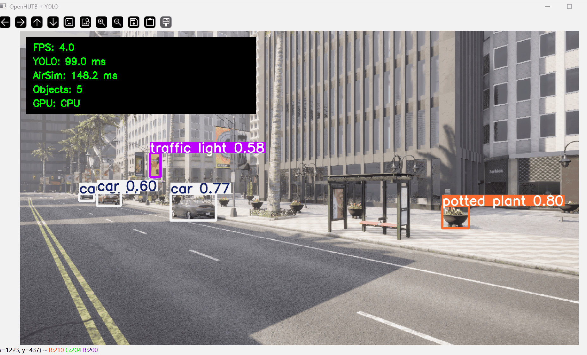

# YOLO 感知与 MLP 八字轨迹控制

本示例通过 ROS 2 接入 OpenHUTB/AirSim，使用 YOLO11n 检测 RGB 图像中的目标，并使用 MLP 控制器跟踪八字轨迹。YOLO 感知与八字轨迹控制分别运行。运行前请完成[环境配置](setup.md)。

## 系统架构

```text
OpenHUTB / AirSim
       ^
       | RPC
       v
+-------------------+
|   airsim_bridge   |
+-------------------+
   |            ^
   |            |
   |            +---------------- /openhutb/cmd_vel
   |
   +-- /openhutb/camera/rgb --> yolo_detector
   |                              |
   |                              +-- /openhutb/detections
   |                              +-- /openhutb/yolo/image
   |
   +-- /openhutb/odom ----------> mlp_controller
                                   ^          |
                                   |          +-- /openhutb/cmd_vel
                                   |
trajectory_target ----------------+
       |
       +-- /openhutb/target
       +-- /openhutb/trajectory_done
```

YOLO 感知链路与八字轨迹控制链路可以分别运行，也可以通过 `main.launch.py` 同时启动。

## 功能与节点

| 节点 | 作用 | 主要输入/输出 |
| --- | --- | --- |
| `airsim_bridge` | 连接 OpenHUTB/AirSim，将模拟器数据转换为 ROS 2 消息，并执行控制指令 | 发布图像、里程计；订阅速度指令 |
| `yolo_detector` | 对 RGB 图像执行 YOLO11n 实时目标检测 | 订阅 `/openhutb/camera/rgb`；发布检测结果和标注图像 |
| `trajectory_target` | 根据无人机当前位置生成八字形目标轨迹 | 订阅 `/openhutb/odom`；发布 `/openhutb/target` |
| `mlp_controller` | 根据当前位置、速度和目标点预测速度控制量 | 订阅里程计与目标点；发布 `/openhutb/cmd_vel` |

主要 ROS 2 话题如下：

| 话题 | 消息类型 | 含义 |
| --- | --- | --- |
| `/openhutb/camera/rgb` | `sensor_msgs/Image` | OpenHUTB 相机 RGB 图像 |
| `/openhutb/odom` | `nav_msgs/Odometry` | 无人机位置和速度 |
| `/openhutb/detections` | `vision_msgs/Detection2DArray` | YOLO 检测结果 |
| `/openhutb/yolo/image` | `sensor_msgs/Image` | 带检测框的图像 |
| `/openhutb/target` | `geometry_msgs/PointStamped` | 当前八字轨迹目标点 |
| `/openhutb/cmd_vel` | `geometry_msgs/Twist` | 控制器输出的速度指令 |
| `/openhutb/trajectory_done` | `std_msgs/Bool` | 八字轨迹完成标志 |

## MLP 八字轨迹控制

MLP 控制器输入为：`[ex, ey, ez, vx, vy, vz]`。

其中 `ex`、`ey`、`ez` 为目标位置与当前位置之间的误差，`vx`、`vy`、`vz` 为当前速度。

网络输出为：`[vx_cmd, vy_cmd, vz_cmd]`。

控制器通过 `/openhutb/cmd_vel` 发布 `geometry_msgs/Twist`。

当前 ROS 接口保持 OpenHUTB/AirSim 使用的 NED 坐标约定。轨迹生成器使用无人机开始执行轨迹时的当前高度，不强制跳变到固定高度，从而降低轨迹开始阶段的瞬时垂直误差。

软件包内提供 `mlp_controller.pth`，其中包含 MLP 网络参数以及运行所需的输入、输出归一化信息。安装 ROS 2 包后，`trajectory_control.launch.py` 和 `main.launch.py` 会通过 ROS 2 package share 路径自动定位该模型，通常不需要手动指定路径。

如需重新生成训练数据并训练模型，可执行：

```bash
ros2 run openhutb_yolo_mlp_control generate_training_data
ros2 run openhutb_yolo_mlp_control train_mlp
```

## 运行方式

运行前先启动 OpenHUTB AIR 模式，并确认 RPC 端口能够访问。

如果是原生 Linux 同机运行：

```bash
export AIRSIM_IP=127.0.0.1
```

如果是 WSL2 连接 Windows 主机上的 OpenHUTB：

```bash
export AIRSIM_IP=$(ip route | awk '/default/ {print $3; exit}')
```

建议在正式启动前执行：

```bash
nc -vz "$AIRSIM_IP" 41451
test -f "$HOME/models/yolo11n.pt"
```

### 运行 YOLO 感知

在支持 WSLg 或原生 Linux 图形桌面的环境中，优先显示实时 YOLO 检测窗口，便于直接观察目标检测结果：

```bash
ros2 launch openhutb_yolo_mlp_control perception.launch.py \
  airsim_ip:="$AIRSIM_IP" \
  model_path:="$HOME/models/yolo11n.pt" \
  show_window:=true
```

该模式不会接管无人机轨迹控制，只发布相机图像、检测结果和标注后的图像，并显示实时检测窗口。

如果当前环境没有图形界面，例如通过纯 SSH 终端运行，可以关闭窗口显示：

```bash
ros2 launch openhutb_yolo_mlp_control perception.launch.py \
  airsim_ip:="$AIRSIM_IP" \
  model_path:="$HOME/models/yolo11n.pt" \
  show_window:=false
```

### 仅运行八字轨迹控制

如果无人机已经处于空中，可以关闭自动起飞，并将轨迹数据保存到 `~/openhutb_results`：

```bash
mkdir -p ~/openhutb_results

ros2 launch openhutb_yolo_mlp_control trajectory_control.launch.py \
  airsim_ip:="$AIRSIM_IP" \
  auto_takeoff:=false \
  figure8_scale:=10.0 \
  figure8_points:=160 \
  use_vertical_control:=true \
  result_dir:="$HOME/openhutb_results"
```

默认情况下会自动加载软件包中的 `models/mlp_controller.pth`。轨迹执行过程中，控制器会将目标位置、实际位置、误差和控制指令记录到：`~/openhutb_results/eight_trajectory.csv`。

轨迹完成后，结束当前 launch 进程，再运行分析脚本生成轨迹图：

```bash
python -m openhutb_yolo_mlp_control.analyze_eight_trajectory \
  --csv "$HOME/openhutb_results/eight_trajectory.csv" \
  --outdir "$HOME/openhutb_results/analysis"
```

分析结果保存在 `~/openhutb_results/analysis`，其中主要包括：

```text
trajectory_xy.png
tracking_error.png
path_tracking_error.png
```

三张图片分别用于观察目标轨迹与实际轨迹的平面形状、离散航点跟踪误差以及连续路径跟踪误差。

### 一键运行 YOLO + 八字轨迹控制

`main.launch.py` 会同时启动 OpenHUTB/AirSim ROS 2 桥接、YOLO11n 实时检测、八字形目标轨迹生成和 MLP 轨迹控制器。

```bash
mkdir -p ~/openhutb_results

ros2 launch openhutb_yolo_mlp_control main.launch.py \
  airsim_ip:="$AIRSIM_IP" \
  yolo_model_path:="$HOME/models/yolo11n.pt" \
  auto_takeoff:=false \
  figure8_scale:=10.0 \
  figure8_points:=160 \
  result_dir:="$HOME/openhutb_results" \
  show_window:=false
```

如果希望由系统自动执行起飞流程，可将 `auto_takeoff:=true` 传给启动文件。

`main.launch.py` 默认从安装后的 ROS 2 package share 目录读取 `models/mlp_controller.pth`，因此 MLP 模型路径不依赖启动命令所在的当前目录。

可通过以下命令查看 launch 支持的参数：

```bash
ros2 launch openhutb_yolo_mlp_control main.launch.py --show-args
```

## ROS 2 节点与话题检查

完整系统启动后，可在另一个已经加载 ROS 2 工作空间的终端中执行：

```bash
ros2 node list
ros2 topic list
```

正常情况下可以看到：

```text
/airsim_bridge
/yolo_detector
/trajectory_target
/mlp_controller
```

检查主要话题频率：

```bash
ros2 topic hz /openhutb/odom
ros2 topic hz /openhutb/camera/rgb
ros2 topic hz /openhutb/target
ros2 topic hz /openhutb/cmd_vel
```

查看 YOLO 检测消息：

```bash
ros2 topic echo /openhutb/detections
```

## 轨迹结果与分析

`mlp_controller` 会在 `result_dir` 中生成：`eight_trajectory.csv`。

CSV 记录目标位置、实际位置、位置误差和控制指令等信息。

轨迹分析脚本支持 `--csv` 和 `--outdir` 参数：

```bash
python -m openhutb_yolo_mlp_control.analyze_eight_trajectory \
  --csv ~/openhutb_results/eight_trajectory.csv \
  --outdir ~/openhutb_results/analysis
```

分析脚本会生成：

```text
trajectory_xy.png
tracking_error.png
path_tracking_error.png
trajectory_stats.json
trajectory_report.txt
```

其中：

- `trajectory_xy.png`：目标八字轨迹与实际飞行轨迹对比；
- `tracking_error.png`：当前位置到当前离散 waypoint 的误差；
- `path_tracking_error.png`：当前位置到完整理想八字轨迹最近线段的距离；
- `trajectory_stats.json`：轨迹统计数据；
- `trajectory_report.txt`：实验统计报告。

`tracking_error.png` 会受到 waypoint 切换影响，因此可能出现周期性峰值。评价连续路径跟踪质量时，可以结合 `trajectory_xy.png` 和 `path_tracking_error.png` 观察整体轨迹形状与连续路径偏差。

## 实验效果

### 八字形目标轨迹与实际轨迹

下图对比目标八字形路径和无人机实际路径，用于观察轨迹形状和整体跟踪效果。



### 航点跟踪误差

下图表示无人机当前位置到当前离散 waypoint 的距离。轨迹目标从一个 waypoint 切换到下一个 waypoint 时，误差可能发生跳变。



### 连续路径跟踪误差

下图计算实际位置到完整理想八字轨迹最近线段的距离。相比离散 waypoint 误差，该指标能够减少 waypoint 切换造成的误差跳变，更适合观察连续路径跟踪偏差。



### OpenHUTB + YOLO 实时检测

下图展示 OpenHUTB 相机图像经过 YOLO11n 后的实时检测效果。检测窗口可以显示 FPS、YOLO 推理耗时、OpenHUTB/AirSim 图像获取耗时、检测目标数量和推理设备等运行信息。



## OpenHUTB 控制接口说明

当前实现中，`airsim_bridge` 对外保持标准的 `geometry_msgs/Twist` 速度控制接口。桥接层负责将 ROS 2 控制指令转换为 OpenHUTB/AirSim 可以执行的控制调用。

因此控制器只依赖 `/openhutb/odom`、`/openhutb/target` 和 `/openhutb/cmd_vel` 等 ROS 2 接口。后续如果替换控制后端，主要调整桥接层即可，不需要改变 MLP 控制节点的 ROS 2 接口。

## 软件包结构

```text
openhutb_yolo_mlp_control/
├── package.xml
├── setup.py
├── setup.cfg
├── requirements.txt
├── README.md
├── config/
│   └── openhutb_ros.yaml
├── launch/
│   ├── main.launch.py
│   ├── perception.launch.py
│   └── trajectory_control.launch.py
├── models/
│   └── mlp_controller.pth
├── resource/
│   └── openhutb_yolo_mlp_control
├── tools/
│   └── vendor_openhutb_pythonclient.ps1
└── openhutb_yolo_mlp_control/
    ├── __init__.py
    ├── airsim_bridge_node.py
    ├── yolo_node.py
    ├── trajectory_target_node.py
    ├── mlp_control_node.py
    ├── mlp_model.py
    ├── generate_training_data.py
    ├── train_mlp.py
    ├── evaluate_trajectories.py
    ├── analyze_eight_trajectory.py
    └── vendor/
```

## 常见问题

### `ConnectionRefusedError: [Errno 111] Connection refused`

该错误表示 `airsim_bridge` 已经尝试建立 TCP/RPC 连接，但目标地址的 `41451` 端口没有接受连接。

先检查当前使用的地址：

```bash
echo "$AIRSIM_IP"
nc -vz "$AIRSIM_IP" 41451
```

如果 ROS 2 运行在 WSL2、OpenHUTB 运行在 Windows，不要只根据默认参数假定 `127.0.0.1` 可以访问 Windows 侧服务。可以重新获取 WSL2 默认网关：

```bash
export AIRSIM_IP=$(ip route | awk '/default/ {print $3; exit}')
nc -vz "$AIRSIM_IP" 41451
```

仍然无法连接时，应确认：

- OpenHUTB 已经进入 AIR 模式并完成加载；
- Windows 防火墙允许对应网络上的 RPC 连接；
- 端口 `41451` 没有被其他程序占用；
- WSL2 与 Windows 主机之间网络可达。

### YOLO 启动时尝试联网下载并出现 `403 Forbidden`

如果日志中出现类似：

```text
Loading YOLO model: yolo11n.pt
Download failure ... 403 Client Error: Forbidden
```

通常表示本地没有找到 `yolo11n.pt`，Ultralytics 随后尝试从网络自动下载模型，但当前网络无法访问下载地址。

先检查本地模型：

```bash
ls -lh ~/models/yolo11n.pt
```

然后显式传入本地绝对路径：

```bash
ros2 launch openhutb_yolo_mlp_control main.launch.py \
  airsim_ip:="$AIRSIM_IP" \
  yolo_model_path:="$HOME/models/yolo11n.pt" \
  show_window:=false
```

建议不要依赖运行时自动下载模型。

### YOLO 模型可以找到，但节点仍无法加载

可以在当前虚拟环境中单独测试模型加载：

```bash
python - <<'PY'
from pathlib import Path
from ultralytics import YOLO

path = Path.home() / "models" / "yolo11n.pt"
YOLO(str(path))
print(f"YOLO model loaded successfully: {path}")
PY
```

如果这里仍然报错，应优先检查当前虚拟环境中的 `torch`、`ultralytics` 版本以及模型文件是否完整。

### WSL2 中无法显示 YOLO OpenCV 窗口

检测本身不依赖 GUI。没有 WSLg 或图形转发环境时，使用：`show_window:=false`。

仍可通过 ROS 2 的 `/openhutb/yolo/image` 话题获取标注图像。

### MLP 控制器找不到模型

正常安装后，launch 文件会自动加载软件包中的 `models/mlp_controller.pth`。可检查 ROS 2 是否已经找到该包：

```bash
ros2 pkg prefix openhutb_yolo_mlp_control
```

如果刚修改过 `setup.py`、模型文件或安装配置，应重新构建：

```bash
colcon build \
  --packages-select openhutb_yolo_mlp_control \
  --symlink-install
source install/setup.bash
```

### 无人机已经起飞但启动后再次执行起飞动作

启动时使用：`auto_takeoff:=false`。

### 航点误差存在周期性峰值

`tracking_error.png` 记录当前位置到当前离散 waypoint 的距离，目标点切换时可能产生跳变。连续轨迹跟踪效果可以结合 `path_tracking_error.png` 和 XY 轨迹图进行判断。

返回[文档目录](README.md)。

## 说明

本文档整理、代码重构和问题排查过程中使用了大模型辅助；提交者已检查全部内容并对最终结果负责。
