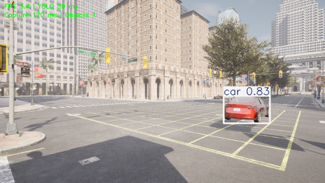
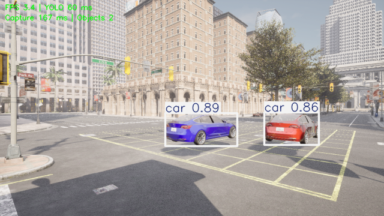

# YOLO 目标视觉伺服：居中与距离保持

`openhutb_yolo_mlp_control` 提供独立的 YOLO 目标视觉伺服模式。节点根据检测框偏差控制无人机运动：**水平居中始终启用**；**距离保持**与**垂直居中**为可选能力，默认关闭，关闭时行为与原有水平居中模式完全一致。本模式不做避障，也不控制相机朝向。无人机须先在仿真器中起飞并稳定，本模式不负责解锁、起飞或降落。

目标类别默认为 `car`，也可通过 `target_class:=person` 等参数切换。运行前需先准备 YOLO11n 权重；该文件不包含在仓库中，可从[模型下载地址](https://pan.baidu.com/s/1nHSTqk4aYdC5HOpih6jPrg?pwd=fffa)下载（提取码：`fffa`）。请将 `yolo11n.pt` 保存到本地，并在启动时传入其绝对路径，避免 Ultralytics 在运行时尝试联网下载。

以下命令在完成[环境配置](setup.md)中的依赖安装、功能包构建并加载工作空间后运行。先将 `REPO_DIR` 设为本仓库根目录，再设置模型文件和当前 Windows 主机地址，并确认文件及 RPC 端口可用：

```bash
export REPO_DIR=/绝对路径/到/ros2
export YOLO_MODEL=/绝对路径/到/yolo11n.pt
export AIRSIM_IP=实际Windows地址
test -f "$YOLO_MODEL"
nc -vz "$AIRSIM_IP" 41451
```

`REPO_DIR` 应设置为本仓库根目录，不依赖特定的工作空间名称；`YOLO_MODEL` 则应指向刚才下载的权重文件。

## 预览控制量

预览模式运行检测和控制计算，但不发送飞行控制指令：

```bash
ros2 launch openhutb_yolo_mlp_control visual_centering.launch.py \
  airsim_ip:="$AIRSIM_IP" \
  yolo_model_path:="$YOLO_MODEL" \
  target_class:=car \
  dry_run:=true \
  show_window:=true
```

在另一个已加载工作空间环境的终端查看状态和预览速度：

```bash
ros2 topic echo /openhutb/visual_centering/status
ros2 topic echo /openhutb/visual_centering/preview_cmd_vel
```

## YOLO 窗口显示与置顶

`start_topmost` 默认是 `true`。启动时可设置 `start_topmost:=false` 关闭置顶；运行中先让 YOLO 窗口获得焦点，再按 `T` 切换。置顶需要图形桌面和窗口管理器支持。在 WSLg 下程序优先调用 Windows 宿主窗口功能，不可用时使用 OpenCV 窗口接口。

指标采用左上角两行小字显示 FPS、推理耗时、采集耗时及目标数，不绘制背景色块。YOLO 结果也发布到 `/openhutb/yolo/image`，可用 ROS 图像查看器显示。模拟器 F1/F2/F3 子视窗由模拟器渲染；当前 AirSim RPC 不提供将该 ROS 图像写入内置子视窗的接口，真正内嵌需要模拟器端支持。

外部窗口按画面实际比例自动确定大小，默认最大显示宽度为 640 像素（16:9 画面为 640×360），不放大小图。可设置 `window_width:=480` 进一步缩小。此参数只影响窗口显示，不改变检测输入或发布图像分辨率；窗口使用简洁界面，不显示 Qt 扩展工具栏。

视觉启动入口把发布图像等比例缩小至 640 像素宽，以减少 ROS 图像传输和 Python 消息转换开销；YOLO 图像订阅仅保留最新一帧，相机朝向不变，误差仍按图像尺寸归一化。

## 仿真控制

确认目标类别和相机方向正确、无人机已稳定悬停，并停止其他飞行指令发布者后，将 `dry_run` 设为 `false`：

```bash
ros2 launch openhutb_yolo_mlp_control visual_centering.launch.py \
  airsim_ip:="$AIRSIM_IP" \
  yolo_model_path:="$YOLO_MODEL" \
  target_class:=car \
  dry_run:=false \
  show_window:=true
```

也可从任意当前目录调用仓库入口脚本：

```bash
bash "$REPO_DIR/src/air/openhutb_yolo_mlp_control/main.sh" \
  airsim_ip:="$AIRSIM_IP" \
  yolo_model_path:="$YOLO_MODEL" \
  target_class:=car \
  dry_run:=false
```

退出 ROS 节点不会自动降落；由操作者按照仿真器流程接管无人机。目标丢失、检测或里程计过期，以及姿态、水平位移保护触发时，控制器输出零速度；启用垂直居中时，高度保护（`altitude_limit`）也会输出零速度。桥接的精确零指令清除滤波和待发送位移，命令中断另有看门狗；退出视觉模式时取消残留任务并恢复初始 API 控制状态。恢复 API 状态本身不能证明鼠标或键盘接管有效，应另行实测。

若预览确认本机图像拍摄间隔会达到约 1 秒，可在受控慢速仿真中显式追加 `detection_timeout:=1.5 lock_timeout:=3.0`。这允许更长的帧间隔，但检测进程或图像完全中断时，最长检测停控等待也增加至 1.5 秒，另加控制周期和后端执行延迟；空检测到达时仍立即停控。默认 0.8 秒检测保护保持不变，不能将延长超时当作提高采集帧率的方法。

移动车辆实验应先使用[车辆工具](traffic_tracking.md)造车，停止真值跟随及其他指令源，再按上文先预览后控制。CARLA 的位置只可用于场景准备和独立评估；默认控制器只订阅 YOLO 完整视觉观测、操作动作和无人机里程计，不接收车辆真值。固定相机和横向控制不能保证车辆驶离前方视野后仍可跟随，默认不启用距离保持与垂直居中，也不提供避障；默认 3 米位移保护保留，触发后应重新布置场景。

## 距离保持与垂直居中

两项能力默认关闭，需要显式设置参数才会启用。

**距离保持**（`target_area` > 0）：把目标框占画面的面积比作为设定值，检测框偏小说明目标太远，控制器输出前向速度；偏大则后退。该量是**单目视觉的表观尺寸**，不是真实测距，因此只在目标类别已知、目标完整可见且不改变姿态的场景下可靠；目标被遮挡或侧向旋转时面积会剧烈变化，此时不建议开启。参数为 `target_area`、`distance_gain`、`distance_deadband`、`max_forward_speed`。

**垂直居中**（`vertical_gain` > 0）：用检测框的纵向偏差控制升降，**启用后取代原有的定高保持**；目标在画面上方则爬升，在下方则下降。参数为 `vertical_gain`、`vertical_deadband`，升降速度仍受 `max_vertical_speed` 限制。

**安全边界**：`max_altitude_change` 限制的是**相对跟踪起点高度的变化量**，并且**只在启用垂直居中（`vertical_gain` > 0）时生效**；超过该值控制器立即输出零速度并报告 `altitude_limit`。未启用垂直居中时该限制不会触发，高度仍按原有定高逻辑保持，正常爬升或高空作业不受影响。水平位移始终由 `max_displacement` 限制。

## 常用参数与状态

| 参数 | 默认值 | 作用 |
| --- | --- | --- |
| `dry_run` | `true` | 预览模式，不发送飞行控制指令 |
| `target_class` | `car` | 要跟踪的 YOLO 类别 |
| `gain` | `1.8` | 水平误差控制增益 |
| `max_speed` | `0.8` | 横向速度上限，单位 m/s |
| `max_displacement` | `3.0` | 相对初始位置的水平位移上限，单位 m |
| `target_area` | `0.0` | 期望的目标框面积占画面比例；`0` 表示关闭距离保持 |
| `distance_gain` | `1.0` | 相对面积误差到前向速度的增益 |
| `distance_deadband` | `0.15` | 相对面积误差死区，落在区间内不输出前向速度 |
| `max_forward_speed` | `0.5` | 前向速度上限，单位 m/s |
| `vertical_gain` | `0.0` | 纵向偏差到升降速度的增益；`0` 表示保持定高 |
| `vertical_deadband` | `0.08` | 纵向归一化偏差死区 |
| `max_altitude_change` | `3.0` | 启用垂直居中时，相对跟踪起点高度的最大变化，单位 m |
| `start_topmost` | `true` | 启动时置顶 YOLO 窗口 |

状态发布在 `/openhutb/visual_centering/status`，包含 `status`、`error_x`、`distance_error`、`forward_speed`、`velocity_ned`、`dry_run` 字段；`status` 取值包括 `acquiring`、`tracking`、`centered`、`paused`、`target_lost`、`reselect_required`、`awaiting_image`、`odom_stale`、`displacement_limit`、`heading_changed`、`altitude_limit`；所有保护状态均输出零速度。预览速度发布在 `/openhutb/visual_centering/preview_cmd_vel`。`centered` 表示水平偏差在死区内，且启用距离保持时面积误差也在死区内。

首次选择按类别和置信度筛选，再连续确认 `confirmation_frames` 帧（默认 3）才进入 `tracking` 或 `centered`。锁定后按归一化框中心距离（`association_gate`）和宽高变化比例（`max_size_ratio`，默认 1.8）关联；YOLO 的 `detection.id` 是逐帧编号，不作为车辆身份。

空检测、异常或过期帧立即输出零速度，短时丢失保留上一确认框，重新出现仍需连续确认，期间状态为 `acquiring`。超过 `lock_timeout`（默认 1 秒）没有可关联的有效观测后进入 `reselect_required`，不会按置信度自动追另一辆车；此时需操作者确认视野后显式重选。几何关联无法保证近似车辆交叉、重叠时身份不切换。旧图像配对适配路径中，检测先于图像到达时会有界暂存，等待期间停控。

确认连续性按相邻图像的拍摄时间判断；定时器发现输入过期时仍停控，但不单独清空尚在连续拍摄序列中的确认计数。空检测、非法帧或拍摄间隔超过阈值会打断确认，控制恢复仍须获得新鲜且通过确认的检测。初次 GPU 推理可能有较长冷启动，应先用预览确认检测能持续更新。

默认控制输入为 `/openhutb/visual_observation`（`std_msgs/String` 的版本 1 JSON），由 YOLO 将同一推理输入的 `stamp_ns`、`frame_id`、`width`、`height` 和 `boxes` 一起发布。每个框为 `[中心x, 中心y, 宽, 高, 置信度, 类别]`。控制节点无需接收整幅图像，也不依赖图像与检测跨话题配对；原 `/openhutb/detections` 保留供其他消费者使用。格式错误、重复或过期拍摄时间及相机标识变化都会停控。只有显式设置节点参数 `use_visual_observation:=false` 时才使用旧的图像配对适配路径。

控制动作使用以下 ROS 话题；`resume` 保留锁定及位移保护原点，不能解除长时丢失保护，`reselect` 允许选择新的视觉目标，也不重置飞行保护：

```bash
ros2 topic pub --once /openhutb/visual_centering/action std_msgs/msg/String "{data: pause}"
ros2 topic pub --once /openhutb/visual_centering/action std_msgs/msg/String "{data: resume}"
ros2 topic pub --once /openhutb/visual_centering/action std_msgs/msg/String "{data: reselect}"
```

## 可选双车干扰验证工具

`tools/visual_validation` 提供独立场景驱动 `two_car_scene.py` 和 ROS 观察器 `two_car_observer.py`，构建时安装到功能包的 share 目录。工具不参与正常启动；场景驱动只通过 CARLA 造车、设置运动和记录真值，观察器启动原有视觉控制 launch 并记录视觉观测、状态、里程计及截图，不将车辆坐标送入控制器。

适用场景为 OpenHUTB Town10HD、异步世界、固定前视相机。A 先确认，5 秒后显示 B；15–16 秒隐藏 A，30–35 秒再次隐藏 A，45 秒显式重选，55 秒结束。临时隐藏用于模拟不可见，不等同于真实障碍遮挡。B 根据无人机初始朝向放在 A 侧方 5 米，仍须检查两车均在视野内，且 B 位于关联范围外；检测不满足这些条件时不能认定验证通过。

Windows 场景驱动和 WSL 观察器可以使用不同 Python 环境，通过同一个共享输出目录通信。每轮使用一个全新目录，禁止将输出放入任何 Git 工作区。先在 Windows PowerShell 启动场景（`CARLA_PYTHON` 为匹配模拟器版本的 Python，`REPO_DIR` 为 Windows 仓库绝对路径）：

```powershell
$CARLA_PYTHON = 'C:\path\to\python.exe'
$REPO_DIR = 'D:\path\to\repository'
$RUN_DIR = 'D:\visual_validation\two_car_001'
& $CARLA_PYTHON "$REPO_DIR\src\air\openhutb_yolo_mlp_control\tools\visual_validation\two_car_scene.py" --output "$RUN_DIR"
```

确认输出目录出现 `scene_ready.json` 后，在已加载 ROS、项目 Python 环境及最新安装环境的 WSL 终端执行。`RUN_DIR` 必须指向上述同一 Windows 目录，`AIRSIM_IP` 与 `YOLO_MODEL` 按前文设置并验证：

```bash
export RUN_DIR=/mnt/d/visual_validation/two_car_001
export TOOL_DIR="$(ros2 pkg prefix openhutb_yolo_mlp_control)/share/openhutb_yolo_mlp_control/tools/visual_validation"
python "$TOOL_DIR/two_car_observer.py" \
  --output "$RUN_DIR" --airsim-ip "$AIRSIM_IP" --model "$YOLO_MODEL" \
  --prepare-pose
```

`--prepare-pose` 明确授权一次性布置仿真位置并将相机设为固定前视，保留机体朝向；它使用 Town10HD 的场景坐标换算，仅用于初始布置。结束后保留测试结束位置和固定相机安装方向，不自动恢复起点、不降落。若自行布置好观察位置和前视相机，可省略此选项。启动前停止所有其他控制器并停止手动操作；观察器只能检查当前 ROS domain 的已发现节点，不能排除其他 domain 或原生 API 控制源。默认不弹窗，追加 `--show-window` 显示 YOLO 窗口。

正常结束或中断会请求清理本轮生成的两辆车；场景驱动也有独立超时，避免观察器异常退出后无限运行。不要强杀进程；需要提前停止时先在观察器终端按 Ctrl+C，等待控制 launch 退出，再等待场景清理。程序或模拟器被强制终止时仍可能残留车辆，不能据此声称清理成功；工具只销毁自己创建的 actor，不删除其他车辆。

输出包含 `result.json`、`scene.json`、`summary.json`、`launch.log` 和关键帧 PNG，默认保存在仓库外；日志和原始记录不提交到 Git，教程仅收录下方三张经过检查的效果图。截图按拍摄时间戳匹配视觉状态；没有匹配图像时不会生成该阶段截图。`summary.json` 仅汇总保护状态非零输出和各阶段 car 数量，不自动判定身份保持通过；应检查 A/B 对应框、关联诊断、状态转换、实际位移和 `scene_cleaned.json`。缺少检测证据、场景提前结束或关键阶段未发生时应判为未充分验证，不能只看进程退出码。两车交叉、重叠或 B 置信度更高需另设场景验证。

## 验证环境与结果

2026-11-07 在 OpenHUTB 2.10.0 / Town10HD、WSL2 Ubuntu 22.04、ROS 2 Humble、Python 3.10 和 YOLO11n 下验证固定前视相机的水平居中。在线使用 `detection_timeout:=1.5 lock_timeout:=3.0`，距离保持与垂直居中关闭，保留默认 3 米位移保护。96 项单元测试、15 项 ROS 链路测试及功能包构建通过。

2026-11-07 使用模块内场景驱动及安装后的观察器完成 55 秒完整在线闭环：双车可见阶段 22 帧均有两辆 car，长时隐藏阶段 8 帧只有 B，两车返回等待阶段 25 帧均有两辆 car；约 15.55 秒停控、17.30 秒短时恢复，33.30 秒进入显式重选等待，45.01 秒重选后于 45.70 秒恢复。保护状态非零控制输出数为 0，停控抽查区间及退出后 2 秒水平漂移为 0，六个阶段截图均与状态的拍摄时间戳匹配，三个控制节点干净退出，两车清理无错误。该结果仍限于关联范围外干扰车，不扩展到车辆交叉重叠身份保持。

以下三张图直接保存自上述双车工具发布的 YOLO 标注画面，分辨率为 640×360，均与控制状态的拍摄时间戳匹配。蓝紫色车辆为先锁定的目标 A，红色车辆为关联范围外的干扰车 B；图注中的控制状态来自同轮 ROS 记录，静态画面本身不证明无人机已经停控。

**双车同时可见，保持目标 A。** A 先完成连续确认，随后 B 进入画面。此时两车均被检测为 `car`，控制器保持 A，状态为 `centered`。


**A 长时丢失，B 可见时保持停控。** 场景驱动临时隐藏 A，B 仍被检测为 `car`。控制器进入 `reselect_required`，三方向控制速度均为零，没有自动接替 B。



**两车返回后仍等待显式重选。** A 恢复可见后，两车再次被检测为 `car`，控制器仍保持 `reselect_required`；直到后续显式重选并连续确认，才恢复控制。



另有 65 秒单车慢速测试：车辆横向摆幅 ±0.7 米、最大速度约 0.07 m/s，居中时间（归一化水平误差绝对值 ≤0.08）占 90.5%，已确认目标状态占 98.8%，无人机最大水平位移约 0.75 米；短时漏检后重新确认恢复。故障测试覆盖 0.4 秒与 4 秒隐藏、显式重选、暂停和恢复，保护状态非零控制输出数为 0。单车结果采集于同步上游之前；同步后进行了 2,913 步默认水平模式回放比较，状态与控制输出一致，双车工具则在同步后的代码上重新完成在线验证。

较大摆幅场景在约 12 秒触发 3 米位移上限并停控。测试使用 `simSetVehiclePose` 增量位置后端，结果只验证仿真接口及视觉控制链路，不代表原生飞行动力学、避障或任意道路全程追车。没有同配置修改前基线，也未重新验证图形窗口及人工键盘接管；B 置信度高于 A、两车交叉或重叠时的身份保持仍需单独验证。

返回[文档目录](README.md)。

## 说明

本文档整理、代码重构和问题排查过程中使用了大模型辅助；提交者已检查全部内容并对最终结果负责。
