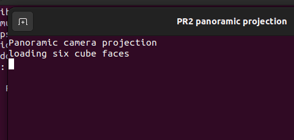

title: 全景相机投影

# 六相机等距柱状全景投影

该模块把前、右、后、左、上、下六张同步相机图像拼接为 $2:1$ 等距柱状全景图，并提供离线验证与可选 ROS 2 在线节点。

## 1. 前置条件

- Python 3.10 或更高版本。
- NumPy 与 OpenCV。
- 在线节点需要 ROS 2 Humble、`rclpy`、`sensor_msgs` 和 `cv_bridge`。
- 六张输入图像的尺寸必须相同且为正方形。

## 2. 注意事项

在线节点按 ROS 时间戳分组；只有六路图像时间戳完全一致时才会拼接。图像方向按照项目中统一的立方体面名称解释，输入相机外参需在调用节点前完成标定。

## 3. 离线运行

```bash
cd src/air/panoramic_camera_projection
python3 main.py --output output/panorama.png
```

使用真实六面图像：

```bash
python3 main.py --faces-dir path_to_faces --output output/panorama.png
```

## 4. 预期结果

输出分辨率为 `1024x512`，终端显示：

```text
PASS: equirectangular panorama generated
```



## 5. 在线节点

```bash
source /opt/ros/humble/setup.bash
source install/setup.bash
ros2 run panoramic_camera_projection panorama_node
```

节点订阅 `camera/<face>/image`，六路消息均到达后发布 `panorama/image`。

## 6. 测试

```bash
python3 -m unittest discover -s tests -v
```

## AI 使用声明

本模块使用大型语言模型辅助编写。提交者已完成代码审查和虚拟机运行验证，并对提交内容负责。
