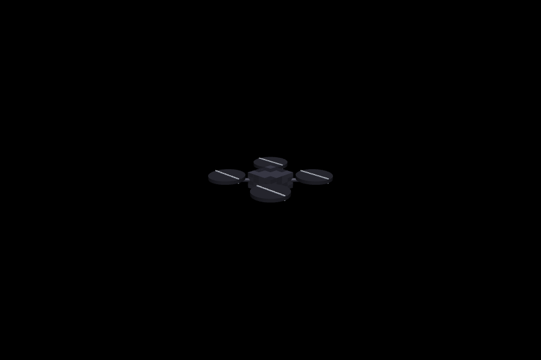
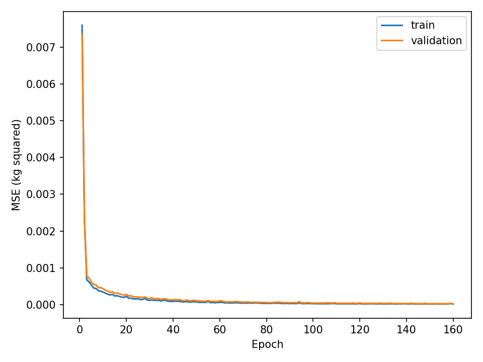
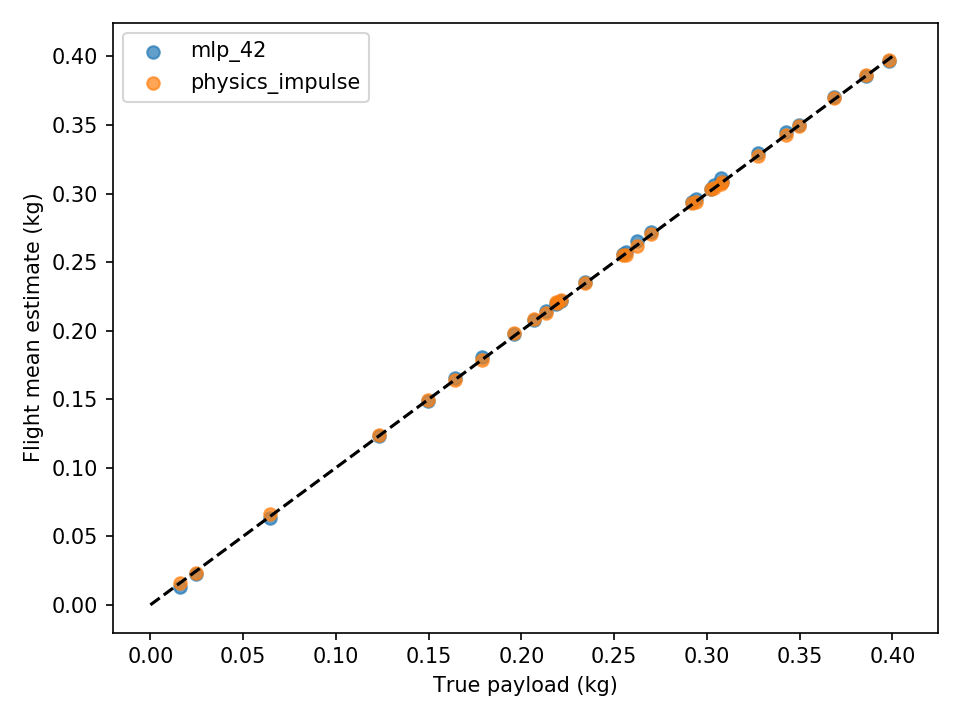
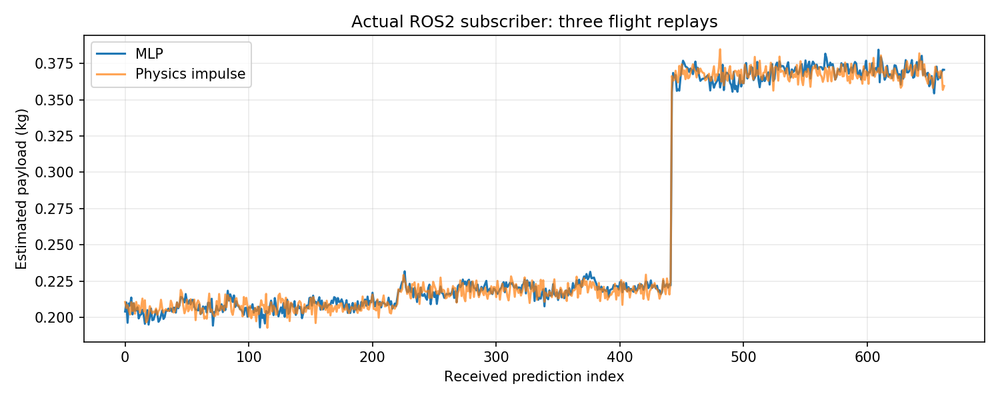
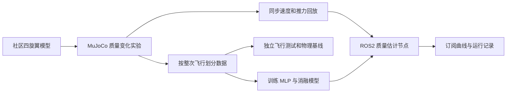

# 无人机载荷质量估计

这个项目用飞行中的推力和速度数据估计无人机搭载物的质量。比如同样的推力下，载荷变化会影响竖直运动响应，模型据此给出以 kg 为单位的估计值。

项目复用 OpenHUTB 社区 [PR #178](https://github.com/OpenHUTB/ros2/pull/178) 的四旋翼模型，增加质量变化实验、神经网络训练、物理公式对照和 ROS2 回放。模型文件、来源版本及许可说明见 [来源记录](payload_mass_estimation/models/source.json) 和 [第三方说明](payload_mass_estimation/THIRD_PARTY_NOTICES.md)。采集数据和估计程序为本项目新增。

目前实验限定为水平姿态下的竖直飞行，已知空机质量及推力标定。这里的“载荷”是附加质量，与着陆时的接地力不同。



载荷通过调整机身质量表示，没有单独绘制货物。上图由同一实验重新运行后渲染，脚本检查重跑的物理数据与保存记录一致。

## 数据与方法

共采集 180 次 MuJoCo 飞行，每次 12 秒。90 次训练、30 次验证、30 次正常测试，另外 30 次用于推力标定偏差测试。整次飞行只属于一个集合；归一化只使用训练集。原始数据和校验清单保存在 `assets/flights.zip`。

空机总质量为 0.95 kg，其中机身 0.85 kg，四个旋翼合计 0.10 kg。附加质量在 0～0.4 kg 间随机选取。控制器使用固定参数，不读取真实载荷；高度目标含小幅正弦变化。改变质量时沿用原有转动惯量，本实验不讨论载荷偏心和姿态控制。

物理步长为 2.5 ms，记录频率为 20 Hz。在记录的竖直速度上加入标准差为 0.025 m/s 的高斯噪声。传感器延迟、推力噪声、风和姿态扰动没有包含在正常实验中。

模型使用最近 20 个采样点中的 19 个推力值和 19 个速度差分加速度，共 38 个输入。推力按前一采样时刻对齐，因为该指令作用于随后一段时间。高度、真实质量、飞行编号和未来观测不进入网络。20 个点覆盖 0.95 秒。

网络为 38→48→24→1 的 MLP，隐藏层使用 Tanh，输出载荷质量。训练 160 轮，按验证集均方误差保存模型。使用 42、43、44 三个随机种子；ROS2 演示固定使用 `mlp_42`。消融模型 `no_thrust_42` 只保留加速度输入。

物理基线使用同一窗口的冲量关系：

```text
总质量 = sum(指令推力 × dt) / (窗口末速度 - 窗口初速度 + g × 窗口时长)
载荷质量 = 总质量 - 0.95 kg
```

## 实验结果

### 正常标定条件

| 方法 | 窗口 MAE（g） | 窗口 RMSE（g） | 整次飞行平均值 MAE（g） |
|---|---:|---:|---:|
| mlp_42 | 3.538 | 4.436 | 1.463 |
| mlp_43 | 2.919 | 3.794 | 0.973 |
| mlp_44 | 2.843 | 3.619 | 0.849 |
| no_thrust_42 | 79.825 | 100.110 | 72.744 |
| physics_impulse | 3.683 | 4.636 | 0.709 |
| train_mean | 81.641 | 100.990 | 81.641 |

表中每种方法都评估 30 次未用于训练的飞行，共 690 个重叠窗口。窗口不是相互独立的飞行样本，因此同时列出“每次飞行先平均预测，再计算误差”的结果。

主模型的窗口 MAE 为 3.54 g，物理基线为 3.68 g，两者接近；整次飞行平均后，物理基线的表现见表。这里不据此认定神经网络普遍优于物理方法。去掉推力输入后误差明显增大，说明仅靠运动响应不足以完成当前设置下的估计。

### 推力标定偏差

这一组将实际推力改为指令的 95% 或 105%，但估计器仍只接收原指令，不提供偏差值，也不重新训练。

| 方法 | 窗口 MAE（g） | 窗口 RMSE（g） | 整次飞行平均值 MAE（g） |
|---|---:|---:|---:|
| mlp_42 | 57.360 | 57.773 | 57.360 |
| mlp_43 | 55.768 | 56.278 | 55.768 |
| mlp_44 | 56.886 | 57.253 | 56.886 |
| no_thrust_42 | 80.685 | 101.918 | 72.834 |
| physics_impulse | 57.073 | 57.560 | 57.073 |
| train_mean | 78.999 | 100.276 | 78.999 |

主模型误差增至约 57 g。神经网络与物理基线都会受推力标定影响；如果推力比例和质量都未知，仅凭这里的输入难以区分两者。




运行评估后，详细指标生成到本地 `results/metrics.json`，逐窗口预测生成到同目录 CSV 中。运行记录不随源码提交，文档保留实验汇总表和展示图片。结果来自当前的简化竖直飞行实验，尚未进行跨控制器、复杂机动、OpenHUTB Unreal 或实机验证。

## 运行

已验证环境为 VMware Ubuntu 20.04.6、现有 ROS2 Humble、Python 3.8.10、PyTorch 2.4.1+cpu、MuJoCo 3.1.6。使用系统 Python 创建虚拟环境，以便访问 ROS2 库。

代码目录以下按 `~/ros2/src/air/payload_mass_estimation` 举例，独立解压时替换为实际路径。系统需已有 ROS2、rclpy、std_msgs 和 launch_ros；缺少 venv 时安装系统 `python3-venv`。

```bash
cd ~/ros2/src/air/payload_mass_estimation
source /opt/ros/humble/setup.bash
/usr/bin/python3 -m venv --system-site-packages ~/uav_prediction_env
source ~/uav_prediction_env/bin/activate
python -m pip install -r requirements.txt
bash main.sh doctor
bash main.sh prepare
bash main.sh test
bash main.sh build
```

已有相同虚拟环境时直接激活即可。`ROS_SETUP` 和 `UAV_ENV` 可以指定其他 ROS setup 文件和虚拟环境目录。仿真及模型可在 CPU 上运行，无需另下大型场景。

先在上述终端启动订阅绘图程序：

```bash
MPLBACKEND=Agg python -m payload_mass_estimation.dashboard
```

再在第二个终端运行：

```bash
cd ~/ros2/src/air/payload_mass_estimation
bash main.sh demo
```

默认回放 3 次测试飞行，约 36 秒。节点结束后，订阅程序等待 5 秒无新消息便保存图片和计数，最多等待 90 秒；它保存曲线文件，不打开实时窗口。若没有收到消息会报错。

输出为 `results/ros_subscriber.png`、`results/ros_subscriber.json` 和 `results/ros_node.json`。本次运行发布 720 条观测、663 条预测，订阅端收到全部 663 条预测，两个节点正常退出。



图中的台阶对应三次独立飞行的切换，不表示飞行途中加载货物。

## ROS2 接口

| 话题 | 消息类型 | 字段 |
|---|---|---|
| `/payload/observation` | `std_msgs/String` JSON | `stamp_s`、`height_m`、`velocity_z_mps`、`command_thrust_n` |
| `/payload/estimate` | `std_msgs/String` JSON | `stamp_s`、`mass_kg`、`physics_kg` |

输入包将速度和推力放在同一时间戳下，采样间隔为 0.05 秒。估计器收到 20 个有效点后开始输出；时间倒退、间隔异常或非有限值会清空窗口。当前节点为有限回放设计，接收过数据后断流 3 秒会保存记录并退出。

本项目没有直接接入 `carlair_ros_bridge`。若接入其他仿真器，需要同时取得同步后的竖直速度和以牛顿为单位的总推力；仅有 `/uav/odom` 不够。倾斜飞行还需要处理推力的竖直分量。



## 复现实验

恢复数据后评估随附模型：

```bash
bash main.sh evaluate
```

随附权重可直接评估，不需要训练过程日志。训练曲线图保留在本文中；重新训练后会生成本地 `models/*/loss.csv`，再次评估时可据此重绘损失曲线。

如需重新采集、训练，请先复制项目目录，避免覆盖随附数据和模型。在副本中运行：

```bash
bash main.sh collect
bash main.sh train
bash main.sh evaluate
```

在有图形环境的 Ubuntu 桌面运行 `python render_validation.py` 可重新渲染仿真图，输出到本地 `results/simulation.png`。

8 项测试涵盖模型总质量、已知质量物理公式、时间对齐、在线与离线一致性、输入字段、异常值、采样间隔和飞行划分。`doctor` 生成本地环境记录 `artifacts/environment.json`；测试、评估和回放结果由运行命令生成。`results/`、`artifacts/`、构建目录、日志和训练过程 CSV 均不提交到仓库。

代码、实验脚本和文档使用 OpenAI Codex 辅助编写。指标与图片来自程序运行。
