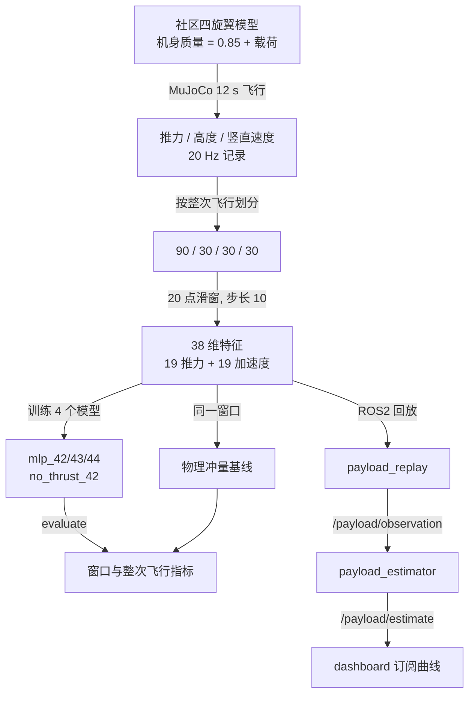

# 无人机载荷质量估计

本页记录一个可复现的载荷质量估计实验：用飞行中的**推力指令**与**竖直速度响应**，估计无人机当前搭载物的质量（kg）。同一个推力下，载荷越重、竖直加速越慢——模型要学的就是这个关系。

实验在 MuJoCo 里做：把同一架四旋翼的机身质量改成"空机 + 载荷"，用固定参数的控制器飞出一段高度轨迹，记录推力与速度，再用神经网络和物理公式分别反推载荷。


上图的每一帧都来自真实运行：`payload_estimator` 节点订阅回放话题，逐条发布 `/payload/estimate`，共 663 条估算。三次飞行的真实载荷分别是 0.207、0.219、0.368 kg。

---

## 1. 任务定义与设计取舍

**输入**：最近 20 个采样点（20 Hz，约 0.95 秒）的推力指令与竖直速度。

**输出**：载荷质量估计值（kg），范围 0～0.4 kg。

**边界**：只做**水平姿态下的竖直飞行**，且空机质量与推力标定已知。这里的"载荷"是附加质量，与着陆时的接地力不是一回事。

三个关键取舍：

| 取舍 | 选择 | 理由 |
|---|---|---|
| 特征 | 推力序列 + 速度差分加速度序列 | 动力学上，推力与加速度之比直接给出质量；网络不必自己学微分 |
| 网络 | 小 MLP（38→48→24→1） | 输入已是物理量，样本只有 90 次飞行；深层网络没有增益 |
| 对照 | 同一窗口的冲量物理基线 | 这个问题有闭式解，**必须**与它比较，否则无法说明神经网络的价值 |

### 1.1 与社区模型的关系

四旋翼模型复用 OpenHUTB 社区 [PR #178](https://github.com/OpenHUTB/ros2/pull/178)，版本与许可见 `models/source.json` 与 `THIRD_PARTY_NOTICES.md`。**质量变化实验、数据采集、训练与 ROS2 估计程序都是本项目新增的**。

### 1.2 功能与入口

| 阶段 | 入口 | 输出 |
|---|---|---|
| 自检 | `bash main.sh doctor` | `artifacts/environment.json` |
| 数据 | `bash main.sh prepare` | 解压语料到 `data/` |
| 采集 | `bash main.sh collect` | 180 次 MuJoCo 飞行（另存目录） |
| 训练 | `bash main.sh train` | `models/<name>/model.pt`、`meta.json`、`loss.csv` |
| 评估 | `bash main.sh evaluate` | `results/metrics.json`、逐窗口 CSV、2 张图 |
| 测试 | `bash main.sh test` | 8 项单元测试 |
| 构建 | `bash main.sh build` | `install/`、`build/`、`log/` |
| ROS2 | `bash main.sh demo` | 两个话题 + 订阅曲线 |
| 仿真图 | `python render_validation.py` | `results/simulation.png` |

---

## 2. 运行环境与快速开始

### 2.1 环境

| 项 | 配置 |
|---|---|
| 系统 | Ubuntu 20.04.6（VMware），6 核 / 8.5 GB |
| ROS | ROS2 **Humble**（`/opt/ros/humble`，Python 3.8） |
| 深度学习 | PyTorch **2.4.1+cpu** |
| 仿真 | **MuJoCo 3.1.6**（CPU，无需下载场景） |
| Python | 3.8.10，venv `--system-site-packages` |

### 2.2 安装与自检

```bash
cd ~/ros2/src/air/payload_mass_estimation
source /opt/ros/humble/setup.bash
/usr/bin/python3 -m venv --system-site-packages ~/uav_prediction_env
source ~/uav_prediction_env/bin/activate
python -m pip install -r requirements.txt      # 含 mujoco==3.1.6
bash main.sh doctor
bash main.sh prepare
bash main.sh test
bash main.sh build
```

`doctor` 检查 13 个模块，其中 **`mujoco` 只在重新采集时需要**：训练与评估只用 numpy + torch。但如果跳过安装，`doctor` 会直接失败——这是有意的，避免"以为能采集、实际不能"。

`ROS_SETUP` 与 `UAV_ENV` 可覆盖 ROS setup 与虚拟环境路径。

### 2.3 跑回放

两个终端：

```bash
# 终端 1：订阅绘图（只写文件，不开窗口）
MPLBACKEND=Agg python -m payload_mass_estimation.dashboard

# 终端 2：回放 3 次测试飞行
bash main.sh demo
```

回放约 36 秒。订阅端在无新消息 5 秒后落盘（最多等 90 秒），输出 `results/ros_subscriber.png`、`ros_subscriber.json`、`ros_node.json`。约定俗成的现象是：**台阶对应三次独立飞行的切换**，不代表飞行途中装卸货物。

### 2.4 重新采集（可选）

采集会覆盖同目录数据，**务必先复制项目目录**：

```bash
cp -r ~/ros2/src/air/payload_mass_estimation ~/paymass_run
cd ~/paymass_run && bash main.sh collect && bash main.sh train && bash main.sh evaluate
```

---

## 3. 数据与仿真

### 3.1 仿真设置

| 项 | 值 |
|---|---|
| 模型 | 社区四旋翼 `models/community_quadrotor.xml` |
| 空机总质量 | **0.95 kg** = 机身 0.85 + 四个旋翼各 0.025 |
| 载荷范围 | 0～0.4 kg，均匀随机 |
| 控制器 | 固定参数 PID，**不读取真实载荷** |
| 高度目标 | \(3 + 0.25\sin(0.8t + \varphi)\) m，相位随机 |
| 物理步长 | 2.5 ms |
| 记录频率 | 20 Hz（DT = 0.05 s） |
| 每次时长 | 12 s |
| 观测量 | 高度加标准差 **0.025 m/s** 的高斯噪声 |

控制器是

$$
u_t = \mathrm{clip}\Big(0.85g + 5e_t - 3\dot z_t + 2\!\!\int\!\! e,\ 0,\ 22\Big)\ \text{N},
\qquad e_t = z^{\text{target}}_t - z_t
$$

它只用到目标高度、当前高度与速度——**载荷标签不进入控制律**，否则"质量可从控制响应推断"就成了循环论证。

改变质量时沿用原有转动惯量，本实验不讨论载荷偏心与姿态控制。传感器延迟、推力噪声、风扰动**都没有**包含在正常实验中。

### 3.2 数据规模与划分

| 集合 | 飞行数 | 种子范围 | 用途 |
|---|---:|---|---|
| 训练 | 90 | 40000–40089 | 拟合权重与标准化 |
| 验证 | 30 | 40090–40119 | 选模型（验证 MSE） |
| 测试 | 30 | 40120–40149 | 只报告 |
| 推力偏差 | 30 | 40150–40179 | 鲁棒性测试 |

每次飞行 12 s × 20 Hz = 240 个采样点；滑窗步长 10，每个 20 点窗口 → **每段 23 个窗口**，30 段共 **690 个重叠窗口**。

推力偏差组的实际推力被缩放为指令的 **95% 或 105%**，但估计器**仍只看到原指令**，也不重新训练——模拟"推力标定不准"。

原始数据与校验清单在 `assets/flights.zip`；`prepare` 解压后，`manifest.json` 记录每个文件的质量、推力比例与 SHA256，训练与评估前都会校验。

---

## 4. 计算原理

### 4.1 窗口与特征

每个采样点是一行 \([t_k, z_k, v_k, f_k]\)：时间、高度、竖直速度、**指令推力**（N）。取最近 20 行，计算 19 个加速度差分：

$$
a_k = \frac{v_{k+1}-v_k}{\Delta t},\qquad k=0,\dots,18,\quad \Delta t = 0.05\ \text{s}
$$

特征向量把推力与加速度拼起来：

$$
\mathbf{x} = \big[f_0,\dots,f_{18},\ a_0,\dots,a_{18}\big]^{\top}\in\mathbb{R}^{38}
$$

**推力按前一时刻对齐**：第 \(k\) 条指令作用在 \([t_k, t_{k+1})\)，因此驱动 \(a_k\) 的是 \(f_k\)，不是 \(f_{k+1}\)。这个错位如果搞反，物理基线与网络都会系统性偏差。

高度、真实质量、飞行编号、未来观测都**不进入**输入。

### 4.2 物理基线（冲量法）

对同一窗口用冲量关系：

$$
m_{\text{total}} = \frac{\sum_{k=0}^{18} f_k}{\sum_{k=0}^{18}\big(a_k + g\big)},
\qquad
\hat m_{\text{payload}} = m_{\text{total}} - 0.95
$$

分母里的 \(a_k + g\) 是"比力"：加速度加上重力，正是推力要克服的部分。基线**不含任何学习参数**，是这个问题的闭式解参考。

### 4.3 网络

$$
\mathbf{h}_1=\tanh(\mathbf{W}_1\mathbf{x}+\mathbf{b}_1)\in\mathbb{R}^{48},\quad
\mathbf{h}_2=\tanh(\mathbf{W}_2\mathbf{h}_1+\mathbf{b}_2)\in\mathbb{R}^{24},\quad
\hat m = \mathbf{w}_3^{\top}\mathbf{h}_2 + b_3
$$

参数量 \(38\times48+48 + 48\times24+24 + 24+1 = 3073\)。

输入先按训练集标准化：\(\tilde{\mathbf{x}} = (\mathbf{x}-\boldsymbol\mu)/\boldsymbol\sigma\)，\(\boldsymbol\sigma\) 下限 0.001。

### 4.4 损失与训练目标

$$
\mathcal{L}(\theta)=\frac{1}{N}\sum_{n=1}^{N}\big(\hat m_n - m_n\big)^2
$$

直接对**以 kg 为单位**的质量做 MSE，而不是对归一化值——这样验证损失就是物理量，判读更直接（本次最好约 \(1.3\times10^{-5}\,\text{kg}^2\)，对应 RMSE ≈ 3.6 g）。

### 4.5 评价指标

$$
\mathrm{MAE}_{\text{win}}=\frac{1}{N}\sum_{n}\big|\hat m_n-m_n\big|,\qquad
\mathrm{RMSE}_{\text{win}}=\sqrt{\frac{1}{N}\sum_{n}\big(\hat m_n-m_n\big)^2}
$$

以及更贴近实际的**整次飞行平均误差**：

$$
\mathrm{MAE}_{\text{flight}}=\frac{1}{F}\sum_{i=1}^{F}\Big|\frac{1}{n_i}\sum_{k\in i}\hat m_k - m_i\Big|
$$

690 个窗口来自 30 次飞行、彼此重叠，**不是 690 次独立试验**。整次飞行平均把同一飞行的窗口先平均，回答的是"这一趟估得准不准"。

---

## 5. 算法流程

### 5.1 总体流程



### 5.2 训练

```
输入: 训练/验证窗口 X, 标签 y(kg), 种子 s
1  固定 torch 种子; 线程数 2
2  μ, σ ← 训练集均值/标准差, σ 下限 0.001
3  对 mlp_42/43/44 与 no_thrust_42:
      no_thrust_42 只取加速度 19 维, 其余取 38 维
      for epoch = 1..160:
          打乱训练集, batch = 128, MSE 反传, Adam(lr = 0.001)
          若验证 MSE 创新低 → 保存 model.pt 与 meta.json(含 μ, σ, 训练集均值)
4  写出 loss.csv
```

### 5.3 在线估计

```
每条 /payload/observation:
1  校验 4 个字段有限; 否则清空窗口
2  若与上一条的时间差偏离 0.05 s 超过 25% → 清空窗口
3  入队, 只保留最近 20 条
4  不足 20 条 → 不输出
5  计算 19 个加速度 → 38 维特征 → MLP → mass_kg
   同时用冲量公式算 physics_kg
6  发布 {stamp_s, mass_kg, physics_kg}
7  断流 3 秒 → 保存 ros_node.json 并退出
```

---
