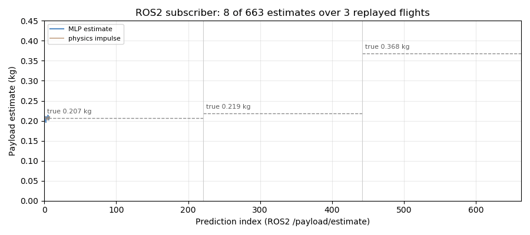
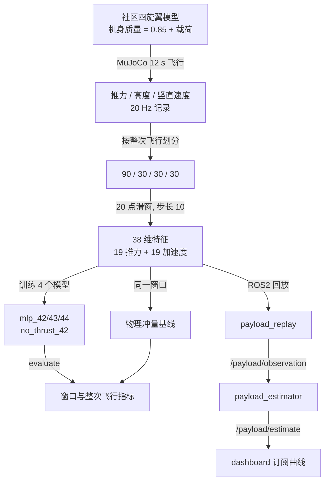
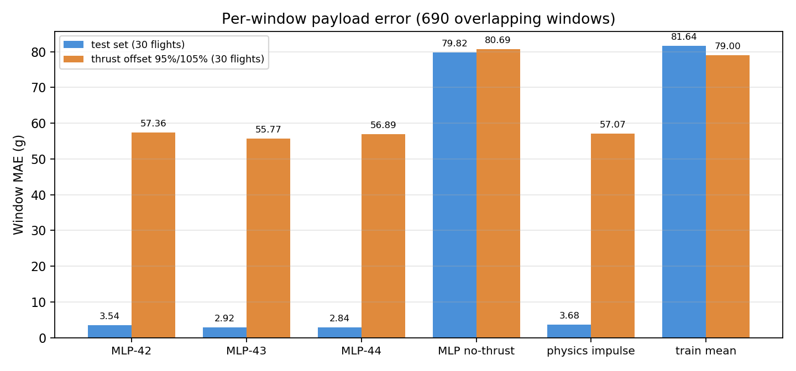
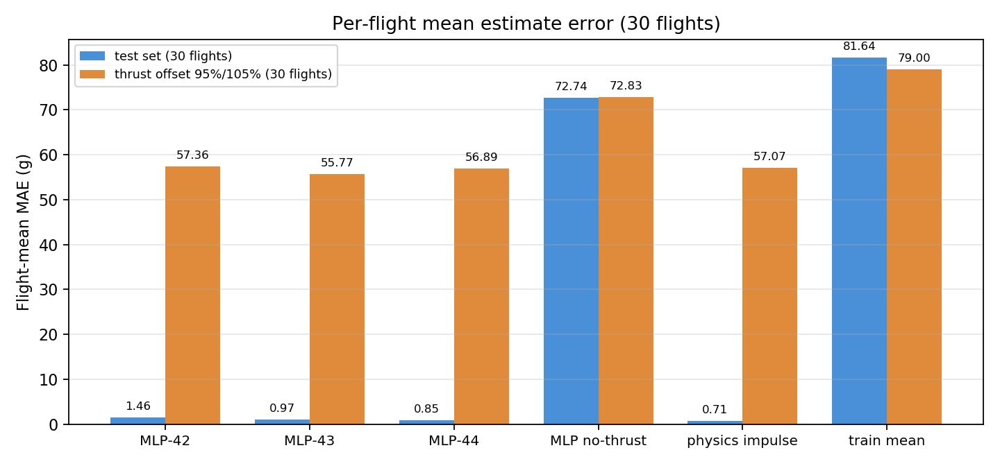
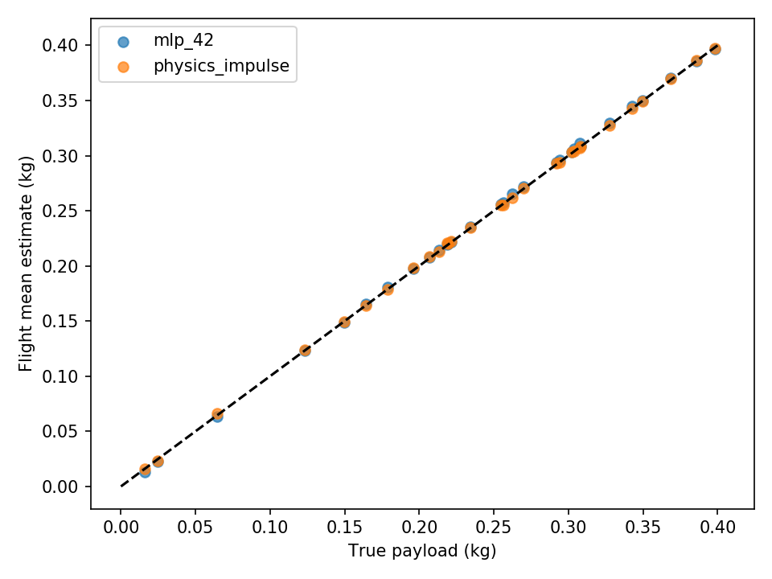
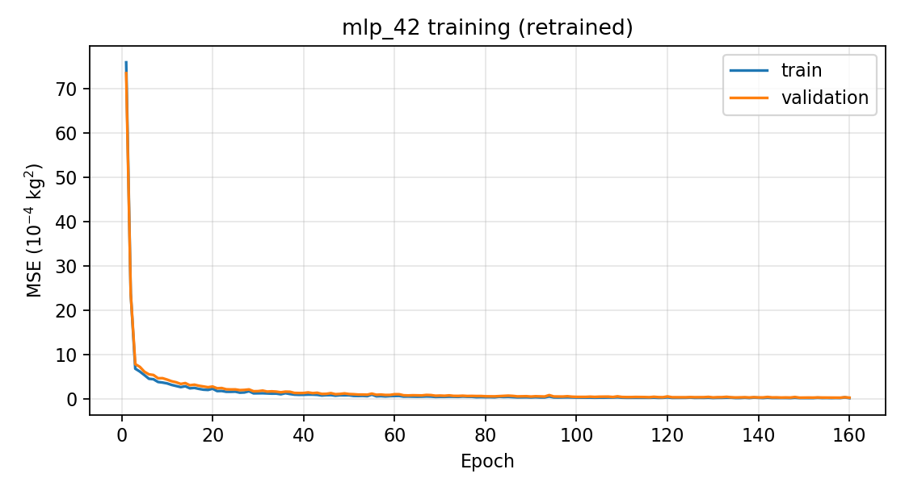
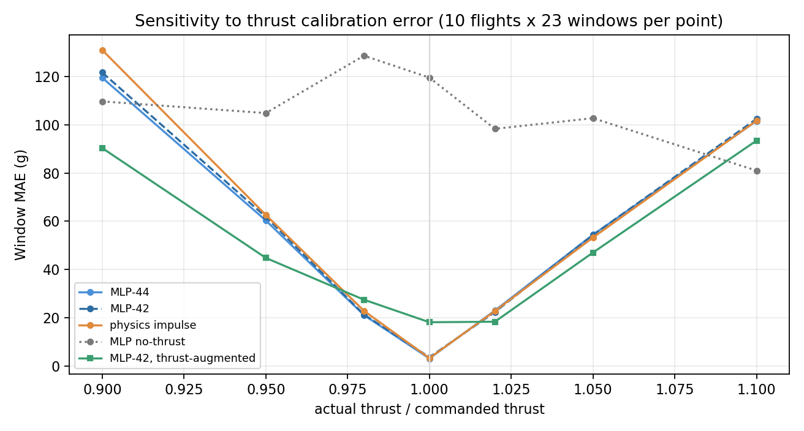

# 无人机载荷质量估计

本页记录一个可复现的载荷质量估计实验：用飞行中的**推力指令**与**竖直速度响应**，估计无人机当前搭载物的质量（kg）。同一个推力下，载荷越重、竖直加速越慢——模型要学的就是这个关系。

实验在 MuJoCo 里做：把同一架四旋翼的机身质量改成"空机 + 载荷"，用固定参数的控制器飞出一段高度轨迹，记录推力与速度，再用神经网络和物理公式分别反推载荷。



上图的每一帧都来自真实运行：`payload_estimator` 节点订阅回放话题，逐条发布 `/payload/estimate`，共 663 条估算。三次飞行的真实载荷分别是 0.207、0.219、0.368 kg。

---

## 1. 任务定义与设计取舍

**输入**：最近 20 个采样点（20 Hz，约 0.95 秒）的推力指令与竖直速度。

**输出**：载荷质量估计值（kg），范围 0～0.4 kg。

**边界**：只做**水平姿态下的竖直飞行**，且空机质量与推力标定已知。这里的"载荷"是附加质量，与着陆时的接地力不是一回事。

三个关键取舍：

| 取舍 | 选择 | 理由 |
|---|---|---|
| 特征 | 推力序列 + 速度差分加速度序列 | 动力学上，推力与加速度之比直接给出质量；网络不必自己学微分 |
| 网络 | 小 MLP（38→48→24→1） | 输入已是物理量，样本只有 90 次飞行；深层网络没有增益 |
| 对照 | 同一窗口的冲量物理基线 | 这个问题有闭式解，**必须**与它比较，否则无法说明神经网络的价值 |

### 1.1 与社区模型的关系

四旋翼模型复用 OpenHUTB 社区 [PR #178](https://github.com/OpenHUTB/ros2/pull/178)，版本与许可见 `models/source.json` 与 `THIRD_PARTY_NOTICES.md`。**质量变化实验、数据采集、训练与 ROS2 估计程序都是本项目新增的**。

### 1.2 功能与入口

| 阶段 | 入口 | 输出 |
|---|---|---|
| 自检 | `bash main.sh doctor` | `artifacts/environment.json` |
| 数据 | `bash main.sh prepare` | 解压语料到 `data/` |
| 采集 | `bash main.sh collect` | 180 次 MuJoCo 飞行（另存目录） |
| 训练 | `bash main.sh train` | `models/<name>/model.pt`、`meta.json`、`loss.csv` |
| 评估 | `bash main.sh evaluate` | `results/metrics.json`、逐窗口 CSV、2 张图 |
| 测试 | `bash main.sh test` | 8 项单元测试 |
| 构建 | `bash main.sh build` | `install/`、`build/`、`log/` |
| ROS2 | `bash main.sh demo` | 两个话题 + 订阅曲线 |
| 仿真图 | `python render_validation.py` | `results/simulation.png` |

---

## 2. 运行环境与快速开始

### 2.1 环境

| 项 | 配置 |
|---|---|
| 系统 | Ubuntu 20.04.6（VMware），6 核 / 8.5 GB |
| ROS | ROS2 **Humble**（`/opt/ros/humble`，Python 3.8） |
| 深度学习 | PyTorch **2.4.1+cpu** |
| 仿真 | **MuJoCo 3.1.6**（CPU，无需下载场景） |
| Python | 3.8.10，venv `--system-site-packages` |

### 2.2 安装与自检

```bash
cd ~/ros2/src/air/payload_mass_estimation
source /opt/ros/humble/setup.bash
/usr/bin/python3 -m venv --system-site-packages ~/uav_prediction_env
source ~/uav_prediction_env/bin/activate
python -m pip install -r requirements.txt      # 含 mujoco==3.1.6
bash main.sh doctor
bash main.sh prepare
bash main.sh test
bash main.sh build
```

`doctor` 检查 13 个模块，其中 **`mujoco` 只在重新采集时需要**：训练与评估只用 numpy + torch。但如果跳过安装，`doctor` 会直接失败——这是有意的，避免"以为能采集、实际不能"。

`ROS_SETUP` 与 `UAV_ENV` 可覆盖 ROS setup 与虚拟环境路径。

### 2.3 跑回放

两个终端：

```bash
# 终端 1：订阅绘图（只写文件，不开窗口）
MPLBACKEND=Agg python -m payload_mass_estimation.dashboard

# 终端 2：回放 3 次测试飞行
bash main.sh demo
```

回放约 36 秒。订阅端在无新消息 5 秒后落盘（最多等 90 秒），输出 `results/ros_subscriber.png`、`ros_subscriber.json`、`ros_node.json`。约定俗成的现象是：**台阶对应三次独立飞行的切换**，不代表飞行途中装卸货物。

### 2.4 重新采集（可选）

采集会覆盖同目录数据，**务必先复制项目目录**：

```bash
cp -r ~/ros2/src/air/payload_mass_estimation ~/paymass_run
cd ~/paymass_run && bash main.sh collect && bash main.sh train && bash main.sh evaluate
```

---

## 3. 数据与仿真

### 3.1 仿真设置

| 项 | 值 |
|---|---|
| 模型 | 社区四旋翼 `models/community_quadrotor.xml` |
| 空机总质量 | **0.95 kg** = 机身 0.85 + 四个旋翼各 0.025 |
| 载荷范围 | 0～0.4 kg，均匀随机 |
| 控制器 | 固定参数 PID，**不读取真实载荷** |
| 高度目标 | \(3 + 0.25\sin(0.8t + \varphi)\) m，相位随机 |
| 物理步长 | 2.5 ms |
| 记录频率 | 20 Hz（DT = 0.05 s） |
| 每次时长 | 12 s |
| 观测量 | 高度加标准差 **0.025 m/s** 的高斯噪声 |

控制器是

$$
u_t = \mathrm{clip}\Big(0.85g + 5e_t - 3\dot z_t + 2\!\!\int\!\! e,\ 0,\ 22\Big)\ \text{N},
\qquad e_t = z^{\text{target}}_t - z_t
$$

它只用到目标高度、当前高度与速度——**载荷标签不进入控制律**，否则"质量可从控制响应推断"就成了循环论证。

改变质量时沿用原有转动惯量，本实验不讨论载荷偏心与姿态控制。传感器延迟、推力噪声、风扰动**都没有**包含在正常实验中。

### 3.2 数据规模与划分

| 集合 | 飞行数 | 种子范围 | 用途 |
|---|---:|---|---|
| 训练 | 90 | 40000–40089 | 拟合权重与标准化 |
| 验证 | 30 | 40090–40119 | 选模型（验证 MSE） |
| 测试 | 30 | 40120–40149 | 只报告 |
| 推力偏差 | 30 | 40150–40179 | 鲁棒性测试 |

每次飞行 12 s × 20 Hz = 240 个采样点；滑窗步长 10，每个 20 点窗口 → **每段 23 个窗口**，30 段共 **690 个重叠窗口**。

推力偏差组的实际推力被缩放为指令的 **95% 或 105%**，但估计器**仍只看到原指令**，也不重新训练——模拟"推力标定不准"。

原始数据与校验清单在 `assets/flights.zip`；`prepare` 解压后，`manifest.json` 记录每个文件的质量、推力比例与 SHA256，训练与评估前都会校验。

---

## 4. 计算原理

### 4.1 窗口与特征

每个采样点是一行 \([t_k, z_k, v_k, f_k]\)：时间、高度、竖直速度、**指令推力**（N）。取最近 20 行，计算 19 个加速度差分：

$$
a_k = \frac{v_{k+1}-v_k}{\Delta t},\qquad k=0,\dots,18,\quad \Delta t = 0.05\ \text{s}
$$

特征向量把推力与加速度拼起来：

$$
\mathbf{x} = \big[f_0,\dots,f_{18},\ a_0,\dots,a_{18}\big]^{\top}\in\mathbb{R}^{38}
$$

**推力按前一时刻对齐**：第 \(k\) 条指令作用在 \([t_k, t_{k+1})\)，因此驱动 \(a_k\) 的是 \(f_k\)，不是 \(f_{k+1}\)。这个错位如果搞反，物理基线与网络都会系统性偏差。

高度、真实质量、飞行编号、未来观测都**不进入**输入。

### 4.2 物理基线（冲量法）

对同一窗口用冲量关系：

$$
m_{\text{total}} = \frac{\sum_{k=0}^{18} f_k}{\sum_{k=0}^{18}\big(a_k + g\big)},
\qquad
\hat m_{\text{payload}} = m_{\text{total}} - 0.95
$$

分母里的 \(a_k + g\) 是"比力"：加速度加上重力，正是推力要克服的部分。基线**不含任何学习参数**，是这个问题的闭式解参考。

### 4.3 网络

$$
\mathbf{h}_1=\tanh(\mathbf{W}_1\mathbf{x}+\mathbf{b}_1)\in\mathbb{R}^{48},\quad
\mathbf{h}_2=\tanh(\mathbf{W}_2\mathbf{h}_1+\mathbf{b}_2)\in\mathbb{R}^{24},\quad
\hat m = \mathbf{w}_3^{\top}\mathbf{h}_2 + b_3
$$

参数量 \(38\times48+48 + 48\times24+24 + 24+1 = 3073\)。

输入先按训练集标准化：\(\tilde{\mathbf{x}} = (\mathbf{x}-\boldsymbol\mu)/\boldsymbol\sigma\)，\(\boldsymbol\sigma\) 下限 0.001。

### 4.4 损失与训练目标

$$
\mathcal{L}(\theta)=\frac{1}{N}\sum_{n=1}^{N}\big(\hat m_n - m_n\big)^2
$$

直接对**以 kg 为单位**的质量做 MSE，而不是对归一化值——这样验证损失就是物理量，判读更直接（本次最好约 \(1.3\times10^{-5}\,\text{kg}^2\)，对应 RMSE ≈ 3.6 g）。

### 4.5 评价指标

$$
\mathrm{MAE}_{\text{win}}=\frac{1}{N}\sum_{n}\big|\hat m_n-m_n\big|,\qquad
\mathrm{RMSE}_{\text{win}}=\sqrt{\frac{1}{N}\sum_{n}\big(\hat m_n-m_n\big)^2}
$$

以及更贴近实际的**整次飞行平均误差**：

$$
\mathrm{MAE}_{\text{flight}}=\frac{1}{F}\sum_{i=1}^{F}\Big|\frac{1}{n_i}\sum_{k\in i}\hat m_k - m_i\Big|
$$

690 个窗口来自 30 次飞行、彼此重叠，**不是 690 次独立试验**。整次飞行平均把同一飞行的窗口先平均，回答的是"这一趟估得准不准"。

---

## 5. 算法流程

### 5.1 总体流程



### 5.2 训练

```
输入: 训练/验证窗口 X, 标签 y(kg), 种子 s
1  固定 torch 种子; 线程数 2
2  μ, σ ← 训练集均值/标准差, σ 下限 0.001
3  对 mlp_42/43/44 与 no_thrust_42:
      no_thrust_42 只取加速度 19 维, 其余取 38 维
      for epoch = 1..160:
          打乱训练集, batch = 128, MSE 反传, Adam(lr = 0.001)
          若验证 MSE 创新低 → 保存 model.pt 与 meta.json(含 μ, σ, 训练集均值)
4  写出 loss.csv
```

### 5.3 在线估计

```
每条 /payload/observation:
1  校验 4 个字段有限; 否则清空窗口
2  若与上一条的时间差偏离 0.05 s 超过 25% → 清空窗口
3  入队, 只保留最近 20 条
4  不足 20 条 → 不输出
5  计算 19 个加速度 → 38 维特征 → MLP → mass_kg
   同时用冲量公式算 physics_kg
6  发布 {stamp_s, mass_kg, physics_kg}
7  断流 3 秒 → 保存 ros_node.json 并退出
```

---

## 6. 训练设置

| 超参数 | 值 |
|---|---|
| 网络 | 38 → 48(tanh) → 24(tanh) → 1 |
| 参数量 | 3,073 |
| 优化器 | Adam，lr = 0.001 |
| 批量 | 128 |
| 轮数 | 160（固定，不早停） |
| 模型保存 | 验证 MSE 创新低时覆盖 |
| 种子 | 42 / 43 / 44 |
| 消融 | `no_thrust_42`：只保留 19 维加速度 |
| 基线 | `physics_impulse`（冲量法）、`train_mean`（训练集均值） |

`train_mean` 是"永远猜训练集平均载荷"的常数基线，用来标定误差的量级下界。

---

## 7. 实验结果

以下全部由本机重跑得到：`bash main.sh evaluate` 直接用随附权重算，`bash main.sh train` 在副本里重训。

### 7.1 正常标定条件

| 方法 | 窗口 MAE (g) | 窗口 RMSE (g) | 整次飞行 MAE (g) |
|---|---:|---:|---:|
| `mlp_44` | **2.843** | **3.619** | 0.849 |
| `mlp_43` | 2.919 | 3.794 | 0.973 |
| `mlp_42` | 3.538 | 4.436 | 1.463 |
| `no_thrust_42` | 79.825 | 100.110 | 72.744 |
| `physics_impulse` | 3.683 | 4.636 | **0.709** |
| `train_mean` | 81.641 | 100.990 | 81.641 |



三点观察：

1. **窗口级与物理基线接近**：`mlp_44` 2.843 g vs 3.683 g，网络略好。
2. **飞行级要看清差距是否真实**：见下面的配对检验。
3. **去掉推力输入就崩了**：`no_thrust_42` 的窗口 MAE 79.8 g，几乎等于 `train_mean`。说明本任务的信息主要在推力里，加速度只是辅助。

#### 7.1.1 逐飞行配对检验

整次飞行平均后，物理基线是 0.709 g，三个网络分别是 0.849 / 0.973 / 1.463 g。但 30 次飞行里
"平均差 0.14 g"是否意味着真的更差？对每个模型做**逐飞行配对**：

| 模型 | 飞行级 MAE (g) | 与基线差 (g) | bootstrap 95% CI | 胜场 | 符号检验 p |
|---|---:|---:|---|---:|---:|
| `mlp_44` | 0.849 | +0.140 | [−0.161, +0.435] | 15/30 | 1.000 |
| `mlp_43` | 0.973 | +0.263 | [−0.050, +0.567] | 10/30 | 0.099 |
| `mlp_42` | 1.463 | +0.753 | [+0.365, +1.155] | 7/30 | 0.005 |
| `physics_impulse` | 0.709 | — | — | — | — |

结论比"物理基线反超"更细：

- **`mlp_44` 与物理基线在统计上无法区分**（CI 含 0，30 次飞行各赢 15 次）；
- `mlp_43` 处于边缘（p = 0.099）；
- **只有 `mlp_42` 显著更差**（CI 不含 0，p = 0.005）。

所以不能说"物理基线在所有情况下都更好"，也不能说"网络追上了基线"。
**在 30 次飞行的样本量下，最好的网络与闭式解法打平**，其余两个更差。
如果目标是"用最低复杂度做对这件事"，物理基线仍然是合理选择；网络要证明价值，需要更大的样本或不同的条件。







### 7.2 推力标定敏感性扫描

上面的 95% / 105% 只是两个点。为了看清趋势，我们重新采集了 **7 个推力比例**下的飞行
（每个比例 10 次新飞行、23 个窗口，种子 50000–50009，载荷仍均匀取 0～0.4 kg）：

| 实际/指令推力 | `mlp_44` | `mlp_42` | `physics_impulse` | `no_thrust_42` |
|---:|---:|---:|---:|---:|
| 0.90 | 119.61 | 121.76 | 131.11 | 109.79 |
| 0.95 | 60.34 | 61.83 | 62.66 | 104.93 |
| 0.98 | 21.06 | 21.30 | 22.83 | 128.76 |
| 1.00 | **3.04** | **3.55** | **3.19** | 119.65 |
| 1.02 | 22.94 | 22.33 | 22.73 | 98.40 |
| 1.05 | 54.42 | 54.34 | 53.26 | 102.81 |
| 1.10 | 101.68 | 102.55 | 101.80 | 81.04 |



三个结论：

1. **误差近似正比于标定偏差**：\(\mathrm{MAE}\approx|1-s|\times m_{\text{total}}\)。5% 偏差对应约 57 g
   ——正好是总质量（约 1.15 kg）的 5%，10% 对应约 110 g。这与推导一致：估计值 \(\hat m = m/s\)。
2. **网络与物理基线几乎完全重合**（三条 V 形曲线），因为它们用的是同一份信息。
3. **`no_thrust_42` 是平的**（80～130 g）：它不看推力，自然对推力标定免疫——但它对载荷变化也几乎不敏感，
   在标定准确时反而最差。这组数据里最有价值的反讽是：当偏差大到 10% 时，**"什么都不知道"的模型
   反而比两个"知道一点"的模型更准**。

### 7.3 为什么重训也救不回来：可辨识性

有人会问：把带推力偏差的数据放进训练，能不能学会补偿？我们做了这个实验：

- 训练集扩为 3 份：原始（比例 1.00）+ 比例 0.95 + 比例 1.05，共 270 次飞行、6,210 个窗口；
- 验证集仍用比例 1.00 的 30 次飞行（保持选模型的标准不变）；
- 同样 160 轮、Adam、种子 42。

| 实际/指令推力 | 原始 `mlp_42` | 增强训练 | 变化 |
|---:|---:|---:|---:|
| 0.90 | 121.76 | 90.41 | −31.35 |
| 0.95 | 61.83 | 44.80 | −17.03 |
| 1.00 | **3.55** | **18.09** | **+14.54** |
| 1.05 | 54.34 | 47.03 | −7.31 |
| 1.10 | 102.55 | 93.52 | −9.03 |

增强训练**把 V 形曲线压平了一点，代价是标定准确时的精度大幅下降**（3.55 g → 18.09 g）。
它没有解决问题，原因不是训练不充分，而是**这个问题在给定输入下不可辨识**：

$$
a + g = \frac{s f}{m} \;\Longrightarrow\; \frac{f}{a+g} = \frac{m}{s}
$$

观测量只决定比值 \(m/s\)——"推力低 5%"与"载荷重 5%"在数学上完全等价，没有任何网络能从这两个通道
区分它们。要恢复可辨识性，必须引入额外信息，例如

- 一次**已知质量的标定飞行**（\(m\) 已知，反推 \(s\)）；
- 直接测量推力（力传感器、电机转速-推力曲线标定）；
- 或者引入与质量无关的通道（如加速度计与推力之外的动力学响应）。

这是我们目前能给出的最强结论：**这类估计器的上限由输入信息决定，而不是由模型容量决定。**

### 7.4 复现一致性

在副本 `~/paymass_retrain` 中重训 4 个模型：

| 项 | 结果 |
|---|---|
| 训练总耗时 | **15.7 秒**（4 个模型 × 160 轮） |
| 重训 vs 随附权重（两个场景 × 6 行指标） | 全部差值 **0.000 g** |

验证方法：重训后跑 `evaluate`，逐项比较 `metrics.json`。训练脚本固定 `torch.manual_seed(seed)`，数据顺序由 `torch.randperm` 决定，因此可复现。

---

## 8. ROS2 接口

| 话题 | 类型 | 字段 |
|---|---|---|
| `/payload/observation` | `std_msgs/String` JSON | `stamp_s`、`height_m`、`velocity_z_mps`、`command_thrust_n` |
| `/payload/estimate` | `std_msgs/String` JSON | `stamp_s`、`mass_kg`、`physics_kg` |

| 节点 | 可执行文件 | 职责 |
|---|---|---|
| `payload_replay` | `payload_replay` | 回放 3 段测试飞行（种子 40120–40122），20 Hz |
| `payload_estimator` | `payload_estimator` | 维护 20 点窗口、推理、同时输出物理估计 |
| 订阅绘图 | `-m payload_mass_estimation.dashboard` | 订阅 `/payload/estimate`，结束后落盘图片 |

启动：

```bash
ros2 launch payload_mass_estimation main.launch.py project_root:="$PWD"
```

`main.launch.py` 通过 `SetEnvironmentVariable` 把 `PAYLOAD_PROJECT_ROOT` 传给两个节点，模型与数据路径都相对该根目录解析。

**接口约定**：输入包把速度与推力放在**同一时间戳**下，间隔 0.05 s。估计器收到 20 个有效点后才输出；时间倒退、间隔异常、非有限值都会清空窗口。

本项目**没有**直接接入 `carlair_ros_bridge`。接其他仿真器时，必须同时拿到**同步的竖直速度**与**以牛顿为单位的总推力**——只有 `/uav/odom` 不够。倾斜飞行还要把推力投影到竖直方向。

---

## 9. 源代码解析

| 文件 | 行数 | 职责 |
|---|---:|---|
| `payload_mass_estimation/data.py` | 25 | 窗口、加速度差分、冲量基线、在线 `Estimator` |
| `payload_mass_estimation/experiment.py` | 84 | 采集调度、数据集、训练、评估、指标 |
| `payload_mass_estimation/simulation.py` | 46 | MuJoCo 模型加载、固定控制器、飞行与可选渲染 |
| `payload_mass_estimation/ros_nodes.py` | 51 | `Replay` 与 `Predict` 两个节点 |
| `payload_mass_estimation/dashboard.py` | 24 | 订阅 `/payload/estimate`，结束后画图落盘 |
| `main.py` | 18 | 统一入口（prepare/collect/train/evaluate/test/build/demo） |
| `main.sh` | 6 | 加载 ROS 与 venv |
| `course_environment.py` | 52 | `doctor` 与 colcon 构建 |
| `render_validation.py` | 11 | 重新渲染 MuJoCo 场景图 |

五个关键设计：

**训练与在线共用一份特征代码。** `data.py` 的 `features()` 同时被 `experiment.dataset()` 与在线 `Estimator.step()` 调用，避免"离线一套、在线一套"的经典偏差。

**推力错一位对齐。** `force = a[:-1, 3]`、`acceleration = np.diff(v)/DT`：第 \(k\) 条推力对应第 \(k\) 个加速度。这行代码决定了物理基线与网络的正确性。

**标签不参与控制。** `simulation.collect()` 里载荷只影响 `inertial` 的质量；控制器读的是高度与速度。所以"载荷可被推断"不是自证。

**物理基线是代码里的一等公民。** 它在 `evaluate()` 中与四个网络并列评估，输出同样的指标；不是文档里补的一句说明。

**采集拒绝静默失败。** 飞行出现非有限值或高度低于 0.3 m 时直接 `raise`，而不是把坏样本混进训练集。

---

## 10. 复现步骤

```bash
cd ~/ros2/src/air/payload_mass_estimation
source /opt/ros/humble/setup.bash
source ~/uav_prediction_env/bin/activate

bash main.sh doctor      # 13 个模块，含 mujoco
bash main.sh prepare     # 解压语料
bash main.sh test        # 8 项单元测试
bash main.sh evaluate    # 用随附权重复现两张表
bash main.sh build
bash main.sh demo        # 需要先开 dashboard
```

纯 CPU 环境下：评估约 3 秒，8 项测试 0.14 秒，重训 4 个模型 **15.7 秒**，回放 36 秒。

**注意**：`main.sh train` 会写入 `models/<name>/`，**覆盖随附权重**。要验证重训一致性，请先复制整个目录（第 2.4 节）。

---

## 11. 局限与适用范围

1. **单一运动模式**：只做水平姿态的竖直飞行；倾斜、机动飞行时推力需分解，特征定义会变。
2. **已知空机质量与推力标定**：这是任务前提。第 7.2 节显示 5% 的标定偏差就会让误差到 57 g。
3. **与闭式解法打平而非超越**：最好模型 `mlp_44` 与物理基线在飞行级指标上统计不可区分（第 7.1.1 节），
   不能声称神经网络普遍优于物理方法。
4. **推力比例与载荷不可辨识**：只给推力与加速度时，两者在数学上等价（第 7.3 节）；增强训练也救不回来。
5. **载荷表示过于理想**：只改机身质量、转动惯量沿用空机，不涉及偏心、晃动与姿态变化。
6. **无外部扰动**：没有风、传感器延迟、推力噪声；这些都会改变误差量级。
7. **样本量小**：飞行级指标只有 30 次飞行，配对检验的置信区间仍然较宽（见 7.1.1 节）。
8. **窗口重叠**：690 个窗口来自 30 次飞行，不能当作独立样本。
9. **未在实机验证**：MuJoCo 简化模型的结果不能外推到真实无人机。
10. **新增实验的边界**：第 7.2、7.3 节的扫描与增强训练各只用了 10 次飞行/单一种子，趋势清楚但不宜当作精确曲线。

---

## 12. 维护说明

1. 采集会覆盖数据，**先复制目录**；
2. 改动特征、窗口或对齐方式后，必须同时更新物理基线——两者共用同一套特征约定；
3. 重新训练会生成 `models/*/loss.csv`；随附权重不含训练日志，所以评估时不会重画损失曲线（本文的 `loss.png` 来自本机重训副本）；
4. 图片放在 `docs/img/air/payload_mass_estimation/`（仓库 `.gitignore` 忽略 `*.gif`，只对该目录开白名单）；
5. `results/`、`artifacts/`、构建目录与日志都不入库；
6. 第 7.2、7.3 节的扫描与增强训练是一次性脚本生成的，没有入库：它们直接调用
   `simulation.collect(seed, payload_kg, thrust_scale=...)` 与同一套 `features()`，参数（每个比例 10 次飞行、
   种子 50000–50009、三种比例的 6,210 个训练窗口）都写在正文里，可按同参数重跑。

`assets/flights.zip` 为自包含数据；`models/` 为权重、`meta.json` 与来源说明；`tests/` 为契约测试。

---

## 13. 参考资料

1. Mueller M., et al. *MuJoCo: A Physics Engine for Model-Based Control.* IROS 2012.
2. OpenHUTB 社区四旋翼模型：[PR #178](https://github.com/OpenHUTB/ros2/pull/178)
3. ROS 2 Humble 文档：<https://docs.ros.org/en/humble/>
4. Goodfellow I., Bengio Y., Courville A. *Deep Learning.* MIT Press, 2016.（回归损失与基线比较）

---

**说明**：代码、实验脚本与文档在 OpenAI Codex 辅助下完成；指标与图片均来自本机实际运行。提交者负责检查与维护提交内容。
