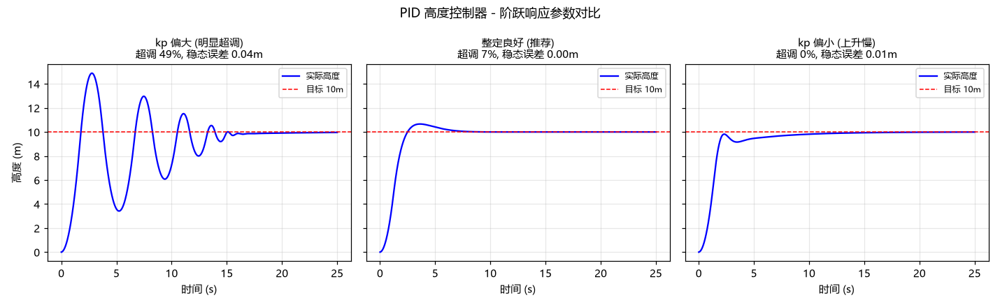

# (作业) 蒋宇鑫 2535030012 PID 高度控制器仿真 (pid_altitude_controller)

## 1. 简介

高度控制是无人机悬停与定高巡航的基础。本模块实现了一个带**抗积分饱和**的 PID 控制器与无人机垂直方向二阶动力学模型（推力节流阀 → 加速度 → 速度 → 位置），进行高度阶跃仿真，并对比三组 PID 参数的超调量、调节时间与稳态误差，展示 PID 整定的基本规律。

## 2. 运行环境

- Ubuntu 22.04 + ROS 2 Humble；测试需 pytest；绘图需 matplotlib

## 3. 目录结构

```text
src/air/pid_altitude_controller/
├── main.py              # ROS2 节点: 50Hz 发布 /drone/altitude_setpoint 与 /drone/altitude_actual
├── core.py              # PID 控制器 + 二阶动力学 + 仿真（纯 Python）
└── test/test_core.py    # 8 项单元测试
```

## 4. 运行步骤

```bash
pytest src/air/pid_altitude_controller/test/test_core.py -v
python3 src/air/pid_altitude_controller/main.py
# 另一终端: ros2 topic echo /drone/altitude_actual
```

## 5. 单元测试运行结果

```text
test/test_core.py::test_pid_proportional_only PASSED
test/test_core.py::test_pid_output_limit PASSED
test/test_core.py::test_pid_integral_accumulates PASSED
test/test_core.py::test_plant_hover PASSED
test/test_core.py::test_plant_climb PASSED
test/test_core.py::test_step_response_reaches_target PASSED
test/test_core.py::test_overshoot_recorded PASSED
test/test_core.py::test_windup_guard PASSED
8 passed
```

其中 `test_windup_guard` 专门验证抗积分饱和：目标 50m、限幅 1.0 时持续 10s，若无保护积分项会累积到 500，带保护后远小于该值。

## 6. ROS2 节点运行结果

```text
[pid_altitude_controller]: PID 高度仿真启动: kp=1.2, ki=0.6, kd=0.8, 目标 10.0m
[pid_altitude_controller]: ===== 阶跃响应指标 =====
[pid_altitude_controller]:   峰值高度:   10.98 m
[pid_altitude_controller]:   超调量:     9.8 %
[pid_altitude_controller]:   调节时间:   6.4 s
[pid_altitude_controller]:   稳态误差:   0.024 m
```

## 7. 运行效果图



（图由 `make_figures.py` 实际运行生成：三组参数对比显示 kp 偏大→超调明显、kp 偏小→上升缓慢、整定良好→快速无超调收敛。）

## 8. 设计说明

- **模型**：`a = throttle × 6.0 − 9.81`，节流阀由 PID 输出并限幅 [0,1]；
- **抗积分饱和**：输出限幅且误差与积分同号时，回退本次积分累加，防止长时间饱和后猛烈回调；
- **性能指标自动计算**：超调量、±5% 调节时间、稳态误差，便于参数对比。

## 9. 参考链接

- PID 控制: <https://en.wikipedia.org/wiki/PID_controller>
- OpenHUTB MultirotorClient 高度控制 API: <https://openhutb.github.io/doc/python_api/>

## 10. 大模型使用声明

本模块代码与文档在编写过程中使用了大模型工具（WorkBuddy）辅助生成，作者已逐行核对全部内容，理解其原理并实际运行验证，对提交内容负全部责任。
