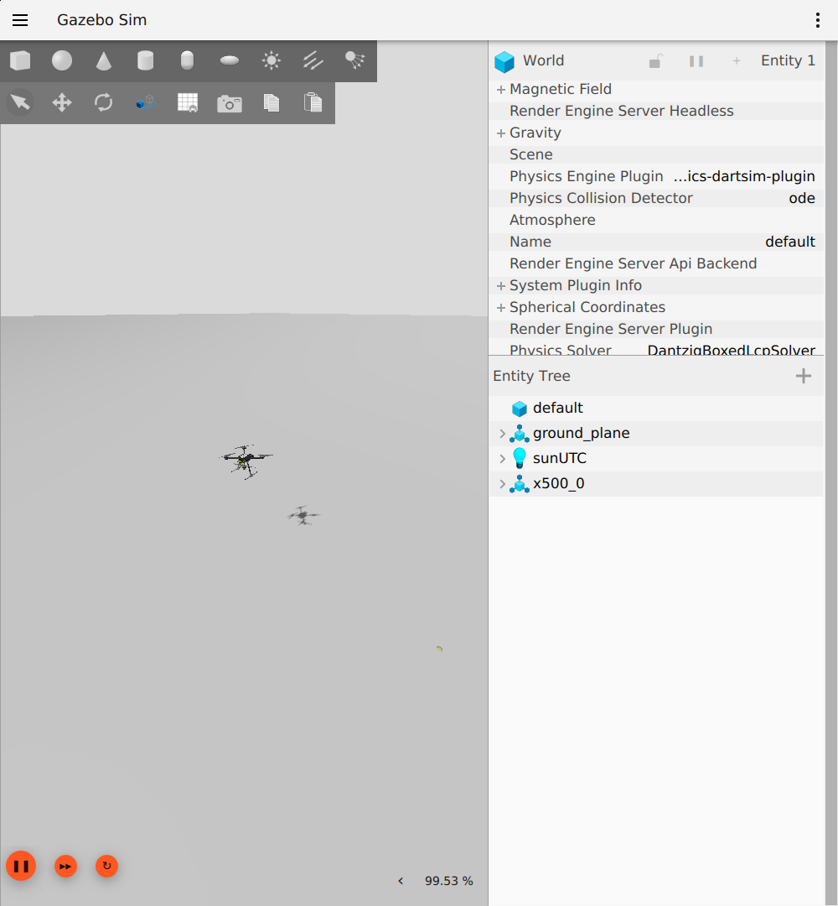
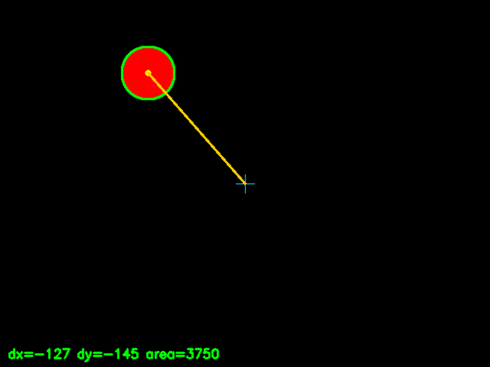

# PX4 + ROS2 + OpenCV 无人机视觉追踪（合成图像 Offboard 演示）

本文档在 **Ubuntu 22.04.5 LTS**（VMware 虚拟机，16 核 / 7 GB 内存）上，用 PX4 v1.18 + ROS 2 Humble + Gazebo Sim 8 + OpenCV 演示"图像目标检测 → Offboard 速度控制"链路：无人机起飞并在 2 m 高度悬停，按图像中的红色目标偏差调整水平位置、按目标像素面积调整前后距离。

> ⚠️ **重要说明（请先读）**
> - 本模块的 `/camera/image_raw` 来自 `image_pub` 节点**程序合成的图像**（黑底红色圆，640×480 / 10 Hz），**不是 Gazebo 相机画面**。PX4 的 `gz_x500` 机型默认没有相机，因此图像与无人机在仿真中的运动无关——本模块演示的是「OpenCV 检测 → Offboard 速度指令 → PX4 位置响应」这条控制/通信链路，**不是严格意义的视觉闭环伺服**。
> - 如需真正的视觉闭环，请使用带相机的机型（如 `gz_x500_mono_cam` / `gz_x500_depth`），用 `ros_gz_bridge` 把 Gazebo 相机话题桥接到 `/camera/image_raw`，并在 Gazebo 世界中放置红色目标物。欢迎在此模块基础上提交后续 PR。

## 1. 环境与工程总览

| 项目 | 版本 / 说明 |
| --- | --- |
| 操作系统 | Ubuntu 22.04.5 LTS（VMware 虚拟机，64 位） |
| ROS 版本 | ROS 2 Humble Hawksbill |
| PX4 固件 | PX4-Autopilot，`release/1.18` 分支 |
| 仿真环境 | Gazebo Sim（gz-harmonic 8.15.0） |
| 视觉库 | OpenCV 4.x（Python 3.10，cv2）+ numpy 1.x |
| 桥接 | Micro-XRCE-DDS-Agent（eProsima 源码构建） |
| ROS2 工作空间 | `~/ws_px4` |
| PX4 源码目录 | `~/PX4-Autopilot` |
| 磁盘要求 | ≥ 40 GB（PX4 全量子模块 + 编译约需 25 GB+） |

工程结构：

```
~/ws_px4/src/
├── px4_msgs/                    # PX4 ROS2 消息（release/1.18，必须先构建）
├── px4_ros_com/                 # PX4 官方 ROS2 示例（main）
└── px4_ros2_opencv_tracking/    # 本模块功能包
    ├── README.md
    ├── package.xml / setup.py / setup.cfg
    ├── launch/tracking_launch.py
    └── px4_ros2_opencv_tracking/
        ├── image_pub.py         # 合成图像源（/camera/image_raw）
        ├── color_tracker.py     # HSV 检测（/vision/target、/vision/debug_image）
        └── offboard_control.py  # Offboard 速度控制状态机
```

## 2. 前置准备（网络 / 磁盘 / 基础工具）

**① 磁盘空间检查**（PX4 子模块全量约 10 GB+，编译后累计 25 GB+，**磁盘必须 ≥ 40 GB**）：

```bash
df -h
```

**② 基础工具**：

```bash
sudo apt update && sudo apt install -y git build-essential cmake ninja-build curl wget unzip
```

**③ GitHub 镜像（关键：大陆网络 github.com 直连可能 Connection refused）**：

```bash
git config --global url."https://gh-proxy.com/https://github.com/".insteadOf "https://github.com/"
git config --get-regexp insteadof   # ✅ 输出 url.https://gh-proxy.com/...insteadof 一行
```

## 3. 安装 ROS 2 Humble

```bash
sudo apt install -y curl gnupg lsb-release
sudo curl -sSL https://raw.githubusercontent.com/ros/rosdistro/master/ros.key \
  -o /usr/share/keyrings/ros-archive-keyring.gpg
echo "deb [arch=$(dpkg --print-architecture) signed-by=/usr/share/keyrings/ros-archive-keyring.gpg] http://packages.ros.org/ros2/ubuntu $(. /etc/os-release && echo $UBUNTU_CODENAME) main" | sudo tee /etc/apt/sources.list.d/ros2.list > /dev/null
sudo apt update
sudo apt install -y ros-humble-desktop python3-colcon-common-extensions python3-rosdep
echo "source /opt/ros/humble/setup.bash" >> ~/.bashrc && source ~/.bashrc
```

**✅ 完成标志**：`echo $ROS_DISTRO` 输出 `humble`。

## 4. 安装 Gazebo Sim 8（gz-harmonic）

```bash
sudo apt install -y lsb-release wget gnupg
sudo wget https://packages.osrfoundation.org/gazebo.gpg \
  -O /usr/share/keyrings/pkgs-osrf-archive-keyring.gpg
echo "deb [arch=$(dpkg --print-architecture) signed-by=/usr/share/keyrings/pkgs-osrf-archive-keyring.gpg] http://packages.osrfoundation.org/gazebo-ubuntu-stable $(lsb_release -cs) main" | sudo tee /etc/apt/sources.list.d/gazebo-stable.list > /dev/null
sudo apt update && sudo apt install -y gz-harmonic
```

**✅ 完成标志**：`gz sim --versions` 输出 `8.15.0`。

## 5. Python 依赖链

```bash
sudo apt install -y libopencv-dev python3-opencv python3-numpy
/usr/bin/python3 -m pip install empy kconfiglib jsonschema jinja2 pyserial pyulog pyros-genmsg pymavlink "numpy<2"
```

**✅ 完成标志**：`python3 -c "import cv2, numpy, pymavlink; print('OK')"` 输出 `OK`（numpy 必须是 1.x）。

## 6. 编译 PX4 v1.18

```bash
cd ~ && git clone https://github.com/PX4/PX4-Autopilot.git --recursive
cd ~/PX4-Autopilot && git checkout release/1.18
# 跳过 gz 仿真用不到的 flightgear 桥接子模块
git config -f .gitmodules submodule.Tools/simulation/flightgear/flightgear_bridge.update none
git submodule update --init --recursive --depth 1
/usr/bin/python3 -m pip install -r ~/PX4-Autopilot/Tools/setup/requirements.txt
make px4_sitl gz_x500 -j4
```

**✅ 完成标志**：编译结束自动拉起 Gazebo 窗口；PX4 终端出现 `pxh>`；日志出现 `INFO [uxrce_dds_client] init UDP agent IP:127.0.0.1, port:8888`。

> 编译报 `No module named 'xxx'` → 补装模块后重跑 `make`（增量继续）。

## 7. ROS 2 工作区：先构建消息与桥接包

```bash
mkdir -p ~/ws_px4/src && cd ~/ws_px4/src
git clone --depth 1 -b release/1.18 https://github.com/PX4/px4_msgs.git
git clone --depth 1 https://github.com/PX4/px4_ros_com.git
cd ~/ws_px4
source /opt/ros/humble/setup.bash
colcon build --packages-select px4_msgs px4_ros_com
```

> **必须先构建 `px4_msgs`**：`offboard_control` 直接 `from px4_msgs.msg import …`，只 clone 不构建会在 `ros2 launch` 时报 `ModuleNotFoundError: px4_msgs`。

**✅ 完成标志**：`ls ~/ws_px4/src` 看到 `px4_msgs px4_ros_com`，且 `source install/setup.bash` 后 `ros2 interface list | grep px4_msgs` 有输出。

## 8. px4_ros2_opencv_tracking 功能包

### 8.1 拷贝与构建

```bash
# 克隆本仓库（已克隆可跳过）
git clone https://github.com/OpenHUTB/ros2.git ~/ros2
cp -r ~/ros2/src/air/px4_ros2_opencv_tracking ~/ws_px4/src/
cd ~/ws_px4
source /opt/ros/humble/setup.bash
source install/setup.bash
colcon build --packages-select px4_ros2_opencv_tracking
source install/setup.bash
```

**✅ 完成标志（验收一）**：

```bash
ros2 pkg executables px4_ros2_opencv_tracking
# px4_ros2_opencv_tracking color_tracker
# px4_ros2_opencv_tracking image_pub
# px4_ros2_opencv_tracking offboard_control
```

> 若看不到包：确认 `setup.cfg` 为标准 ament_python 布局（`[install] install_scripts=$base/lib/<包名>`），
> 并确认三个脚本位于 `px4_ros2_opencv_tracking/` Python 包目录内（与 `setup.py` 的 entry_points 对应）。

### 8.2 节点与话题

| 可执行文件 | 作用 | 订阅 / 发布 |
| --- | --- | --- |
| `image_pub` | 合成 640×480 黑底红色移动圆（10 Hz） | 发布 `/camera/image_raw` |
| `color_tracker` | HSV 红色双区间 + 轮廓质心 | `/camera/image_raw` → `/vision/target`（`point.x/y` 像素偏移、`point.z` 面积）、`/vision/debug_image`（检测框/质心/数值可视化） |
| `offboard_control` | 图像偏差 → PX4 Offboard 速度指令（状态机） | `/vision/target`、`/fmu/out/*` → `/fmu/in/offboard_control_mode`、`/fmu/in/trajectory_setpoint`、`/fmu/in/vehicle_command` |

`launch/tracking_launch.py` 一次拉起三个节点，可用参数覆盖（见下表）。

### 8.3 参数

| 参数 | 默认 | 说明 |
| --- | --- | --- |
| `image_pub.radius_px` | 35 | 合成红圆半径（`contourArea` 实测约 3750 px²） |
| `image_pub.rate_hz` | 10.0 | 图像发布频率 |
| `color_tracker.min_area` | 300.0 | 有效目标最小面积 px² |
| `offboard_control.takeoff_alt` | -2.0 | 悬停高度（NED，向下为正） |
| `offboard_control.desired_area` | 3750.0 | 期望目标面积（距离保持目标） |
| `offboard_control.max_v` | 1.0 | 水平速度限幅 m/s |
| `offboard_control.k_y` / `k_d` / `k_alt` | 0.12 / 0.02 / 0.8 | 居中 / 距离 / 高度比例增益 |
| `offboard_control.target_timeout` | 3.0 | 目标丢失悬停超时 s |

> `desired_area` 标定方法：目标静止在期望距离时读一次 `/vision/target` 的 `point.z`，把该值填入 `desired_area`；若使用真实相机，还需按相机内参和目标真实尺寸换算。

## 9. 构建 MicroXRCEAgent（PX4 ↔ ROS 2 桥接器）

```bash
cd ~ && git clone https://github.com/eProsima/Micro-XRCE-DDS-Agent.git
cd Micro-XRCE-DDS-Agent && mkdir build && cd build
cmake .. && make -j4
sudo make install && sudo ldconfig
```

**✅ 完成标志**：`which MicroXRCEAgent` 输出 `/usr/local/bin/MicroXRCEAgent`。

## 10. 启动仿真与视觉追踪（4 个终端）

> 用 `make` 方式启动 PX4（自动管理 gz + px4）。**不要**再手动启动 gz。
> VMware 虚拟机内 Gazebo 3D 画面若空白（无 GPU 加速），可用 `Xvfb + LIBGL_ALWAYS_SOFTWARE=1` 软件渲染，或直接以话题数据验收（不影响仿真与验收）。

```bash
# 终端 1：PX4 SITL + Gazebo
cd ~/PX4-Autopilot
PX4_SIM_MODEL=gz_x500 make px4_sitl gz_x500
# ✅ 标志：Gazebo 窗口出现 x500；终端出现 pxh>；/fmu 话题就绪

# 终端 2：uXRCE-DDS 桥接
MicroXRCEAgent udp4 -p 8888
# ✅ 标志：running... port: 8888

# 终端 3：GCS 心跳（PX4 1.18 的 ARM 前置检查要求 GCS 在线）
cat > /tmp/gcs.py <<'PY'
import time
from pymavlink import mavutil
m = mavutil.mavlink_connection('udpout:127.0.0.1:18570', source_system=255, source_component=190)
print('GCS heartbeat -> 18570')
while True:
    m.mav.heartbeat_send(mavutil.mavlink.MAV_TYPE_GCS, mavutil.mavlink.MAV_AUTOPILOT_INVALID, 0, 0, mavutil.mavlink.MAV_STATE_ACTIVE)
    time.sleep(1)
PY
python3 /tmp/gcs.py        # ✅ 打印 GCS heartbeat -> 18570

# 终端 4：启动追踪
source /opt/ros/humble/setup.bash && source ~/ws_px4/install/setup.bash
ros2 launch px4_ros2_opencv_tracking tracking_launch.py
# ✅ 标志（offboard_control 日志）：
#   state -> SET_OFFBOARD (首帧有效目标已收到)
#   state -> ARM (nav_state=14)
#   state -> TAKEOFF (arming_state=2)
#   state -> TRACK (高度已保持 -2.0x m)
```

`offboard_control` 的状态机：`WAIT_TARGET → SET_OFFBOARD → ARM → TAKEOFF → TRACK`，每步等待 PX4 状态回读，失败自动重试，超时降级 LAND；目标丢失超过 `target_timeout` 后悬停等待；Ctrl-C 退出时主动发 LAND。

## 11. 最终验收

新开终端：

```bash
source /opt/ros/humble/setup.bash && source ~/ws_px4/install/setup.bash

ros2 topic echo /fmu/out/vehicle_status_v4 --once | grep -E "arming_state|^nav_state:"
ros2 topic echo /fmu/out/vehicle_local_position_v1 --once | grep -E "^\s*(x|y|z):"
ros2 topic echo /vision/target --once
ros2 topic hz /vision/target
```

**✅ 通过标准（全部满足即复现成功）**：

| 指标 | 期望值 | 含义 |
| --- | --- | --- |
| `arming_state` | **2** | 2 = ARMED（注意 1 = DISARMED，不是"已解锁"） |
| `nav_state` | **14** | Offboard 机外控制模式 |
| `z`（`vehicle_local_position_v1`） | **-2.0 ± 0.3 m**（稳定悬停） | 离地约 2 m 并保持 |
| `x` / `y` | 有界（\|x\|、\|y\| ≤ 5 m 量级） | 不持续前飞（旧版会因面积误差恒饱和一路前飞） |
| `/vision/target` | 持续输出 `point.x/y/z`，约 10 Hz | `z` = 红色目标像素面积（约 3750） |
| `/vision/debug_image` | 有图像（约 10 Hz） | 检测框/质心/数值可视化，可用 `rqt_image_view` 查看 |

```bash
# 查看检测画面
ros2 run rqt_image_view rqt_image_view      # 选择 /vision/debug_image
```

### 11.1 运行效果

**Gazebo 中的 x500（软件渲染，实际仿真画面）**



**`/vision/debug_image`：HSV 红色检测结果（绿框=目标，黄点=质心，十字=画面中心）**



**屏幕录制的完整演示（起飞 → 2 m 悬停 → 视觉居中/距离保持）**

<video controls preload="metadata" width="100%" poster="../../img/air/px4_ros2_opencv_tracking/gazebo_x500.png">
  <source src="../../img/air/px4_ros2_opencv_tracking/px4_tracking_demo.mp4" type="video/mp4">
  你的浏览器不支持 video 标签，请<a href="../../img/air/px4_ros2_opencv_tracking/px4_tracking_demo.mp4">下载视频</a>。
</video>

> 若页面内视频无法播放，可[点击下载](../../img/air/px4_ros2_opencv_tracking/px4_tracking_demo.mp4)。录屏为虚拟机内屏幕录制（H.264），非手机翻拍。

## 12. 常见问题（真实踩坑记录）

**Q1：github.com 直连 Connection refused / clone 卡死？** 配置镜像全局重写（§2 ③），大仓库用 `--depth 1` 浅克隆。

**Q2：磁盘满 No space left on device？** PX4 全量子模块 + 编译需要 25 GB+；VMware 扩容后 `sudo growpart /dev/sda 3 && sudo resizefs /dev/sda3`。

**Q3：编译报 `No module named 'empy/jsonschema/jinja2'`？** 执行 §6 的 pip 安装后重跑 `make`。

**Q4：`ros2 launch` 报 `ModuleNotFoundError: px4_ros2_opencv_tracking.xxx`？** 三个脚本没有放进 `px4_ros2_opencv_tracking/` 包目录，或 `setup.cfg` 安装布局不是标准 ament_python 模板；按 §8 检查后重新 `colcon build --packages-select px4_ros2_opencv_tracking`。

**Q5：ARM 被拒，日志 `No connection to the GCS`？** PX4 1.18 的 HealthAndArmingChecks 把 GCS 连接作为解锁前置，运行 §10 终端 3 的心跳，等 `failsafe_flags.gcs_connection_lost=false` 后再启动 launch。

**Q6：Gazebo 窗口 3D 画面空白？** VMware 无 GPU 加速导致；用 `LIBGL_ALWAYS_SOFTWARE=1` 或 `Xvfb :99` 软件渲染可恢复（本文档截图即软件渲染）。数据验收不受影响。

**Q7：`import cv2` 报 `_ARRAY_API not found`？** NumPy 2.x 与系统 OpenCV 不兼容，`pip install "numpy<2"` 降级。

**Q8：`px4_ros_com` 没有 `release/1.18` 分支？** 用 `main` 分支即可，不影响编译与桥接。

## 附录 A：本轮修复的 Bug 清单

| # | 问题 | 修复 |
| --- | --- | --- |
| 1 | `setup.cfg` 安装布局错误（`[install] prefix = install`），节点装不进 `lib/<pkg>`，`ros2 launch` 报 libexec 不存在 | 改为标准 ament_python：`script_dir=$base/lib/<pkg>`、`install_scripts=$base/lib/<pkg>` |
| 2 | 原 launch `executable` 带 `.py` 或旧节点名 | 统一 `image_pub` / `color_tracker` / `offboard_control` |
| 3 | `PointStamped` 坐标取错（无顶层 x/y/z） | 统一 `p.point.x/y/z` |
| 4 | `DO_SET_MODE(176)` 的 `param1=0` 在 1.18 无效 | `param1=1.0, param2=6.0` |
| 5 | 只发一次 ARM、无状态校验/重试，切模式窗口过短 | 重写为状态机：等回读、失败重试、超时 LAND、退出发 LAND |
| 6 | `position` + `velocity` 混用导致高度不保持 | 改为纯速度控制（`position=False`，`position` 全 NaN），高度也用速度环 |
| 7 | `DESIRED_AREA=15000` 与实际 3750 不匹配，`vx` 恒饱和一路前飞 | 默认 `desired_area=3750`（可参数化）+ 面积死区，实测 `vx≈0` |
| 8 | 缺少 `px4_msgs` 构建步骤、`launch` 依赖、README | 文档补全构建顺序；`package.xml` 补 `launch`/`launch_ros`；新增模块 README |
| 9 | 无调试图，验收只能看数字 | `color_tracker` 新增 `/vision/debug_image`（检测框/质心/数值） |
| 10 | 演示视频为手机翻拍、文档中 mp4 用图片语法导致破图 | 重录屏幕演示（H.264）并改用 `<video>` 标签 + 正确相对路径 |

## 附录 B：命令速查

```bash
# 常用验证
source /opt/ros/humble/setup.bash && source ~/ws_px4/install/setup.bash
ros2 topic list | grep -c "^/fmu"
ros2 topic echo /vision/target --once
ros2 topic echo /fmu/out/vehicle_status_v4 --once | grep -E "arming_state|^nav_state:"
ros2 topic echo /fmu/out/vehicle_local_position_v1 --once | grep -E "^\s*(x|y|z):"
ros2 run rqt_image_view rqt_image_view     # /vision/debug_image

# 重启整套
pkill -f "bin/px4" ; pkill -f MicroXRCEAgent ; pkill -f "gz sim" ; pkill -f gcs.py ; pkill -f px4_ros2_opencv_tracking
```

---

> 本文档基于 Ubuntu 22.04.5 LTS + VMware 虚拟机的实际复现整理。环境版本：ROS 2 Humble、PX4 `release/1.18`、gz-harmonic 8.15.0、Micro-XRCE-DDS-Agent、OpenCV 4.x。图像输入为合成图像（见文首说明），真实相机闭环见文首"如需真正的视觉闭环"。
