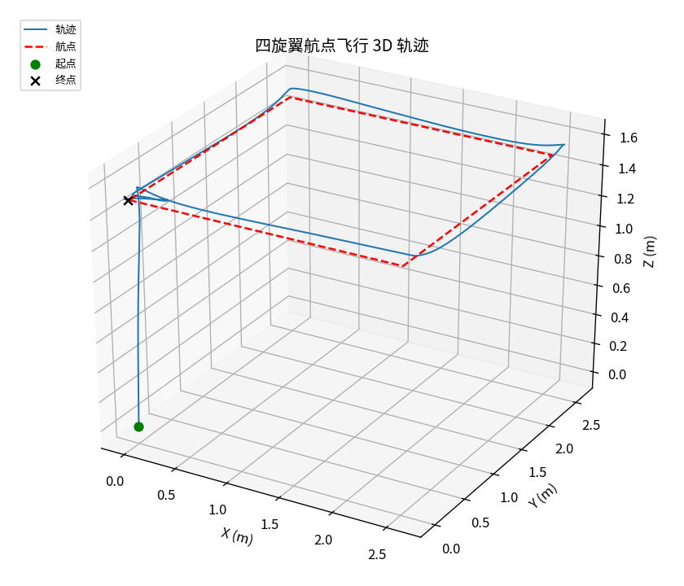
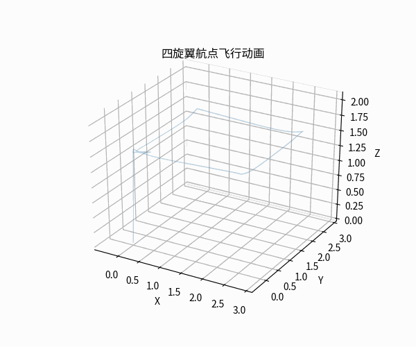
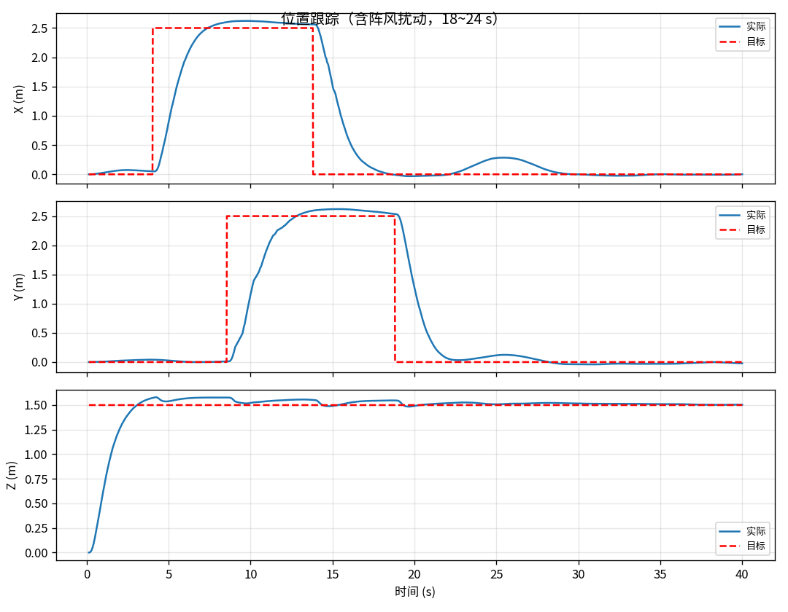
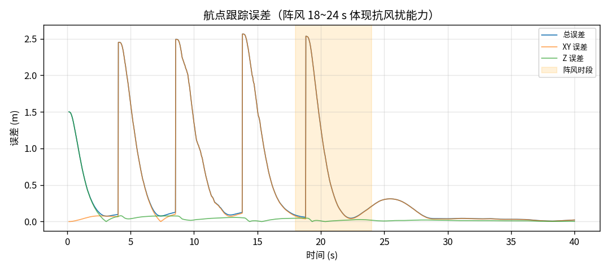
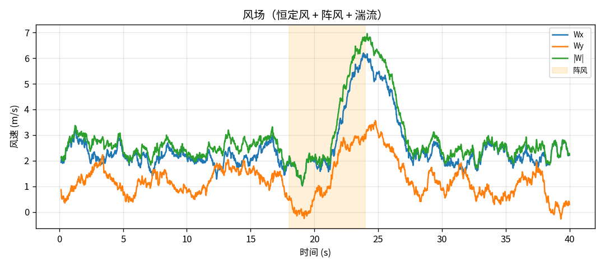
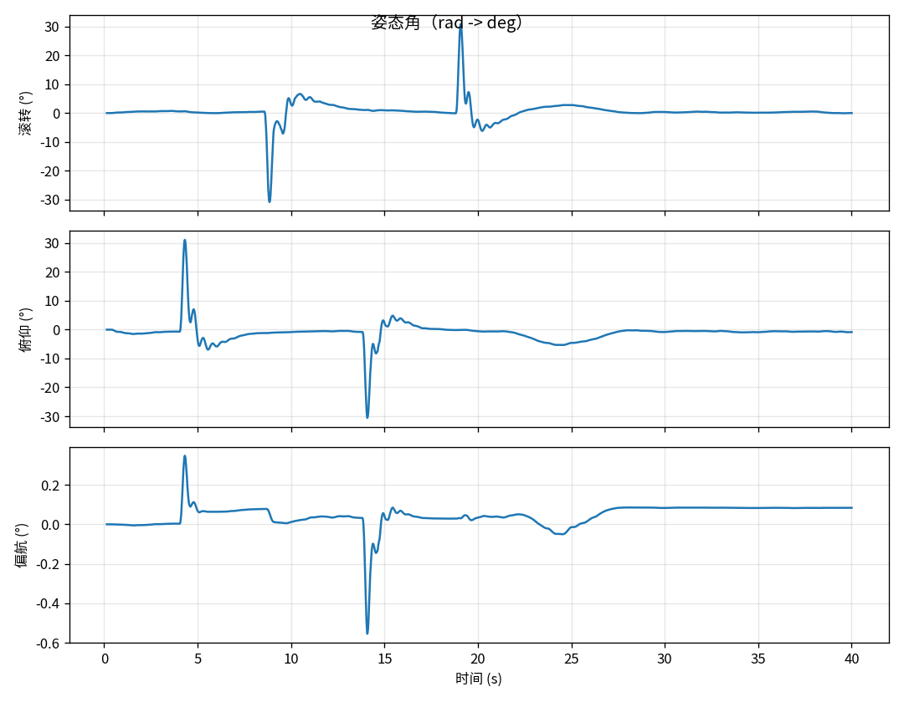

# 基于串级 PID 的四旋翼航点定点悬停与抗风扰仿真

源码：`src/air/quad_cascade_pid_hover_wind/`

## 1. 项目目标

实现一个**自包含的四旋翼 6 自由度刚体动力学仿真器**与**串级 PID 控制器**，完成：

1. 多航点序列飞行；
2. 到达航点后的定点悬停；
3. 在恒定风 + 阵风 + 湍流扰动下保持位置的抗风扰能力。

控制回路仅使用 `/odom` 反馈（位置、速度、姿态、角速度），`/ground_truth` 仅用于离线评估。

## 2. 系统架构

```
+-------------+     /cmd_motors      +------------------+
| 串级 PID 控制 |  (4 个旋翼转速) ---> |  6-DOF 动力学仿真  |
|   节点        |                     |  (风场 + 气动阻力) |
+-------------+ <----- /odom --------+------------------+
        |                                |
        | /target                        | /ground_truth
        v                                v
   航点管理器                      日志节点 (CSV)
```

### 2.1 控制串级

| 层级 | 输入 | 输出 |
| --- | --- | --- |
| 位置环 PID（世界系） | 位置误差 + 速度反馈 | 期望加速度（xy 含小积分项消除风扰稳态偏差） |
| 期望姿态解算 | 期望加速度 + 重力 | 期望总推力、期望滚转/俯仰（atan2 精确解算） |
| 姿态环 PID | 欧拉角误差 | 期望角速率 |
| 角速率环 PID | 角速率误差 | 期望三轴力矩 |
| 混控 | 推力 + 力矩 | 4 个旋翼转速（限幅后按“保持总推力、等比缩放力矩”重分配） |

### 2.2 动力学与风扰

- X 型四旋翼，旋翼推力 $T_i = k_f \omega_i^2$，反扭矩 $Q_i = k_\tau \omega_i^2 \cdot \text{spin}_i$；
- 电机一阶响应 $\dot{\omega} = (\omega_{cmd} - \omega)/\tau_m$；
- 四元数积分更新姿态，含陀螺耦合项 $\omega \times (I\omega)$；
- 风场 = 恒定风 + 半正弦阵风 + 一阶低通白噪声湍流；
- 气动阻力 $F_d = -\frac{1}{2}\rho C_d A |v_r| v_r$，$v_r$ 为机体相对空气的速度。

## 3. 目录结构

```
src/air/quad_cascade_pid_hover_wind/
├── config/params.yaml              # 全部参数（机体、风场、PID、航点）
├── launch/main.launch.py
├── quad_cascade_pid_hover_wind/
│   ├── geometry.py                 # 四元数/旋转矩阵/欧拉角
│   ├── dynamics.py                 # 6-DOF 动力学 + 风场
│   ├── controller.py               # 串级 PID + 航点管理 + 混控
│   ├── config_loader.py            # 参数加载
│   ├── sim_node.py                 # 仿真节点
│   ├── controller_node.py          # 控制节点
│   └── logger_node.py              # 日志节点
├── tools/analyze.py                # 指标与图表生成
├── test/                           # pytest
├── main.py                         # 一键实验
└── results/                        # 本机运行输出（.gitignore，不入库）
```

控制器以固定步长（1/控制频率）计算 PID 积分/微分，避免定时器调度抖动污染 dt。

## 4. 构建与运行

```bash
colcon build --packages-select quad_cascade_pid_hover_wind --symlink-install
source install/setup.bash

# 一键实验（构建 + 运行 40s + 生成图表）
cd src/air/quad_cascade_pid_hover_wind
python3 main.py --duration 40.0

# 或单独启动
ros2 launch quad_cascade_pid_hover_wind main.launch.py duration:=40.0
```

## 5. 话题

| 话题 | 类型 | 方向 | 说明 |
| --- | --- | --- | --- |
| `/odom` | `nav_msgs/Odometry` | sim→ctrl | 状态反馈 |
| `/ground_truth` | `nav_msgs/Odometry` | sim→log | 真值（评估用） |
| `/cmd_motors` | `std_msgs/Float32MultiArray` | ctrl→sim | 4 旋翼转速 |
| `/wind` | `geometry_msgs/Vector3Stamped` | sim→log | 世界系风速 |
| `/target` | `geometry_msgs/Point` | ctrl→log | 当前航点 |
| `/goal_pose` | `geometry_msgs/PoseStamped` | 外部→ctrl | 手动目标 |

## 6. 真实运行结果

`results/run_01`（本机生成、不入库），40 s 飞行，5 个航点（正方形 + 回到起点悬停），18~24 s 施加阵风。

### 6.1 关键指标

| 指标 | 数值 |
| --- | --- |
| 轨迹长度 | 12.59 m |
| 稳定悬停最大误差 | 0.30 m |
| 末段悬停 RMS 误差 | 0.021 m（XY 0.019 / Z 0.006 m） |
| 阵风段悬停 RMS 误差 | 0.123 m |
| 阵风前航点段 RMS 误差 | 0.177 m（含到位暂态） |
| 最大风速 | 6.96 m/s |
| 最大滚转/俯仰 | 31.0° / 31.1° |
| 终点误差 | 0.022 m |

xy 方向引入较小积分项（ki=0.3，带 i_max 抗饱和）后，末段定点悬停 RMS 误差降至 2.1 cm，阵风段悬停 RMS 误差 12.3 cm，常值风引起的稳态偏差被消除，串级 PID 对风扰有良好的抑制与恢复能力。

### 6.2 3D 轨迹



### 6.3 航点飞行动画



### 6.4 位置跟踪



### 6.5 跟踪误差（阵风时段高亮）



### 6.6 风场



### 6.7 姿态角



## 7. 测试

```bash
cd src/air/quad_cascade_pid_hover_wind
PYTHONPATH=. python3 -m pytest test/ -q
```

15 项测试通过，覆盖四元数/旋转一致性、悬停推力平衡、混控推力重分配、期望姿态精确解算、风场阵风包络、PID、航点切换及闭环收敛。

## 8. 复现

- 机体参数、PID 增益、航点、风场均在 `config/params.yaml`，修改后重新运行即可；
- 关风：将 `wind.mean`、`wind.gust_magnitude`、`wind.turbulence_sigma` 置 0；
- 单航点悬停：`waypoints.points` 只留一个点。

## 9. 大模型使用声明

使用 AI 编程助手辅助生成代码与文档；作者已逐行核对并在本机实际运行验证，实验数据与图表均由真实仿真产生，未人工篡改。
