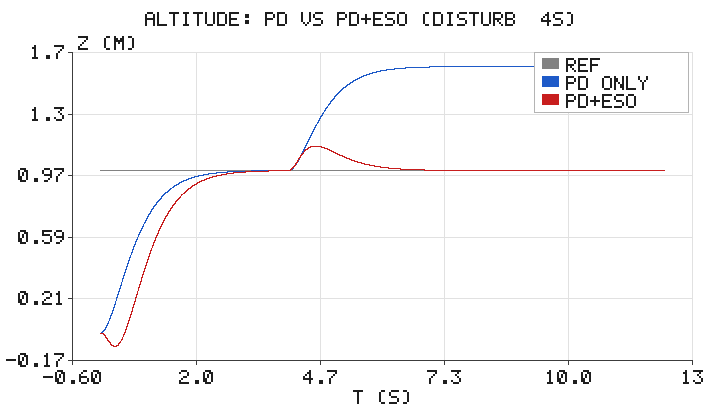
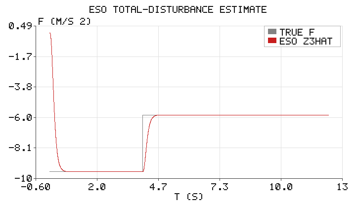

# 四旋翼高度 PD + 扩张状态观测器（ESO/ADRC）抗扰控制

## 1. 背景与目标

四旋翼在悬停时，常受阵风、地面效应、负载变化等**未知扰动**影响。若只用 PD
控制（即使带重力前馈），在持续扰动下会残留稳态高度偏差，难以精确定高。
**自抗扰控制（Active Disturbance Rejection Control, ADRC）**的核心思想是：
把所有"未知的部分"（外部扰动 + 未建模动态）合并成一个**总扰动**，用一个
**扩张状态观测器（Extended State Observer, ESO）**在线估计它，再在控制律中
把它前馈抵消，从而把复杂系统"还原"为一个纯净的积分链来处理。

本模块在四旋翼高度通道上，对比 **纯 PD** 与 **PD + ESO** 在阶跃扰动下的表现，
直观展示 ADRC 的"扰动估计 + 前馈补偿"如何实现零稳态误差。全部仅用 Python 标准库。

## 2. 运行环境

```bash
cd src/air/quad_eso_hover
python3 scripts/main.py --outdir scripts
```

输出 `eso_altitude.png`、`eso_disturbance.png` 并打印误差与扰动估计指标。

## 3. 代码文件清单

```
src/air/quad_eso_hover/
├── scripts/
│   ├── eso.py            # 高度通道被控对象、PD、ESO、ADRC 仿真
│   ├── simulate.py       # 场景编排与配图输出
│   ├── simple_plot.py    # 仅用 zlib 的极简折线图输出
│   └── main.py           # 命令行入口
├── tests/
│   └── test_eso.py       # 单元断言（PD 偏差 / ESO 抗扰 / 扰动估计 / 重力估计）
├── package.xml
├── CMakeLists.txt
├── launch/main.launch
├── README.md
└── requirements.txt
```

## 4. 处理原理

### 4.1 高度通道模型

$$
m\,\ddot{z} = u - mg + d(t)
$$

$z$ 高度、$u$ 总推力、$d(t)$ 未知扰动。记控制增益 $b_0 = 1/m$，把"除输入外的一切"
（重力 + 扰动）合并为**总扰动** $f$：

$$
\ddot{z} = f + b_0 u, \qquad f = -g + \frac{d}{m}
$$

### 4.2 线性扩张状态观测器（LESO）

把 $f$ 视为一个"扩张状态"，用三阶观测器在线估计 $z,\ \dot z,\ f$：

$$
\begin{aligned}
e &= \hat z_1 - y \\
\dot{\hat z}_1 &= \hat z_2 - \beta_1 e \\
\dot{\hat z}_2 &= \hat z_3 + b_0 u - \beta_2 e \\
\dot{\hat z}_3 &= -\beta_3 e
\end{aligned}
$$

取 $\beta_1=3\omega_0,\ \beta_2=3\omega_0^2,\ \beta_3=\omega_0^3$，使观测器误差极点
配置在 $-\omega_0$（三重极点），$\omega_0$ 为观测器带宽。带宽越大估计越快，但对噪声越敏感。

### 4.3 ADRC 控制律

用估计到的总扰动前馈抵消，再对"纯净积分链"做 PD：

$$
u_0 = k_p(z_{\text{ref}}-\hat z_1) + k_d(0-\hat z_2), \qquad
u = \frac{u_0 - \hat z_3}{b_0}
$$

代入对象得 $\ddot z = u_0 + (f-\hat z_3)$：只要 ESO 估得准（$\hat z_3\approx f$），
扰动被抵消，闭环表现为二阶线性系统 $k_p,k_d$ 的期望响应，**对常值扰动零稳态误差**。

### 4.4 对照基线：PD + 重力前馈

$$
u = m\left(g + k_p(z_{\text{ref}}-z) + k_d(0-\dot z)\right)
$$

在常值扰动 $d$ 下，令 $\ddot z=0$ 得稳态误差

$$
e_{ss} = -\frac{d}{m k_p}
$$

无法消除——这正是引入 ESO 的动机。

## 5. 仿真结果

参数：$m=1\,\mathrm{kg},\ g=9.81$，控制器 $k_p=\omega_c^2,\ k_d=2\omega_c$（$\omega_c=2.5$），
观测器带宽 $\omega_0=15$。目标高度 $z_{\text{ref}}=1\,\mathrm{m}$；
$t=4\,\mathrm{s}$ 起施加 $d=4\,\mathrm{N}$ 的持续上推扰动。



- **PD-only（蓝）**：扰动后高度被顶到约 $1.64\,\mathrm{m}$，稳态偏差
  $e_{ss}=d/(mk_p)=0.64\,\mathrm{m}$，与理论一致；
- **PD+ESO（红）**：短暂过渡后回到 $1.0\,\mathrm{m}$，稳态误差近似为 0。



ESO 估计的总扰动 $\hat z_3$（红）准确跟踪真实值 $f$（灰）：扰动前 $f=-g=-9.81$，
扰动后跳到 $f=-g+d/m=-5.81$，估计值同步收敛到 $-5.81$，稳态平均估计误差约 $0$。
正是这份准确的扰动估计支撑了上图的零稳态误差。

## 6. 小结

- ADRC 用 ESO 把"重力 + 未知扰动"统一为总扰动并在线估计，控制律据此前馈补偿；
- 观测器带宽 $\omega_0$ 决定估计速度与噪声敏感性，一般取控制器带宽的数倍；
- 相比纯 PD，PD+ESO 在常值扰动下**消除了稳态误差**，鲁棒性更强；
- 全程仅用 Python 标准库（欧拉离散 + RK4 积分）即可复现。

## 参考

- J. Han, *From PID to Active Disturbance Rejection Control*, IEEE TIE, 2009
- Z. Gao, *Scaling and Bandwidth-Parameterization Based Controller Tuning*, ACC, 2003
- 韩京清, 《自抗扰控制技术》, 2008

> 说明：本模块仅依赖 Python 标准库，开箱即跑；文档与代码在编写过程中使用 AI 辅助，
> 但均经实跑验证（单元测试与 `python3 main.py` 生成上图），作者对内容正确性负责。
