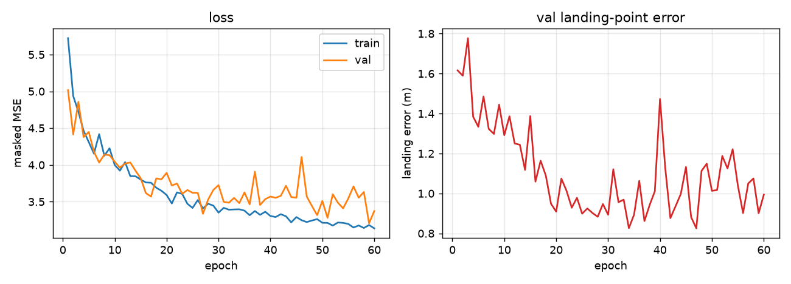
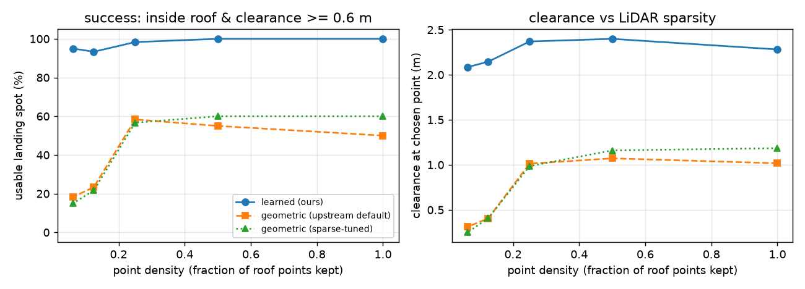
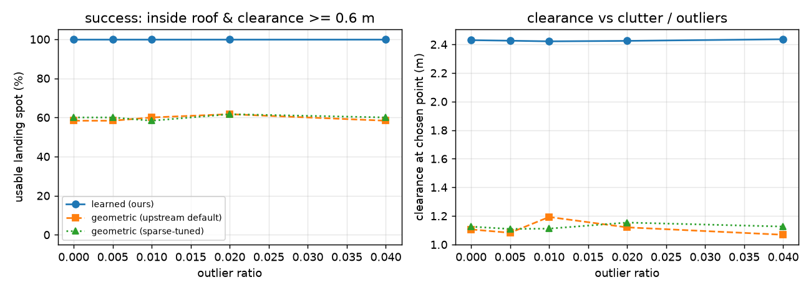
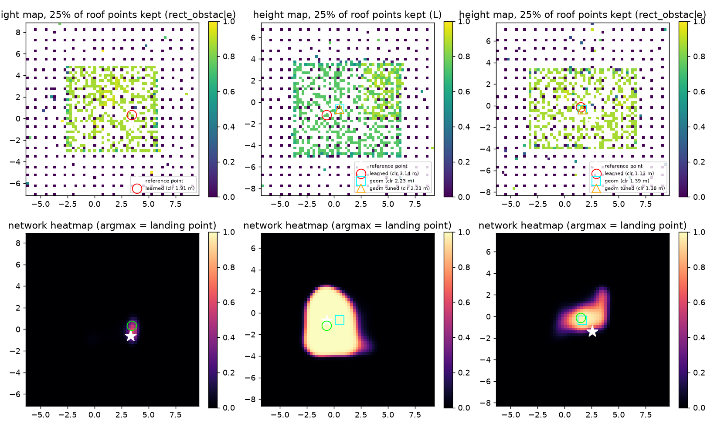
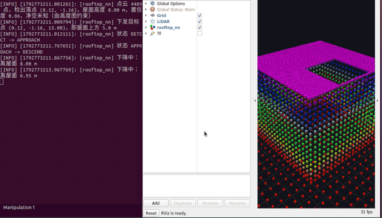
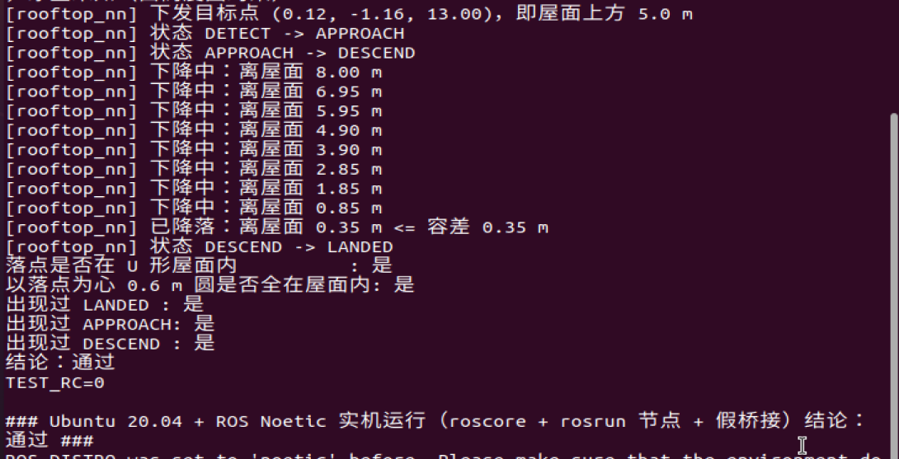
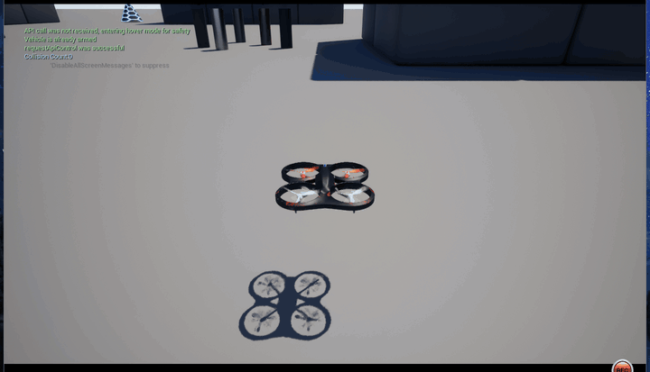

# 无人机屋顶降落（学习型落点选择）

本模块把**屋顶落点选择**做成一个学习问题：机载 LiDAR 点云先栅格化成「高度图」，
再用一个小卷积网络在图上回归「最安全的落点」，最后复用桥接层的目标点 / 速度通道
完成飞抵与垂直降落。

和已有的 [无人机屋顶降落](./rooftop_landing.md)（RANSAC 平面 + 凸包 + polylabel 最大内切圆）
是**同一个选题的两条技术路线**，本页重点回答一个问题：

> 在凹形屋顶、稀疏点云、杂波这些真实退化条件下，几何法与学习法谁更稳？

## 1. 为什么要换成学习的方式

几何法的落点来自「屋顶点云的凸包 → 最大内切圆圆心」。这条链在两处会失效：

* **凹形屋顶**：U 形、L 形、带天井的楼，凸包会把缺口**填平**，内切圆圆心会落到缺口上方（空中）。
* **稀疏点云**：点云一稀，连通域会被拆成几块，凸包随之变形，落点漂移甚至跑到屋面外。

学习法不显式求凸包，而是直接从「哪里有平屋顶、离边界多远、有没有障碍」的栅格证据里学落点，
因此对这两类退化更鲁棒。

## 2. 方法

```
/lidar/points ──► ROI 裁剪 ──► 高度图(64x64x3) ──► CNN ──► 热力图 ──► argmax + 亚格精化
                    │                                                       │
                    └─ 通道: [归一化高度, 有效掩码, 粗糙度]                    ▼
                                                                  落点 (x, y) + 屋面高度 z
                                                                           │
                                              /rooftop_nn/landing_point ◄──┤
                                              /uav/goal  (屋面上方 5 m) ◄───┤
                                              /uav/cmd_vel (垂直下降)   ◄───┘
```

* **高度图**：16 m × 16 m 的 ROI 栅格化成 64 × 64，三通道
  * 归一化高度：每格最高点相对「参考面」（点云 10% 分位数带的均值）的高度，
    尺度用 98% 分位数的 1.15 倍现算，因此对不同屋顶高度尺度无关；
  * 有效掩码：该格有没有点；
  * 粗糙度：每格 (max z − min z)，用于区分「平屋面」与「立面（墙）」——
    墙脚那一列的高度和屋面一样高，只有粗糙度能区分。
* **网络**：三级下采样 + 三级上采样的小 CNN（约 5 万参数，权重的 npz 约 200 KB）。
  感受野要覆盖整个 16 m ROI，网络才能比较「屋顶中心」与「屋顶边缘」的净空；
  早期版本只用两级下采样（感受野不到 5 m），落点误差在 4~6 m 量级。
* **落点提取**：热力图 argmax + 3×3 加权质心做亚格精化，再叠两条**物理硬约束**：
  `min_height_m`（不许落到地面）与 `rough_max`（不许贴着墙下落）。约束按
  「高度+平坦 → 高度 → 掩码」依次退让，保证任何情况下都有解。
* **部署零依赖**：权重导出成 `models/landing_cnn.npz`，numpy 前向在
  `scripts/landing_cnn.py` 里逐层复刻，客户机**不需要装 torch**（只需 numpy），
  与 `rooftop_landing` 的「无重型依赖」原则一致。
  训练结束后脚本会自动做 numpy / torch 的逐元素对齐检查，argmax 一致率 100%。

## 3. 训练数据与真值

真实仿真器里没有「完美落点」的标注，因此按几何定义造数据（`tools/scene_dataset.py`）：

* **场景**：矩形 / L 形 / U 形 / 带天井 / 双楼相邻 / 屋面有空调外机，共 6 类；
* **点云退化**：屋顶保留比例 5%~100%、离群点 0~3%、测距噪声 0.5~5 cm、
  另含地面、立面回波（贴近真实 LiDAR）；
* **真值**：理想几何上的「最大净空连通域中心」（等价于 polylabel 想逼近的最大内切圆圆心）。



## 4. 对比实验：学习法 vs 几何法

同一批场景、**同一份 ROI 内点云**，比较三条路线：

* `learned`：本模块；
* `geometric (default)`：`rooftop_landing` 的默认参数（面向稠密点云）；
* `geometric (sparse-tuned)`：按上游 README 建议放宽参数（`cluster_min_points=1` 等），
  避免「拿差参数踩对手」。

主指标是**落点处的净空**（该点到屋面边界的距离，来自理想几何，与选点无关）以及
「可用落点率」= 落在屋面内 **且** 净空 ≥ 0.6 m（与上游 `select_landing_target` 的
`min_radius` 安全常数一致）。不直接用「与某个真值点的距离」：细长屋顶的
「离边界最远的点」本身就是一整条中轴，任何中轴上的点同样安全。

### 4.1 点云稀疏度

| 屋顶保留比例 | 学习法 可用落点率 / 平均净空 | 几何法(默认) | 几何法(调参) |
|---|---|---|---|
| 100% | **100% / 2.28 m** | 50% / 1.02 m | 60% / 1.18 m |
| 50%  | **100% / 2.40 m** | 55% / 1.07 m | 60% / 1.16 m |
| 25%  | **98% / 2.37 m** | 58% / 1.01 m | 57% / 0.99 m |
| 12.5%| **93% / 2.15 m** | 23% / 0.41 m | 22% / 0.41 m |
| 6.25%| **95% / 2.09 m** | 18% / 0.31 m | 15% / 0.25 m |



### 4.2 杂波 / 离群点

离群点比例 0% → 4%，学习法可用落点率始终 100%、平均净空 2.42~2.44 m；
几何法 58%~62%、净空 1.07~1.19 m。



### 4.3 分形状（点云保留 35%，离群点 1%）

| 屋顶形状 | 学习法 | 几何法(默认) | 说明 |
|---|---|---|---|
| 矩形 `rect` | **100%** / 3.14 m | 100% / 3.29 m | 规则屋顶上两者都很好（不夸大） |
| L 形 `L` | **100%** / 2.49 m | 60% / 1.11 m | 凸包把缺口填平 |
| U 形 `U` | **100%** / 2.66 m | 67% / 0.79 m | 同上 |
| 带天井 `courtyard` | **100%** / 1.97 m | **0%** / 0.00 m | 凸包把天井填平，落点落到天井里 |
| 双楼 `twin` | **100%** / 2.44 m | 67% / 1.78 m | 连通域被拆开的取舍 |
| 有障碍物 `rect_obstacle` | **100%** / 2.05 m | 75% / 1.08 m | 障碍物顶面被当成候选面 |



> 结论要如实说：**规则矩形屋顶上几何法已经很准**，学习法的价值体现在凹形屋顶
> （凸包结构性失效）、稀疏点云（凸包被拆碎）和有障碍物的屋面这三类情况。

## 5. 运行

### 5.1 依赖

```bash
# 客户机（Ubuntu 20.04 + ROS Noetic）
sudo apt install -y python3-numpy      # 唯一需要额外装的 Python 依赖
```

前置的仿真器启动、桥接层编译与连接见
[无人机与 ROS 的桥接模块](./carlair_ros_bridge.md)。

### 5.2 编译

```bash
cd ~/uav_ws/src
cp -r <本包> air/          # 目录结构为 src/air/rooftop_landing_nn
cd ~/uav_ws && catkin_make
source devel/setup.bash
```

### 5.3 启动

```bash
# 终端 1：桥接层（另见 carlair_ros_bridge 文档）
roslaunch carlair_ros_bridge main.launch host:=<仿真器地址>

# 终端 2：本模块
roslaunch rooftop_landing_nn main.launch
```

节点会依次输出：

```
[rooftop_nn] 已启动，状态 DETECT，模型 landing_cnn.npz（64 格 / 16.0 m ROI）
[rooftop_nn] 点云 8082 点，检出落点 (18.42, -3.17)，屋面高度 13.85 m，置信度 1.00
[rooftop_nn] 下发目标点 (18.42, -3.17, -18.85)，即屋面上方 5.0 m
[rooftop_nn] 状态 DETECT -> APPROACH
[rooftop_nn] 状态 APPROACH -> DESCEND
[rooftop_nn] 下降中：离屋面 3.42 m
[rooftop_nn] 已降落：离屋面 0.31 m <= 容差 0.35 m
[rooftop_nn] 状态 DESCEND -> LANDED
```

`rosrun rooftop_landing_nn main.py` 等价（前台直接跑），
`roslaunch rooftop_landing_nn main.launch use_rviz:=false` 不开 RViz。

### 5.4 常用参数

| 参数 | 默认 | 说明 |
|---|---|---|
| `perception/cells` | 64 | 高度图边长（格），与模型 meta 一致 |
| `perception/size_m` | 16.0 | ROI 边长 (m) |
| `perception/accumulate_frames` | 3 | 累积几帧点云再推理（点云稀疏时调大） |
| `perception/min_height_m` | 1.0 | 落点高出参考面的下限 (m) |
| `perception/rough_max` | 0.35 | 落点允许的最大粗糙度；`-1` 关闭 |
| `perception/roi_center` | `uav` | ROI 中心取无人机位置或点云中心 |
| `approach/safe_altitude` | 5.0 | 过渡目标点在屋面上方的高度 (m) |
| `descend/speed` | 0.5 | 垂直下降速度 (m/s) |
| `descend/tolerance` | 0.35 | 判定触地的高度容差 (m) |
| `frame/z_up` | `true` | 高度是否上为正（`carlair_ros_bridge` 为 ENU） |

### 5.5 话题

| 方向 | 话题 | 类型 | 说明 |
|---|---|---|---|
| 订阅 | `/lidar/points` | `sensor_msgs/PointCloud2` | 世界系点云 |
| 订阅 | `/uav/odom` | `nav_msgs/Odometry` | 位姿 |
| 订阅 | `/uav/status` | `std_msgs/String` | `GOAL_DONE <x> <y> <z>` |
| 发布 | `/uav/goal` | `geometry_msgs/Point` | 屋面上方的目标点 |
| 发布 | `/uav/cmd_vel` | `geometry_msgs/Twist` | 下降阶段的垂直速度 |
| 发布 | `/rooftop_nn/landing_point` | `geometry_msgs/Point` | 选中的落点（z = 屋面高度） |
| 发布 | `/rooftop_nn/markers` | `visualization_msgs/MarkerArray` | 落点与 ROI 可视化 |

## 6. 测试

### 6.1 本地回归测试（无需 ROS / 仿真器 / GPU / torch）

```bash
python3 tests/test_rooftop_landing_nn_local.py
```

覆盖高度图栅格化、基础算子与朴素实现的一致性、权重文件自洽性、
两条硬约束的退让顺序，以及**用仓库里那份真实权重的端到端合成场景回归**。
预期结尾：

```
结果：46/46 通过
```

### 6.2 闭环冒烟测试（假桥接层，不含仿真器）

`tests/test_rooftop_landing_nn_ros_sim.py` 自带一个假桥接层：按 20 Hz 发 `/uav/odom`、
按 10 Hz 发一帧 **U 形屋顶**（10×10 m 挖掉 4×5 m 缺口，z=8 m）+ 地面 + 立面的点云，
收到 `/uav/goal` 后瞬移到目标点上方并回报 `GOAL_DONE <x> <y> <z>`，
把 `/uav/cmd_vel.linear.z` 积分进高度 —— 于是整条链路能真的从 16 m 一层层降到屋面。

```bash
# 终端 1
roslaunch rooftop_landing_nn main.launch use_rviz:=false
# 终端 2
python3 tests/test_rooftop_landing_nn_ros_sim.py
```

测试最后会自己核对：**落点在 U 形屋面内**、且**以落点为心 0.6 m 的圆完全在屋面内**
（几何法在这张图上会把落点选到缺口上方）。

该测试已在 **Ubuntu 20.04 + ROS Noetic** 实机跑通（`roscore` + `rosrun` 起节点，
再跑测试脚本），状态机完整走到最后一步。下面是这次运行的真实录屏（左：节点实时日志；
右：RViz 里 `/lidar/points` 的 U 形屋面点云与 `/rooftop_nn/markers` 的落点球 + ROI 框）：





```text
[rooftop_nn] 下发目标点 (0.12, -1.16, 13.00)，即屋面上方 5.0 m
[rooftop_nn] 状态 DETECT -> APPROACH
[rooftop_nn] 状态 APPROACH -> DESCEND
[rooftop_nn] 已降落：离屋面 0.35 m <= 容差 0.35 m
[rooftop_nn] 状态 DESCEND -> LANDED
落点是否在 U 形屋面内            : 是
以落点为心 0.6 m 圆是否全在屋面内: 是
结论：通过
```

### 6.3 真实仿真器（UE 5.5 + Cosys-AirSim）实测：一次完整降落

宿主 Windows 上跑 UE 5.5 + Cosys-AirSim（Blocks 场景，雷达改成 32 线 / 60 m），
同一台机器上跑 `carlair_ros_bridge` + 本模块（ROS Noetic 用 conda 环境即可，不需要虚拟机）。
一次完整跑通的日志：

```text
[rooftop_nn] 点云 24980 点，检出落点 (10.99, 14.52)，屋面高度 15.83 m，置信度 1.00
[rooftop_nn] 下发目标点 (10.99, 14.52, 20.83)，即屋面上方 5.0 m
[rooftop_nn] 状态 DETECT -> APPROACH
[rooftop_nn] 状态 APPROACH -> DESCEND
[rooftop_nn] 下降中：离屋面 4.66 m / 3.68 m / 2.61 m / 1.55 m / 0.55 m
[rooftop_nn] 已降落：离屋面 0.35 m <= 容差 0.35 m
[rooftop_nn] 状态 DESCEND -> LANDED
```



（橙色球就是模块算出的落点标记，飞机飞到它上方再垂直下降。）

**关键坑：桥接层的 `control/cmd_duration` 必须给到 0.3~0.5 s。**
`cmd_vel_sub` 把每条速度指令调成 `moveByVelocityBodyFrameAsync(..., duration=cmd_duration)`，
默认 0.1 s。策略侧 10 Hz 下发时，下一条命令会在上一条生效前把它顶掉，飞机几乎不动。实测（同一架飞机、
同一条 0.5 m/s 下降指令，各跑 4 s）：

| 下发方式 | 4 s 实际下降 | 期望 |
| --- | --- | --- |
| 10 Hz × `duration=0.1`（默认） | +0.11 m | +2.0 m |
| 3.3 Hz × `duration=0.3` | +0.28 m | +2.0 m |
| 10 Hz × `duration=0.5` | **+2.27 m** | +2.0 m |

所以跑真机前先 `rosparam set /control/cmd_duration 0.5` 再起桥接层（本模块不用改）。

另一个环境坑：Windows 上 `roslaunch` 解析含中文注释的 `config/*.yaml` 会走 GBK 解码失败，
需要给进程加 `PYTHONUTF8=1`。

## 7. 已知限制

* 学习法需要训练数据；本模块的真值来自合成几何，**迁移到完全不同风格的城市地图时
  应当重新采样训练**（`tools/train_landing_cnn.py` 一条命令即可，RTX 5060 上约 4 分钟）。
* 高度图取每格最高点，对**悬挑结构**（雨棚、广告牌）会偏保守；`rough_max` 能挡掉大部分
  立面误判，但极端场景仍需靠 `min_height_m` 调参。
* 已在真实 UE + AirSim 上跑通一次完整降落（检出落点 → 飞抵 → 垂直下降 → LANDED，见 6.3），
  但**下降速度通道依赖桥接层的设置**：`control/cmd_duration` 默认 0.1 s 时飞机几乎不动
  （实测 4 s 只降 0.11 m），必须先设成 0.3~0.5 s。这是 `carlair_ros_bridge` 的下发方式决定的，
  不是本模块的问题；模块与 `rooftop_landing` 共用同一套桥接话题
  （`/uav/odom`、`/lidar/points`、`/uav/goal`、`/uav/cmd_vel`、`/uav/status`）。

## 附：大模型使用声明

本模块的代码、训练脚本、对比实验与文档在编写过程中使用了 AI 大模型辅助
（方案讨论、代码与文档起草、实验脚本整理）。全部结论均来自本仓库内可复现的运行结果：
`tests/test_rooftop_landing_nn_local.py`（46 项本地断言）、
`tests/test_rooftop_landing_nn_ros_sim.py`（Ubuntu 20.04 + ROS Noetic 实机闭环，
见 6.2）、
`tools/eval_landing_nn.py`（三组消融实验，CSV 与图见 `src/air/rooftop_landing_nn/results/`
与 `docs/img/air/rooftop_landing_nn/`）。作者对提交内容的正确性与完整性负全部责任。
