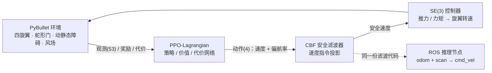
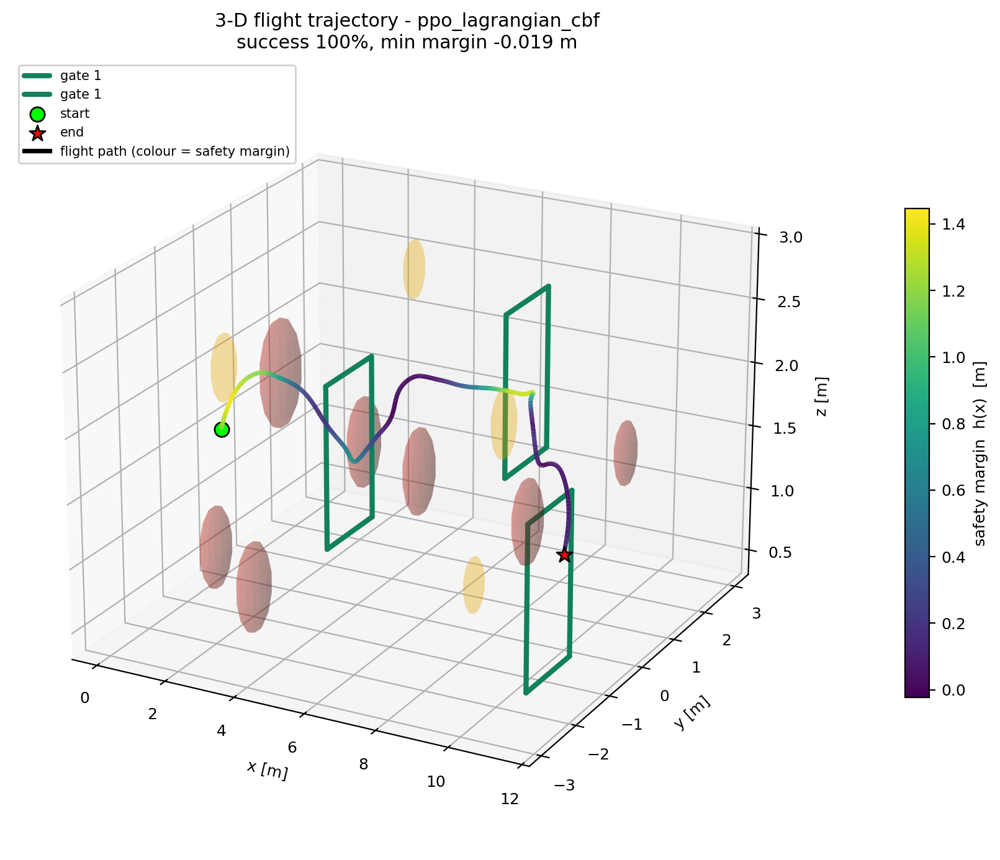
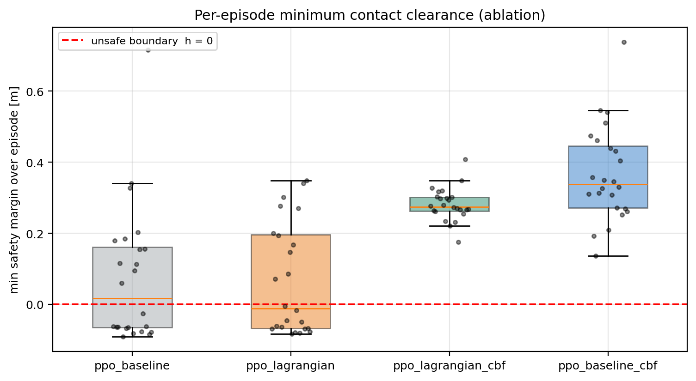
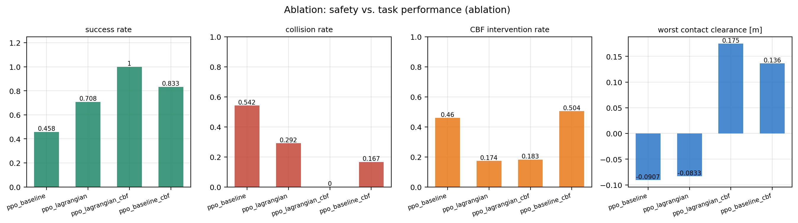
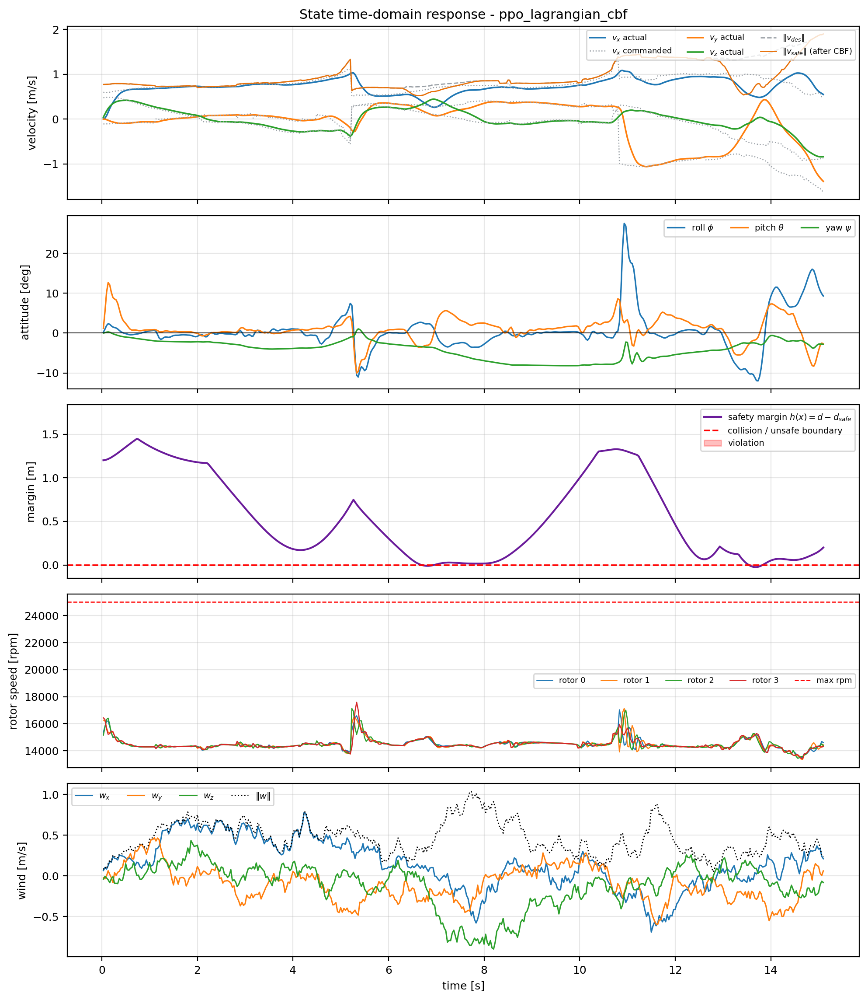
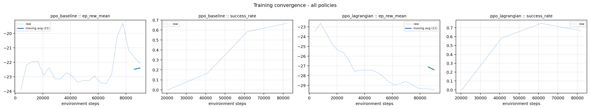
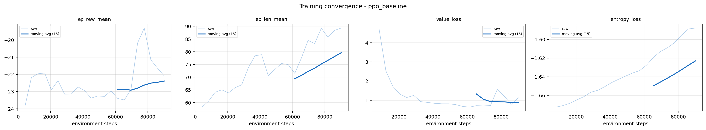
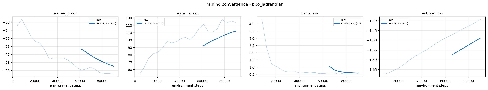

# 基于 CBF-PPO 的无人机安全导航

本模块在 [eRGiBi/DRL-DroneNavigation](https://github.com/eRGiBi/DRL-DroneNavigation)
的基础上，为四旋翼穿越蛇形门任务加入控制屏障函数（CBF）安全滤波与拉格朗日约束 PPO。
仿真环境基于 PyBullet，部署节点面向 ROS Noetic，训练与评测均在 CPU 上完成。

## 1. 系统架构 <span id="architecture"></span>



系统为分层结构：RL 策略以 30 Hz 输出归一化速度与偏航率指令；CBF 滤波器对速度指令
做最小修正；SE(3) 几何控制器将速度指令转换为推力与机体力矩，经旋翼分配器得到四个
电机转速，由 240 Hz 物理步长积分。ROS 节点复用同一套观测构造函数与 CBF 实现，
保证评测策略与部署策略一致。

## 2. 算法原理 <span id="method"></span>

### 2.1 约束化 PPO

将安全要求写成显式约束，而不是奖励惩罚项：

\[
\max_{\theta}\ J_r(\theta)
\quad \text{s.t.} \quad
J_c(\theta) \le d
\]

\[
L(\theta,\lambda)=J_r(\theta)-\lambda\left(J_c(\theta)-d\right),
\qquad
\lambda \leftarrow \left[\lambda+\eta\left(J_c(\theta)-d\right)\right]_+
\]

其中 \(J_r\) 为折扣回报，\(J_c\) 为折扣代价，\(d\) 为代价上限。单步代价定义为碰撞指示
与安全裕度侵占率之和：

\[
c_t=\mathbf{1}\left[\text{collision}\right]
+\frac{w_b}{T_{\max}}\operatorname{clip}\left(\frac{-h_t}{d_{\text{safe}}},\,0,\,1\right),
\qquad w_b=0.5,\ T_{\max}=900
\]

代价按 \(1/T_{\max}\) 归一化，使 \(d=0.6\) 具有直观含义：平均碰撞率不超过 60%。
对偶变量 \(\lambda\) 由投影梯度上升自动调节，无需手工设置安全权重。

### 2.2 CBF 安全滤波

离散时间 CBF 的标准条件为

\[
h(x_{k+1}) \ge (1-\gamma)\,h(x_k)
\]

对速度控制的质点模型展开，得到 \(\nabla h \cdot v \ge -\gamma h/\Delta t\)。
取 \(\gamma=0.55\)、\(\Delta t=1/30\ \text{s}\)、\(h=0.5\ \text{m}\) 时，右端允许的
接近速度为 \(8.25\ \text{m/s}\)，而机体最大速度仅 \(2.6\ \text{m/s}\)。该约束在本任务中
始终不会激活，无法提供实际保护。

因此采用制动距离型障碍函数。四旋翼速度环为一阶惯性环节，时间常数
\(\tau=0.2\ \text{s}\)，制动前的滑行距离为 \(v\tau\)，制动距离为 \(v^2/(2a)\)。
令二者之和等于自由距离 \(h\)，取正根：

\[
v\tau+\frac{v^2}{2a}=h
\quad\Longrightarrow\quad
v_{\text{safe}}=-a\tau+\sqrt{(a\tau)^2+2ah}
\]

其中 \(a=3.0\ \text{m/s}^2\)，显著低于控制器实际可达的 \(7.5\ \text{m/s}^2\)，以覆盖
姿态过渡与 30 Hz 离散化误差。滤波器求解如下最小干预投影：

\[
v^\star=\arg\min_{v}\ \|v-v_{\text{des}}\|^2
\quad \text{s.t.} \quad
\|v\|\le v_{\max},\quad
n_i^\top v \ge -\min\left\{v_{\text{safe}}(h_i),\,\frac{\gamma h_i}{\Delta t}\right\}
\]

其中 \(n_i\) 为障碍物 \(i\) 的屏障梯度方向。各半空间约束与速度球求交，经 6 次
Gauss–Seidel 迭代得到投影解。障碍函数覆盖静态障碍、动态障碍、地面、天花板与
走廊侧壁；门框不设为障碍，以保证门洞可穿越。

主要滤波参数如下：

| 参数 | 取值 | 含义 |
|---|---|---|
| \(d_{\text{safe}}\) | 0.30 m | 安全边界偏移 |
| \(a\) | 3.0 m/s² | 滤波器假定的制动能力 |
| \(\tau\) | 0.20 s | 速度环时间常数 |
| \(\gamma\) | 0.55 | 离散 CBF 类 K 增益 |
| \(v_{\max}\) | 2.6 m/s | 速度球半径 |

### 2.3 奖励设计

引导项采用势函数 \(\Phi(s)=-d_{\text{gate}}\) 的 potential-based reward shaping
（Ng et al., 1999），形式上不改变最优策略。各项权重如下：

| 奖励项 | 权重 | 说明 |
|---|---:|---|
| 门距离势函数进展 | 1.0 | \(\gamma\Phi(s_{t+1})-\Phi(s_t)\) |
| 旋翼气动功率 | 0.03 | \(\sum_i \omega_i^3\) |
| 指令平滑 | 0.02 | \(\|a_t-a_{t-1}\|^2\) |
| 近障惩罚 | 0.15 | 裕度低于 \(d_{\text{safe}}\) 时线性增长 |
| 时间惩罚 | −0.02 / 步 | 抑制悬停 |
| 穿门奖励 | +10.0 | 每通过一道门 |
| 成功奖励 | +40.0 | 通过全部三道门 |
| 碰撞惩罚 | −25.0 | 回合终止 |

## 3. 状态与动作定义 <span id="state-action"></span>

观测为 53 维向量：

\[
s=\left[\,p_{\text{rel}}^{(3)},\ v^{(3)},\ \phi^{(3)},\
\{p_i^{(3)},r_i\}_{i=1}^{4},\ \ell^{(24)},\ a_{t-1}^{(4)}\,\right]
\]

| 分量 | 维度 | 说明 |
|---|---:|---|
| \(p_{\text{rel}}\) | 3 | 当前目标门相对位置 |
| \(v\) | 3 | 世界坐标系速度 |
| \(\phi\) | 3 | 横滚、俯仰、偏航角 |
| 最近障碍物 | 16 | 4 个障碍物的相对位置（3）与半径（1） |
| 虚拟激光雷达 | 24 | 24 条射线的归一化距离 |
| \(a_{t-1}\) | 4 | 上一步动作 |

动作 \(a\in[-1,1]^4\) 映射为速度指令与偏航角速率指令：

\[
v_{\text{des}}=2.6\,(a_1,a_2,a_3)\ \text{m/s},
\qquad
\dot{\psi}_{\text{des}}=2.0\,a_4\ \text{rad/s}
\]

## 4. 网络结构与训练参数 <span id="training"></span>

策略、价值与代价价值各使用一个两层 MLP，隐藏层均为 128 单元、Tanh 激活；
动作分布为对角高斯分布，初始 \(\log\sigma=-1.0\)。PPO-Lagrangian 的训练参数如下：

| 参数 | 取值 |
|---|---|
| 并行环境数 × 单环境步数 | 4 × 1024 |
| 批大小 / 迭代轮数 | 256 / 10 |
| 学习率 | \(5\times10^{-5}\) |
| 折扣因子 \(\gamma\) / GAE \(\lambda\) | 0.99 / 0.95 |
| 裁剪系数 / 熵系数 | 0.2 / 0.0 |
| 代价上限 \(d\) | 0.6 |
| 对偶步长 \(\eta\) / \(\lambda\) 上限 | 0.03 / 8.0 |
| 训练步数 / 随机种子 | 90 000 / 12 |

直接从随机初始化训练 PPO 会收敛到悬停局部最优，因此先用纯追踪专家进
行为克隆热启动（200 回合，250 轮），再以上述参数微调。行为克隆阶段专家成功率为
84.5%，克隆后为 87.5%，微调后达到 100%。

## 5. 实验结果 <span id="results"></span>

评测使用 `scripts/evaluate.py`，固定随机种子 20000–20023，共 24 个回合。
四组实验共享同一策略与同一组种子，唯一变量为推理时是否启用 CBF 滤波器。

| # | 策略 | CBF | 成功率 ↑ | 碰撞率 ↓ | 最差接触裕度 ↑ | 平均到达时间 | 平均代价 |
|---|------|:---:|:--------:|:--------:|:--------------:|:------------:|:--------:|
| 1 | PPO（无约束） | ✗ | 0.458 | 0.542 | −0.091 m | 6.82 s | 0.546 |
| 2 | PPO-Lagrangian | ✗ | 0.708 | 0.292 | −0.083 m | 14.77 s | 0.303 |
| 3 | PPO-Lagrangian | ✓ | **1.000** | **0.000** | **+0.175 m** | 15.93 s | **0.001** |
| 4 | PPO（无约束） | ✓ | 0.833 | 0.167 | **+0.137 m** | 7.65 s | 0.167 |

接触裕度定义为到真实接触面的距离，负值表示机身在几何上已侵入障碍物。

实验结论：

1. **CBF 提供硬安全保证。** 关闭滤波器时，策略会实际穿透障碍物（最差 −0.091 m）；
   开启后全部评估回合均未接触障碍物，最差情形仍保持 0.137 m 的间隙。
2. **CBF 同时提升任务成功率。** 对无约束策略，成功率由 0.458 提升至 0.833，
   未过滤时的多数失败源于本可避免的碰撞。



图 1　三维飞行航迹。颜色表示安全裕度，绿色为门框，红色为静态障碍，
黄色为动态障碍及其扫掠轨迹。



图 2　逐回合最小接触裕度分布。虚线为不安全边界（\(h=0\)）。



图 3　四组消融实验的成功率、碰撞率与平均代价对比。



图 4　CBF 滤波下的状态时序响应：速度（实际 / 指令 / 滤波后）、姿态、安全裕度、
旋翼转速与风场。第一栏可见滤波器的速度裁剪，第三栏安全裕度逼近但未越过零线。

### 5.1 训练收敛过程



图 5　无约束 PPO 与 PPO-Lagrangian 的平均回报与评测成功率随训练步数的变化。



图 6　无约束 PPO 基线的回合奖励、回合长度、价值损失与熵损失。



图 7　PPO-Lagrangian 策略的同组训练曲线，价值损失由约 4.2 收敛至 0.6 附近。

## 6. 运行指令 <span id="quickstart"></span>

### 6.1 环境安装

```bash
pip install -r src/air/safedrl_drone_nav/requirements.txt
```

PyPI 未提供 PyBullet 的 Windows 预编译包，Ubuntu 下可直接安装。Windows 复现时改用
conda-forge：

```bash
conda install -c conda-forge pybullet "numpy<2"
pip install --force-reinstall --no-deps numpy==1.26.4
```

### 6.2 自检

```bash
cd src/air/safedrl_drone_nav
python tests/test_safety_filter.py      # CBF 投影解析测试，11 项
python tests/test_environment.py        # 闭环集成测试，8 项
python scripts/dummy_state_publisher.py --selftest
```

### 6.3 训练与评估

```bash
# 行为克隆热启动
python scripts/pretrain_bc.py --use-cbf --episodes 200 --epochs 250 \
    --out-name bc_warmstart_cbf

# PPO 微调
python scripts/train.py --policy ppo_lag --use-cbf \
    --init-from checkpoints/bc_warmstart_cbf.zip --normalize-reward \
    --timesteps 90000 --run-name ppo_lagrangian --seed 12

# 在 24 个固定种子上评测并出图
python scripts/evaluate.py --model checkpoints/best_model.zip \
    --use-cbf --run-name ppo_lagrangian_cbf --episodes 24 --figures
```

仓库内置唯一权重 `checkpoints/best_model.zip`，对应表中第 3 行策略。

### 6.4 ROS 闭环

```bash
# 通信与推理自检（无策略时回退到内置纯追踪）
roslaunch safedrl_drone_nav smoke_test.launch

# 加载训练好的策略
roslaunch safedrl_drone_nav navigate.launch \
    model_path:=$(rospack find safedrl_drone_nav)/checkpoints/best_model.zip
```

`dummy_state_publisher.py` 以质点模型积分 `cmd_vel` 并射线投射生成 LaserScan，
可在无仿真器与飞控的虚拟机上完成闭环。

## 7. 已知限制 <span id="limitations"></span>

1. 门框不属于障碍函数覆盖范围。门框擦碰由代价信号约束，不由滤波器保证。
2. 成功回合中对偶变量 \(\lambda\) 为 0。拉格朗日机制的作用体现在表第 2 行，
   而非第 3 行。
3. 滤波器按 \(3.0\ \text{m/s}^2\) 的保守制动能力设计，到达时间由 6.82 s 增至 15.93 s。
4. 每组实验仅使用一个训练种子，到达时间等指标未做统计显著性检验。
5. ROS 节点未在运行中的 ROS master 上完成联调，launch 文件与节点逻辑仅通过
   语法校验与替代被控对象自检。

## 8. 参考文献 <span id="references"></span>

1. Ng A Y, Harada D, Russell S. Policy invariance under reward transformations:
   Theory and application to reward shaping[C]//ICML. 1999: 278-287.
2. Ames A D, Coogan S, Egerstedt M, et al. Control barrier functions: Theory and
   applications[C]//ECC. IEEE, 2019: 3420-3431.
3. Agrawal A, Sreenath K. Discrete control barrier functions for safety-critical
   control of discrete systems with application to bipedal robot navigation[C]//
   Robotics: Science and Systems. 2017.
4. Stooke A, Achiam J, Abbeel P. Responsive safety in reinforcement learning by
   PID Lagrangian methods[C]//ICML. PMLR, 2020: 9133-9143.
5. Lee T, Leok M, McClamroch N H. Geometric tracking control of a quadrotor UAV
   on SE(3)[C]//CDC. IEEE, 2010: 5420-5425.
6. Schulman J, Wolski F, Dhariwal P, et al. Proximal policy optimization
   algorithms[J]. arXiv preprint arXiv:1707.06347, 2017.

## 人工智能使用声明

开发过程使用 AI 编程助手辅助代码编写、调试与文档撰写，提交内容由提交者审阅并
对正确性负责。
