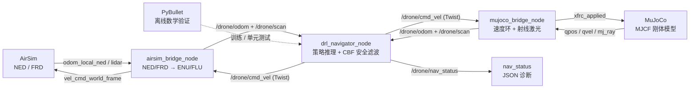
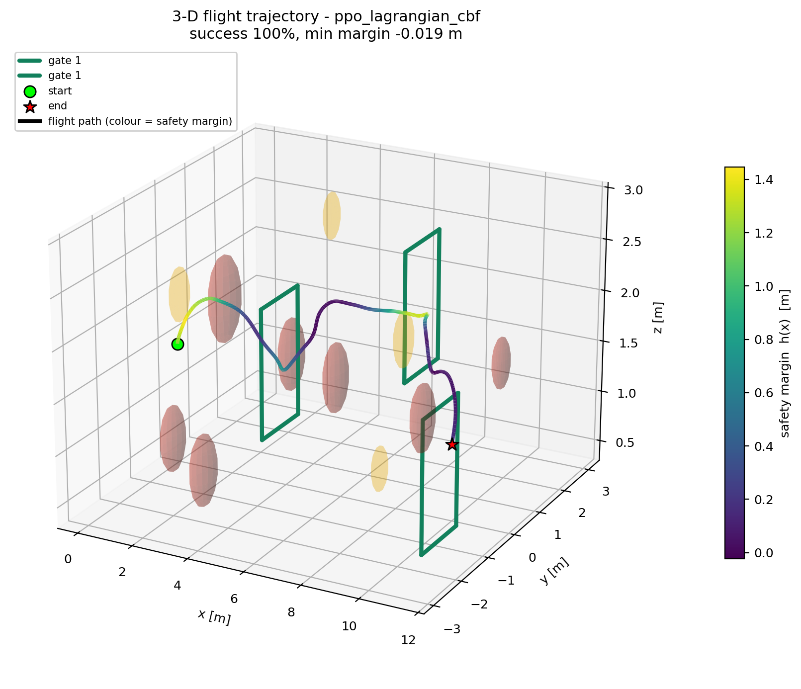
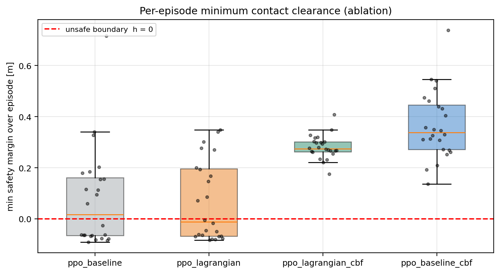
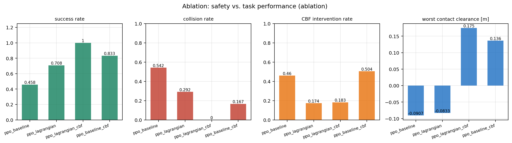
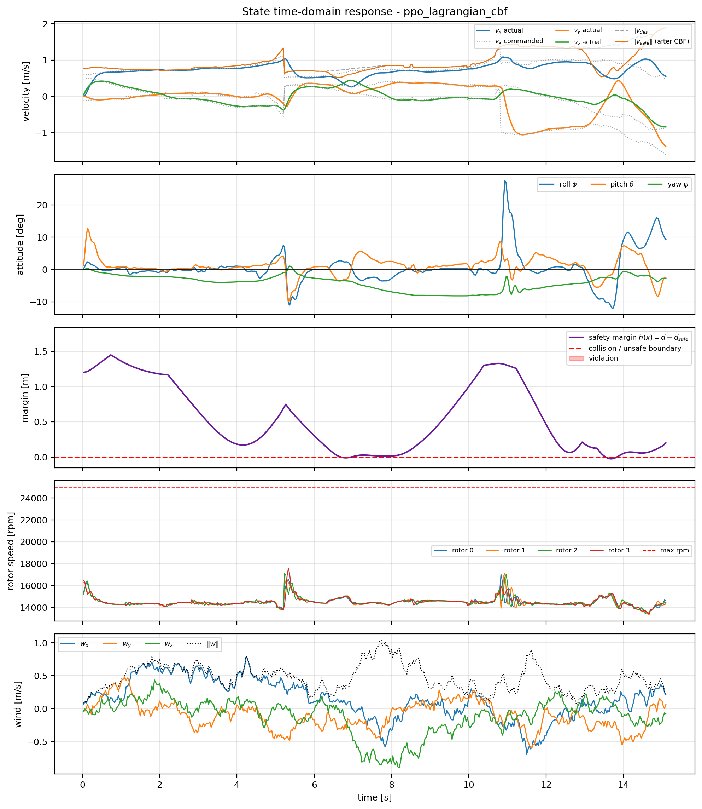
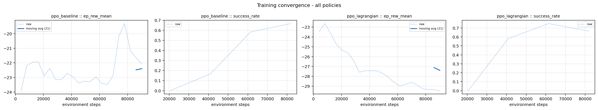
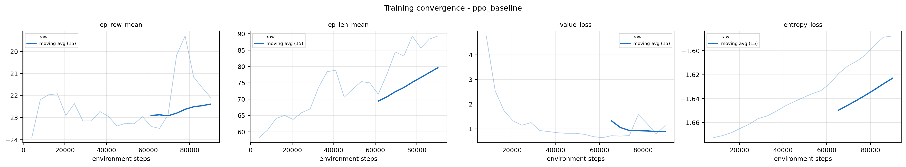
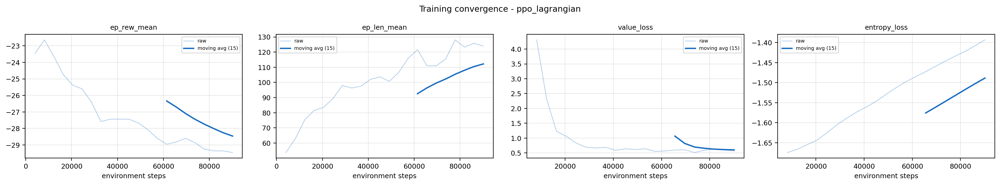

# 基于 CBF-PPO 的无人机安全导航

本模块实现一个跨仿真器可移植的底层 CBF 安全避障控制器与 ROS 节点。算法层只通过
标准 ROS 消息与外部交互，因此同一份策略权重可以接入课程约定的 **AirSim** 或
**MuJoCo**。PyBullet 只作为离线单元级数学验证与策略训练环境，不是课程主仿真器。

模块沿用 [eRGiBi/DRL-DroneNavigation](https://github.com/eRGiBi/DRL-DroneNavigation)
的四旋翼穿门任务，在拉格朗日约束 PPO 之上加入控制屏障函数（CBF）速度滤波。训练与
离线评测均在 CPU 上完成。

## 1. 系统架构 <span id="architecture"></span>



系统分为三层：

1. **仿真器适配层**：`airsim_bridge_node.py` 与 `mujoco_bridge_node.py` 把各自
   仿真器的状态、传感器和控制接口转换为统一接口。
2. **标准 ROS 接口层**：`nav_msgs/Odometry`、`sensor_msgs/LaserScan`、
   `geometry_msgs/Twist` 和 `std_msgs/String`，坐标系遵循 ROS REP-103。
3. **算法层**：`drl_navigator_node.py` 运行策略推理和 CBF 滤波，不直接调用任何
   仿真器 API；`safety.py` 中的滤波实现与训练阶段完全相同。

## 2. 仿真接口 <span id="interface"></span>

### 2.1 标准话题与坐标系

| 话题 | 消息类型 | 方向 | 坐标系 |
|---|---|---|---|
| `/drone/odom` | `nav_msgs/Odometry` | 仿真器 → 导航节点 | 世界 ENU，机体系 FLU |
| `/drone/scan` | `sensor_msgs/LaserScan` | 仿真器 → 导航节点（可选） | `base_link` |
| `/drone/cmd_vel` | `geometry_msgs/Twist` | 导航节点 → 仿真器 | 世界 ENU，机体系 FLU |
| `/drone/nav_status` | `std_msgs/String` | 导航节点 → 诊断 | JSON |

世界坐标系为 ENU（x 东、y 北、z 上），机体系为 FLU（x 前、y 左、z 上）。速度指令
在线速度中给出世界系三轴速度，在角速度 `z` 中给出偏航角速率，单位分别为 m/s 和
rad/s。

### 2.2 AirSim 桥接

`airsim_bridge_node.py` 支持两种后端。

| 后端 | 启动方式 | 状态来源 | 控制输出 |
|---|---|---|---|
| `ros` | `backend:=ros` | `airsim_ros_pkgs` 的 `odom_local_ned` | `vel_cmd_world_frame` |
| `api` | `backend:=api` | `airsim.MultirotorClient.getMultirotorState()` | `moveByVelocityAsync()` |

`backend:=ros` 时的话题映射：

| 方向 | AirSim 话题 | 标准话题 |
|---|---|---|
| 状态 | `/airsim_node/<vehicle>/odom_local_ned` | `/drone/odom` |
| 控制 | `/airsim_node/<vehicle>/vel_cmd_world_frame` | `/drone/cmd_vel` |
| 激光 | `~lidar_topic`（`sensor_msgs/PointCloud2`） | `/drone/scan` |

AirSim 使用 NED 世界系和 FRD 机体系。桥接器按固定旋转完成双向转换：

\[
\mathbf{p}_{\text{ENU}} =
\begin{bmatrix}
0 & 1 & 0\\
1 & 0 & 0\\
0 & 0 & -1
\end{bmatrix}
\mathbf{p}_{\text{NED}},
\qquad
R_{\text{ENU,FLU}} = M\,R_{\text{NED,FRD}}\,B,
\quad B=\operatorname{diag}(1,-1,-1)
\]

由 \(R_{\text{ENU,FLU}}\) 提取横滚、俯仰和偏航角，供导航节点构造观测。偏航角速率
在 NED 中顺时针为正，桥接器对其取负后写入 `Twist.angular.z`。激光点云先由 FRD 转为 FLU，再在
`base_link` 平面内按方位角分箱，每个分箱保留最近距离，生成 180 束 `LaserScan`。

启用 `backend:=ros` 前需先在 ROS 工作空间中编译并运行 `airsim_ros_pkgs`：

```bash
roslaunch airsim_ros_pkgs airsim_node.launch
roslaunch safedrl_drone_nav airsim_navigate.launch backend:=ros
```

不使用 ROS 封装时，安装 `airsim` 客户端后可直接连接：

```bash
pip install airsim==1.8.1
roslaunch safedrl_drone_nav airsim_navigate.launch backend:=api
```

AirSim 车辆起飞点为坐标原点，launch 文件中的门框和障碍物坐标均相对该原点。

### 2.3 MuJoCo 桥接

`mujoco_bridge_node.py` 加载 `models/quadrotor_scene.xml`。场景包含自由飞行四旋翼、
走廊地面与侧壁、四个静态球形障碍和三个仅用于显示的门框。门框位于 geom group 2，
不参与接触，也不被射线检测，因此不会阻挡穿越。

桥接器在 MJCF 时间步长 \(0.004\ \text{s}\) 上积分刚体动力学，并以 30 Hz 接收
`Twist`。速度环与 CBF 滤波器假设的一阶惯性环节一致：

\[
m\dot{\mathbf{v}} = \frac{m}{\tau}\left(\mathbf{v}_{\text{des}}-\mathbf{v}\right)
+ m\mathbf{g},
\qquad
I_z\dot{\omega}_z = \frac{I_z}{\tau}\left(\dot{\psi}_{\text{des}}-\omega_z\right)
\]

其中 \(\tau=0.20\ \text{s}\)，与 `safety.py` 的 `tau_lag` 相同。世界系力和偏航力矩
写入 `data.xfrc_applied`；竖直方向叠加 \(m\mathbf{g}\) 以保持悬停。激光扫描通过
`mj_ray` 在机体当前高度水平投射 72 条射线，命中距离写入 `LaserScan`。

```bash
pip install mujoco>=3.0
roslaunch safedrl_drone_nav mujoco_navigate.launch
```

话题映射：

| 话题 | 数据来源 |
|---|---|
| `/drone/odom` | `qpos` 位置与四元数、`qvel` 速度 |
| `/drone/scan` | `mj_ray` 射线距离，72 束 |
| `/drone/cmd_vel` | 一阶速度环的期望速度与偏航角速率 |
| `/drone/nav_status` | 导航节点发布的 JSON 诊断 |

### 2.4 PyBullet 的定位

PyBullet 仅用于两类离线工作：

1. `scripts/safe_nav_env.py` 与 `scripts/drone_dynamics.py` 构建四旋翼、旋翼分配、
   风场和动静态障碍，用于训练和离线消融实验。
2. `tests/test_environment.py` 在无 ROS、无 AirSim、无 MuJoCo 的环境中验证 CBF
   闭环性质。

PyBullet 不是课程主仿真器，也不参与 AirSim/MuJoCo 的实时接口。离线环境与课程
仿真器共享 `safety.py`、观测构造函数和策略权重。

任务几何与观测维度放在 `scripts/nav_config.py`。该模块不导入 PyBullet、
Gymnasium 或 ROS，因此只安装 AirSim 或 MuJoCo 的环境也能直接启动导航节点。

### 2.5 CBF 障碍来源

导航节点支持两种障碍输入：

1. `~obstacles`：参数服务器上的三维球形障碍列表。离线评测使用该模式，CBF 约束
   直接由球心、半径和机体位置计算。
2. `~scan_barriers`：由实时 `LaserScan` 构造二维障碍约束。AirSim 与 MuJoCo 的
   launch 文件启用该模式；每束有效回波给出
   \(h_i = r_i - r_{\text{drone}} - d_{\text{safe}}\)，梯度方向为回波反方向。

## 3. 算法原理 <span id="method"></span>

### 3.1 约束化 PPO

安全要求写成显式约束，而不是奖励惩罚项：

\[
\max_{\theta}\ J_r(\theta)
\quad \text{s.t.} \quad
J_c(\theta) \le d
\]

\[
L(\theta,\lambda)=J_r(\theta)-\lambda\left(J_c(\theta)-d\right),
\qquad
\lambda \leftarrow \left[\lambda+\eta\left(J_c(\theta)-d\right)\right]_+
\]

其中 \(J_r\) 为折扣回报，\(J_c\) 为折扣代价，\(d\) 为代价上限。单步代价为碰撞指示
与安全裕度侵占率之和：

\[
c_t=\mathbf{1}\left[\text{collision}\right]
+\frac{w_b}{T_{\max}}\operatorname{clip}\left(\frac{-h_t}{d_{\text{safe}}},\,0,\,1\right),
\qquad w_b=0.5,\ T_{\max}=900
\]

代价按 \(1/T_{\max}\) 归一化，使 \(d=0.6\) 表示平均碰撞率不超过 60%。对偶变量
\(\lambda\) 由投影梯度上升自动调节。

### 3.2 CBF 安全滤波

离散时间 CBF 条件为

\[
h(x_{k+1}) \ge (1-\gamma)\,h(x_k)
\]

对速度控制的质点模型展开，得到 \(\nabla h \cdot v \ge -\gamma h/\Delta t\)。
取 \(\gamma=0.55\)、\(\Delta t=1/30\ \text{s}\)、\(h=0.5\ \text{m}\) 时，右端允许的
接近速度为 \(8.25\ \text{m/s}\)，而机体最大速度仅 \(2.6\ \text{m/s}\)。该条件在本
任务中始终不会激活，不能提供实际保护。

因此采用制动距离型障碍函数。四旋翼速度环为一阶惯性环节，时间常数
\(\tau=0.2\ \text{s}\)，制动前的滑行距离为 \(v\tau\)，制动距离为 \(v^2/(2a)\)。
令二者之和等于自由距离 \(h\)，取正根：

\[
v\tau+\frac{v^2}{2a}=h
\quad\Longrightarrow\quad
v_{\text{safe}}=-a\tau+\sqrt{(a\tau)^2+2ah}
\]

其中 \(a=3.0\ \text{m/s}^2\)，低于控制器实际可达的 \(7.5\ \text{m/s}^2\)，以覆盖
姿态过渡与 30 Hz 离散化误差。滤波器求解最小干预投影：

\[
v^\star=\arg\min_{v}\ \|v-v_{\text{des}}\|^2
\quad \text{s.t.} \quad
\|v\|\le v_{\max},\quad
n_i^\top v \ge -\min\left\{v_{\text{safe}}(h_i),\,\frac{\gamma h_i}{\Delta t}\right\}
\]

其中 \(n_i\) 为障碍物 \(i\) 的屏障梯度方向。各半空间约束与速度球求交，经 6 次
Gauss–Seidel 迭代得到投影解。障碍函数覆盖静态障碍、动态障碍、地面、天花板与
走廊侧壁；门框不设为障碍，以保证门洞可穿越。

主要滤波参数：

| 参数 | 取值 | 含义 |
|---|---|---|
| \(d_{\text{safe}}\) | 0.30 m | 安全边界偏移 |
| \(a\) | 3.0 m/s² | 滤波器假定的制动能力 |
| \(\tau\) | 0.20 s | 速度环时间常数 |
| \(\gamma\) | 0.55 | 离散 CBF 类 K 增益 |
| \(v_{\max}\) | 2.6 m/s | 速度球半径 |

### 3.3 奖励设计

引导项采用势函数 \(\Phi(s)=-d_{\text{gate}}\) 的 potential-based reward shaping
（Ng et al., 1999），形式上不改变最优策略。各项权重：

| 奖励项 | 权重 | 说明 |
|---|---:|---|
| 门距离势函数进展 | 1.0 | \(\gamma\Phi(s_{t+1})-\Phi(s_t)\) |
| 旋翼气动功率 | 0.03 | \(\sum_i \omega_i^3\) |
| 指令平滑 | 0.02 | \(\|a_t-a_{t-1}\|^2\) |
| 近障惩罚 | 0.15 | 裕度低于 \(d_{\text{safe}}\) 时线性增长 |
| 时间惩罚 | −0.02 / 步 | 抑制悬停 |
| 穿门奖励 | +10.0 | 每通过一道门 |
| 成功奖励 | +40.0 | 通过全部三道门 |
| 碰撞惩罚 | −25.0 | 回合终止 |

## 4. 状态与动作定义 <span id="state-action"></span>

观测为 53 维向量：

\[
s=\left[\,p_{\text{rel}}^{(3)},\ v^{(3)},\ \phi^{(3)},\
\{p_i^{(3)},r_i\}_{i=1}^{4},\ \ell^{(24)},\ a_{t-1}^{(4)}\,\right]
\]

| 分量 | 维度 | 说明 |
|---|---:|---|
| \(p_{\text{rel}}\) | 3 | 当前目标门相对位置 |
| \(v\) | 3 | 世界坐标系速度 |
| \(\phi\) | 3 | 横滚、俯仰、偏航角 |
| 最近障碍物 | 16 | 4 个障碍物的相对位置（3）与半径（1） |
| 虚拟激光雷达 | 24 | 24 条射线的归一化距离 |
| \(a_{t-1}\) | 4 | 上一步动作 |

动作 \(a\in[-1,1]^4\) 映射为速度指令与偏航角速率指令：

\[
v_{\text{des}}=2.6\,(a_1,a_2,a_3)\ \text{m/s},
\qquad
\dot{\psi}_{\text{des}}=2.0\,a_4\ \text{rad/s}
\]

## 5. 网络结构与训练参数 <span id="training"></span>

策略、价值与代价价值各使用一个两层 MLP，隐藏层均为 128 单元、Tanh 激活；动作
分布为对角高斯分布，初始 \(\log\sigma=-1.0\)。PPO-Lagrangian 的训练参数：

| 参数 | 取值 |
|---|---|
| 并行环境数 × 单环境步数 | 4 × 1024 |
| 批大小 / 迭代轮数 | 256 / 10 |
| 学习率 | \(5\times10^{-5}\) |
| 折扣因子 \(\gamma\) / GAE \(\lambda\) | 0.99 / 0.95 |
| 裁剪系数 / 熵系数 | 0.2 / 0.0 |
| 代价上限 \(d\) | 0.6 |
| 对偶步长 \(\eta\) / \(\lambda\) 上限 | 0.03 / 8.0 |
| 训练步数 / 随机种子 | 90 000 / 12 |

直接从随机初始化训练 PPO 会收敛到悬停局部最优，因此先用纯追踪专家进行行为克隆
热启动（200 回合，250 轮），再以上述参数微调。行为克隆阶段专家成功率为 84.5%，
克隆后为 87.5%，微调后达到 100%。

## 6. 实验结果 <span id="results"></span>

以下结果由离线 PyBullet 验证环境产生。评测使用 `scripts/evaluate.py`，固定随机
种子 20000–20023，共 24 个回合。四组实验共享同一策略与同一组种子，唯一变量为
推理时是否启用 CBF 滤波器。

| # | 策略 | CBF | 成功率 ↑ | 碰撞率 ↓ | 最差接触裕度 ↑ | 平均到达时间 | 平均代价 |
|---|------|:---:|:--------:|:--------:|:--------------:|:------------:|:--------:|
| 1 | PPO（无约束） | ✗ | 0.458 | 0.542 | −0.091 m | 6.82 s | 0.546 |
| 2 | PPO-Lagrangian | ✗ | 0.708 | 0.292 | −0.083 m | 14.77 s | 0.303 |
| 3 | PPO-Lagrangian | ✓ | **1.000** | **0.000** | **+0.175 m** | 15.93 s | **0.001** |
| 4 | PPO（无约束） | ✓ | 0.833 | 0.167 | **+0.137 m** | 7.65 s | 0.167 |

接触裕度定义为到真实接触面的距离，负值表示机身在几何上已侵入障碍物。

实验结论：

1. **CBF 提供硬安全保证。** 关闭滤波器时，策略会实际穿透障碍物（最差 −0.091 m）；
   开启后全部评估回合均未接触障碍物，最差情形仍保持 0.137 m 的间隙。
2. **CBF 同时提升任务成功率。** 对无约束策略，成功率由 0.458 提升至 0.833，
   未过滤时的多数失败源于本可避免的碰撞。



图 1　三维飞行航迹。颜色表示安全裕度，绿色为门框，红色为静态障碍，
黄色为动态障碍及其扫掠轨迹。



图 2　逐回合最小接触裕度分布。虚线为不安全边界（\(h=0\)）。



图 3　四组消融实验的成功率、碰撞率与平均代价对比。



图 4　CBF 滤波下的状态时序响应：速度（实际 / 指令 / 滤波后）、姿态、安全裕度、
旋翼转速与风场。第一栏可见滤波器的速度裁剪，第三栏安全裕度逼近但未越过零线。

### 6.1 训练收敛过程



图 5　无约束 PPO 与 PPO-Lagrangian 的平均回报与评测成功率随训练步数的变化。



图 6　无约束 PPO 基线的回合奖励、回合长度、价值损失与熵损失。



图 7　PPO-Lagrangian 策略的同组训练曲线，价值损失由约 4.2 收敛至 0.6 附近。

## 7. 运行指令 <span id="quickstart"></span>

### 7.1 依赖安装

```bash
# 训练、离线验证与标准 ROS 接口
pip install -r src/air/safedrl_drone_nav/requirements.txt

# 课程仿真器适配（按需安装）
pip install -r src/air/safedrl_drone_nav/requirements-sim.txt
```

`airsim_ros_pkgs` 需在 ROS 工作空间中作为 catkin 包编译。Windows 上 PyBullet 没有
PyPI 预编译包，复现离线结果时改用 conda-forge：

```bash
conda install -c conda-forge pybullet "numpy<2"
pip install --force-reinstall --no-deps numpy==1.26.4
```

### 7.2 自检

```bash
cd src/air/safedrl_drone_nav
python tests/test_safety_filter.py      # CBF 投影解析测试，11 项
python tests/test_environment.py        # 离线闭环测试，8 项，需要 PyBullet
python tests/test_bridge_frames.py      # 坐标变换、MJCF 与接口检查，10 项
python scripts/dummy_state_publisher.py --selftest
```

`test_bridge_frames.py` 不依赖 ROS、AirSim、MuJoCo 或 PyBullet，可在任意安装了
NumPy 的 Python 环境中运行。

### 7.3 训练与评估

```bash
# 行为克隆热启动
python scripts/pretrain_bc.py --use-cbf --episodes 200 --epochs 250 \
    --out-name bc_warmstart_cbf

# PPO 微调
python scripts/train.py --policy ppo_lag --use-cbf \
    --init-from checkpoints/bc_warmstart_cbf.zip --normalize-reward \
    --timesteps 90000 --run-name ppo_lagrangian --seed 12

# 在 24 个固定种子上评测并出图
python scripts/evaluate.py --model checkpoints/best_model.zip \
    --use-cbf --run-name ppo_lagrangian_cbf --episodes 24 --figures
```

仓库内置唯一权重 `checkpoints/best_model.zip`，对应表中第 3 行策略。

### 7.4 AirSim 闭环

```bash
# 终端 1：启动 AirSim 与 ROS 封装
roslaunch airsim_ros_pkgs airsim_node.launch

# 终端 2：桥接器 + 导航节点
roslaunch safedrl_drone_nav airsim_navigate.launch backend:=ros \
    model_path:=$(rospack find safedrl_drone_nav)/checkpoints/best_model.zip
```

不使用 `airsim_ros_pkgs` 时，安装 `airsim==1.8.1` 后改用：

```bash
roslaunch safedrl_drone_nav airsim_navigate.launch backend:=api
```

### 7.5 MuJoCo 闭环

```bash
roslaunch safedrl_drone_nav mujoco_navigate.launch \
    policy_path:=$(rospack find safedrl_drone_nav)/checkpoints/best_model.zip
```

桥接器默认发布 `/drone/scan`，导航节点以 `~scan_barriers:=true` 从激光回波构造
CBF 约束。关闭滤波器进行消融：

```bash
roslaunch safedrl_drone_nav mujoco_navigate.launch use_cbf:=false
```

### 7.6 离线 ROS 自检

无课程仿真器时，可用质点被控对象检查完整话题链路：

```bash
roslaunch safedrl_drone_nav smoke_test.launch
roslaunch safedrl_drone_nav navigate.launch \
    model_path:=$(rospack find safedrl_drone_nav)/checkpoints/best_model.zip
```

`dummy_state_publisher.py` 以质点模型积分 `cmd_vel` 并射线投射生成 `LaserScan`。
该链路只验证通信、推理和滤波器接线，不作为课程仿真结果。

## 8. 已知限制 <span id="limitations"></span>

1. 门框不属于障碍函数覆盖范围。门框擦碰由代价信号约束，不由滤波器保证。
2. 成功回合中对偶变量 \(\lambda\) 为 0。拉格朗日机制的作用体现在表第 2 行，
   而非第 3 行。
3. 滤波器按 \(3.0\ \text{m/s}^2\) 的保守制动能力设计，到达时间由 6.82 s 增至
   15.93 s。
4. 每组实验仅使用一个训练种子，到达时间等指标未做统计显著性检验。
5. 表 1 与图 1–7 的数据来自离线 PyBullet 环境。AirSim 与 MuJoCo 桥接器的坐标
   变换、话题映射和 MJCF 场景由 `tests/test_bridge_frames.py` 检查；完整飞行需在
   安装对应仿真器的环境中运行 launch 文件。

## 9. 参考文献 <span id="references"></span>

1. Ng A Y, Harada D, Russell S. Policy invariance under reward transformations:
   Theory and application to reward shaping[C]//ICML. 1999: 278-287.
2. Ames A D, Coogan S, Egerstedt M, et al. Control barrier functions: Theory and
   applications[C]//ECC. IEEE, 2019: 3420-3431.
3. Agrawal A, Sreenath K. Discrete control barrier functions for safety-critical
   control of discrete systems with application to bipedal robot navigation[C]//
   Robotics: Science and Systems. 2017.
4. Stooke A, Achiam J, Abbeel P. Responsive safety in reinforcement learning by
   PID Lagrangian methods[C]//ICML. PMLR, 2020: 9133-9143.
5. Lee T, Leok M, McClamroch N H. Geometric tracking control of a quadrotor UAV
   on SE(3)[C]//CDC. IEEE, 2010: 5420-5425.
6. Schulman J, Wolski F, Dhariwal P, et al. Proximal policy optimization
   algorithms[J]. arXiv preprint arXiv:1707.06347, 2017.

## 人工智能使用声明

开发过程使用 AI 编程助手辅助代码编写、调试与文档撰写，提交内容由提交者审阅并
对正确性负责。
