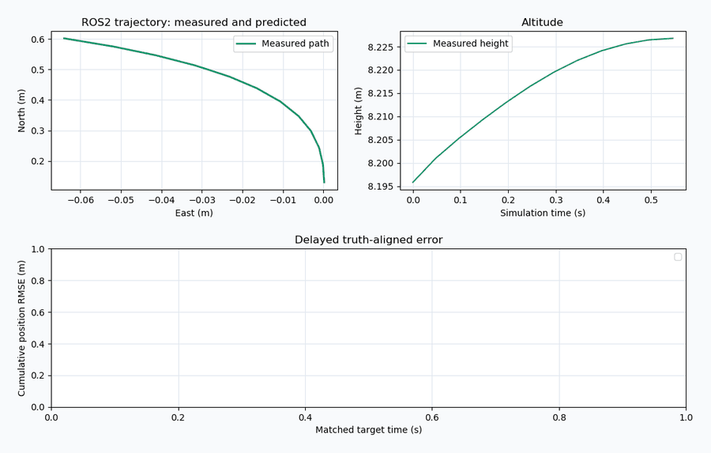
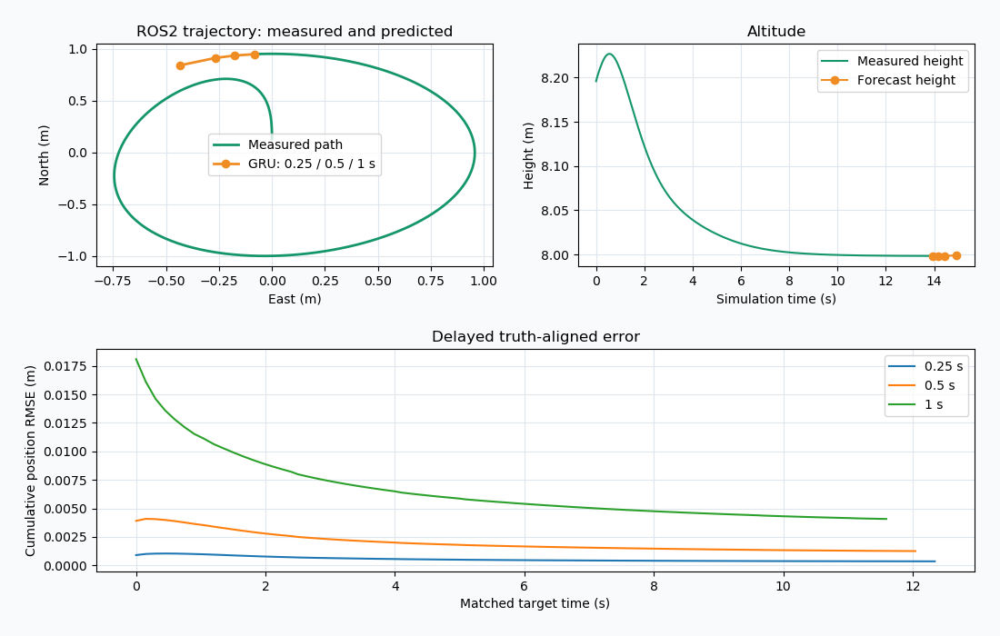
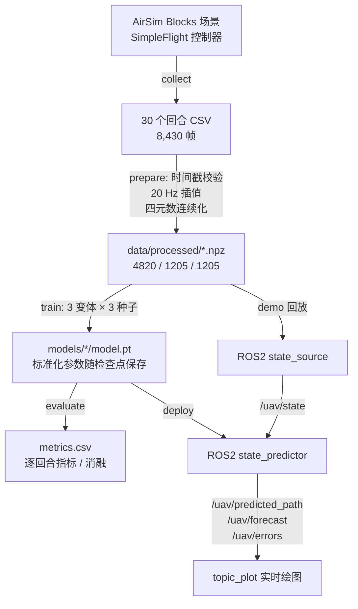
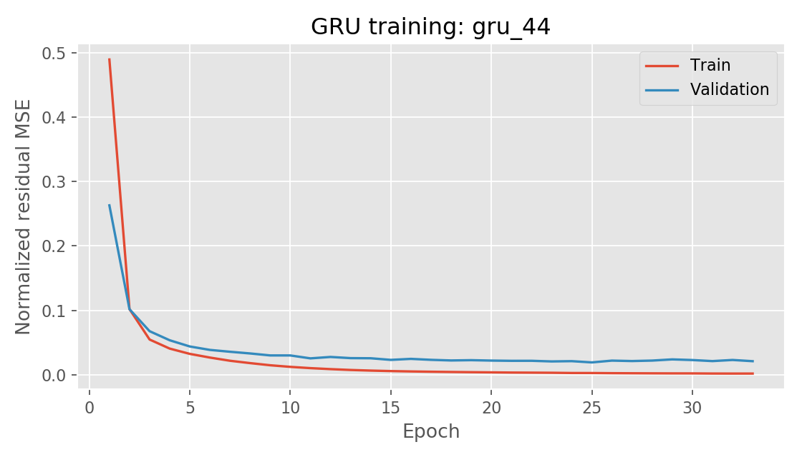
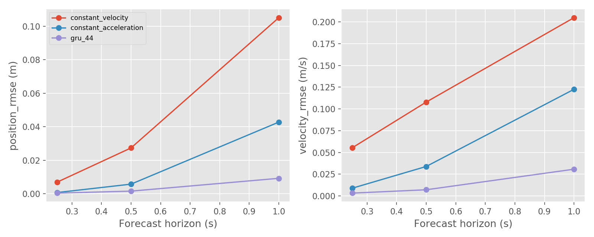
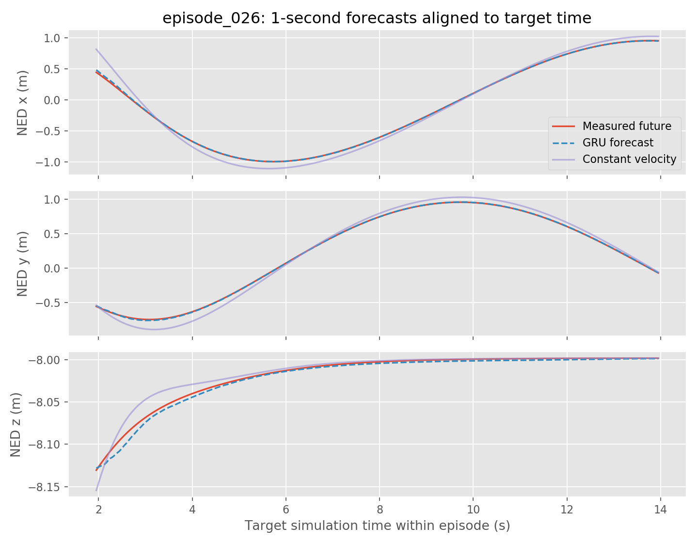
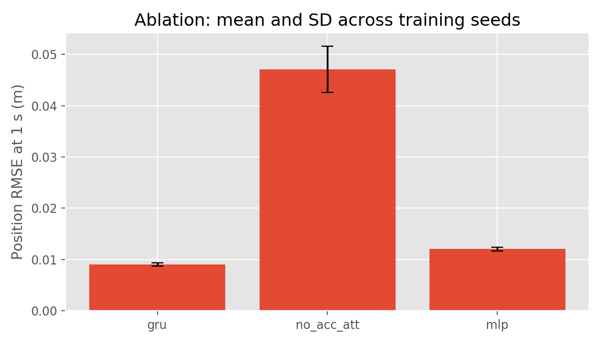

# 基于 GRU 的无人机多时域飞行状态预测与 ROS2 在线误差分析

本页记录一个可独立复现的无人机飞行状态预测实验：用一层的 GRU（门控循环单元）网络，从过去 1 秒的飞行状态历史预测未来 0.25 / 0.5 / 1.0 秒的位置与速度；预测结果通过 ROS2 话题实时发布，并在目标时刻的真实状态到达后自动对齐、计算误差。

网络并不直接回归绝对位置，而是回归**相对恒速模型的残差**。这个设计让网络只需学习"运动偏离匀速直线运动的那一部分"，在小样本、弱机动的飞行数据上更容易训练。

全部结果都在 Ubuntu 20.04 + ROS2 Humble + AirSim Blocks 场景的仿真环境中实测得到；表格里的每个数字都可以用第 10 节的命令重新跑出来。




---

## 1. 任务定义与设计取舍

**输入**：最近 20 帧飞行状态（20 Hz 采样，约 1 秒），每帧 16 维。

**输出**：未来 3 个时域（0.25 s / 0.5 s / 1.0 s），每个时域给出位置（3 维）与速度（3 维），共 18 维。

**约束**：不使用未来的控制指令。这意味着模型只能依赖状态自身的时间演化——这对无人机是现实的：飞控指令在预测时不可知。

三个关键取舍：

| 取舍 | 选择 | 理由 |
|---|---|---|
| 预测目标 | 预测**残差**而非绝对位置 | 恒速基线已能解释大部分运动；残差的量级小一到两个数量级，网络只需拟合偏差 |
| 序列模型 | GRU 而非 LSTM / Transformer | 单层 48 隐单元已足够（10,386 参数），CPU 单样本推理 p50 0.79 ms、p95 1.32 ms；更深的模型在小数据上过拟合 |
| 评估方式 | 目标时刻**对齐**而非固定 lead time | 状态以不规则间隔到达，只有按真实目标时刻插值才能得到无偏误差 |

### 1.1 功能与入口

`main.py` 是统一入口，`main.sh` 负责加载 ROS 环境并激活虚拟环境后转交执行：

| 阶段 | 入口 | 输出 |
|---|---|---|
| 仿真采集 | `bash main.sh collect --host <IP>` | `data/raw/episode_*.csv` / `.json` |
| 数据集 | `bash main.sh prepare` | `data/processed/*.npz`、`manifest.json` |
| 神经网络 | `bash main.sh train --output models/retrained` | `models/<variant>_<seed>/model.pt`、`loss.csv` |
| 独立测试 | `bash main.sh evaluate --output results/xxx` | `metrics.csv`、`episode_metrics.csv`、4 张图 |
| 构建 | `bash main.sh build` | `install/`、`build/`、`log/` |
| ROS2 回放 | `bash main.sh demo` | `/uav/state`、预测路径、误差与可视化 |
| ROS2 实时 | `bash main.sh live --host <IP>` | 同上，数据来自 AirSim RPC |
| 自检 | `bash main.sh doctor` | `artifacts/environment.json` |

`demo` 用仓库内的真实回放数据 `data/sample/episode_026.csv`，能完整演示 **状态发布 → ROS2 → GRU → 预测发布 → 未来真实值到达 → 误差发布 → 绘图** 这条链路；`live` 直接从 AirSim RPC 取状态。**只有 `collect` 会控制仿真无人机**，回放与只读桥接都不下发飞控指令。

---

## 2. 仿真环境与运行步骤

### 2.1 环境

| 项 | 配置 |
|---|---|
| 宿主 | Windows 11 + VMware Workstation 16 |
| 虚拟机 | Ubuntu 20.04.6 LTS，6 核 / 8.5 GB，kernel 5.15 |
| ROS | ROS2 **Humble**（`/opt/ros/humble`，为 Python 3.8 构建） |
| 仿真器 | AirSim 1.8.1，Blocks 场景，SimpleFlight 控制器 |
| Python | 3.8.10，venv `--system-site-packages` |
| 深度学习 | PyTorch **2.4.1+cpu**，numpy 1.24.4，matplotlib 3.1.2 |
| 推理设备 | 纯 CPU（无 CUDA） |

### 2.2 安装

```bash
cd ~/ros2/src/air/state_prediction
source /opt/ros/humble/setup.bash
/usr/bin/python3 -m venv --system-site-packages ~/uav_prediction_env
source ~/uav_prediction_env/bin/activate
python -m pip install -r requirements.txt      # CPU 版 torch，约 195 MB
bash main.sh doctor                            # 环境自检，输出 artifacts/environment.json
bash main.sh build                             # colcon 构建
```

`doctor` 会逐一导入 12 个必需模块（numpy、torch、matplotlib、rclpy、std_msgs、lark、launch_ros 及 6 个 colcon 插件），任何一个缺失都会直接报错退出，不会带着残缺环境继续构建。

安装时的四个常见问题：

- **`ensurepip` 缺失**：说明系统没装 `python3-venv`，先 `sudo apt install python3.8-venv`。
- **没有图形窗口**：`topic_plot` 依赖 Tk，需要 `python3-tk`（`import tkinter` 可自检）。
- **`doctor` 报 `launch_ros: No module named 'lark'`**：在模块目录、已激活的 venv 里重跑 `pip install -r requirements.txt` 即可，`lark==1.1.9` 已在依赖表中；不要用跳过 `launch_ros` 检查的方式绕过。
- **Conda 环境冲突**：Conda 的 `python3` 无法导入 ROS2。保留原环境，另建一个基于 `/usr/bin/python3` 的 venv，再跑同一个 requirements 命令。

虚拟环境的优先级由 `main.sh` 决定：`UAV_ENV` > 当前已激活的 `VIRTUAL_ENV` > `~/uav_prediction_env`；`ROS_SETUP` 可覆盖 ROS 发行版的 setup 文件。换目录重建时，旧的 `build/`、`install/`、`log/` **不要**复制过来，否则会指向旧路径。

### 2.3 回放演示

回放不需要启动仿真器，也不需要下载任何场景：

```bash
bash main.sh demo
```

这条命令启动三个节点：`state_source`（回放 CSV 状态）、`state_predictor`（加载 GRU、发布预测）、`topic_plot`（Tk 窗口实时绘图）。窗口内容自上而下为：

- 左上：轨迹平面图，绿色为实测路径，橙色为三个时域的未来位置预测；
- 右上：高度曲线，含未来高度预测；
- 下方：三个时域随目标时间累积的位置 RMSE 曲线。

回放结束后窗口保持显示，按 `Ctrl+C` 退出。



### 2.4 为什么是 Tk 绘图而不是 RViz2

这台 Ubuntu 20.04 上的 ROS2 Humble 是既有环境，`rviz2` 启动即失败：

```
rviz2: error while loading shared libraries: libOgreMain.so.1.12.1: cannot open shared object file
```

缺的是 Ogre 1.12 运行库。因此默认用包内的 `topic_plot`（TkAgg）直接从 ROS2 话题绘图：

- 只依赖 Python + matplotlib，不需要 Ogre；
- 话题消费方式与 RViz 完全一致，不影响验证结论；
- `rviz/prediction.rviz` 仍然保留，供图形依赖完整的 ROS2 环境使用。

需要 RViz2 时用 `bash main.sh demo --rviz`。**没有为了这个故障去换机或重装整个虚拟机**——环境是既有的，能验证什么就验证什么，不在文档里假装 RViz 可用。

### 2.5 采集与实时接入

只有在需要重新采集或实时接入时才需要 AirSim 客户端：

```bash
python -m pip install -r requirements_airsim.txt
bash main.sh collect --host <AirSim 主机 IP>
bash main.sh live    --host <AirSim 主机 IP>
```

`collect` 会真正控制仿真无人机飞行五类轨迹；`live` 与 `demo` 只读取状态，**不下发任何飞控指令**。

两点必须注意：

1. `config/airsim_settings.json` 里的 `192.168.239.1` 与 `PredictionDrone` 是示例值，换机器必须按实际的主机地址、车辆名和端口调整，不要照抄。
2. 重新采集的数据**不保证逐值重复**原始实验——采集受实时性、控制器状态和网络延迟影响。要复现本文表格中的数字，请用仓库自带的 `assets/flight_corpus.zip`，不要重新采集。

### 2.6 仿真器选择与验证范围的边界

新部署推荐使用维护者提供的 [OpenHUTB 模拟器发布页](https://github.com/OpenHUTB/hutb/releases)，选择支持无人机的场景与 AirSim 兼容接口。

**必须写清楚的一点**：本文所有训练数据、曲线和截图来自 **Windows Blocks / AirSim 1.8.1** 的实际运行，**尚未在 OpenHUTB 模拟器上重新采集与验证**。AirSim RPC 客户端可以直接复用，但场景、机型与接口版本需要按实际配置核对。把本文的误差数字套用到其他场景时需要重新评估。

### 2.7 回放与源码的关系

`data/sample/episode_026.csv` 同时被 `demo` 回放与第 7.1 节的对比图使用，因此文档中的图表与可运行的演示是同一条轨迹，便于对照检查。


---

## 3. 数据定义

### 3.1 坐标系

| 量 | 坐标系 | 单位 |
|---|---|---|
| 位置 `px/py/pz` | 世界 **NED**（北-东-地） | m |
| 线速度 `vx/vy/vz` | 世界 **NED** | m/s |
| 线加速度 `ax/ay/az` | 世界 **NED** | m/s² |
| 姿态四元数 `qw/qx/qy/qz` | 机体 **FRD** → 世界 **NED** | — |
| 角速度 `wx/wy/wz` | 机体 **FRD** | rad/s |

训练与误差计算全部在 NED 下进行；只在 ROS2 发布 `Odometry` / `Path` 时转换为 **ENU**，以符合 ROS 的 REP-103 约定。分量对应关系为

$$
(x_{\text{ENU}},\,y_{\text{ENU}},\,z_{\text{ENU}}) \;=\; (y_{\text{NED}},\,x_{\text{NED}},\,-z_{\text{NED}})
$$

四元数按 \(R_{\text{ENU\_FLU}} = R_{\text{ENU\_NED}} \cdot R_{\text{NED\_FRD}} \cdot R_{\text{FRD\_FLU}}\) 复合转换。

### 3.2 每帧字段

每个回合的 CSV 逐行记录：

| 字段 | 含义 |
|---|---|
| `timestamp_ns` | 采集时钟，整数纳秒（误差对齐依赖它，不能截断成毫秒） |
| `px/py/pz` | 位置（NED，m） |
| `vx/vy/vz` | 线速度（NED，m/s） |
| `ax/ay/az` | 线加速度（NED，m/s²） |
| `qw/qx/qy/qz` | 姿态四元数（FRD → NED） |
| `wx/wy/wz` | 角速度（机体 FRD，rad/s） |
| 命令速度 | 本回合下发的期望速度，仅作记录，**不进入模型输入** |
| `collision` | 碰撞标志，采集时用于拒收 |
| 采集时钟 | 用于检查采样间隔与超时 |

模型只用前 16 维（位置、速度、加速度、姿态、角速度）。

### 3.3 轨迹与规模

五类轨迹：直线往返、圆形、8 字、升降、平滑停走。振幅、频率、相位由记录种子决定。

- 30 个独立回合，8,430 条真实 AirSim 状态；
- 采样中位间隔约 0.051 s，插值重采样到 20 Hz；
- 所有回合碰撞数为 0，时间戳单调，最大间隔超过 0.15 s 的回合被拒绝。

### 3.4 划分与窗口

按**完整回合**划分，而不是按窗口随机划分——否则相邻窗口会同时出现在训练集和测试集中，造成信息泄漏：

| 集合 | 回合 | 窗口数 |
|---|---:|---:|
| 训练 | 20（每类 4） | 4,820 |
| 验证 | 5（每类 1） | 1,205 |
| 测试 | 5（每类 1） | 1,205 |

测试集固定为 `episode_025` ~ `episode_029`。标准化参数**只**从训练窗口拟合。

---

## 4. 计算原理

### 4.1 状态向量与输入构造

记第 \(t\) 帧的完整状态为

$$
\mathbf{s}_t \;=\; \big[\underbrace{p_x,p_y,p_z}_{\text{位置}},\; \underbrace{v_x,v_y,v_z}_{\text{速度}},\; \underbrace{a_x,a_y,a_z}_{\text{加速度}},\; \underbrace{q_w,q_x,q_y,q_z}_{\text{姿态}},\; \underbrace{\omega_x,\omega_y,\omega_z}_{\text{角速度}}\big]^{\top}\in\mathbb{R}^{16}
$$

输入是长度 \(T=20\) 的窗口 \(\mathbf{X}_t=\{\mathbf{s}_{t-T+1},\dots,\mathbf{s}_t\}\)。

为消除绝对位置带来的平移差异（同一动作在不同位置应当等价），对窗口内每一帧的位置做**相对末端平移**：

$$
\tilde{p}^{(i)} \;=\; p^{(i)} - p^{(T)},\qquad i=1,\dots,T
$$

四元数在输入前先做符号连续化：若 \(\mathbf{q}^{(i)}\cdot\mathbf{q}^{(i-1)}<0\) 则整体取反，保证插值与求均值时不被符号跳变污染。

### 4.2 标准化

对每个特征维度 \(j\)，用训练窗口的均值 \(\mu_j\) 与标准差 \(\sigma_j\) 做仿射标准化：

$$
\hat{x}^{(i)}_j \;=\; \frac{\tilde{x}^{(i)}_j-\mu_j}{\max(\sigma_j,\,0.01)}
$$

标签同样标准化。标准化参数随检查点一起保存，推理时复用，避免训练与部署不一致。

### 4.3 物理基线

**恒速模型（CV）**：假设未来速度不变，

$$
\hat{p}^{\mathrm{cv}}_{t+h}=p_t+v_t h,\qquad \hat{v}^{\mathrm{cv}}_{t+h}=v_t
$$

**恒加速度模型（CA）**：假设未来加速度不变，

$$
\hat{p}^{\mathrm{ca}}_{t+h}=p_t+v_t h+\tfrac{1}{2}a_t h^2,\qquad \hat{v}^{\mathrm{ca}}_{t+h}=v_t+a_t\cdot h
$$

这两个基线不是"陪跑"的对照组，而是**残差学习的分母**：网络学习的是真实值相对 CV 的偏差。

### 4.4 GRU 的更新方程

单层 GRU，隐状态 \(\mathbf{h}_t\in\mathbb{R}^{48}\)，输入 \(\mathbf{x}_t\in\mathbb{R}^{16}\)。下面按**本模块实际使用的 PyTorch `nn.GRU` 约定**书写：

$$
\begin{aligned}
\mathbf{r}_t &= \sigma\!\left(\mathbf{W}_{ir}\mathbf{x}_t+\mathbf{b}_{ir}+\mathbf{W}_{hr}\mathbf{h}_{t-1}+\mathbf{b}_{hr}\right) &&\text{（重置门）}\\
\mathbf{z}_t &= \sigma\!\left(\mathbf{W}_{iz}\mathbf{x}_t+\mathbf{b}_{iz}+\mathbf{W}_{hz}\mathbf{h}_{t-1}+\mathbf{b}_{hz}\right) &&\text{（更新门）}\\
\mathbf{n}_t &= \tanh\!\left(\mathbf{W}_{in}\mathbf{x}_t+\mathbf{b}_{in}+\mathbf{r}_t\odot\left(\mathbf{W}_{hn}\mathbf{h}_{t-1}+\mathbf{b}_{hn}\right)\right) &&\text{（候选状态）}\\
\mathbf{h}_t &= (1-\mathbf{z}_t)\odot\mathbf{n}_t+\mathbf{z}_t\odot\mathbf{h}_{t-1} &&\text{（隐状态更新）}
\end{aligned}
$$

有两处极易写反，这里以 PyTorch 的实现为准：

- **重置门作用在隐藏态线性变换的*结果*上**，即 \(\mathbf{r}_t\odot(\mathbf{W}_{hn}\mathbf{h}_{t-1}+\mathbf{b}_{hn})\)，而不是先把 \(\mathbf{h}_{t-1}\) 乘上 \(\mathbf{r}_t\) 再做线性变换。Cho 等人 2014 年的原始定义是后者，两者**并不等价**（偏差项的位置不同）。
- **更新门 \(\mathbf{z}_t\) 加权的是上一时刻隐状态**，候选状态分到的是 \(1-\mathbf{z}_t\)。

若按原始论文的写法实现，训练出来的模型与本文指标不会一致；第 7 节的全部数字都对应 PyTorch 的实现。

其中 \(\sigma\) 为 logistic 函数，\(\odot\) 为逐元素乘。这种"线性插值式"的更新是 GRU 与 LSTM 的关键差别：没有独立的输出门，隐状态直接按门控比例在旧值与候选值之间插值，参数更少、在短序列上更不容易过拟合。

### 4.5 输出头与残差合成

取末时刻隐状态 \(\mathbf{h}_T\) 过一层线性映射：

$$
\mathbf{f}(\mathbf{h}_T)=\mathbf{W}_o\mathbf{h}_T+\mathbf{b}_o\in\mathbb{R}^{18}
$$

输出 18 维 = 3 个时域 × (3 位置 + 3 速度)。最终预测为基线加残差：

$$
\hat{\mathbf{y}}_h \;=\; \mathbf{b}_h \;+\; \boldsymbol{\sigma}_{y,h}\odot\mathbf{f}(\mathbf{h}_T)_h \;+\; \boldsymbol{\mu}_{y,h}
$$

其中 \(\boldsymbol{\mu}_{y,h},\boldsymbol{\sigma}_{y,h}\) 是该时域残差标签的均值与标准差（每个时域 6 维），\(\mathbf{f}(\mathbf{h}_T)_h\) 表示取出该时域对应的 6 维。

线性层权重与偏置**初始化为零**，因此训练起点是 CV 基线**加上训练集残差均值**（1 秒位置约 −5 mm），而不是纯 CV。网络要做的第一件事不是重新发明预测，而是在这个起点上继续变好；这个性质让训练初期的损失不会比物理基线差太多。

### 4.6 损失函数

标签为残差 \(r_h = y_h - b_h\)，损失为标准化残差上的均方误差：

$$
\mathcal{L}(\theta) \;=\; \frac{1}{18N}\sum_{n=1}^{N}\sum_{h\in\{0.25,0.5,1.0\}} \left\| \frac{\hat{\mathbf{r}}_{n,h}-\mathbf{r}_{n,h}}{\boldsymbol{\sigma}_{y,h}} \right\|_2^2
$$

即 18 维（3 时域 × 6 分量）标准化残差上的均方误差。按 \(\boldsymbol{\sigma}_{y,h}\) 归一化使三个时域、位置与速度各分量对总损失的贡献可比；否则 1 秒时域的误差会比 0.25 秒大一个数量级，梯度会被它主导。

### 4.7 评价指标

对第 \(c\) 个分量、所有窗口取平均（本表口径为"窗口 × 分量"平均）：

$$
\mathrm{RMSE}_c=\sqrt{\frac{1}{N}\sum_{n=1}^{N}\big(\hat{y}_{n,c}-y_{n,c}\big)^2},\qquad
\mathrm{MAE}_c=\frac{1}{N}\sum_{n=1}^{N}\big|\hat{y}_{n,c}-y_{n,c}\big|
$$

此外给出**矢量 RMSE**，它衡量单次预测的整体偏离，不受分量正负抵消影响：

$$
\mathrm{RMSE}_{\text{vec}}=\sqrt{\frac{1}{N}\sum_{n=1}^{N}\big\|\hat{\mathbf{y}}_n-\mathbf{y}_n\big\|_2^2}
$$

> 注意：1,205 个测试窗口来自 5 个重叠滑窗回合，**不是 1,205 次独立飞行**。窗口间强相关，因此统计显著性应看逐回合指标（第 7.2 节），不能把窗口数当样本量。

### 4.8 在线误差的目标时刻对齐

ROS2 节点的难点不在推理，而在**对齐**：状态以约 20 Hz 的不规则间隔到达，而预测的目标时刻 \(t+h\) 几乎不会正好落在某一帧上。

设预测在 \(t_k\) 发出，目标时刻 \(\tau=t_k+h\)。当真实状态首次满足 \(t_{k'} \ge \tau\) 时，在相邻两帧间线性插值：

$$
\alpha=\frac{\tau-t_{k'-1}}{t_{k'}-t_{k'-1}},\qquad
\hat{\mathbf{s}}(\tau)=(1-\alpha)\,\mathbf{s}_{k'-1}+\alpha\,\mathbf{s}_{k'}
$$

插值用位置与速度的前 6 维。位置与速度分别累积，位置 RMSE 为

$$
\mathrm{RMSE}^{(j)}_{h}=\sqrt{\frac{\sum_{m\le j}\big\|\mathbf{e}^{\text{pos}}_{m,h}\big\|^2}{3\,n_h}},\qquad
\mathbf{e}^{\text{pos}}_{m,h}=\hat{\mathbf{y}}_{m,h}[0{:}3]-\hat{\mathbf{s}}(\tau_{m,h})[0{:}3]
$$

速度 RMSE 同式，取第 3–6 维。分母乘 3 是因为对三个分量取平均；\(n_h\) 是该时域已匹配的预测条数。这个口径与离线评估的"分量平均 RMSE"一致，可以互相对照。


---

## 5. 算法流程

### 5.1 总体流程



### 5.2 训练伪代码

```
输入: 训练窗口 X ∈ R^(N×20×16), 标签 Y ∈ R^(N×3×6), 种子 s
1  固定随机种子 random/numpy/torch ← s; 开启确定性算法
2  计算基线 B = CV(X)                     # 恒速预测, 形状同 Y
3  μx, σx ← mean/std(X, axis=(0,1))       # 仅训练集
4  R ← (Y − B − μy) / σy                  # 标准化残差标签
5  用零权重初始化输出层 ⇒ 初始模型 ≡ CV
6  for epoch = 1..45:
7      for 每个 batch (128 条, 打乱):
8          loss ← MSE( model((X−μx)/σx), R )
9          反传; 梯度裁剪 ‖g‖ ≤ 1.0; Adam(lr=0.002, wd=1e-5)
10     计算验证集损失
11     if 验证损失 < 历史最优 − 1e-5:
12         保存 model.pt(含 μx,σx,μy,σy 与 manifest 哈希)
13     else: 连续 8 轮无改善 → 早停
```

### 5.3 在线推理与误差对齐

```
每个 /uav/state 消息 s_t:
1  若 episode 变化 或 t 回退 或 间隔 > 150 ms → 清空历史与待评估队列
2  对待评估队列中每个 (τ, h, ŷ):
       if τ ≤ t: 用 (s_prev, s_t) 线性插值得到 s(τ)
                 e ← ŷ − s(τ)[0:6]; 累积平方与绝对值; 发布 /uav/errors
3  窗口不足 20 帧 或 距上次预测 < 100 ms → 返回
4  构造历史矩阵 → 相对平移 → 标准化
5  ŷ ← CV(s_t) + σy ⊙ GRU(标准化输入) + μy     # 单次前向, CPU p50 0.79 ms
6  发布 /uav/predicted_path, /uav/forecast, /uav/prediction_markers
7  把 (t+h, h, ŷ_h) 三个目标压入待评估队列
```

---

## 6. 训练设置

| 超参数 | 值 |
|---|---|
| 模型 | 1 层 GRU，48 隐单元，输出 18 维 |
| 参数量 | 10,386（GRU 本体 9,504 + 输出头 882） |
| 优化器 | Adam，lr = 0.002，weight-decay = 1e-5 |
| 批量 | 128 |
| 轮数 | 最多 45，验证损失连续 8 轮无改善则早停 |
| 梯度裁剪 | L2 范数 ≤ 1.0 |
| 种子 | 42 / 43 / 44 |
| 部署模型选择 | 仅按**验证**损失最小，测试集不参与选择 |
| 数据增强 | 无（避免引入不真实的飞行形态） |

消融设置：

- **`no_acc_att`**：输入只保留位置与速度 6 维，去掉加速度、姿态、角速度——用于验证惯性量与姿态信息的价值；
- **`mlp`**：只取当前帧 16 维过两层 tanh MLP——用于验证历史序列（而非单帧快照）的价值。

---

## 7. 实验结果

以下全部数字由本机重新训练与评估得到（`bash main.sh train --output models/retrained` 后 `evaluate`），并已与随附部署模型交叉验证：重训的 `gru_44` 在验证损失（0.0191543847322464）、数据清单哈希与全部测试指标上与仓库随附检查点**完全一致**，说明训练管线是确定性可复现的。

### 7.1 测试集主表

5 个测试回合、1,205 个重叠窗口，位置单位 m，速度单位 m/s。

| 模型 | 时域 | 位置 MAE | 位置 RMSE | 速度 MAE | 速度 RMSE |
|---|---:|---:|---:|---:|---:|
| 恒速 | 0.25 s | 0.004302 | 0.006983 | 0.034223 | 0.055405 |
| 恒速 | 0.5 s | 0.016950 | 0.027381 | 0.066956 | 0.107859 |
| 恒速 | 1.0 s | 0.065469 | 0.105059 | 0.127754 | 0.204840 |
| 恒加速度 | 0.25 s | 0.000416 | 0.000781 | 0.004648 | 0.008948 |
| 恒加速度 | 0.5 s | 0.002950 | 0.005787 | 0.016972 | 0.033891 |
| 恒加速度 | 1.0 s | 0.021354 | 0.042784 | 0.061036 | 0.122541 |
| **GRU `gru_44`** | 0.25 s | **0.000287** | **0.000444** | **0.002145** | **0.003305** |
| **GRU `gru_44`** | 0.5 s | **0.001026** | **0.001624** | **0.004304** | **0.007145** |
| **GRU `gru_44`** | 1.0 s | **0.005363** | **0.009265** | **0.016877** | **0.030767** |

三点观察：

1. GRU 在**所有** 9 个指标上都是最优，包括比恒加速度基线更好——而恒加速度已经是一个相当强的物理模型（1 秒 0.0428 m）。
2. 时域越长，相对提升越大：0.25 s 时 GRU 的位置 RMSE 是恒加速度的 0.57 倍，1.0 s 时是 0.22 倍。这说明网络学到的主要不是"下一帧的抖动"，而是机动过程中的曲率变化。
3. 速度误差的绝对量级明显大于位置误差（1 秒 0.0308 m/s vs 0.00927 m），因为位置是速度的积分，速度的高频误差在位置上游被平滑掉了。



训练曲线没有出现验证损失反弹后继续下降的典型过拟合形态；9 个模型实际训练 25~45 轮（`gru_44` 在 33 轮早停，`no_acc_att_43` 25 轮，其余多在 45 轮或接近上限）。





上图为 `episode_026` 上 1 秒预测与真实值在目标时刻的对齐对比：GRU 的虚线几乎贴合实测曲线，而恒速基线在转弯处的偏离清晰可见。

### 7.2 逐回合指标

1 秒位置 RMSE（单位 m）：

| 回合 | GRU `gru_44` | 恒速 | 提升倍数 |
|---|---:|---:|---:|
| episode_025 | 0.009227 | 0.108312 | 11.7× |
| episode_026 | 0.005245 | 0.069500 | 13.3× |
| episode_027 | 0.004584 | 0.122126 | 26.6× |
| episode_028 | 0.007935 | 0.082516 | 10.4× |
| episode_029 | 0.015249 | 0.130005 | 8.5× |
| **平均** | **0.009265** | **0.105059** | **11.3×** |

回合间差异接近 3 倍（0.0046 ~ 0.0152 m）。`episode_029` 最差，因为它包含较多快速转向；`episode_027` 最好，轨迹以平稳圆周为主。只看平均值会掩盖这个分布——报告结论时应当给出区间。

### 7.3 消融实验

三个种子（42/43/44）在 1 秒时域上的位置 RMSE：

| 变体 | 均值 ± 标准差 (m) | 相对完整 GRU |
|---|---:|---:|
| `gru`（完整输入） | **0.008992 ± 0.000303** | — |
| `no_acc_att`（去加速度/姿态/角速度） | 0.047095 ± 0.004532 | 差 5.2× |
| `mlp`（仅当前帧） | 0.012029 ± 0.000348 | 差 1.34× |



结论：

- **姿态与加速度信息不可替代**：去掉它们后误差放大 5.2 倍，退化到几乎与恒加速度基线（0.0428 m）同一水平。这说明 GRU 的增益主要来自利用机体姿态与惯性量推断机动趋势。
- **历史序列有增益但幅度有限**：单帧 MLP 只差 1.34 倍，因为在本实验的规则轨迹上，当前状态本身就携带了大部分未来信息。这个结论**不能**推广到随机遥控或强扰动场景——那些情况下历史才是关键。
- **种子稳定性**：`gru` 与 `mlp` 的种子间标准差只占均值的 3.4% 与 2.9%；`no_acc_att` 达到 9.6%，说明去掉惯性量后模型对初始化更敏感——这也是它退化得更厉害的一个侧面证据。

### 7.4 ROS2 在线回放

回放 `episode_026`（281 条状态），在线节点自身统计的误差：

| 时域 | 匹配次数 | 位置 RMSE (m) | 速度 RMSE (m/s) | 位置 MAE (m) |
|---|---:|---:|---:|---:|
| 0.25 s | 77 | 0.000214 | 0.001480 | 0.000137 |
| 0.5 s | 75 | 0.000656 | 0.002181 | 0.000428 |
| 1.0 s | 72 | 0.002182 | 0.007039 | 0.001744 |

匹配次数略少于预测次数，原因是回放末尾发出的最后几个预测，其目标时刻超出了数据范围，不会有人"兑现"它们——这是预期行为，不是丢失数据。

在线误差小于离线测试集指标（0.0022 vs 0.0093 m @ 1 s），原因有两点：`episode_026` 本身是较容易的回合（离线逐回合 RMSE 为 0.005245 m），且回放速度平滑、没有重新采集引入的抖动。**这个数字不能替代离线评估**，它验证的是链路是否打通，而非模型精度。

---

## 8. ROS2 节点与话题

| 话题 | 类型 | 内容 |
|---|---|---|
| `/uav/state` | `std_msgs/String` | 版本化 JSON：`schema_version`、整数纳秒时间戳、16 维 NED/FRD 状态、回合号 |
| `/uav/odometry` | `nav_msgs/Odometry` | 转换为 ENU/FLU 的位置、姿态与机体系速度 |
| `/uav/truth_path` | `nav_msgs/Path` | 实测轨迹（ENU，`map` 系） |
| `/uav/predicted_path` | `nav_msgs/Path` | 当前状态 + 3 个时域预测点 |
| `/uav/prediction_markers` | `visualization_msgs/MarkerArray` | 预测点球体 + 文本指标 |
| `/uav/forecast` | `std_msgs/String` | 18 维预测值 + 单次推理耗时（ms） |
| `/uav/errors` | `std_msgs/String` | 目标时刻到达后的累计 MAE/RMSE 与匹配数 |

保留 JSON 原始纳秒时间戳是有意为之：ROS 的 `builtin_interfaces/Time` 虽也是纳秒，但经过序列化往返与不同中间件时存在精度与格式差异，而误差对齐依赖于**原始采集时钟**，不能容忍这种漂移。

| 节点 | 可执行文件 | 职责 |
|---|---|---|
| `state_source` | `state_source` | 从 AirSim RPC 或 CSV 读取状态，发布 `/uav/state` 与 odometry |
| `state_predictor` | `state_predictor` | 加载 GRU，推理并发布预测与对齐误差 |
| `topic_plot` | `topic_plot` | 从话题实时绘图（无 RViz 依赖） |

启动方式统一走 launch：

```bash
ros2 launch state_prediction main.launch.py model:=<绝对路径> csv:=<回放文件>
# 参数: model / csv / host / vehicle / rviz / plot / error_log
```

没有图形依赖的机器可把 `plot:=false rviz:=false`，仅通过话题消费结果。

---

## 9. 源代码解析

模块共 49 个文件，核心逻辑集中在 `prediction/` 下的 6 个模块。

| 文件 | 行数 | 职责与要点 |
|---|---:|---|
| `main.py` | 53 | 统一入口，把 `doctor/prepare/train/evaluate/build/demo/live` 分派到对应模块；`demo` 自动拼出 launch 参数 |
| `main.sh` | 11 | 加载 ROS 环境 + 激活 venv，再转交 `main.py`；优先级 `UAV_ENV` > `VIRTUAL_ENV` > `~/uav_prediction_env` |
| `course_environment.py` | 52 | `doctor` 逐模块导入检查；`build` 通过 `colcon_core.command.main` 构建，不依赖非标准 `python -m colcon` |
| `prediction/data.py` | 94 | 读回合、校验（时间戳单调、无碰撞、非有限值）、四元数连续化、20 Hz 重采样、按回合划分、生成窗口；`features()` 做位置相对平移 |
| `prediction/model.py` | 37 | `Predictor` 三种变体；输出层零初始化；`load_predictor` 用 `weights_only=True` 加载，避免反序列化任意对象 |
| `prediction/train.py` | 60 | 标准化、残差标签、Adam、梯度裁剪、早停、保存检查点与配置 |
| `prediction/evaluate.py` | 88 | 两个物理基线 + 所有 `models/*/model.pt`，输出 `metrics.csv` / 逐回合指标 / 4 张图；部署模型只按验证损失选 |
| `prediction/ros_nodes.py` | 191 | `StateSource`（回放/实时）、`ForecastNode`（推理 + 目标时刻插值对齐 + 累积误差） |
| `prediction/plot_node.py` | 74 | TkAgg 三子图实时绘图，`after(250ms)` 轮询；RViz 不可用时的替代方案 |
| `prediction/collect.py` | 173 | AirSim RPC 采集五类轨迹，含安全范围检查 |

几个值得说明的实现细节：

**窗口不跨回合。** `data.py` 在单个回合内生成窗口（`for index in range(HISTORY-1, len(state)-OFFSETS[-1])`），任何窗口及其标签都完整属于同一回合。这避免了跨回合拼接带来的虚假连续性。

**校验先于训练。** `read_episode` 会拒绝：长度不足、非有限值、有碰撞、时间戳非单调、间隔 > 150 ms 的回合。数据问题在入口就被拦下，不会传播到指标里。

**零初始化输出层。** `nn.init.zeros_(self.head.weight)` 与 `zeros_(bias)` 让模型初始输出为 0，此时预测退化为"CV 基线 + 残差均值"。注意不是严格的纯 CV——残差均值在 1 秒位置约 −5 mm，虽然不大但不是零。这个初始化保证了训练起点不会比物理基线差太多。

**部署模型的选择与测试集隔离。** `evaluate.py` 只用 `config.json` 里的 `best_validation_loss` 选模型，测试指标只用于报告。这条规则写死在代码里，不是靠流程纪律保证。

**`weights_only=True`。** 检查点只包含张量与基础类型，加载时不允许任意 Python 对象，避免模型文件被替换时的代码执行风险。

---

## 10. 复现步骤

在已装好 ROS2 Humble 的 Ubuntu 20.04 上：

```bash
cd ~/ros2/src/air/state_prediction
source /opt/ros/humble/setup.bash
source ~/uav_prediction_env/bin/activate

# 1. 环境自检
bash main.sh doctor

# 2. 数据准备（自动解压 assets/flight_corpus.zip 并校验 SHA256）
bash main.sh prepare
# 期望输出: {'train': 4820, 'validation': 1205, 'test': 1205}

# 3a. 用随附部署模型重算指标
bash main.sh evaluate --output results/checkpoint_check
# 期望: 1 秒位置 RMSE = 0.009265

# 3b. 完整重训三种子 + 消融
bash main.sh train --output models/retrained
bash main.sh evaluate --models models/retrained --output results/retrained
# 期望: gru 0.008992±0.000303 / no_acc_att 0.047095±0.004532 / mlp 0.012029±0.000348

# 4. ROS2 回放
bash main.sh build
bash main.sh demo
```

纯 CPU 环境下 9 个模型（3 变体 × 3 种子）训练总耗时实测 55 秒，单次全量评估约 3.8 秒，单样本推理 p50 0.79 ms / p95 1.32 ms。

---

## 11. 局限与适用范围

必须明确说明的边界：

1. **单一场景**：所有数据来自 AirSim Blocks 场景、规则小范围轨迹、SimpleFlight 控制器。换地图、换控制器、加重力扰动都会改变误差量级。
2. **重叠窗口**：1,205 个测试窗口来自 5 个回合的滑窗，彼此强相关，不能当作 1,205 次独立试验。因此我们同时给出逐回合指标。
3. **未覆盖的工况**：强风、碰撞、随机遥控、真实无人机均未评估。毫米级误差只在本实验条件下成立。
4. **控制指令不可知**：这是任务设定而非缺陷，但意味着突发机动（例如操作手猛打杆）的 1 秒预测必然变差。
5. **单场景不构成泛化证据**：`mlp` 在规则轨迹上表现接近 GRU，说明本数据集对序列模型的区分度有限；若要论证 GRU 的普遍优势，需要更复杂、更多样的数据。

---

## 12. 维护说明

改动本页或本模块时需要注意：

1. 模块在 `src/air/state_prediction/`，文档在 `docs/air/state_prediction.md`，两者需保持同步；
2. 导航项在 `mkdocs.yml` 的「空域载具」分组，首页入口在 `docs/index.md`；
3. 动图必须放在 `docs/img/**` 下——仓库 `.gitignore` 忽略 `*.gif`，只对该目录开白名单，放在别处会被静默忽略，页面显示坏图；
4. 提交前按仓库约定跑 `mkdocs serve --livereload` 自查，并确认没有超出仓库限制的大文件；
5. 按仓库约定，改动需由另一台机器的其他人复测并同意后才可合并；**本文档的所有数字都可以按第 10 节命令复算**，便于复测者核对。

`data/raw`、`data/processed` 与实验检查点默认被 `.gitignore` 排除；选定的小模型与样例数据随模块提交。

## 13. 参考资料

1. Cho K., et al. *Learning Phrase Representations using RNN Encoder–Decoder for Statistical Machine Translation.* EMNLP 2014.（GRU 原始论文）
2. Chung J., et al. *Empirical Evaluation of Gated Recurrent Neural Networks on Sequence Modeling.* 2014.（GRU 与 LSTM 的对比）
3. Shah S., et al. *AirSim: High-Fidelity Visual and Physical Simulation for Autonomous Vehicles.* Field and Service Robotics, 2018.
4. ROS 2 Humble 文档：<https://docs.ros.org/en/humble/>
5. ROS REP-103：坐标系与单位约定 <https://www.ros.org/reps/rep-0103.html>
6. PyTorch `torch.nn.GRU` 文档：<https://pytorch.org/docs/stable/generated/torch.nn.GRU.html>
