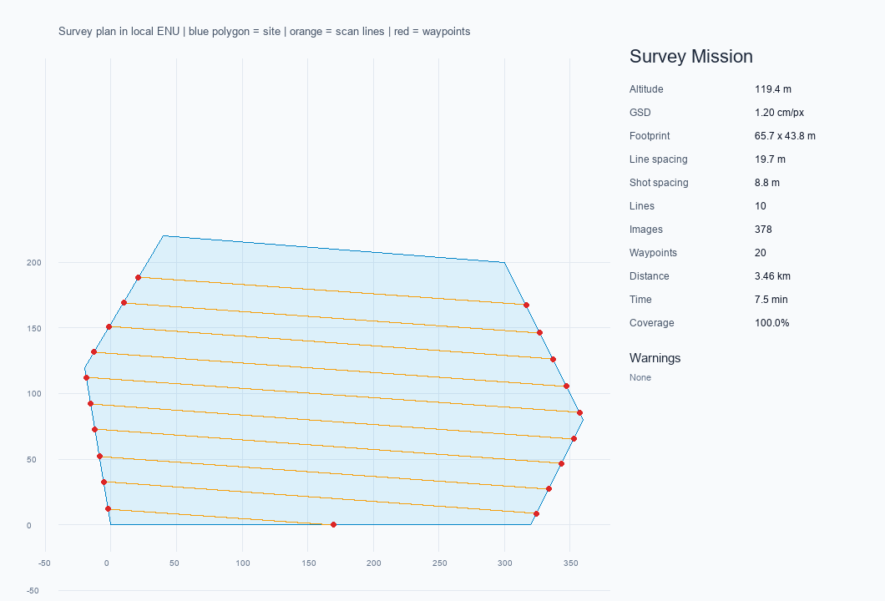

# 无人机航测任务规划：GSD、重叠度与航点导出

## 为什么需要这个模块

[AP-CPP 主动感知覆盖规划](../ap_cpp_overfomo.md) 关注“飞到哪里看、看哪里信息
增益最高”，[航点轨迹跟踪](../air/waypoint_tracking.md) 关注“已有航点怎么跟”。
本模块补的是更前面的一步：**给定相机、目标 GSD、重叠度和测区，应该飞多高、
航带间隔多少、拍多少张、航点在哪里**。

它不控制无人机，也不替代禁飞区检查；输出是飞行前可检查、可导出的任务文件。

## 快速运行

```bash
cd src/air/survey_mission_planner
python -m pip install -r requirements.txt
python main.py demo
```

本机实测：

```text
altitude_m=119.3891
gsd_m=0.012
footprint_width_m=65.664
footprint_height_m=43.776
line_spacing_m=19.6992
shot_spacing_m=8.7552
line_count=10
image_count=378
flight_distance_m=3456.358
flight_time_s=450.045
coverage_ratio=1.0
waypoint_count=20
```



示例相机为 1 英寸传感器、24 mm 镜头、5472×3648 图像；目标 GSD 1.2 cm/px，
算得航高约 119.4 m，旁向/航向重叠 70%/80%，规划 10 条航带、20 个航点和 378 张
照片。测区约 6.5 万 m²，预计航程 3.46 km、纯飞行时间 7.5 min。

## 方法

由目标 GSD 反算航高：

$$
H = \frac{\mathrm{GSD} \cdot f \cdot W_{px}}{W_{sensor}}
$$

然后计算地面覆盖宽高、航带间距和拍照间距。测区先按顶点主方向旋转，使航带
沿长边方向；再对每条扫描线求与多边形的交点区间，生成往复式航点。最后旋转回
原 ENU 坐标系。

覆盖率用 2 m 网格采样：对测区内的每个采样点，检查它到最近航带中心的距离是否
小于半幅宽。示例的覆盖率为 100%，但采样分辨率有限，不等价于真实照片重叠检查。

## 导出

`main.py demo` 在 `results/` 下生成：

- `survey_waypoints.csv`：序号、ENU、经纬度、航高；
- `survey_mission.kml`：航迹线；
- `survey_mission.wpml`：最小 DJI WPML 示例；
- `plan.json`：全部指标和警告。

WPML 的字段会随 DJI Pilot/机型变化，仓库中的文件是**可解析的最小示例**，不是
经过真机验证的飞行任务。正式飞行前必须在地面站中检查航高、返航高度、禁飞区、
电池余量和机型字段。

## ROS 2 接口

节点订阅 `/survey/plan_request`（JSON），发布 `/survey/path`
（`nav_msgs/Path`）和 `/survey/summary`（JSON）。

```bash
colcon build --packages-select survey_mission_planner
source install/setup.bash
ros2 launch survey_mission_planner main.launch.py
```

ROS 2 节点在当前 Windows 开发机上未执行；离线规划、8 个单元测试和三种导出格式
均已实际运行。ROS 2 Humble 的启动验证需要在 Ubuntu 虚拟机中完成。

## 测试

```bash
python -m unittest discover -s tests -v
```

8 个测试全部通过，覆盖 GSD/航高互算、覆盖范围、航带/拍照间距、覆盖率、航点
位于测区内、确定性和 CSV/KML/WPML 可解析。

## 已知限制

- 平面测区，不做 DEM 地形跟随；
- 不考虑风、电池电压曲线和真实转弯动力学；
- 凹多边形会生成多个航段，但没有做全局最优路径排序；
- WPML 未在真实 DJI 机型上验证；
- 覆盖率是几何采样，不是基于真实照片的重叠度检查。

## 大模型使用声明

代码、测试和文档使用 OpenAI Codex 辅助完成；运行指标与截图来自本机实际执行。
提交者需对内容负责。
