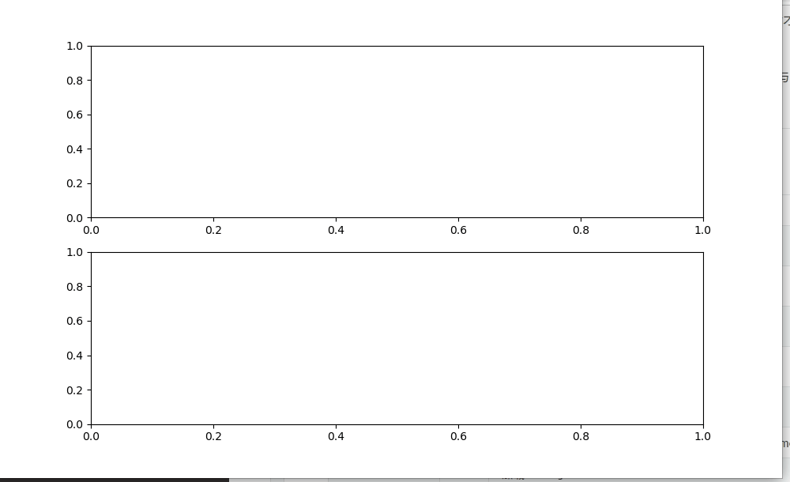
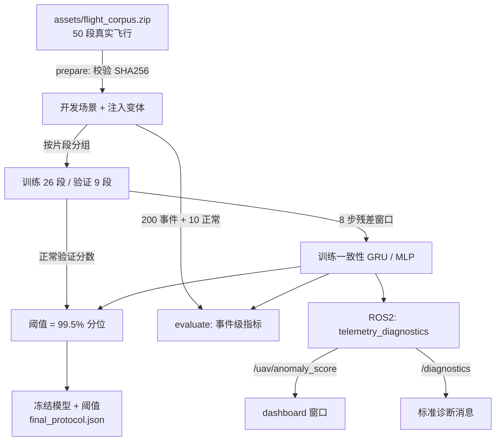
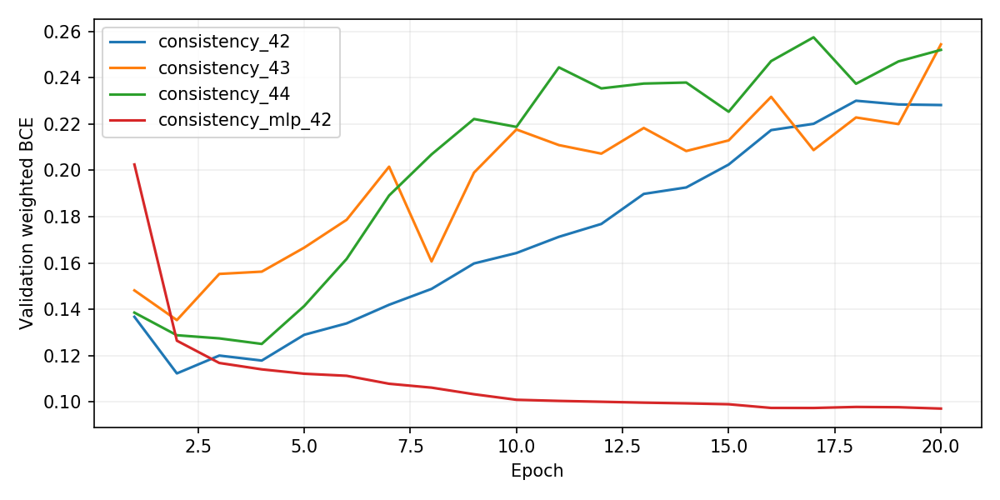
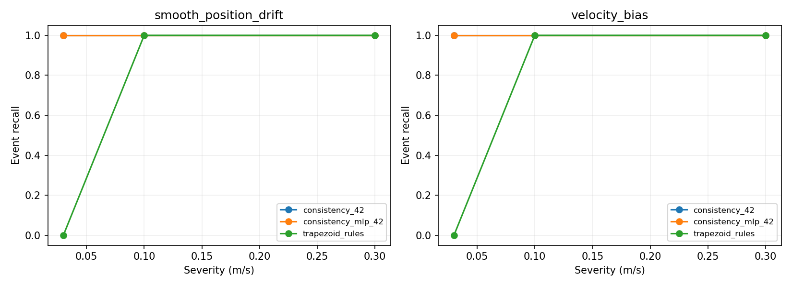
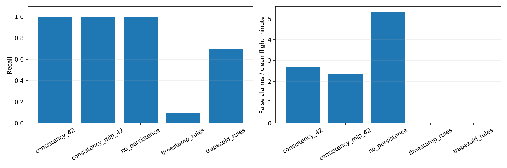
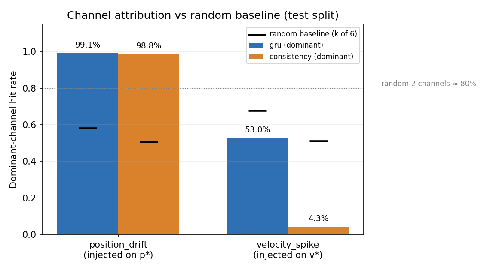

# 无人机遥测异常检测与 ROS2 在线诊断

本页记录一个可复现的**遥测数据可靠性**实验：从 AirSim 记录的飞行状态里，判断当前观测是否"自相矛盾"——位置差分与速度不符、速度差分与加速度不符，或时间戳异常。输出异常分数、阈值、报警与诊断消息，**不下发任何飞控指令**。



上面的动图不是摆拍：`telemetry_diagnostics` 节点订阅回放话题，逐条计算分数并发布 `/uav/anomaly_score`，看板窗口把这 361 条消息画成曲线。第 6.5 秒左右分数从 −4 跳到 +8，越过阈值，报警位从 0 变 1。

---

## 1. 任务定义与边界

**输入**：9 个通道的飞行状态——位置 `px,py,pz`、速度 `vx,vy,vz`、加速度 `ax,ay,az`，以及源时间戳与到达时间。

**输出**：每条观测一个异常分数（logit）、阈值、`alarm` 布尔、原因码、数据有效性与模型就绪状态。

**边界**：

| 不做什么 | 原因 |
|---|---|
| 不输出控制指令 | 只做诊断，不参与飞控，没有失效保护 |
| 不识别"真实传感器硬件故障" | 位置漂移、速度偏置、冻结、丢包都是**软件观测层注入** |
| 不重复导航/避障/轨迹预测 | 那是 PPO、YOLO、状态预测几个项目的事 |

三个设计取舍：

| 取舍 | 选择 | 理由 |
|---|---|---|
| 学什么 | **跨通道一致性残差**，不学具体航迹 | 航迹千变万化，而"位置导数应等于速度"永远成立 |
| 谁负责规则 | 时间戳冻结/缺包交给规则，网络不背这个锅 | 规则零成本且 100% 可解释，混进网络只会让归因变模糊 |
| 阈值怎么定 | 正常验证分数的 99.5% 分位数 | 不用测试集调参，保证最终测试是"一次性的" |

**与相邻项目的界限**：上游的[飞行状态预测（PR #121）](https://github.com/OpenHUTB/ros2/pull/121)预测未来轨迹；本项目判断当前数据是否自洽。两者可以串联，但本项目不依赖它，`prepare` 之后即可独立运行。

---

## 2. 运行环境与快速开始

### 2.1 环境

| 项 | 配置 |
|---|---|
| 系统 | Ubuntu 20.04.6（VMware），6 核 / 8.5 GB |
| ROS | ROS2 **Humble**，在 20.04 上**源码编译**（`/opt/ros/humble`，Python 3.8）；官方二进制目标是 Ubuntu 22.04 / Python 3.10，本机没有 `ros-humble-*` deb |
| 深度学习 | PyTorch **2.4.1+cpu** |
| 可视化 | Tk + matplotlib（不用 RViz2，本机缺 Ogre） |

### 2.2 安装与自检

```bash
cd ~/ros2/src/air/telemetry_diagnostics
source /opt/ros/humble/setup.bash
/usr/bin/python3 -m venv --system-site-packages ~/uav_prediction_env
source ~/uav_prediction_env/bin/activate
python -m pip install -r requirements.txt
bash main.sh doctor
bash main.sh build
```

`doctor` 检查 13 个模块（含 `launch_ros` 依赖的 `lark`），打印实际解释器并写 `artifacts/environment.json`。

常见故障：`launch_ros: No module named 'lark'` → 在本模块目录、已激活的环境中重跑 `pip install -r requirements.txt`。不要跳过检查硬上。

### 2.3 最快演示

```bash
python main.py prepare     # 解压语料并生成 70 个开发场景
python main.py build
bash main.sh demo          # 回放，约 28 秒
```

另一个终端（同一环境、`DISPLAY` 可用）：

```bash
python main.py dashboard
```

也可以一次启动：

```bash
source install/setup.bash
ros2 launch telemetry_diagnostics main.launch.py \
  model:="$PWD/models/consistency_42" csv:="$PWD/sample/observations.csv" plot:=true
```

演示约 18 秒仿真时间加启动等待，脚本自动退出并清理子进程。`sample/evaluation_only.csv` 不会送给诊断节点——避免"演示数据泄漏进评估"。

---

## 3. 数据与实验设计

### 3.1 语料

`assets/flight_corpus.zip` 含 **50 段真实飞行**（AirSim Blocks 场景记录）：

| 批次 | 段数 | 用途 |
|---|---:|---|
| 原始 | 30 | 20 训练、5 验证、5 旧原型测试（不参与新版训练） |
| 100–109 | 10 | 先用于诊断冻结的旧模型；暴露泛化问题后，100–105 进训练、106–109 进验证 |
| 200–209 | 10 | 新模型冻结之后采集，**最终测试**，未用于训练或阈值选择 |

新版训练 26 个原始片段、验证 9 个片段。最终测试 10 段共 **3,610 条状态**，零飞行中碰撞。

### 3.2 两套场景，不要混用

| 数据路径 | 场景数 | 强度 | 用途 |
|---|---:|---|---|
| `data/prepared` | **70** | 0.3（训练/验证）、0.6（开发测试） | 训练、验证、21 项单元测试 |
| `data/final_raw` → 210 个场景 | **210** | 0.03 / 0.1 / 0.3 | **最终指标（第 7 节全部数字）** |

`prepare` 只生成前者（打印 `Prepared 70 scenarios`）；第 7 节的结果来自 `evaluate` 读取 `data/final_raw` 后现场派生的 210 个场景。两套强度不同，**数量与指标都不能互相引用**。

**`data/final_raw` 不入库**：这 10 段 final 飞行由 `collect_holdout.py` 在 AirSim + Unreal 上现场采集，`data/` 整个目录在 `.gitignore` 里。所以干净克隆上 `python main.py evaluate` 会在数据检查处退出——它校验的是「有 10 段 final 数据」，不是模型或代码有问题。想核对第 7 节的数字，直接看已入库的 `results/final/summary.json`；要重新生成，得先用 AirSim 重跑一遍 `collect_holdout.py`。

### 3.3 异常注入

最终测试把 10 段干净飞行各自派生出异常变体：

| 类型 | 强度 | 说明 |
|---|---|---|
| 平滑位置漂移 | 0.03 / 0.1 / 0.3 m/s | 三轴分别注入，强度表示最大漂移斜率 |
| 平滑速度偏置 | 0.03 / 0.1 / 0.3 m/s | 三轴分别注入，强度表示最大偏置 |
| 冻结 | — | 保留旧源时间，值不变 |
| 丢包 | — | 发布端跳过该记录，接收端按到达时间判断 |

合计 **200 个异常事件 + 10 个正常场景**（`results/final/manifest.json` 共 210 条）。异常使用平滑起止，没有第一版的硬恢复跳变。

**注意**：这 200 个事件来自 10 段真实飞行的变体，**不是 200 次独立飞行**。所有区间统计都按"每个场景一个事件"计算。

### 3.4 为什么不用随机划分

若按窗口随机划分，同一段飞行的相邻窗口会同时出现在训练与测试里，模型只要记住"这段航迹的形状"就能作弊。本实验按**完整飞行片段**分组，再在片段内切窗口。

---

## 4. 计算原理

### 4.1 跨通道一致性残差

对相邻两条观测 \(t-1, t\)（时间差 \(\Delta t\)）：

$$
\mathbf{r}_p=\frac{\mathbf{p}_t-\mathbf{p}_{t-1}}{\Delta t}-\frac{\mathbf{v}_{t-1}+\mathbf{v}_t}{2},
\qquad
\mathbf{r}_v=\frac{\mathbf{v}_t-\mathbf{v}_{t-1}}{\Delta t}-\frac{\mathbf{a}_{t-1}+\mathbf{a}_t}{2}
$$

两个残差各 3 维，拼成 6 维：

$$
\mathbf{r}_t=\big[\mathbf{r}_p^\top,\ \mathbf{r}_v^\top\big]^\top\in\mathbb{R}^6
$$

物理含义：位置的差分应当等于速度的中点值；速度的差分应当等于加速度的中点值。正常飞行里两者都接近 0，漂移或偏置会让残差系统性偏离。

\(\Delta t\) 不在 \(0.01\sim0.15\) s 之内时丢弃该窗口——太短无法差分，太长说明中间丢包。

### 4.2 尺度归一与保号对数

训练集正常样本给出每个通道的尺度 \(s_j\)，再做保号对数变换：

$$
\tilde r_j=\operatorname{sign}(r_j)\cdot\log\!\Big(1+\frac{|r_j|}{s_j}\Big)
$$

保号是为了不丢失"偏高/偏低"的方向信息；对数是为了压缩大残差的动态范围，让网络不被少数尖峰主导。

### 4.3 时序模型

取最近 **8** 个残差向量组成序列 \(\mathbf{R}=[\tilde{\mathbf r}_{t-7},\dots,\tilde{\mathbf r}_t]\in\mathbb{R}^{8\times6}\)：

$$
\mathbf{h}_k=\mathrm{GRU}\big(\tilde{\mathbf r}_{t-7+k},\ \mathbf{h}_{k-1}\big),\quad k=1..8,\qquad
z=\mathbf{w}^\top\mathbf{h}_8+b
$$

隐藏单元 16，参数量 \(3\times(16\times6+16\times16+2\times16)+17=1{,}169\)。输出 \(z\) 是 logit，不是概率——阈值也定义在同一尺度上。

### 4.4 训练目标

正常样本记 0，注入异常样本记 1：

$$
\mathcal{L}=\frac{1}{N}\sum_{n=1}^{N}\Big[-\big(y_n\log\sigma(z_n)+(1-y_n)\log(1-\sigma(z_n))\big)\Big]
$$

20 轮，按**验证集 BCE** 选模型（不是按准确率，避免阈值未定时的偏置）。

### 4.5 阈值与报警

$$
\tau=\operatorname{Quantile}_{99.5\%}\big(\{z_i\}_{i\in\text{正常验证}}\big)
$$

报警需要**连续 3 次** \(z>\tau\)：

$$
\text{alarm}_t=\mathbb{1}\Big[\sum_{k=0}^{2}\mathbb{1}(z_{t-k}>\tau)=3\Big]
$$

单次越阈值不报警，是为了压掉尖峰引起的误报；代价是延迟增加约 2 个采样周期（本实验为 0.1 s 量级）。

### 4.6 事件级指标

$$
\text{Precision}=\frac{TP}{TP+FP},\qquad
\text{Recall}=\frac{TP}{N_{\text{events}}},\qquad
F_1=\frac{2PR}{P+R}
$$

- **检出（TP）**：异常区间内**新出现**的报警；
- **假阳性（FP）**：正常时段新出现的报警；
- 异常发生前就已持续的报警**不算检出**（否则一直报警就能刷满分）；
- **延迟**只对检出事件统计；漏检单独报。

正常误报率按**分钟**归一：

$$
\text{FP/min}=\frac{\#\text{正常时段的报警}}{\sum_{\text{正常场景}}\text{时长}/60}
$$

只用 10 个唯一正常场景，避免变体前缀重复计数。

---

## 5. 算法流程

### 5.1 总体流程



### 5.2 训练

```
输入: 训练窗口 R (8×6), 标签 y, 尺度 s, 种子
1  用训练集正常样本估计 s（逐通道）
2  变换 R → sign(r)·log1p(|r|/s)
3  打乱, batch, BCE 反传, Adam
4  每轮在验证集算 BCE, 保留最优
5  用最优模型对正常验证集打分, 取 99.5% 分位作为阈值
6  与持久化参数一起写入 models/<name>/{model.pt,config.json}
```

### 5.3 在线推理

```
每条 /uav/telemetry:
1  解析 JSON; 坏 JSON / 非有限值 → reason=invalid_payload, alarm=True
2  delivered=0 或源时间戳倒退 → 清空历史, alarm=True
3  Δt 不在 [0.01, 0.15] → 清空历史, reason=time_gap
4  追加残差, 只保留最近 8 条
5  不足 8 条 → model_ready=False, 不报警
6  否则打分; z>τ 且连续 3 次 → alarm=True
7  发布 /uav/anomaly_score 与 /diagnostics
```

**规则与网络的分工**写在代码里：时间戳类异常由规则直接判 `True`，网络只负责 `model_residual`。

---

## 6. 训练设置

| 超参数 | 值 |
|---|---|
| 历史长度 | 8 |
| 输入维度 | 6（3 位置残差 + 3 速度残差） |
| 网络 | GRU(6→16) → Linear(16→1)；对照 MLP(6→16→1) |
| 参数量 | 1,169 |
| 优化器 | Adam |
| 轮数 | 20，按验证 BCE 选模型 |
| 阈值 | 正常验证分数 99.5% 分位（`consistency_42`：1.3973） |
| 持久化 | 连续 3 次越阈值 |
| 窗口数 | 训练 143,982 / 验证 52,763 |
| 种子 | 42 / 43 / 44（部署用 42） |

---

## 7. 实验结果

### 7.1 总体（200 个事件）

| 方法 | 检出 | Precision | Recall | F1 | 正常误报/分钟 |
|---|---:|---:|---:|---:|---:|
| **`consistency_42`（部署）** | 200 | 0.617 | 1.000 | 0.763 | 2.669 |
| `consistency_43` | 200 | 0.766 | 1.000 | 0.868 | 1.001 |
| `consistency_44` | 200 | 0.704 | 1.000 | 0.826 | 3.336 |
| `consistency_mlp_42` | 200 | **0.833** | 1.000 | **0.909** | 2.335 |
| 仅神经网络（无时间戳规则） | 180 | 0.592 | 0.900 | 0.714 | 2.669 |
| 不要求连续触发 | 200 | 0.467 | 1.000 | 0.637 | 5.337 |
| 仅时间戳规则 | 20 | 1.000 | 0.100 | 0.182 | 0.000 |
| 同验证集校准的梯形积分规则 | 140 | 1.000 | 0.700 | 0.824 | 0.000 |

三个必须说清楚的点：

1. **部署的 `consistency_42` 是三个种子里最弱的**：F1 0.763，低于 43（0.868）与 44（0.826）。当初选 42 是为了固定种子、避免"按测试集挑最好"，不是因为它最好。
2. **MLP 变体在所有指标上优于 GRU**：F1 0.909 vs 0.763，Precision 0.833 vs 0.617，误报还更低（2.335 vs 2.669）。8 步的时序建模在这个任务上没有带来收益——残差本身已经很局部。
3. **规则基线精度 100%**：梯形积分规则零误报，但只检出 70%；时间戳规则零误报、检出 10%。**没有任何方法在精度与召回上同时占优**，这是这个任务的真实形状。



### 7.2 分类型与分强度（`consistency_42`）

| 类型 | 强度 | 检出 | Precision | 平均延迟 (s) |
|---|---|---:|---:|---:|
| 平滑位置漂移 | 0.03 | 30/30 | 0.588 | 0.323 |
| 平滑位置漂移 | 0.1 | 30/30 | 0.612 | 0.244 |
| 平滑位置漂移 | 0.3 | 30/30 | 0.625 | 0.213 |
| 平滑速度偏置 | 0.03 | 30/30 | 0.625 | 0.512 |
| 平滑速度偏置 | 0.1 | 30/30 | 0.625 | 0.361 |
| 平滑速度偏置 | 0.3 | 30/30 | 0.625 | 0.281 |
| 冻结 | — | 10/10 | 0.625 | 0.100 |
| 丢包 | — | 10/10 | 0.625 | 0.100 |

规律很清楚：**强度越大，延迟越短**（位置漂移 0.323 → 0.213 s；速度偏置 0.512 → 0.281 s）。速度偏置比位置漂移更难检，因为它在残差里更"像"正常抖动。

冻结与丢包由规则处理，延迟约 0.1 s；实际 ROS2 中丢包还有 **0.15 s 接收超时**，不能直接把离线的 0.1 s 当成在线延迟。



### 7.3 种子方差

三个 GRU 种子：F1 均值 **0.819 ± 0.043**，误报 **2.335 ± 0.982** 次/分钟，Recall 恒为 1.0。

误报率的标准差接近均值的一半——**单次跑的误报指标不能当作稳定值**，这是本实验最该被注意的统计事实。

### 7.4 消融



- 去掉时间戳规则：检出从 200 降到 180（漏掉的正是冻结/丢包）；
- 去掉连续 3 次要求：Recall 不变，但 Precision 从 0.617 掉到 0.467，误报从 2.67 涨到 5.34——**持久化要求是性价比最高的一行代码**。

### 7.5 通道归因：报警时指出可疑通道

报警只说"有问题"，不说"哪里有问题"。上游在本页合入后新增了**通道归因**：把 6 维残差（位置差分 3 通道、速度差分 3 通道）按训练尺度归一化后分摊占比，取占比 ≥20% 的前两个作为 `dominant`；GRU 预测残差与一致性检测器都输出 `channels` 与 `dominant` 字段。

**必须和随机基线比**：`dominant` 最多 2 个通道，从 6 个里选，随机选 2 个的期望命中率就有 80%。基线要按每条报警**实际给出的通道数**逐条算，不能用一个常数。

| 检测器 | 注入类型 | 报警步数 | 命中率 | 随机基线 |
|---|---|---:|---:|---:|
| GRU 预测残差 | 位置漂移（p*） | 350 | **99.1%** | 58.2% |
| GRU 预测残差 | 速度偏置（v*） | 287 | 53.0% | 67.8% |
| 一致性残差 | 位置漂移（p*） | 343 | **98.8%** | 50.6% |
| 一致性残差 | 速度偏置（v*） | 348 | 4.3% | 51.2% |

本机重跑 `python attribution_eval.py --detectors gru,consistency` 复现了后两行：位置漂移 343 次报警、命中率 98.83%、基线 50.61%；速度偏置 348 次、命中率 4.31%、基线 51.21%。

结论分两半，差别很大：

- **位置漂移可用**：98.8%–99.1%，远高于 50%–58% 的随机基线；
- **速度偏置不可用**：一致性检测器只有 4.3%，**比随机猜还差**。恒定速度偏置在差分残差里只出现在起止边缘，平台段残差接近噪声，归因被噪声主导。



因此接口口径是：**`dominant` 只在位置类异常上可信；速度偏置请只看 `score`/`alarm`**。归因是相关性分摊，不是因果解释，也无法区分"传感器故障"与"观测层注入"。

### 7.6 复现一致性

| 项 | 结果 |
|---|---|
| `bash main.sh test` | **21 项**通过（4.42 秒） |
| `python main.py evaluate` | 与随附 `results/final/summary.json` 一致（Precision 0.6173、FP 2.6687）；**需要 `data/final_raw`（不入库）**，干净克隆上会明确报错退出 |
| `python attribution_eval.py` | 与上游记录一致（343 → 98.83%、348 → 4.31%） |
| `bash main.sh demo` | 361 条诊断记录（`results/final_replay/ros_diagnostics.jsonl` 361 行） |
| 交付 ZIP 异目录复测 | 上游记录：准备、测试、训练入口、构建、回放全部通过，最终 CSV 逐字节一致 |

---

## 8. ROS2 接口

| 话题 | 类型 | 用途 |
|---|---|---|
| `/uav/telemetry` | `std_msgs/String` JSON | 整数纳秒源时间、到达时间、9 个飞行量 |
| `/uav/anomaly_score` | `std_msgs/String` JSON | 分数、阈值、报警、原因、数据有效性、模型就绪、`channels`、`dominant` |
| `/diagnostics` | `diagnostic_msgs/DiagnosticArray` | 标准诊断等级与键值 |
| `/uav/replay_status` | `std_msgs/String` JSON | 回放完成通知 |

| 节点 | 职责 |
|---|---|
| `telemetry_diagnostics` | 订阅遥测、维护 8 步历史、打分、发布报警与诊断 |
| `telemetry_replay` | 回放 CSV，按源时间戳发布；丢包时真的跳过 |
| `dashboard` | 订阅 `/uav/anomaly_score`，画分数与报警曲线（Tk 窗口） |

异常处理约定：

- 输入非有限值或坏 JSON → `reason=invalid_payload`，输出 ERROR 诊断，**节点不崩**；
- 源时间戳不前进 → `stale_timestamp`，清空历史；
- 回放结束后发 `complete=true`，仪表盘显示 `REPLAY COMPLETE`；
- `live_source.py` 只读仿真状态，**不解锁、不起飞、不发控制**。

接入其他仿真器需要同时拿到**同步的位置、速度、加速度与源时间戳**。只有 `/uav/odom` 不够——没有加速度通道时，速度残差这一半特征无法计算。

---

## 9. 源代码解析

| 文件 | 行数 | 职责 |
|---|---:|---|
| `consistency.py` | 100 | 残差、8 步窗口、GRU/MLP、在线 `ConsistencyDetector` |
| `train_consistency.py` | 94 | 训练、验证选模、阈值标定 |
| `evaluate_consistency.py` | 111 | 冻结模型的事件级评估与消融 |
| `report_final.py` | 41 | 汇总表与三张图 |
| `telemetry_data.py` | 100 | 语料解压、校验、场景生成 |
| `holdout_evaluate.py` | 128 | 注入与旧版评估 |
| `collect_holdout.py` | 186 | 真实仿真采集（唯一会控制无人机的脚本） |
| `ros_diagnostics.py` | 133 | ROS2 推理节点 |
| `attribution.py` | 32 | 残差通道占比与 `dominant` 归因 |
| `channels.py` | 12 | 残差通道定义 |
| `attribution_eval.py` | 118 | 归因命中率与随机基线评估 |
| `live_source.py` | 40 | 只读实时桥接 |
| `dashboard.py` | 74 | Tk 看板 |
| `check_ros.py` | 49 | 独立订阅与记录 |
| `main.py` / `main.sh` | 51 / 27 | 统一入口 |

五个关键设计：

**残差只依赖相邻两帧。** `residual()` 不需要历史缓冲区之外的任何状态，在线与离线共用同一函数——这消除了"离线一套、在线一套"的经典偏差。

**规则与网络分工明确。** `step()` 里时间戳类异常直接 `abnormal=True`，网络只在 `reason='model_residual'` 时出现。归因清楚，消融才有意义。

**阈值来自正常验证集，不是测试集。** `config.json` 里写死 `threshold`，`evaluate` 先校验 `final_protocol.json` 的哈希，防止"边评估边调参"。

**冻结模型有哈希保护。** `final_protocol.json` 记录权重与阈值哈希，重训不会自动替换部署模型——这是本实验"最终测试只跑一次"承诺的技术保证。

**采集脚本与诊断脚本分离。** 只有 `collect_holdout.py` 会控制仿真无人机，其余全部只读。安全边界写在代码结构里，而不是文档里。

---

## 10. 复现步骤

```bash
cd ~/ros2/src/air/telemetry_diagnostics
source /opt/ros/humble/setup.bash
source ~/uav_prediction_env/bin/activate

bash main.sh doctor        # 13 个模块
python main.py prepare     # 70 个开发场景
python main.py test        # 21 项测试
python main.py evaluate    # 需 data/final_raw（AirSim 采集，不入库）；缺失时会报错退出，此时请对照 results/final/summary.json
python main.py report      # 三张图与汇总表
bash main.sh build
bash main.sh demo          # 另开 dashboard
```

耗时：测试 4.0 秒，评估约 6 秒，回放 28 秒。训练另算（`python main.py train --seed 42 --output models/retrained`，20 轮）。

---

## 11. 局限与适用范围

1. **单一场景**：只有 AirSim Blocks 一段场景，正常观察时长约 3 分钟，误报率的置信区间很宽（种子间 ±0.98 次/分钟）。
2. **异常是软件注入的**：位置漂移、速度偏置、冻结、丢包都由观测层制造，**不等价于真实传感器故障**。
3. **不覆盖未知异常**：训练只见过这四类，遇到没注入过的故障模式，模型会给一个分数但没有保证。
4. **网络不比规则强**：精度上规则 100%，网络 0.62；召回上规则 70%，网络 100%。选择哪个取决于代价，本文不宣称网络更优。
5. **GRU 没有超过 MLP**：F1 0.763 vs 0.909，时序建模在此任务上没有收益。
6. **延迟不等于在线延迟**：离线 0.10 s 的冻结检出，在线还要加 0.15 s 接收超时。
7. **未在异机复测**：所有数字来自同一台虚拟机，作者不冒充跨机器复现。
8. **通道归因只对位置类异常可信**：速度偏置上命中率 4.3%，低于随机基线，会误导定位。
9. **不是安全组件**：不参与飞控，没有失效保护，不能用于实机决策。

---

## 12. 维护说明

1. 权重与阈值有哈希保护（`final_protocol.json`），改模型后必须同步更新，否则 `evaluate` 会拒绝运行；
2. 新增异常类型要同时更新注入代码、评估分组与第 7.2 节的表；
3. 阈值必须只在**正常验证集**上标定，不能在测试集上调；
4. 图片放在 `docs/img/air/telemetry_diagnostics/`（仓库 `.gitignore` 忽略 `*.gif`，只对该目录开白名单）；
5. `results/`、`artifacts/`、`build/`、`install/`、`log/` 都不入库；
6. 第一版实验（`train_evaluate.py`、`holdout_evaluate.py` 与根目录旧结果）保留作为记录，**不要与新版的成绩混用**。

`assets/flight_corpus.zip` 为自包含语料；`models/` 为权重与配置；`tests/` 为单元与一致性测试。

---

## 13. 参考资料

1. Cho K., et al. *Learning Phrase Representations using RNN Encoder–Decoder for Statistical Machine Translation.* EMNLP 2014.（GRU）
2. Chandola V., Banerjee A., Kumar V. *Anomaly Detection: A Survey.* ACM Computing Surveys, 2009.
3. ROS 2 诊断消息规范：<https://docs.ros.org/en/humble/Tutorials/Demos/Quality-of-Service.html>
4. OpenHUTB AirSim ROS 桥接示例：<https://github.com/OpenHUTB/ros2/tree/master/src/air/air_teleop>

---

**说明**：本项目代码、环境排查与文档在 OpenAI Codex 辅助下完成；指标来自实际运行，截图与动图来自实际窗口，未生成或伪造实验图。提交者负责检查与维护提交内容。
