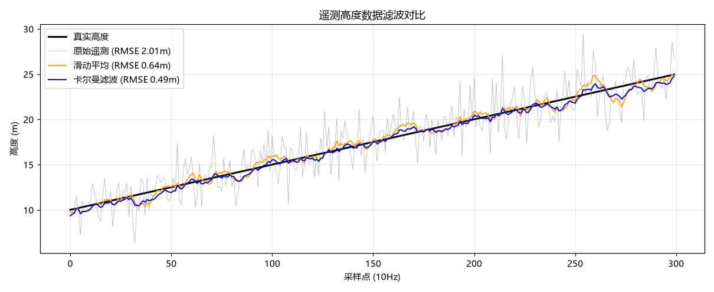

# (作业) 蒋宇鑫 2535030012 遥测高度数据滤波对比: 滑动平均 vs 卡尔曼 (telemetry_filter_compare)

## 1. 简介

无人机高度计（气压计/超声波/GNSS）原始遥测必然混入噪声，直接用于控制会引起抖动。本模块以 10Hz 生成含高斯噪声的爬升高度遥测，实时对比**滑动平均**与**标量卡尔曼滤波**两种方案，以 RMSE（相对真实高度）量化滤波效果。结论：卡尔曼在斜坡信号下优于滞后明显的滑动平均。

## 2. 运行环境

- Ubuntu 22.04 + ROS 2 Humble；测试需 pytest

## 3. 目录结构

```text
src/air/telemetry_filter_compare/
├── main.py              # ROS2 节点: 10Hz 发布原始/滑动平均/卡尔曼三路高度
├── core.py              # 滤波器与 RMSE 评估（纯 Python）
└── test/test_core.py    # 6 项单元测试
```

## 4. 话题说明

| 话题 | 类型 | 说明 |
| --- | --- | --- |
| `/drone/altitude_raw` | `std_msgs/Float32` | 原始含噪高度 |
| `/drone/altitude_ma` | `std_msgs/Float32` | 滑动平均滤波（窗口 9） |
| `/drone/altitude_kalman` | `std_msgs/Float32` | 卡尔曼滤波结果 |

## 5. 单元测试运行结果

```text
test/test_core.py::test_moving_average_length PASSED
test/test_core.py::test_moving_average_smooths_spike PASSED
test/test_core.py::test_kalman_converges PASSED
test/test_core.py::test_kalman_better_than_raw PASSED
test/test_core.py::test_kalman_beats_lagging_ma_on_ramp PASSED
test/test_core.py::test_rmse_zero_for_equal PASSED
6 passed
```

## 6. ROS2 节点运行结果（真实运行 30 秒）

```text
[telemetry_filter_compare]: 遥测滤波对比节点启动 (10Hz), 运行 30 秒...
[telemetry_filter_compare]: ===== 滤波效果对比 (RMSE, 越小越好) =====
[telemetry_filter_compare]:   原始数据:   2.061 m
[telemetry_filter_compare]:   滑动平均:   0.595 m
[telemetry_filter_compare]:   卡尔曼滤波: 0.522 m
```

## 7. 运行效果图



（图由 `make_figures.py` 实际运行生成：卡尔曼 RMSE 0.486m，优于滑动平均 0.635m 与原始 2.006m。）

## 8. 设计说明

- **滑动平均滞后**：窗口 9 在 10Hz 下引入约 0.4s 延迟，爬升段产生系统性低估；
- **卡尔曼自适应**：用残差在线估计观测噪声方差 R，过程噪声 Q 取 0.05，对斜坡信号几乎无滞后；
- **可复现**：噪声使用固定种子，测试与运行结果可复现。

## 9. 参考链接

- 卡尔曼滤波: <https://en.wikipedia.org/wiki/Kalman_filter>
- OpenHUTB 传感器文档: <https://openhutb.github.io/doc/>

## 10. 大模型使用声明

本模块代码与文档在编写过程中使用了大模型工具（WorkBuddy）辅助生成，作者已逐行核对全部内容，理解其原理并实际运行验证，对提交内容负全部责任。
