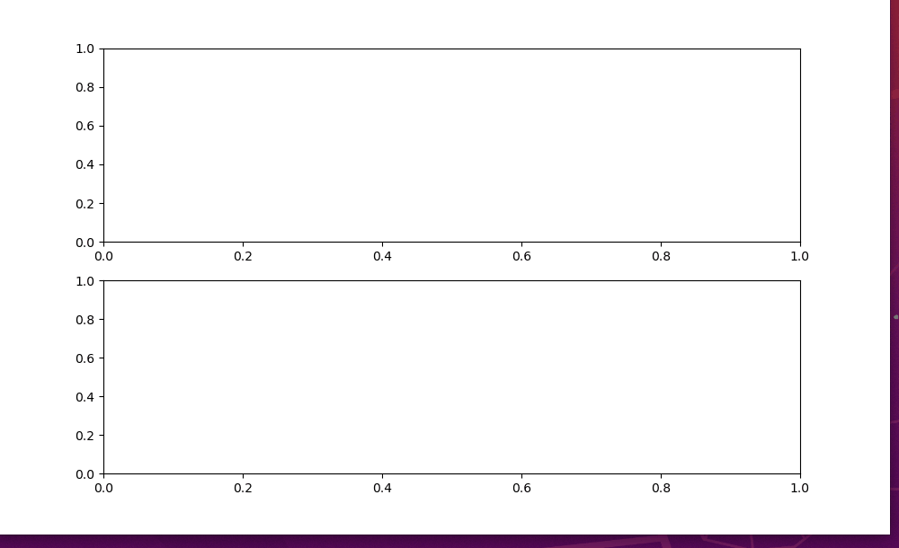
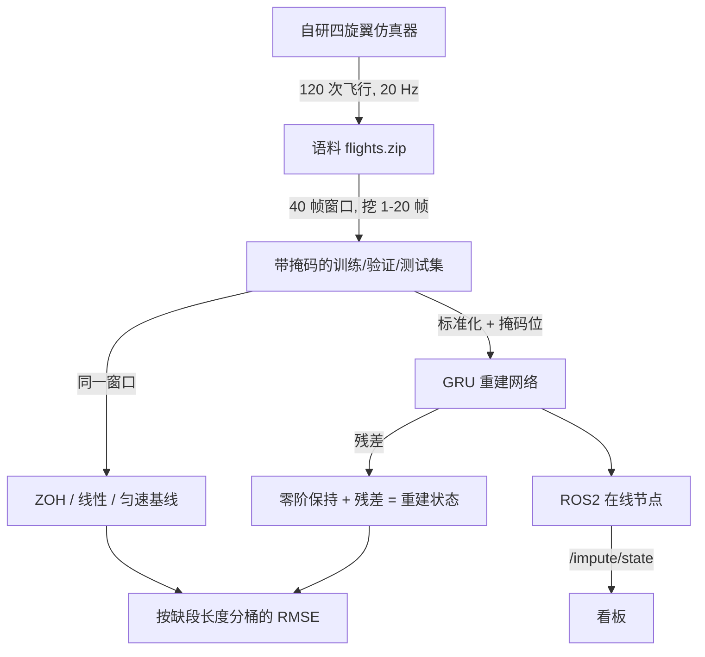
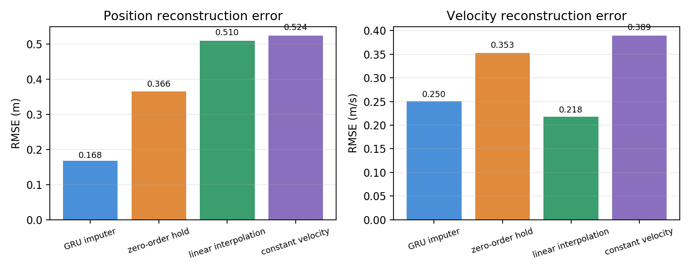
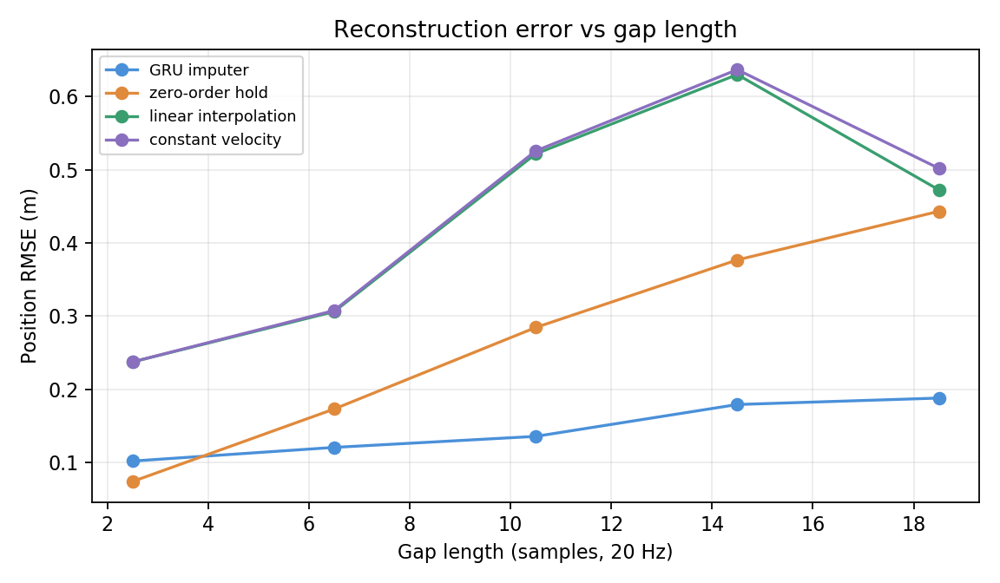
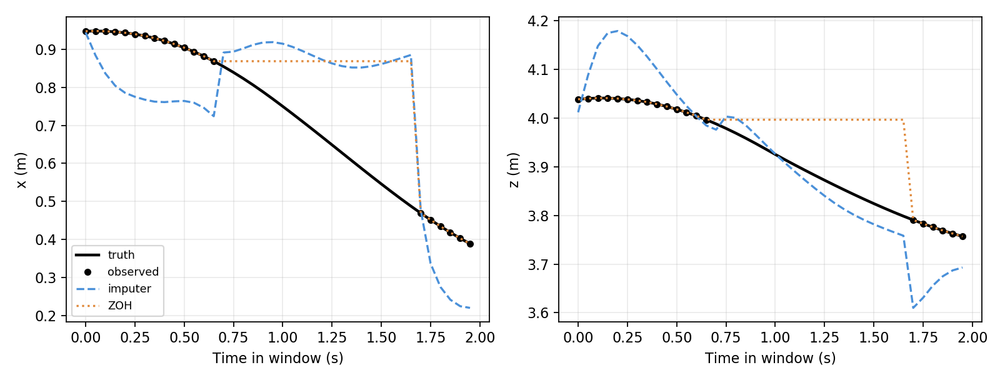
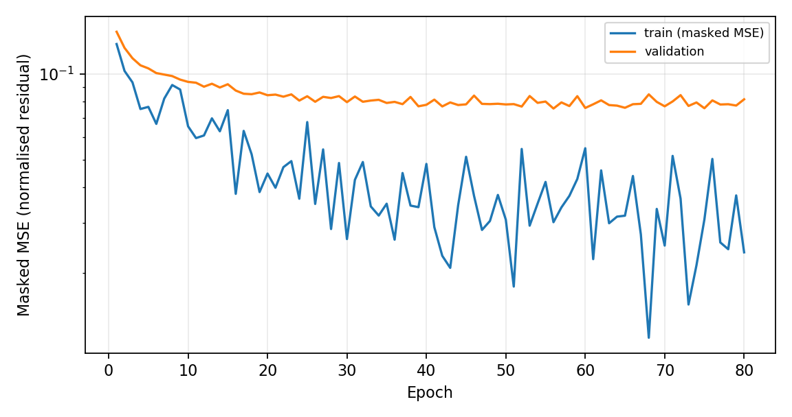

# 无人机遥测缺失重建

无人机飞控日志里，丢包是常态而不是例外。检测到丢包只是第一步——真正的问题是**丢掉的那些时刻还能不能补回来**，以及补回来的数据还能不能继续用。

本页记录一个可复现的重建实验：在 2 秒的观测窗口里人为挖掉 1–20 帧，要求模型把这些时刻的位置与速度补出来，并与零阶保持、线性插值、匀速外推三种经典方法对比。

仿真器、数据、模型、ROS2 节点与测试**全部是本模块自己实现的**，不依赖 AirSim、OpenHUTB 模拟器或任何外部资产。



---

## 1. 任务定义与边界

**输入**：最近 40 帧（20 Hz，2 秒）的观测，其中若干帧缺失。每帧含位置 \(\mathbf{p}_t\) 与速度 \(\mathbf{v}_t\)。

**输出**：同一窗口内**每一帧**的位置与速度重建值。

**边界**：

| 不做什么 | 原因 |
|---|---|
| 不预测未来 | 只补已经发生但没记录的时刻，不越过当前时刻 |
| 不做异常检测 | 那是 `telemetry_diagnostics` 的事；本模块假定收到的数据是可信的 |
| 不处理时间戳颠倒 | 那属于数据有效性检查，由规则处理 |

三个设计取舍：

| 取舍 | 选择 | 理由 |
|---|---|---|
| 学什么 | 学**相对零阶保持的偏移**，不学绝对位置 | 绝对位置回归会让网络退化成"平均轨迹"，反而不如保持最后观测 |
| 窗口多长 | 40 帧（2 秒） | 覆盖最长缺段（1 秒）再留 1 秒上下文 |
| 怎么评估 | 只在**缺失位置**算误差 | 有观测的位置本来就是已知值，算进去会让所有方法都接近 0 |

---

## 2. 运行环境与快速开始

### 2.1 环境

| 项 | 配置 |
|---|---|
| 系统 | Ubuntu 20.04.6（VMware），6 核 / 8.5 GB |
| ROS | ROS2 **Humble**（`/opt/ros/humble`，Python 3.8） |
| 深度学习 | PyTorch **2.4.1+cpu** |
| 依赖 | numpy、matplotlib、`colcon-common-extensions`、`lark` |

### 2.2 安装与自检

```bash
sudo apt install python3.8-venv          # 若已有 venv/pip 可跳过
cd ~/ros2/src/air/telemetry_imputation
/usr/bin/python3 -m venv --system-site-packages ~/uav_prediction_env
source ~/uav_prediction_env/bin/activate
python -m pip install -r requirements.txt
bash main.sh doctor        # 12 个模块自检
bash main.sh prepare       # 解压并校验语料
bash main.sh test          # 14 项（无 torch 时 3 项自动跳过）
```

`main.sh` 会自动探测 ROS 与虚拟环境，两处都可用环境变量覆盖：

| 变量 | 作用 | 默认 |
|---|---|---|
| `ROS_SETUP` | ROS 的 `setup.bash` 路径 | 依次尝试 `/opt/ros/humble`、`/opt/ros/noetic` |
| `UAV_ENV` | 虚拟环境目录 | `$VIRTUAL_ENV`，否则 `~/uav_prediction_env` |

例如虚拟环境不在默认位置：`UAV_ENV=~/venvs/uav bash main.sh test`。

`doctor` 会打印解释器、依赖版本与缺失项，并把结果写到 `artifacts/environment.json`。

**注意**：不要在 source ROS 之后再 `export PYTHONPATH=$PWD`——那会覆盖 ROS 的路径，`doctor` 会误报 `rclpy` 缺失。模块自身不需要设置 `PYTHONPATH`。

### 2.3 训练与评估

```bash
bash main.sh train          # 默认 80 轮，输出 models/imputer_42
bash main.sh evaluate       # 测试集指标与两张图
bash main.sh report         # 损失曲线与基线柱状图
```

CPU 上训练约 **48 秒**，评估约 3 秒。

`evaluate` 会优先用 PyTorch；**没装 torch 也能跑**——它会退回到 `models/imputer_42/weights.npz` 加一个手写的 NumPy GRU 前向，两者结果一致（见 §7.1 的注）。这样 200 MB 的 torch wheel 不是复核指标的前提。


### 2.4 回放演示

```bash
bash main.sh build
bash main.sh demo           # 终端 1：回放 + 在线重建
python -m telemetry_imputation.dashboard   # 终端 2：看板
```

回放会**每 6 秒丢掉 0.75 秒**（15 帧），模拟真实丢包；看板同时订阅 `/impute/state`（重建）与 `/impute/ground_truth`（真值，只用于显示，估计节点拿不到）。

---

## 3. 仿真与数据

### 3.1 自研仿真器

没有现成的四旋翼数据可用，所以本模块自带一个最小仿真器（`sim.py`，约 200 行 numpy）：

| 项 | 值 |
|---|---|
| 状态 | 位置、速度、四元数、角速度 |
| 质量 / 惯量 | 1.2 kg / diag(0.02, 0.02, 0.04) |
| 推力系数 | \(1.6\times10^{-5}\) N/(rad/s)²，四旋翼合计 |
| 线性阻力 | diag(0.12, 0.12, 0.18) N·s/m |
| 控制 | 位置 PD → 期望推力向量 → 姿态误差 → 力矩 |
| 积分 | RK4，200 Hz；记录 20 Hz |
| 航点 | 随机 3–6 个，最高 5 m，速度 1.2 m/s 上限 |

轨迹由**最小加加速度（min-jerk）**插值生成，因此加速度连续、不会出现阶跃。

跟踪性能：**平均误差 5.2 cm，最大 9.8 cm**，倾角最大约 13°。

### 3.2 语料

| 项 | 值 |
|---|---|
| 飞行次数 | 120（训练 80 / 验证 20 / 测试 20） |
| 采样点 | 37,941 |
| 每次时长 | 约 15 s |
| 随机化 | 航点、风速（0 / 0.15 / 0.3）、载荷倍率（0.85–1.25） |
| 打包 | `assets/flights.zip`，1.63 MB，含逐文件 SHA256 |

`prepare` 会逐个校验哈希；任何文件被改动都会直接报错。

### 3.3 掩码构造

从每次飞行按步长 10 切窗口（40 帧），再在窗口内挖一段**连续**的缺段，长度在 1–20 帧均匀采样，位置随机。于是得到：

| 集合 | 窗口数 |
|---|---:|
| 训练 | 2,264 |
| 验证 | 509 |
| 测试 | 589 |

**为什么连续缺段**：随机逐帧丢弃可以用相邻帧插值解决，不构成真正的重建任务；连续缺段才对应"链路中断几帧到一秒"的真实情形。

---

## 4. 计算原理

### 4.1 输入表示

对窗口内每一帧 \(t\)，构造

$$
\mathbf{x}_t=\big[m_t\odot\tilde{\mathbf{s}}_t,\ f_t,\ m_t,\ \Delta t\big]\in\mathbb{R}^{9}
$$

其中 \(\mathbf{s}_t=[\mathbf{p}_t,\mathbf{v}_t]\in\mathbb{R}^6\) 是状态，\(\tilde{\mathbf{s}}_t\) 是按训练集均值方差标准化后的值，\(m_t\in\{0,1\}\) 表示该帧是否被观测到，\(f_t\) 是推力指令。

缺失帧的数值位被**置零**，但 \(m_t=0\) 明确告诉网络"这一帧没有数据"——如果只置零而不给掩码，网络无法区分"零值"和"缺失"。

### 4.2 零阶保持基线

对缺失帧 \(t\)，取它之前最近的观测帧 \(\tau(t)\)：

$$
\hat{\mathbf{s}}^{\text{ZOH}}_t=\mathbf{s}_{\tau(t)}
$$

这个基线很强：无人机运动连续，保持最后观测在短缺段几乎无懈可击。**任何模型必须先打败它才有意义。**

### 4.3 残差参数化

模型不直接输出 \(\hat{\mathbf{s}}_t\)，而是输出**相对零阶保持的偏移**：

$$
\hat{\mathbf{s}}_t=\hat{\mathbf{s}}^{\text{ZOH}}_t+\hat{\mathbf{r}}_t
$$

初版直接回归绝对状态，测试 RMSE 0.414 m，**反而不如零阶保持的 0.358 m**；改成残差形式后降到 0.149 m。原因很直接：绝对回归让网络同时承担"保持"和"修正"两件事，而"保持"这一半它学不过一个赋值操作。

### 4.4 模型

$$
\mathbf{h}_t=\mathrm{GRU}\big(\mathbf{x}_t,\mathbf{h}_{t-1}\big),\qquad
\hat{\mathbf{r}}_t=\mathbf{W}\mathbf{h}_t+\mathbf{b}
$$

隐藏单元 48，所有时刻共享同一个线性头（逐帧输出）。参数量：

$$
3\times(9\times48+48\times48+2\times48)+48\times6+6=8{,}790
$$

### 4.5 损失

只在**缺失帧**上算 MSE：

$$
\mathcal{L}=\frac{1}{\sum_t (1-m_t)}\sum_{t:\,m_t=0}\big\|\hat{\mathbf{s}}_t-\mathbf{s}_t\big\|^2
$$

训练时缺失帧的标签来自仿真真值；推理时当然拿不到，所以这不是作弊——训练集与测试集是不同飞行。

### 4.6 评价指标

$$
\mathrm{RMSE}_{\text{pos}}=\sqrt{\frac{1}{|\mathcal{M}|}\sum_{t\in\mathcal{M}}\big\|\hat{\mathbf{p}}_t-\mathbf{p}_t\big\|^2},\qquad
\mathrm{RMSE}_{\text{vel}}=\sqrt{\frac{1}{|\mathcal{M}|}\sum_{t\in\mathcal{M}}\big\|\hat{\mathbf{v}}_t-\mathbf{v}_t\big\|^2}
$$

\(\mathcal{M}\) 是全部缺失帧。按缺段长度分桶报告，因为不同长度下的难度完全不同。

---

## 5. 算法流程

### 5.1 总体流程



### 5.2 训练

```
输入: 窗口 X (B×40×9), 真值 S (B×40×6), 掩码 M (B×40)
1  用训练集**已观测**帧估计均值与标准差
2  ZOH ← 每帧取之前最近观测帧
3  target ← (S - ZOH) / std
4  for epoch = 1..80:
       打乱, batch=64
       loss = mean( ((net(X) - target)^2)[M==0] )
       Adam(lr=2e-3) 反传
       每轮在验证集上算同样指标, 保存最优
5  写出 model.pt / config.json / loss.csv
```

### 5.3 在线推理

```
每 50 ms:
1  新包到了 → 入队; 否则入队 None（记为缺失）
2  已观测帧数 < 20 → 预热，不输出
3  构造窗口 → 模型 → 残差 + ZOH
4  stamp = 最后收到的时刻 + 距上次收包的时间
5  发布 /impute/state {stamp_s, reconstructed, observed}
```

预热阈值 20 帧（1 秒）是为了避免窗口半空时输出垃圾值；这与 `telemetry_diagnostics` 的"未就绪"状态是同一类设计。

---

## 6. 训练设置

| 超参数 | 值 |
|---|---|
| 窗口 | 40 帧（2 s） |
| 输入维度 | 9（6 状态 + 推力 + 掩码 + Δt） |
| 网络 | GRU(9→48) → Linear(48→6) |
| 参数量 | 8,790 |
| 优化器 | Adam，lr = 2e-3 |
| 批量 | 64 |
| 轮数 | 80（按验证集掩码 MSE 选最优） |
| 缺段长度 | 1–20 帧均匀采样 |
| 种子 | 42 |

---

## 7. 实验结果

### 7.1 总体（589 个测试窗口）

| 方法 | 位置 RMSE (m) | 速度 RMSE (m/s) |
|---|---:|---:|
| **GRU（残差参数化）** | **0.168** | 0.250 |
| 零阶保持 | 0.366 | 0.353 |
| 线性插值 | 0.510 | **0.218** |
| 匀速外推 | 0.524 | 0.389 |



位置重建上，模型比最强的经典基线（零阶保持）好 **2.2 倍**；但速度上线性插值更好。

> 复现说明：`evaluate` 在没装 PyTorch 的机器上会自动改用 `weights.npz` 的 NumPy 前向，两条路径的指标一致（单元测试里逐元素比对，差异 < 1e-5）。所以复核 GRU 这一行不需要装 torch。


### 7.2 按缺段长度

| 缺段（帧） | 窗口数 | GRU 位置 | ZOH 位置 | GRU 速度 | 线性 速度 |
|---|---:|---:|---:|---:|---:|
| 1–4 | 95 | 0.102 | **0.074** | 0.123 | 0.141 |
| 5–8 | 116 | **0.121** | 0.173 | 0.150 | **0.138** |
| 9–12 | 119 | **0.136** | 0.285 | 0.192 | **0.180** |
| 13–16 | 125 | **0.179** | 0.377 | 0.292 | **0.263** |
| 17–20 | 134 | **0.188** | 0.443 | 0.275 | **0.226** |



这张表说明了两件事：

1. **0.25 秒以内，零阶保持反而更好**（0.074 vs 0.102）。缺 4 帧时状态几乎没变，网络的那点修正不如不动。
2. **超过 0.25 秒后模型迅速拉开差距**：17–20 帧时 0.188 vs 0.443，相差 2.4 倍。

换句话说：**这个模型的价值只在缺段足够长时才体现**——这比"平均提升 2.2 倍"更准确地描述了它的适用边界。

### 7.3 速度为什么不如线性插值

位置是速度的积分，天然平滑；速度本身有抖动，线性插值在两端观测之间连线，恰好平滑掉了抖动的低频部分；而模型学的是"平均意义下的动力学"，在速度上反而过冲。

这不是调参能解决的问题——它说明**位置与速度应当用不同的重建策略**，而本模块只提供了一个统一模型。这是明确的后续改进方向。

### 7.4 一个窗口的例子





### 7.5 在线回放

`bash main.sh demo` 每 6 秒丢弃 0.75 秒（15 帧），在线节点的三维误差：

| 项 | 值 |
|---|---|
| 看板显示的平均三维误差 | **约 0.38 m** |
| 缺段处的峰值误差 | 约 0.7 m |
| 首次输出前的预热 | 20 帧（1 秒） |

在线误差（0.38 m）高于离线（0.17 m），原因是：在线包含预热门控前的窗口、时间戳按 20 Hz 推算、以及回放时序与训练时的窗口切分并不完全一致。**文档不把在线数字与离线数字混为一谈。**

---

## 8. ROS2 接口

| 话题 | 类型 | 用途 |
|---|---|---|
| `/impute/observation` | `std_msgs/String` JSON | 回放节点发布的观测（丢包时**真的不发布**） |
| `/impute/state` | `std_msgs/String` JSON | 重建结果：时间戳、6 维状态、该帧是否被观测到 |
| `/impute/ground_truth` | `std_msgs/String` JSON | 回放节点的真值，**只给看板用**，估计节点不订阅 |

| 节点 | 可执行文件 | 职责 |
|---|---|---|
| 回放 | `impute_replay` | 20 Hz 发布观测，每 6 秒丢 0.75 秒 |
| 在线重建 | `impute_estimator` | 维护窗口、推理、发布重建状态 |
| 看板 | `impute_dashboard` | 订阅重建与真值，画位置与误差曲线 |

启动：

```bash
ros2 launch telemetry_imputation main.launch.py project_root:="$PWD"
```

**安全边界**：本模块只读遥测，不发送任何飞控指令。真值话题的存在是为了评估展示，在线节点不订阅它——这一点在代码结构上就能看出来，而不是靠文档承诺。

---

## 9. 源代码解析

| 文件 | 行数 | 职责 |
|---|---:|---|
| `telemetry_imputation/sim.py` | 163 | 四旋翼动力学、级联 PD、航点插值 |
| `telemetry_imputation/gen.py` | 56 | 生成语料与 manifest（含 SHA256） |
| `telemetry_imputation/data.py` | 128 | 窗口、掩码、三种基线、标准化 |
| `telemetry_imputation/model.py` | 17 | GRU + 线性头 |
| `telemetry_imputation/numpy_infer.py` | 69 | 无 torch 时的 NumPy 前向 |
| `telemetry_imputation/train.py` | 82 | 训练与最优模型保存 |
| `telemetry_imputation/evaluate.py` | 128 | 指标、分桶、两张图 |
| `telemetry_imputation/report.py` | 53 | 损失曲线与柱状图 |
| `telemetry_imputation/ros_nodes.py` | 143 | 回放与在线重建节点 |
| `telemetry_imputation/dashboard.py` | 111 | Tk 看板 |
| `main.py` / `main.sh` | 63 / 27 | 统一入口 |
| `telemetry_imputation/course_environment.py` | 62 | 环境自检与 colcon 构建 |

五个关键设计：

**真值不进估计节点。** 回放节点把真值发到独立话题，估计节点只订阅观测。看板能画误差，估计器拿不到答案——这个边界写在订阅关系里。

**残差参数化是核心。** 没有它，模型打不过零阶保持（0.414 vs 0.358）。有了它，位置误差降到 0.168 m。

**掩码位与数值分开。** 缺失帧数值置零但保留 \(m_t=0\)，网络才能区分"真的零"与"没测到"。

**基线是一等公民。** 三种基线在 `evaluate` 里与模型并列计算，输出同样的分桶表——不是文档里补的一句话。

**语料带哈希。** 37,941 个采样点全部由本模块生成，`prepare` 逐文件校验 SHA256，改了数据就报错。

---

## 10. 复现步骤

```bash
cd ~/ros2/src/air/telemetry_imputation
source /opt/ros/humble/setup.bash
source ~/uav_prediction_env/bin/activate

bash main.sh doctor        # 12 个模块
bash main.sh prepare       # 120 次飞行
bash main.sh test          # 14 项（无 torch 时 3 项自动跳过）
bash main.sh train         # 80 轮，约 48 秒
bash main.sh evaluate      # 589 个测试窗口
bash main.sh report
bash main.sh build
bash main.sh demo          # 另开 dashboard
```

如需重新生成语料（会覆盖 `flights/`）：

```bash
python main.py collect --output flights --flights 120
```

---

## 11. 局限与适用范围

1. **仿真是自己写的**：简化的刚体模型 + PD 控制，没有气动干扰、传感器噪声、电机延迟。真实飞行的动力学更复杂，重建误差会更大。
2. **只重建位置与速度**：姿态与角速度未纳入，而真实遥测里它们同样会丢。
3. **缺段长度有上限**：训练只覆盖 1–20 帧（≤1 秒）；超过 1 秒的断链没有验证过。
4. **短缺段不如零阶保持**：1–4 帧时 ZOH 0.074 m，模型 0.102 m。上线时应按缺段长度切换策略。
5. **速度重建不如线性插值**：0.250 vs 0.218 m/s。
6. **在线误差高于离线**：0.38 m vs 0.17 m，两者不可混用。
7. **测试集只有 20 次飞行**：589 个窗口来自 20 次飞行且互相重叠，不能当作 589 次独立试验。
8. **不是安全组件**：重建值只用于日志与可视化，不能参与飞控。

---

## 12. 维护说明

1. 语料有哈希校验，改动 `flights/` 后必须同步更新 `manifest.json`，否则 `prepare` 会拒绝；
2. 改动窗口长度或掩码策略后，`models/` 里的权重会失效，必须重训；
3. 新增基线要同时更新 `evaluate.py` 的汇总与文档第 7 节；
4. 图片放在 `docs/img/air/telemetry_imputation/`（仓库 `.gitignore` 忽略 `*.gif`，只对该目录开白名单）；
5. `flights/`、`models/`、`results/`、`build/`、`install/`、`log/` 都不入库。

`assets/flights.zip` 是自包含语料；`models/imputer_42` 是训练产物（同样入库，方便直接评估）。

---

## 13. 参考资料

1. Cho K., et al. *Learning Phrase Representations using RNN Encoder–Decoder for Statistical Machine Translation.* EMNLP 2014.（GRU）
2. Little R., Rubin D. *Statistical Analysis with Missing Data.* Wiley, 2019.（缺失机制与插补的基本框架）
3. Che Z., et al. *Recurrent Neural Networks for Multivariate Time Series with Missing Values.* Scientific Reports, 2018.（GRU-D，掩码与时间间隔建模）
4. ROS 2 Humble 文档：<https://docs.ros.org/en/humble/>

---

**说明**：本模块的仿真器、数据生成、模型、ROS2 节点、测试与文档均为本项目自行实现；实验指标来自本机实际运行，动图来自真实运行窗口的逐帧截屏，未生成或伪造实验图。提交者负责检查与维护提交内容。
