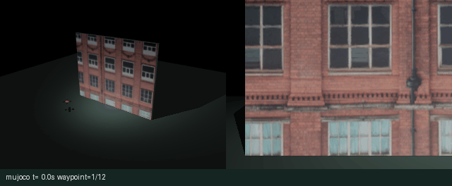
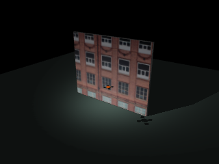
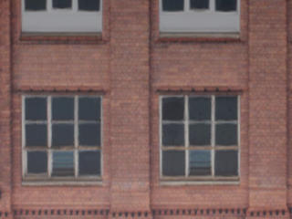
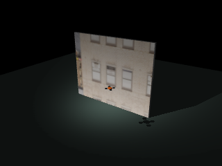
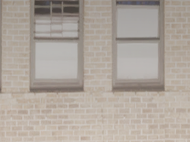
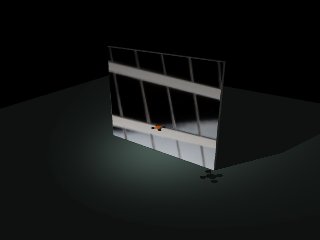
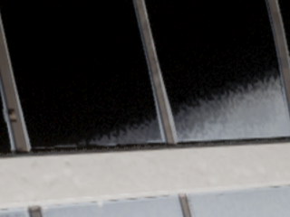
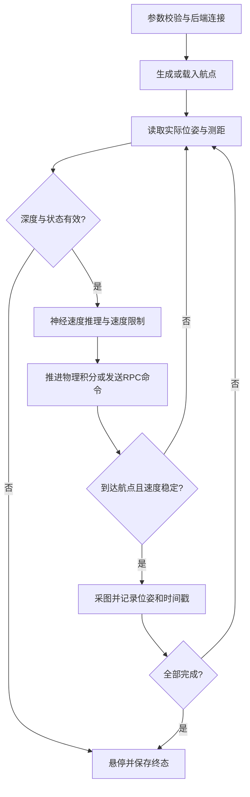
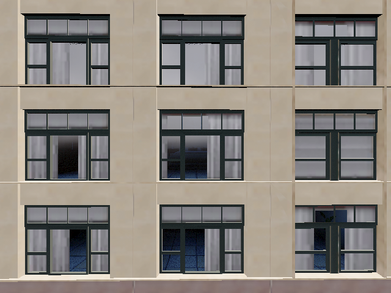
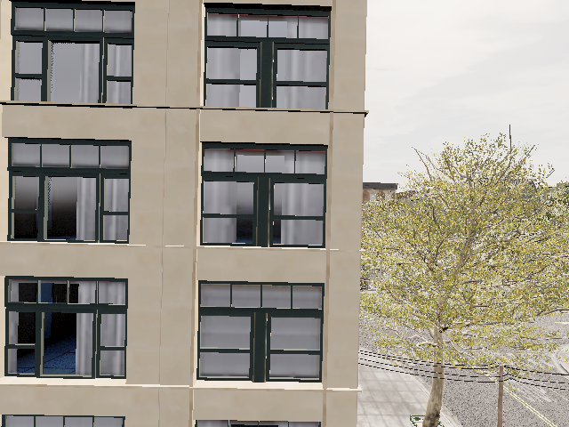

# Town10 立面自主巡航与图像采集

模块将立面扫描、神经速度控制、图像采集和 ROS 2 消息发布组织为统一任务状态机。MuJoCo 后端运行三个由 Town10HD 图像适配的立面场景；原生 AirSim 后端通过 RPC 读取实际飞行状态、相机图像与前向深度。

OpenHUTB Windows 2.10 的 Town10HD 场景已完成原生在线扫描：12/12航点、12张RGB照片，运行76.500 s。




## 1. 场景与数据边界

MuJoCo 场景包含一面 10 m × 8 m 矩形墙面、地面和三平移自由度飞行器。砖墙、灰墙、玻璃采用补充数据包 `airsim_facade_dataset_20261026/dataset_manual/images` 内的三张原始 RGB 图片。图像裁剪后统一为 1000 × 800 像素，通过显式 UV 映射覆盖墙面；纹理不重复铺贴，墙前没有遮挡图案的装饰线。

这些图片是 Town10HD 场景采集样本。图像记录中没有逐张配套的原始相机位姿和深度，故本模块只适配平面外观，不据此恢复城市几何、真实尺度或原拍摄外参。新巡航照片的位姿来自本次后端状态，与原始素材的拍摄位姿分开记录。

| 场景 | 总体视角 | 正向相机 |
|---|---|---|
| 砖墙 |  |  |
| 灰墙 |  |  |
| 玻璃 |  |  |

资产的文件名、SHA-256、裁剪框和输出纹理哈希见 [资产记录](assets.md)。

## 2. 路线与控制原理

### 2.1 蛇形路线

默认扫描宽 6 m、高 3 m、目标壁距 4 m。相机垂直视场角 50°，宽高比 4:3。垂直视场覆盖高度为：

\[
H_f=2d\tan(25^\circ),\qquad W_f=\frac43H_f.
\]

以 55% 预期重叠率计算横纵采样间隔，并在相邻行反转航点顺序，得到 4 列 × 3 行共 12 点。MuJoCo 世界中墙面位于 `y=0`，相机朝 `+y`。原生后端把同一相对路线旋转到启动时的机体右向、前向和向上基向量，并以当前悬停点为第一点，保持平面法向坐标。路线安排不产生向墙前冲的目标航点。

原始 `route_town10.txt` 包含 36 个 NED 航点。该路线以显式参数选择，支持整体 NED 偏移，保留原来的 270° 朝向。坐标依赖场景出生点与高度定义，不能由图片推算。

### 2.2 神经速度控制

小型 NumPy 网络使用 15 维输入：9 个测距特征、3 个局部航点误差和 3 个局部速度。输入经均值与标准差归一化后，经过 32 单元 ReLU 隐藏层和 3 维线性输出：

\[
\tilde x=(x-\mu)/\sigma,\quad h=\max(0,\tilde xW_1+b_1),\quad
v_c=\operatorname{clip}(hW_2+b_2,-1,1).
\]

随包权重与仓库 `mujoco_facade_capture` 控制器使用相同的输入定义。训练函数 `train_controller` 以专家速度指令为标签、Adam 优化均方误差；该纹理适配实验使用固定权重，不把三种外观当作新的独立训练证据。

MuJoCo 的速度内环输出控制力：

\[
a_c=\operatorname{clip}(4(v_c-v),-8,8),\qquad
F=m(a_c+[0,0,9.81]^T).
\]

物理步长为 0.01 s，默认任务控制周期 0.05 s；每次命令推进 5 个真实积分步，不在运行中直接设置 `qpos`。姿态稳定为固定姿态假设，因此结果反映平移巡航控制，不涉及旋翼动力分配或姿态机动。

原生后端使用有界神经网络前馈与三轴PD反馈。实际深度与MuJoCo训练场景可能不同，前馈只提供有限修正，位置误差反馈决定近点收敛。对各轴误差 \(e_i\)、局部速度 \(v_i\) 与网络输出 \(v_{NN,i}\)：

\[
\alpha_i=0.2\operatorname{clip}(|e_i|/0.5,0,1),\qquad
v_{c,i}=\operatorname{clip}(\alpha_i v_{NN,i}+1.1e_i-0.5v_i,-1,1).
\]

当 \(|e_i|<0.035\,m\) 时该轴命令置零。前馈权重随误差趋零，避免网络偏置造成稳态位置偏差；世界速度另受总速度限幅和深度门控约束。真实 DepthPlanar 九点数据进入网络输入，并独立决定近障速度限制。该原生混合控制与MuJoCo神经控制分支分别实现。

### 2.3 原生深度与安全状态机

AirSim 在同一线程串行读取状态、碰撞信息以及相机数据。Scene 与 DepthPlanar 由一次 `simGetImages` 请求取得，默认最多缓存 0.2 s。深度在画面中央 40%–60% 区域采样 3 × 3 点，保存有效数、最小值、中位数和传感器时间戳。

- 有效值不足 5 个时，任务终止并请求悬停。
- 最小深度低于 1.2 m 时，进入 `obstacle_stop`。
- 1.2–3.0 m 内，速度按 `(d_min-1.2)/1.8` 缩放。
- 速度指令和状态必须为有限值；碰撞、单航点超时、总时限和退出均执行停止与 API 控制权释放。

服务端可能保留旧碰撞标志，后端连接时记录碰撞时间戳基线，只有更新后的碰撞事件才终止本次任务。初始深度有效性与1.2 m近障阈值单独检查，不依赖碰撞标志。

九点前向采样仅覆盖中央视场，无法保证侧向、上方和相机视场外无障碍。扫描前需核对整个路线空域。



## 3. 安装与运行

源码目录为 `src/air/town10_facade_cruise_capture`。最低要求 Python 3.10（代码使用 `X | None` 联合类型标注）。实际验证环境：Windows 11 + Python 3.11 + MuJoCo 3.12.0 + OpenHUTB 2.10.0，用于 MuJoCo 后端与 Town10HD 原生后端；Ubuntu 22.04 + ROS 2 Humble + Python 3.10 容器，用于 `colcon build` 与 `ros2 launch`。pytest 不在 `requirements.txt` 中，需单独安装。

```bash
python -m pip install -r requirements.txt
python main.py --backend mujoco --style brick --gif --output output/brick
python evaluate_scenarios.py --output output/three_scenes
python -m pip install pytest
python -m pytest -q
```

Ubuntu 无显示渲染环境需安装 `libosmesa6`、`libgl1`，并设置 `MUJOCO_GL=osmesa`。Python 依赖为 NumPy、Pillow、MuJoCo，原生后端额外安装 AirSim 1.8.1。

```bash
python -m pip install numpy wheel msgpack-rpc-python
python -m pip install airsim==1.8.1 --no-build-isolation
python main.py --backend airsim --host 127.0.0.1 --camera front_cam --speed 0.5 --duration 150 --gif --output output/native
```

原生入口默认要求已起飞悬停，`--takeoff` 显式请求解锁起飞。默认相对路线第一点就是当前悬停点。绝对路线使用：

随包 `settings.example.json` 配置 `front_cam` 位于机体前方1.5 m、上方0.2 m，并分别启用Scene和DepthPlanar。该偏移避免机体进入前向画面；DepthPlanar是从相机测得的前向距离，与机体中心到墙的距离有相机外参差异。原生采图清单保留服务端相机位置。

```bash
python main.py --backend airsim --camera front_cam --route town10 --route-offset 0 0 0 --speed 0.5 --duration 600 --waypoint-timeout 180 --output output/town10_native
```

### 3.1 Town10HD 原生运行起点

从 [OpenHUTB 2.10.0 发布页](https://github.com/OpenHUTB/hutb/releases/tag/v2.10.0) 下载并解压 Windows 发行包。在解压目录放置本模块的 `settings.example.json`，文件名改为 `settings.json`；配置包含 `Drone1`、640×480 RGB 相机及 320×240 深度相机。随后在 PowerShell 中启动：

```powershell
& .\CarlaUE4.exe 'Town10HD?GAME=AIR' -windowed -ResX=960 -ResY=640 -quality-level=Low -nosound
```

Python 客户端连接 `127.0.0.1:41451`；Docker 中的 ROS 节点连接 `host.docker.internal:41451`。客户端可用 `listVehicles()` 核对载具名称，再执行下方初始化和巡航命令。

已完成的原生实验使用官方Windows 2.10发行的Town10HD场景，载具为`Drone1`，前向相机为`front_cam`。一次性设定的NED起点为`[29.02,38.91,38.53] m`，偏航90.5°；相机相对机体偏移`[1.5,0,-0.2] m`。在已起飞悬停状态执行：

```bash
python prepare_airsim.py --vehicle Drone1 --camera front_cam --position 29.02 38.91 38.53 --yaw 90.5 --camera-offset 1.5 0 -0.2
python main.py --backend airsim --vehicle Drone1 --camera front_cam --speed 0.65 --rate 20 --capture-rate 2 --duration 200 --gif --output output/native
```

初始化脚本先请求悬停并等待1 s，只在显式传入`--position`和`--yaw`时调用一次`simSetVehiclePose`设置实验起点。它不描述从出生点到起点的飞行过程。巡航入口随后读取实际悬停点作为相对路线原点，仅发送速度指令，不调用位姿写入接口。设置位置后由飞行动力学产生的悬停变化，以采集清单中的实际状态为准；此次清单路线首点为ENU`[38.9100,29.0200,-39.9224] m`，对应NED高度39.9224 m。

位置设定后，脚本继续检查真实速度，要求连续1 s低于0.2 m/s；最多等待5 s，未稳定则终止初始化。原生航点以位置误差小于0.3 m、速度小于0.35 m/s作为稳定到达条件；MuJoCo沿用0.15 m与0.22 m/s。运行指标中的`arrival_position_tolerance_m`和`arrival_speed_tolerance_m_s`记录本次使用的容差。

`--takeoff`可在初始化时显式执行解锁起飞。该起点仅用于本次Town10HD空域，其他场景应核对坐标和通行空间后再设置。

ROS 2 Humble 工作区构建与启动：

```bash
colcon build --packages-select town10_facade_cruise_capture
source install/setup.bash
MUJOCO_GL=osmesa ros2 launch town10_facade_cruise_capture main.launch.py
ros2 launch town10_facade_cruise_capture main.launch.py backend:=airsim host:=host.docker.internal camera:=front_cam speed:=0.5
```

| 话题 | ROS 类型 | 坐标/数据约定 |
|---|---|---|
| `/town10/image_raw` | `sensor_msgs/Image` | RGB8，默认 2 Hz；相机光学帧 |
| `/town10/odom` | `nav_msgs/Odometry` | ENU 世界位姿，FLU 机体速度 |
| `/town10/cmd_vel` | `geometry_msgs/Twist` | ENU 世界线速度命令 |
| `/town10/status` | `std_msgs/String` | JSON 状态、航点数，末态保留 |

病害识别节点以 `/town10/image_raw` 为输入即可接入，图像源与病害算法解耦。

## 4. 运行结果与产物

### 4.1 Town10HD 原生在线结果

| 指标 | 实测值 |
|---|---:|
| 航点完成数 | 12/12 |
| 航点照片 | 12 |
| 任务时长 | 76.500 s |
| 最大实测速度 | 1.8489 m/s |
| 采图位置最大误差 | 0.2979 m |
| 前方九点深度最小值 | 7.0352 m |
| 九点深度中位数时间均值 | 7.2657 m |
| 当前目标航点误差RMSE | 1.3048 m |
| 当前目标航点最大误差 | 2.1651 m |

全部指标原样保存在[原生运行指标](native_metrics.json)，12次采图的实际位姿、目标位姿、传感器时间戳和深度统计保存在[原生采图清单](native_capture_manifest.json)。以下两张图为本次原生运行的第1和第12张采集原图：





目标航点切换后，新目标通常距离当前位置约1.5–2 m，随后误差逐渐收敛。因此`route_error_rmse_m`是全程到当前目标点的误差统计，包含切换瞬间的距离增量，不能作为偏离整条路径的横向误差或悬停精度。实际采图位置误差以清单逐项记录为准。

表中最大实测速度来自服务端实际线速度，包含原生飞控的瞬态响应；它与0.65 m/s的命令限幅分别统计。到达拍摄条件仍要求实际速度小于0.35 m/s、位置误差小于0.3 m。

原生动图展示成功运行中连续采样的前向图像，航点顺序与采图记录一致。

### 4.2 MuJoCo 纹理场景结果

以下结果来自本模块 MuJoCo 三个纹理场景的实际运行。三种场景使用相同几何、物理参数、路线与控制权重，改变的只有照片纹理，因此控制指标一致；这些结果不用于证明未知城市几何或外观变化下的感知泛化能力。

| 场景 | 航点 | 航点照片 | 仿真时长 | 壁距RMSE | 最大速度 |
|---|---:|---:|---:|---:|---:|
| 砖墙 | 12/12 | 12 | 43.0 s | 0.0020 m | 0.7894 m/s |
| 灰墙 | 12/12 | 12 | 43.0 s | 0.0020 m | 0.7894 m/s |
| 玻璃 | 12/12 | 12 | 43.0 s | 0.0020 m | 0.7894 m/s |

纹理面为避免与碰撞面重叠而置于 `y=-0.002 m`，九束测距使用可见纹理面的交点；此偏置解释表中的 0.002 m 壁距误差。该指标不包含传感器噪声。

完整数据见 [三场景指标](three_scene_metrics.json) 和 [砖墙采图位姿清单](capture_manifest.json)。动图在任务运行中以 2 Hz 连续取样，展示总体视角与正向相机，不使用人工遥控片段。

运行目录包含：

| 文件 | 内容 |
|---|---|
| `capture_000.png` 等 | 每个稳定到达航点的 RGB 照片 |
| `manifest.json` | 航点、实际位姿、目标位姿、误差与图像传感器时间戳 |
| `trajectory.csv` | ENU 位置、速度、速度命令、测距、航点编号 |
| `metrics.json` | 后端、状态、完成数、测量来源与性能统计 |
| `overview.png` | MuJoCo 总体视角 |
| `cruise.gif` | 本次运行连续采样图像 |

原生位姿取自同一串行周期内的飞行状态；图像同时保留传感器时间戳和服务端返回的相机位置，便于检查状态与曝光时刻的差异。原始素材没有位姿的事实不影响新巡航清单的独立记录。

原生指标使用 `front_depth_median_mean_m` 表示九点深度中位数的时间均值，`front_depth_min_m` 表示最小实测深度；`route_error_rmse_m`、`route_error_max_m` 统计到当前目标航点的误差，`capture_position_error_max_m` 统计实际采图位置误差。航点切换时目标距离增加，因此全程路线误差不能等同于悬停精度。原生路线保持启动或绝对路线定义的平面位置，4 m只是路线采样和模型的参考参数，不把实测7 m等深度称作4 m定距结果。MuJoCo表格中的壁距RMSE仅属于该平面物理场景。

原生接口测试覆盖坐标变换、真实图像协议、深度有效性、近障停止、非有限命令拒绝以及退出悬停。受控客户端测试只验证接口契约，不作为 Town10HD 原生飞行结果。

## 5. 源码结构

| 文件 | 作用 |
|---|---|
| `town10_capture/config.py` | 参数约束、NED/ENU变换、36点路线解析 |
| `town10_capture/scene.py` | 显式UV墙面、三平移物理模型、相机与九束测距 |
| `town10_capture/learning.py` | 15–32–3网络、权重校验与训练函数 |
| `town10_capture/route.py` | 基于视场角与重叠率生成蛇形航点 |
| `town10_capture/airsim_backend.py` | 单线程RPC、状态/图像/深度读取、近障测量、退出悬停 |
| `town10_capture/mission.py` | 后端共用任务状态机、采图位姿清单、CSV与指标 |
| `town10_capture/ros_node.py` | ROS2定时调度和四个标准话题 |
| `launch/main.launch.py` | 默认MuJoCo及可选原生主机参数 |
| `prepare_assets.py` | 图像裁剪、尺寸适配和SHA-256记录 |
| `prepare_airsim.py` | 显式一次性设定原生实验起点与相机外参 |

## ROS 2 图像联动

巡航节点与病害识别节点在 ROS 2 Humble 中同时运行，立面任务完成 12/12 航点。识别节点连续处理 93 帧 320×240 相机图像，发布 BGR 带框图像和检测 JSON，并保留相机坐标系。识别结果中的玻璃构件与病害分别计数。

[图像联动记录](ros_integration.json)

## 与相关 PR 的关系

| PR | 内容 | 与本 PR 的关系 |
|---|---|---|
| #586（已合入 master） | `mujoco_facade_capture`：MuJoCo 几何立面定距扫描、ROS 2 封装、跨场景评估 | 本包**复用**其控制器输入约定（九束测距 + 三轴航点误差 + 三轴速度）和同一份 `facade_controller.json` 权重（按文件拷贝，不做 import）。两个包代码相互独立，可分别维护。 |
| #584 | 原始 MuJoCo 幕墙扫描 | 内容已被 #586 覆盖，同步 master 后无剩余差异，建议关闭。 |
| #585 | 幕墙扫描神经网络训练与独立闭环评估 | 训练流程与 #586 中 `train.py`、`facade/learning.py` 重叠，建议基于 #586 之后的 master 重新比对，仅保留新增部分。 |

本 PR **新增**且不与上述 PR 重复的部分：Town10HD/OpenHUTB 2.10.0 原生 AirSim 后端（真实位姿、Scene 图像、DepthPlanar 深度）；深度近障限速与碰撞/超时/非有限值安全状态机；带服务端时间戳和相机位置的位姿可追溯采集清单；砖墙、灰墙、玻璃三种照片纹理 MuJoCo 场景；独立 ROS 2 包 `town10_facade_cruise_capture`（话题前缀 `/town10/`，与 `/facade/` 不冲突）。

建议合并顺序：#586（已完成）→ 本 PR #594 → #585 视剩余差异决定。

## 辅助工具声明

本模块的代码与文档在编写过程中使用 ZCode（基于 Anthropic Claude 模型）作为辅助工具，用于代码起草、文档整理与错误排查。全部代码由作者审阅，并在第 3 节所列实测环境中运行验证，文中所有指标来自实际运行记录（`native_metrics.json`、`three_scene_metrics.json`、`ros_integration.json`）。本模块的正确性、许可合规与后续维护由作者本人负责。
