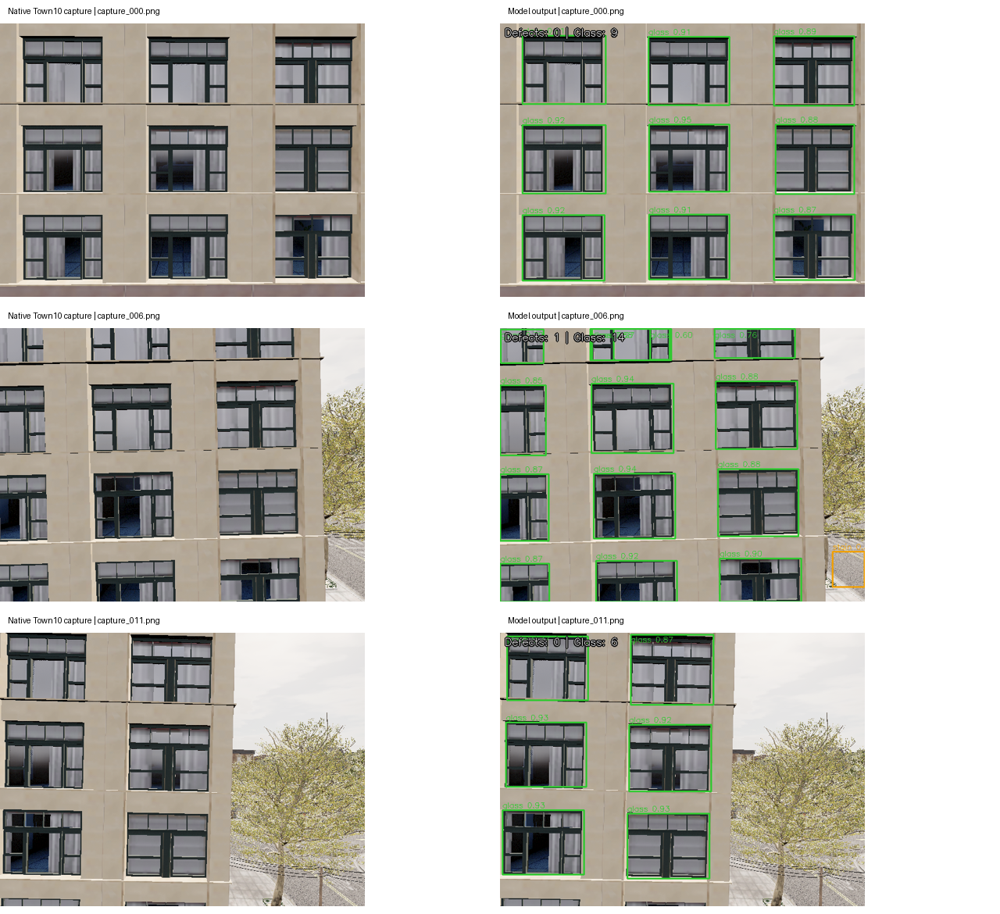
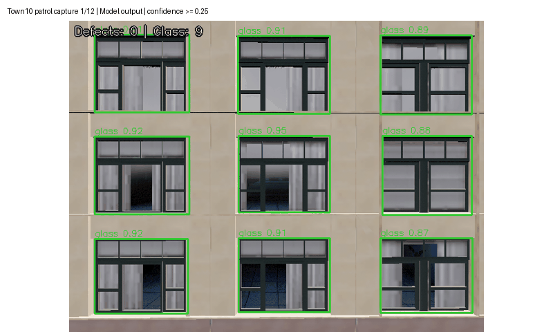
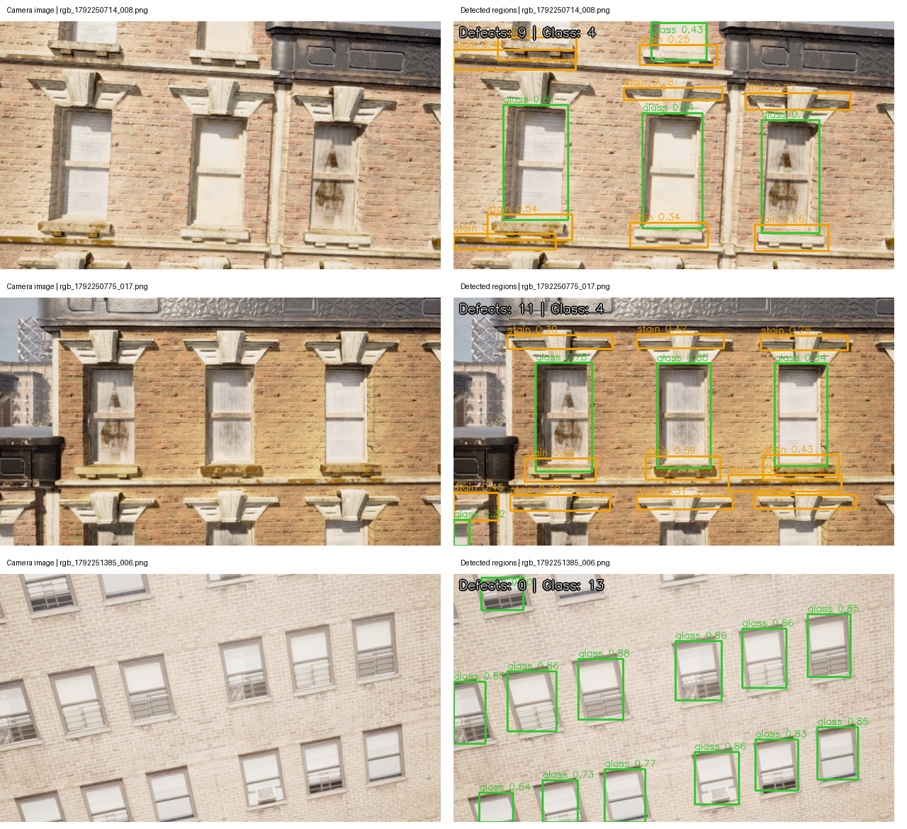
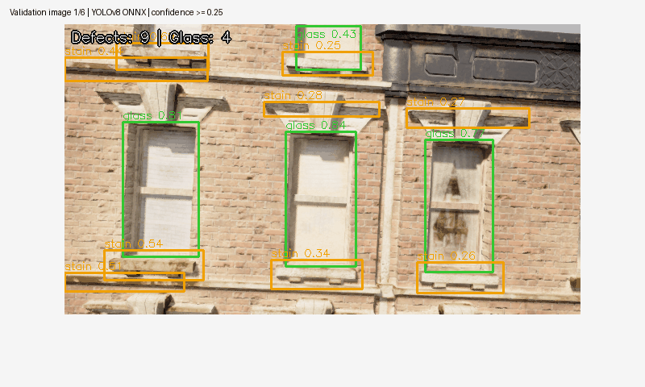

# Town10 幕墙图像病害识别

模块将无人机巡航相机图像转换为可复查的幕墙候选区域，输出裂缝、污渍、剥落与玻璃构件的类别、
置信度和像素边框。玻璃构件不计入病害数量；巡航采集与识别可分别运行，也可通过标准图像话题连接。

## 识别效果

### 原生 Town10 在线巡航图像

OpenHUTB Town10 的原生相机完成 12 个航点采图，随后使用同一 ONNX 模型识别全部 12 张照片。
以下展示 `capture_000`、`capture_006`、`capture_011` 的原图与模型输出。





阈值 0.25 时共输出 115 个候选框：玻璃构件 113 个、污渍候选 2 个；裂缝与剥落候选均为 0。
同一构件可能在多个相邻航点反复出现，此处统计为逐图预测框数。
在线照片尚无人工病害标签，不能据此计算识别精度，也不能将污渍候选视为已确认病害。
[十二图完整识别结果及图像摘要](native_detections.json)

### 标注验证图像

下图左侧为相机图像，右侧为随包 ONNX 模型的识别结果。



动图按顺序查看六张验证图像的带框输出。



## 处理流程

1. 读取巡航保存的 PNG/JPEG，或订阅 `/town10/image_raw`。
2. 等比例缩放并补边至 640×640，转换 RGB 浮点张量。
3. 使用 OpenCV DNN CPU 后端执行 YOLOv8 ONNX。
4. 置信度筛选、按类别进行非极大值抑制，恢复原图像素坐标。
5. 保存带框图像、结构化 JSON，或发布对应 ROS 2 话题。

设原图尺寸为 \(W\times H\)，补边输入尺寸为 \(S=640\)，缩放比为：

\[
r=\min(S/W,S/H),\qquad
x=(x'-p_x)/r,\quad y=(y'-p_y)/r
\]

其中 \(p_x,p_y\) 是左、上补边像素。坐标恢复后截断至原图范围。
同类候选框使用交并比抑制：

\[
\operatorname{IoU}(A,B)=\frac{|A\cap B|}{|A\cup B|}
\]

不同类别分别处理，使玻璃构件与其表面病害可以同时保留。

## 快速运行

在仓库的 `src/air/town10_facade_defect_detection` 目录执行：

```bash
python -m pip install -r requirements.txt
python main.py --input samples --output output
```

结果为 `output/annotated/*.png` 和 `output/detections.json`。
JSON 每框包含 `class_id`、`class_name`、`confidence`、`xyxy`、`is_defect`。
完整六图输出见 [识别结果](sample_detections.json)。

### 原生采集目录接入

在 `src/air/town10_facade_cruise_capture` 中，连接已起飞悬停且朝向墙面的相机：

```bash
python main.py --backend airsim --host 127.0.0.1 --camera front_cam --speed 0.5 --duration 150 --gif --output output/native
```

进入 `src/air/town10_facade_defect_detection`，直接识别巡航照片目录：

```bash
python main.py --input ../town10_facade_cruise_capture/output/native --output output/native_detection
```

识别结果保留 `capture_000.png` 等名称，可与巡航 `manifest.json` 的实际位姿、相机时间戳对应。

### ROS 2 图像接入

```bash
source /opt/ros/humble/setup.bash
colcon build --symlink-install --packages-select town10_facade_defect_detection
source install/setup.bash
ros2 launch town10_facade_defect_detection detect.launch.py
```

默认处理随包图像后退出。巡航采集发布图像时启动持续订阅：

```bash
ros2 launch town10_facade_defect_detection detect.launch.py mode:=live input_topic:=/town10/image_raw
```

| 接口 | 消息类型 | 内容 |
|---|---|---|
| `/town10/image_raw` | `sensor_msgs/Image` | 巡航相机图像 |
| `/town10/defects/image` | `sensor_msgs/Image` | 带框 BGR 图像 |
| `/town10/defects/detections` | `std_msgs/String` | 检测 JSON，含原时间戳和相机坐标系 |

支持 RGB/BGR、RGBA/BGRA、灰度 8 位图像，并正确跳过 `step` 行补齐字节。
Humble 图像接口验证已通过：640×360 RGB 输入每行含 7 字节补齐，
输出 BGR 图像和 JSON 保留输入时间戳、相机坐标系，样本得到 13 个候选框，病害数量为 9。
[接口验证结果](ros_interface_result.json)

## 验证数据与结果

四类模型来源于补充的幕墙巡检实现包。完整人工标注有 132 张图像、1976 个框。
其中 106 张用于训练，训练另有 104 张合成增强副本；26 张原始图像用于验证，包含 482 个框。
随包六图来自该验证集，模型、图像与标签的摘要用于确认评价输入一致。

| 类别 | 标注框 | AP50 | Precision | Recall |
|---|---:|---:|---:|---:|
| crack 裂缝 | 19 | 0.0050 | 0.0000 | 0.0000 |
| stain 污渍 | 147 | 0.4200 | 0.5268 | 0.4014 |
| peel 剥落 | 124 | 0.1662 | 0.6667 | 0.0806 |
| glass 玻璃 | 192 | 0.9460 | 0.8402 | 0.9583 |

四类 mAP50=0.3843，mAP50–95=0.1728；三类病害微平均 Precision=0.5433、Recall=0.2379。
玻璃构件识别较稳定，裂缝、剥落仍有明显漏检，输出用于辅助定位待复查区域。
此数据是图像级划分，相邻采集帧可能分布于训练与验证，不能据此声称严格跨建筑泛化。

固定工作点的 Precision、Recall 采用置信度 0.25、匹配 IoU=0.5。
AP 使用置信度 0.001 的候选及 101 点插值；AP50–95 对 10 个 IoU 阈值平均。

\[
P=\frac{TP}{TP+FP},\qquad R=\frac{TP}{TP+FN}
\]

[完整指标](metrics.json) · [验证文件摘要](validation_files.json)

## 训练与复现

完整数据目录由外部参数指定，训练入口重新建立可移植的 `data.yaml`：

```bash
python -m pip install -r requirements-training.txt
python train.py --dataset /path/to/dataset_final --output training --epochs 60 --batch 8 --device cpu --export
python evaluate.py --dataset /path/to/dataset_final --output evaluation
```

训练输出保存在指定目录；随包模型保持原权重。新的数据应按建筑或采集序列划分，
合成增强仅用于训练，并保存模型、数据划分和评价记录之间的对应关系。

## 模型与许可

随包模型输入 `1×3×640×640`，输出 `1×8×8400`。
类别顺序已从 ONNX 元数据核对为 `crack/stain/peel/glass`。
模型 SHA-256 为 `de2fced0c5260ba31af51603f6c884f783572afed6e32fed5a76bdf699a5a97f`。
代码及模型采用 AGPL-3.0，许可文本和模型来源随模块提供。
