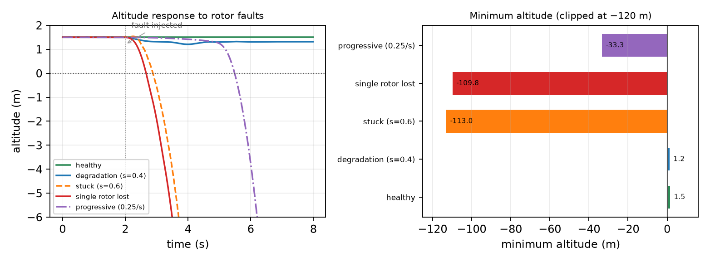
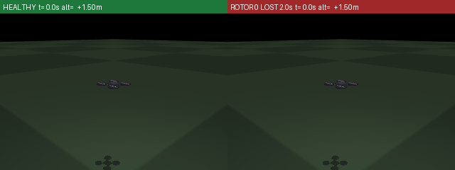
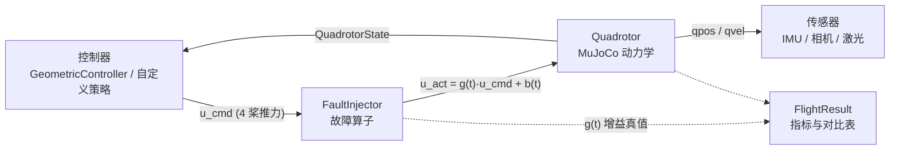

# 无人机执行器故障注入与控制退化观测

本模块在 [MuJoCo 四旋翼仿真底座](./uav_mujoco_sim.md) 上增加**可编程的执行器与传感器故障注入层**，
把"完全失效、推力衰减、卡死、渐进退化"四种桨故障和 IMU 零偏/噪声/丢包变成可以一键复现的仿真条件，
并给出统一的飞行指标（存活率、最低高度、故障到坠地延时、触地速度、控制能量、偏航角速度）。

它对应课程任务的**任务①（在虚拟环境中对无人机进行物理仿真，并通过键盘对机器人进行运动控制）**，
同时是后续「神经容错飞行」系列模块（故障检测、容错控制、故障迫降、端到端策略）的**数据发生器与评测台**。

!!! note "为什么先做这一层"
    故障注入必须发生在"控制器下发推力"和"桨真正出力"之间，才能对上层算法保持透明：
    同一个控制器既可以在健康条件下飞，也可以在单桨失效条件下飞，两者的差别只来自故障算子。
    这样后续模块换控制器（几何控制器 / 加权重分配 / 神经网络策略）时，评测台一行都不用改。

## 1. 问题：单桨失效到底有多严重

四旋翼在悬停时四条旋翼的总推力约等于重力，单条桨承担 25% 的升力。一旦某条桨停转，
剩余三条桨即使按原指令继续出力，合力方向也会立刻偏斜，同时产生一个无法抵消的滚转（或俯仰）力矩。

实测（`open_ground` 场景，悬停 1.5 m，$t=2.0\ \text{s}$ 注入故障，仿真 8 s）：

| 情形 | 最低高度 | 故障→坠地 | 触地速度 | 结论 |
| --- | --- | --- | --- | --- |
| 健康 | 1.500 m | 不坠地 | — | 基线稳定 |
| 桨推力衰减到 40% | 1.208 m | 不坠地 | — | 控制器有余量吸收 |
| 桨卡死在 60% 推力 | −113.0 m | 0.85 s | — | 不再响应指令 |
| 单桨完全失效（无补偿） | **−109.8 m** | **0.64 s** | 5.13 m/s | 必坠 |
| 单桨完全失效 + 损失推力均摊给其余三桨 | −67.9 m | 0.68 s | — | **朴素补偿救不回来** |
| 渐进退化（0.25/s） | −33.3 m | 3.46 s | — | 缓慢恶化，可预测 |



两条结论决定了整个选题方向：**①完全失效必然坠机，现象稳定可复现，非常适合做对照演示；
②简单的"把丢掉的推力分给其他桨"完全无效**——这说明缺口需要检测 + 加权重分配 + 残差补偿这类
真正的方法去填，而不是调参数。



## 2. 系统架构



模块只做两件事：

1. **在控制回路上插入一个乘性/加性故障算子**（上面 `B`）；
2. **把每次飞行的完整轨迹记录下来并折算成指标**（下面 `E`）。

其余（动力学、场景、传感器、控制器）全部复用底座，一行都不改。

## 3. 故障模型

把第 $i$ 条桨的实际推力写成"指令 × 增益 + 偏置"：

$$
T_i^{\text{act}}(t) \;=\; g_i(t)\, u_i^{\text{cmd}}(t) \;+\; b_i(t),
\qquad T_i^{\text{act}} \in [0,\; T_{\max}],
\qquad T_{\max} = 6.0\ \text{N}
$$

四种桨故障用不同的 $(g_i, b_i)$ 组合表达：

| 类型 | 增益 $g_i(t)$ | 偏置 $b_i(t)$ | 物理含义 |
| --- | --- | --- | --- |
| `loss` | $1-\alpha(t)$ | $0$ | 桨停转（电机/电调损坏、桨叶脱落） |
| `degradation` | $1+(s-1)\alpha(t)$ | $0$ | 推力只能出到原来的 $s$（桨叶损伤、电压跌落） |
| `stuck` | $1-\alpha(t)$ | $s\,T_{\max}\,\alpha(t)$ | 电调卡在固定占空比，不再响应指令 |
| `progressive` | $\max\!\big(0.05,\;1-\dot\lambda\,(t-t_0)\big)$ | $0$ | 每秒钟损失 $\dot\lambda$ 的推力（缓慢恶化） |

其中注入过渡为

$$
\alpha(t) \;=\; \min\!\left(1,\; \frac{t-t_0}{r}\right),
$$

$t_0$ 是注入时刻（`onset`），$r$ 是过渡时长（`ramp`；$r=0$ 时故障瞬间生效）。

传感器故障单独一层：

| 参数 | 作用 |
| --- | --- |
| `gyro_bias` | 角速度零偏，常值 $b_\omega$ 叠加到陀螺读数 |
| `noise_scale` | 噪声放大倍数 |
| `dropout` | 丢包率，按概率把读数替换为上一帧 |

## 4. 源码解析

### 4.1 故障算子 `fault.py`

核心是一个不可变的故障描述加一个无状态计算器：

```python
@dataclass(frozen=True)
class RotorFault:
    rotor: int          # 0~3
    kind: str           # loss / degradation / stuck / progressive
    onset: float = 2.0  # 注入时刻 (s)
    severity: float = 0.0
    ramp: float = 0.0

    def gain(self, t, max_thrust) -> float: ...
    def offset(self, t, max_thrust) -> float: ...
```

`FaultInjector` 把多条故障合成两个长度为 4 的向量，再一次性作用到指令上：

```python
def apply(self, thrusts, t):
    g = self.gains(t)                     # (4,)
    b = self.offsets(t)                   # (4,)
    return np.clip(g * thrusts + b, 0.0, self.max_thrust)
```

!!! tip "为什么用 `np.clip`"
    故障后的推力必须落在物理可达范围内。`stuck` 的偏置加上指令放大后很容易超过
    $T_{\max}$，不裁剪会得到一个不存在于真实电调上的推力，指标也就失真了。

### 4.2 闭环运行器 `runner.py`

主循环只有五行，故障注入插在中间：

```python
for k in range(n_steps):
    t = k * cfg.dt
    u_cmd = ctrl.act(quad, target, v_d, a_d, cfg.yaw_d)   # 控制器出指令
    u_act = injector.apply(u_cmd, t)                      # 故障算子改写指令
    quad.apply_rotor_thrust(u_act)                        # 施加到模型
    quad.step(1)                                          # 推进物理
    st = quad.state()                                     # 观测
```

控制器接口统一为

```python
act(quad, p_d, v_d, a_d, yaw_d) -> np.ndarray   # 形状 (4,)，单位 N
```

因此基线几何控制器、加权重分配控制器、神经网络策略可以同台对比，换控制器不改仿真代码。

!!! note "控制器的"期望"和"实际"分开记录"
    `FlightResult.desired` 存控制器算出来的指令，`FlightResult.thrusts` 存故障之后的真实推力，
    两者之差就是"分配器想给"和"真给到"的差，是后面做容错分配的直接信号。

### 4.3 指标 `metrics.py`

```python
CRASH_ALTITUDE = 0.15        # 低于 0.15 m 记为坠地
SAFE_TOUCHDOWN_SPEED = 0.5   # 触地速度 < 0.5 m/s 记为安全着陆
```

六个核心指标：

$$
\begin{aligned}
h_{\min} &= \min_t z(t), \\
\Delta t_{\text{crash}} &= t_{\text{crash}} - t_0, \\
v_{\text{touch}} &= \lVert \mathbf{v}(t_{\text{crash}}) \rVert, \\
\mathrm{RMSE}_{pos} &= \sqrt{\tfrac{1}{N}\textstyle\sum_n \lVert \mathbf{p}_n - \mathbf{p}^{*} \rVert^2}, \\
E_u &= \textstyle\int \lVert \mathbf{u}(t) \rVert^2\, dt, \\
\bar\omega_\psi &= \tfrac{1}{|\mathcal{W}|}\textstyle\sum_{t \in \mathcal{W}} \omega_\psi(t),
\quad \mathcal{W} = \text{最后 0.5 s}.
\end{aligned}
$$

$\bar\omega_\psi$ 值得单独说明：单桨完全失效后，四旋翼**必须放弃偏航控制**，靠机体自转来平衡
反扭矩才能维持姿态（Mueller & D'Andrea, ICRA 2014）。所以"存活且偏航角速度稳定在非零常数"
是容错控制真的按机制工作的证据，而不是靠调参凑出来的指标。

### 4.4 用例矩阵 `scenario.py`

```
5 个物理场景 × 7 种故障 × seeds
  open_ground / obstacle_field / corridor / gate_track(8 门) / urban_block(14 楼)
  healthy / single_loss / dual_loss / partial_degradation / stuck / progressive / sensor_bias
```

`make_case()` 在不显式指定时，用 `seed` 决定故障桨位（0~3）与注入时刻（1.5~3.5 s），
保证同一 seed 完全可复现；`training_matrix()` 自动剔除 `healthy`，直接作为后续模块的训练集来源。

## 5. 运行步骤

### 5.1 安装依赖

```bash
pip install "mujoco>=3.0" numpy pillow matplotlib pytest
```

底座 `src/air/uav_mujoco_sim` 不需要安装，源码树里可见即可（`_compat.py` 会自动定位）。

### 5.2 不用 ROS 直接跑

```bash
cd src/air/uav_actuator_fault_sim
python main.py --selftest                                   # 自检 14 项
python main.py --demo                                       # 健康 vs 6 种故障对比表
python main.py --eval results/comparison.csv                # 完整矩阵 35 条
python main.py --gif results/fault_comparison.gif           # 并排对比动图
```

Windows 双击 `main.bat`、Linux/Mac 执行 `./main.sh`，无参数时默认 `--demo`。

### 5.3 键盘直飞（任务①要求的人机交互）

```bash
python main.py --keyboard                       # w/s 前后、a/d 左右、r/f 升降、q/e 偏航、空格清零
python main.py --keyboard --fault single_loss --onset 5   # 边飞边注入单桨失效
```

### 5.4 ROS2 Humble 启动

```bash
colcon build --packages-select uav_mujoco_sim uav_actuator_fault_sim --parallel-workers 4
source install/setup.bash
ros2 launch uav_actuator_fault_sim fault_sim.launch.py
```

launch 参数：`scene / seed / fault / rotor / onset / severity / controller / seconds`。

| 方向 | 话题 | 类型 |
| --- | --- | --- |
| 发布 | `/uav/odom` | `nav_msgs/Odometry` |
| 发布 | `/uav/status` | `std_msgs/String`（READY / HOVER / FAULT / CRASHED / DONE） |
| 发布 | `/uav/fault` | `std_msgs/String` |
| 发布 | `/uav/health` | `std_msgs/Float32MultiArray`（4 桨增益真值） |
| 订阅 | `/uav/cmd_vel` | `geometry_msgs/Twist`（机体系，0.5 s 超时自动悬停） |
| 订阅 | `/uav/goal` | `geometry_msgs/Point` |

`/uav/health` 是给下游检测器用的**监督标签**：故障检测网络在训练时直接从这里取真值，
不需要额外标注流程。

## 6. 复现结果

`python main.py --eval results/comparison.csv`（5 场景 × 7 故障，每项 1 个 seed）：

```
故障                       样本      存活率        平均最低高度m        平均坠地延时s
--------------------------------------------------------------------
healthy                   5     1.00           1.50           0.00
single_loss               5     0.00         -77.17           0.64
dual_loss                 5     0.00        -109.00           0.56
partial_degradation       5     1.00           1.21           0.00
stuck                     5     0.00         -77.30           0.85
progressive               5     0.00         -16.17           3.46
sensor_bias               5     1.00           1.50           0.00
--------------------------------------------------------------------
合计                       35     0.43         -39.35           1.38
```

健康与推力衰减全部存活；三种"推力来源被切断"的故障（完全失效 / 双桨失效 / 卡死）全部坠机，
且坠机时间都在 1 s 以内；渐进退化因为推力是慢慢掉的，坠机被推迟到 3.4 s。
`sensor_bias` 只改 IMU 读数、不改推力，所以几何控制器仍能悬停——这正是"传感器故障需要靠观测器
而不是控制器来兜"的直接体现。

单元测试与闭环测试：

```bash
python -m pytest test -q     # 45 passed
```

## 7. 局限与后续

- 目前故障只作用于**桨推力与 IMU**，没有做电机电压跌落、桨叶不对称等更细的模型。
- 故障注入是**开环**的（按时间表触发），没有做"基于检测结果自动触发"的闭环。
- 评测只覆盖悬停/简单机动，尚未接入航点跟踪与门穿越任务——这些留给后续模块
  （`uav_rotor_fault_detector_nn`、`uav_neural_fault_tolerant_control`、`uav_fault_emergency_landing`、
  `uav_fault_e2e_depth_policy`）。

## 8. 参考

- Mueller, M. W., & D'Andrea, R. *Stability and control of a quadrocopter despite the complete loss of
  one, two, or three propellers.* IEEE ICRA, 2014.
- 本仓库另见：[MuJoCo 四旋翼仿真与 ROS2 桥接底座](./uav_mujoco_sim.md)、
  [无人机键盘控制](./uav_keyboard_control.md)、[强化学习对比实验（PPO/SAC/TD3）](./uav_rl_benchmark.md)。
