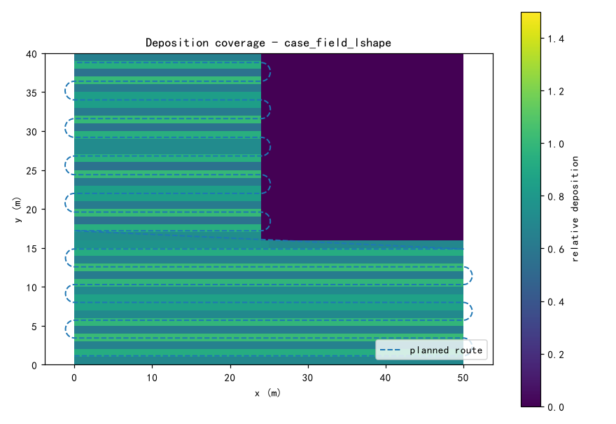
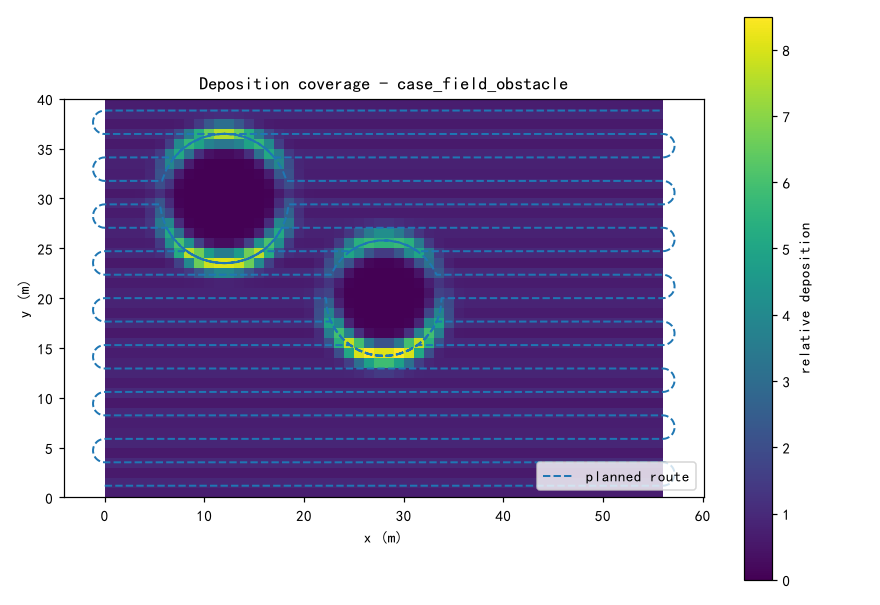
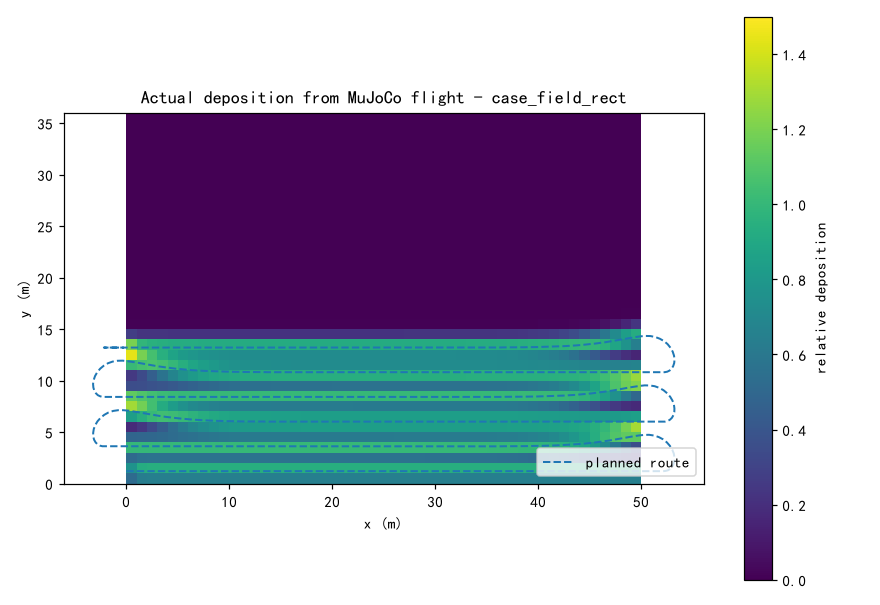

# uav_agri_spray — 植保无人机喷洒覆盖与参数评估

农业植保无人机按固定喷幅往返作业。给定田块多边形与障碍，本模块规划往返扫描
航线，在 1 m 栅格上离散高斯沉积评估覆盖率与重叠率，并扫描速度 × 重叠率参数
组合给出推荐值，最后用 MuJoCo 闭环检验计划沉积与现实沉积的偏差。

## 运行

```bash
cd src/air/uav_agri_spray
python main.py --no-sim     # 仅算法层（秒级，无需 MuJoCo）
python main.py              # 三场景 + 前 6 条扫描线 MuJoCo 真飞闭环
```

无 ROS 环境时源码目录直接运行即可（`main.py` 会自动把同级 `uav_mujoco_sim`
加入 `sys.path`）；装进工作空间后等价于 `ros2 run uav_agri_spray main`。







## 方法

- **扫描方向**：旋转卡壳求凸多边形最小宽方向，沿该方向布置往返扫描线，
  行数最少、转弯最少；L 形田块先拆成两个凸子区分别布置；
- **障碍绕行**：电线杆与树按外扩 5 m 的圆形边界走劣弧绕行，行间转入用
  半圆弧衔接；
- **沉积评估**：每条扫描线当作横向高斯沉积源（σ = 喷幅/4）在 1 m 栅格上
  叠加，统计覆盖率（沉积 ≥ 0.5）、重叠率（叠加剂量 ≥ 1.0）与漏喷面积；
- **参数扫描**：喷幅固定 3 m，扫 速度 3/4/5 m/s × 重叠率 10/20/30% 共
  9 组，覆盖率 ≥ 98% 且时长最短者推荐；
- **闭环检验**：抽推荐参数下前 6 条扫描线在 MuJoCo 真飞，记录刚体真实
  位置，按 0.3 m 重采样成加权点源重算实际沉积。

## 结果

| 场景 | 面积 | 行数 | 航程 | 计划覆盖率 | 推荐参数 | 推荐后时长 |
| --- | --- | --- | --- | --- | --- | --- |
| 矩形田 | 1800 m² | 15 | 802.7 m | 100% | 5.0 m/s @ 20% | 160.5 s |
| 电杆树田 | 2240 m² | 17 | 1039.3 m | 94.2% | 5.0 m/s @ 30% | 231.0 s |
| L 形田 | 1376 m² | 17 | 695.4 m | 100% | 5.0 m/s @ 20% | 139.1 s |

MuJoCo 闭环（矩形田前 6 条扫描线）：计划覆盖 38.9%，实飞重算 36.8%
（−2.1 个百分点），末端跟踪误差 0.01 m。偏差主要来自分段航迹激励下的
姿态波动使有效喷幅轻微收窄。

## 与其他模块的区分

仓库已有的覆盖类模块 `ap_cpp_overfomo` 面向**未知环境**的主动感知覆盖；
本模块面向**已知田块几何**的确定性作业：目标不是"把未知区域探完"，而是
"在已知边界和障碍下，选对扫描方向和喷洒参数，让沉积达标且总时长最短"。
