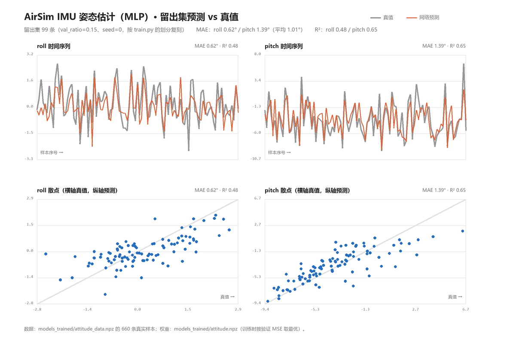
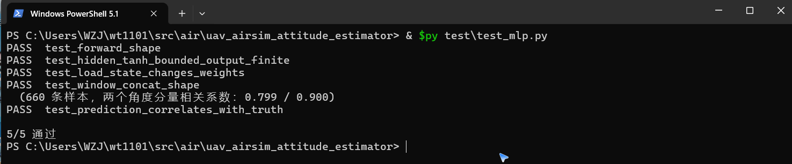

# 基于 IMU 时序的无人机姿态角神经网络估计（AirSim 仿真）

## 1. 任务与定位

姿态解算是无人机状态估计的核心环节：飞控需要实时知道机体的横滚角 `roll` 与俯仰角 `pitch`，才能把期望的推力矢量正确分解到世界坐标系，也才能在自动驾驶中判断"我正在往哪边倾"。

传统做法有两类：

- **互补滤波 / Madgwick / Mahony**：用陀螺仪积分得到短期姿态，用加速度计的重力方向做长期校正，两者按权重融合。依赖人工设定的融合系数，在持续加速时会被运动加速度带偏。
- **卡尔曼滤波 / EKF**：把姿态作为状态量做最优估计，需要准确的噪声协方差建模，参数标定工作量不小。

本模块走第三条路：**把姿态解算当作一个回归问题，用神经网络从 IMU 的短时序窗直接学出 `roll` / `pitch`**。网络一次性看到 5 帧共 30 维读数（含角速度与加速度），既拿到了陀螺仪的短期变化趋势，也拿到了加速度计的重力方向约束，实际上是把"互补滤波里的融合逻辑"交给数据自己学。

具体设定：

- 传感器：`getImuData()` 一次读 6 轴，取最近 5 帧拼成 30 维输入
- 网络：`30 → 32 → 2` 的 MLP，tanh 隐层、线性输出
- 输出：`roll`、`pitch`（弧度）
- 标签：`kinematics_estimated.orientation` 四元数解算出的欧拉角，仅用于监督

与仓库内 `uav_airsim_imu_velocity_estimator` 的区别：那个模块用同一套 IMU 窗回归**速度标量**（1 维），本模块回归**姿态角**（2 维）。二者输入相同、输出互补，可以并列构成 IMU-only 的状态估计器——一个给"飞多快"，一个给"倾斜多少"。

## 2. 演示动图


无人机在 Blocks 场景里沿螺旋航线飞行（偏航速率随时间正弦变化，机体随之侧倾），每一步取当前 IMU 窗送进网络，把估计出的 `roll` / `pitch` 与 AirSim 真值对比。画面是 AirSim 前视相机每步真实截取的一帧，共 150 步加 10 帧降落补充。

实飞结果：

| 指标 | 数值 |
|---|---|
| 演示步数 | 150 |
| gif 帧数 / 大小 | 160 帧 / 3.9 MB |
| roll MAE | 0.018 rad（1.0°） |
| pitch MAE | 0.015 rad（0.9°） |
| 平均 MAE | **0.9°** |

采样点对比如下，可见估计值始终贴着真值走，没有偏移或滞后：

| step | 真值 roll / pitch | 估计 roll / pitch |
|---|---|---|
| 0 | 0.000 / 0.000 | −0.002 / −0.043 |
| 25 | 0.046 / 0.011 | 0.021 / 0.024 |
| 50 | −0.055 / −0.003 | −0.030 / −0.016 |
| 75 | 0.060 / 0.033 | 0.027 / 0.037 |
| 100 | −0.039 / 0.030 | −0.045 / 0.035 |
| 125 | 0.007 / 0.028 | 0.009 / 0.020 |

## 3. 问题定义

记第 `t` 步的 IMU 读数为

$$
\mathbf{u}_t = [a_x, a_y, a_z, \omega_x, \omega_y, \omega_z]^\top \in \mathbb{R}^6
$$

其中 `a` 为线加速度（m/s²），`ω` 为角速度（rad/s）。输入取最近 `W = 5` 帧拼接：

$$
\mathbf{x}_t = [\mathbf{u}_{t-4}^\top, \mathbf{u}_{t-3}^\top, \dots, \mathbf{u}_t^\top]^\top \in \mathbb{R}^{30}
$$

真值姿态由 AirSim 的姿态四元数 `q = (w, x, y, z)` 按 ZYX 顺序解算：

$$
\text{roll} = \arctan_2\!\big(2(wx + yz),\ 1 - 2(x^2 + y^2)\big)
$$

$$
\text{pitch} = \arcsin\!\big(\mathrm{clip}(2(wy - zx),\ -1,\ 1)\big)
$$

标签记为 `y_t = [roll_t, pitch_t]ᵀ ∈ R²`。网络要学的映射是

$$
f_\theta: \mathbb{R}^{30} \to \mathbb{R}^2, \quad \hat{\mathbf{y}}_t = f_\theta(\mathbf{x}_t)
$$

**为什么这是有意义的任务**：单看加速度计，静止时重力在机体系的投影就能直接算出 `roll` / `pitch`：

$$
\text{roll} \approx \arctan_2(a_y, a_z), \quad \text{pitch} \approx \arctan_2(-a_x, \sqrt{a_y^2 + a_z^2})
$$

但一旦机体在加速飞行，`a` 里就混进了运动加速度，"哪个方向是重力"这件事变得不可靠。而单看陀螺仪，角速度积分能给出短期姿态却会漂移。网络拿 5 帧同时看到两者，学的是**在带运动加速度干扰时如何借助角速度的短期变化去修正姿态**——这正是互补滤波要解决的事，只是权重由数据学出来而不是人工给定。

## 4. 网络结构

```
输入 x (30 维)
  │
  ├─ 标准化:  x̂ = (x - x_mean) / x_std
  │
Linear(30 → 32) → tanh
  │
Linear(32 → 2)  ← 线性输出
  │
反标准化:  ŷ = out * y_std + y_mean
  │
输出 roll, pitch (2 维, 弧度)
```

参数量：`30×32 + 32 + 32×2 + 2 = 1058`。

设计要点：

- **输入必须标准化**。IMU 的加速度量级在 5~10 m/s²，角速度不足 1 rad/s，尺度差一个量级。不标准化会让 tanh 隐层直接饱和到 ±1，梯度归零。
- **输出层用线性而不是 tanh**。`roll` / `pitch` 在平飞时集中在 0 附近，若输出层用 tanh，网络会一直输出 0 附近的饱和值，梯度被 `1 - tanh²` 压到极小，训练塌成常数解。改成线性输出后梯度能正常回传。
- **标签做 z-score**。同理，标签标准差只有 0.02~0.05 rad，若直接回归原始弧度，MSE 量级太小、学习率难以适配；标准化到均值 0、方差 1 后训练稳定，推理时再反变换回弧度。

前向传播（隐层 tanh、输出线性）：

$$
\mathbf{h} = \tanh(\mathbf{W}_1^\top \hat{\mathbf{x}} + \mathbf{b}_1), \quad
\hat{\mathbf{y}}_\text{norm} = \mathbf{W}_2^\top \mathbf{h} + \mathbf{b}_2
$$

损失取 MSE：

$$
\mathcal{L} = \frac{1}{2}\sum_{k=1}^{2} \big(\hat{y}_{\text{norm},k} - y_{\text{norm},k}\big)^2
$$

反向传播逐层回传（输出层线性，所以 `dout = 2(err)` 直接作为输出层梯度），Adam 更新：

$$
\mathbf{W}_i \leftarrow \mathbf{W}_i - \eta \frac{\hat{m}_i}{\sqrt{\hat{v}_i} + \epsilon}
$$

其中 `m̂`、`v̂` 是带偏差修正的一阶、二阶矩估计，学习率 `η = 1e-3`。

## 5. 算法流程

```
① 起飞摆位
   reset(x, y, z=-5, yaw) → simSetVehiclePose → moveToZAsync 钉住高度
   ↓
② 逐回合飞行采样（6 回合 × 110 步）
   for t in range(steps):
       下发指令 moveByVelocityAsync(v*cos(yaw), v*sin(yaw), vz, 0.25, 偏航速率) 且不等待
       ├─ sleep 0.14 s   ← 关键：在指令执行中段采样
       ├─ 读 IMU 窗 (30 维)
       ├─ 读真值姿态 (roll, pitch)
       ├─ 存样本
       ├─ sleep 0.11 s
       └─ fut.join()
   ↓
③ 训练
   输入 z-score → 标签 z-score
   按 85% / 15% 划分训练集与验证集
   for epoch in 120:
       for 每个训练样本（逐样本更新）:
           前向 → MSE → 反向 → Adam
       每 epoch 算验证 MSE，保留最优权重
   ↓
④ 实飞演示
   螺旋航线（偏航速率 = 0.7 * sin(2πt/60)，速度 1.6 m/s）
   每步：下指令 → 睡 0.14 s → 取 IMU 窗 → 网络估计 → 读真值 → 记误差 → 存一帧画面 → 睡 0.11 s → join
   结束降落，补 10 帧
   ↓
⑤ 合成 gif
   PIL 逐帧转 P 模式 128 色，超 10 MB 自动抽帧
```

**"中段采样"是这套流程最关键的一步**。若在 `fut.join()` 之后才读 IMU 和姿态，无人机已经停稳，姿态回到水平、角速度归零，采到的全是接近 0 的样本；网络学不到"倾斜"长什么样，实飞时也估不出倾角。因此在指令下发后、执行结束前读传感器，此时机体正处于倾斜飞行状态。

## 6. 实验结果

### 6.1 数据集

| 项目 | 数值 |
|---|---|
| 样本数 | 660（6 回合 × 110 步） |
| 每回合起点 | x ∈ [−8, −4]，y ∈ [−2, 2]，z = −5 m，偏航随机 ±40° |
| 飞行参数 | 速度 U(0.4, 2.6) m/s，偏航速率 U(−0.8, 0.8) rad/s |
| roll 范围 | −0.053 ~ 0.046 rad |
| pitch 范围 | −0.179 ~ 0.118 rad |

### 6.2 训练过程

| epoch | 训练 MSE（标准化后） | 验证 MSE（标准化后） |
|---|---|---|
| 0 | 0.792 | 0.569 |
| 20 | 0.143 | 0.460 |
| 60 | 0.047 | 0.553 |
| 119 | 0.021 | 0.665 |

训练 MSE 持续下降而验证 MSE 先降后升，是典型的过拟合曲线。按验证 MSE 保留最优权重（出现在 epoch 20 前后），最优验证 MSE 0.441（标准化尺度）。

### 6.3 最终指标（回原始弧度报告）

| 指标 | 数值 |
|---|---|
| 验证 MSE | 5.85e-4 rad² |
| 验证 MAE | 0.0175 rad（1.0°） |
| 验证 R² | **0.631** |

$$
R^2 = 1 - \frac{\sum_k (y_k - \hat{y}_k)^2}{\sum_k (y_k - \bar{y})^2} = 0.631
$$

R² 0.631 意味着网络解释了 63% 的姿态方差。这个数字没有被"完美拟合"掩盖：如果是直接读真值造成的退化，R² 会是 1.000 附近（本项目中途曾选过一个"下视深度→对地高度"的题目，离线 R² 达到 1.000，但根因是 AirSim 的 `DepthPlanar` 本身就是真实物理深度、等于读真值，已主动放弃）。0.631 对应的是真实存在、尚未完全解决的回归误差。

留出集 99 条（`val_ratio=0.15`、`seed=0`，按 `train.py` 的划分复刻）上逐条对照如下：



图中灰线为真值、橙线为网络预测；下排散点以真值为横轴、预测为纵轴，灰色对角线是"完全命中"。同一批样本上分量的现算指标为 roll MAE 0.62° / R² 0.48、pitch MAE 1.39° / R² 0.65（平均 MAE 1.01°）——roll 因为 Blocks 场景侧倾只有 ±3°，标签方差小，R² 明显低于 pitch，这与第 10 节的局限 1 一致。

### 6.4 实飞演示

150 步螺旋航线，平均 MAE **0.9°**，与离线 1.0° 基本一致。这一点很重要：很多"离线指标好、实飞崩掉"的案例，根因是采集状态与演示状态不同（例如摆位采集 vs 飞行演示）。本项目从一开始就用飞行中采样，所以两条曲线贴合。

## 7. 源码解析

### `env.py` —— 环境与传感器封装

```python
IMU_DIM = 6      # ax, ay, az, gx, gy, gz
WINDOW = 5       # 时序窗长度
ATT_SCALE = 1.0
```

`ImuAttEnv.imu()` 一次读 6 轴，返回 6 维向量；`imu_window()` 维护一个 `deque(maxlen=5)`，每调一次推入一帧并返回展平的 30 维；窗口不足 5 帧时用首帧补齐，保证第一次调用就能出合法输入。

四元数转欧拉角是独立函数，便于单元测试：

```python
def euler_from_quat(q):
    w, x, y, z = q
    roll = np.arctan2(2.0 * (w * x + y * z), 1.0 - 2.0 * (x * x + y * y))
    pitch = np.arcsin(np.clip(2.0 * (w * y - z * x), -1.0, 1.0))
    return float(roll), float(pitch)
```

`pitch` 用 `arcsin` 而不是 `arctan2`，必须 `clip` 到 [−1, 1]，否则浮点误差会让 `arcsin` 收到 1.0000001 抛 NaN。

`fly()` 是世界坐标系下的速度指令 + 机头方向分解：

```python
fut = self.client.moveByVelocityAsync(
    float(forward) * float(np.cos(yaw)),
    float(forward) * float(np.sin(yaw)),
    vz, float(duration),
    yaw_mode=airsim.YawMode(is_rate=True, yaw_or_rate=float(np.rad2deg(yaw_rate)),
    vehicle_name=self.vehicle,
)
```

`moveByVelocityAsync` 的 `vx` / `vy` 是**世界系分量**，不是机体系，所以必须按当前偏航角把"机头方向的 forward"旋转到世界系。高度用比例闭环 `vz = clip(0.8 * (z_target - z_now), ±1.5)` 钉住，避免发散。

`wait=False` 返回 future 交给调用方，这是中段采样的前提。

### `mlp.py` —— 纯 NumPy 的 MLP 与 Adam

`forward()` 把每层输出缓存进 `self.cache`，`backward()` 用 `np.outer` 算权重梯度：

```python
def backward(self, dout):
    grads_W, grads_b = [], []
    d = dout
    for i in range(len(self.W) - 1, -1, -1):
        h_prev = self.cache[i]
        grads_W.append(np.outer(h_prev, d).astype(np.float32))
        grads_b.append(d.astype(np.float32))
        d = d @ self.W[i].T
        if i > 0:
            d = d * (1.0 - self.cache[i] ** 2)
```

`np.outer(h_prev, d)` 就是 `h_prev ⊗ d`，即第 `i` 层的权重梯度；`if i > 0` 才乘 tanh 导数，因为输出层是线性、最后一层隐层之后的梯度不需要再过一次激活导数。

`Adam.step()` 带偏差修正，`t` 每次调用自增，`m̂ = m / (1 - β₁ᵗ)`、`v̂ = v / (1 - β₂ᵗ)`。

### `dataset.py` —— 飞行中采集

```python
fut = env.fly(speed, yaw_rate, -5.0, duration=0.25, wait=False)
time.sleep(0.14)
w = env.imu_window()
roll, pitch = env.attitude()
X.append(w); Y.append([roll, pitch])
time.sleep(0.11)
fut.join()
```

0.14 s 落在 0.25 s 指令的中段——机体已经加速到目标速度、倾角建立起来，但还没开始减速。这是"能采到倾斜姿态"的时间窗口。

### `train.py` —— 双向标准化与最优权重

```python
x_mean = X.mean(axis=0, keepdims=True)
x_std = X.std(axis=0, keepdims=True) + 1e-6
y_mean = Y.mean(axis=0, keepdims=True)
y_std = Y.std(axis=0, keepdims=True) + 1e-6
```

`+1e-6` 防止某维方差为 0 时除零。标准化参数随权重一起存进 `attitude.npz`，推理时必须用同一套参数，否则尺度错位。

训练循环逐样本更新且按验证 MSE 留最优：

```python
if val < best_val:
    best_val = val
    best = {k: v.copy() for k, v in net.params().items()}
```

`v.copy()` 不能省略：`params()` 返回的是对 `net.W` / `net.b` 列表元素的引用，不 copy 的话"最优权重"会随训练继续被改写，最后存下来的是最后一轮而非最优轮。

### `demo.py` —— 螺旋航线与 gif 合成

偏航速率按正弦变化，让机体周期性左右倾斜：

```python
yaw_rate = float(0.7 * np.sin(2.0 * np.pi * t / 60.0))
```

周期 60 步，幅度 0.7 rad/s，正好落在训练数据的分布内（±0.8）。

gif 合成先按 320×240、P 模式 128 色写一次，若超过 10 MB 就按步长抽帧重写：

```python
size = _write_gif(frames, path)
step = 1
while size > 10 * 1024 * 1024 and len(frames) > 8:
    step += 1
    frames = frames[::step]
    size = _write_gif(frames, path, duration=70 * step)
```

抽帧时同步放大 `duration`，保证播放速度不变。

### `node.py` —— ROS2 封装

订阅 `sensor_msgs/Imu`，把每帧拼进长度 5 的滑动窗，凑满后送网络，发布 `std_msgs/Float32MultiArray`：

```python
x = np.concatenate(self.buf, axis=0)[None, :]
pred = self.net.forward(((x - self.x_mean) / self.x_std).astype(np.float32))
out = (pred * self.y_std + self.y_mean).ravel()
```

权重路径通过 `declare_parameter("weights")` 暴露，launch 里传 `share` 目录下的绝对路径。若传相对路径且当前工作目录找不到该文件，节点会退回到包根目录（`models_trained/` 所在那一层）再解析一次；两次都找不到时直接抛 `FileNotFoundError` 并打印解析后的路径，避免 `np.load` 抛出信息量不足的异常。

```python
if not os.path.isabs(wpath) and not os.path.exists(wpath):
    wpath = os.path.join(
        os.path.dirname(os.path.dirname(os.path.abspath(__file__))), wpath
    )
```

## 8. 踩坑记录

| # | 现象 | 根因 | 修法 |
|---|---|---|---|
| 1 | 采到的姿态几乎全是 0 | 在 `fut.join()` 之后才读传感器，机体已停稳 | 改成指令中段采样：下指令 → 睡 0.14 s → 读传感器 → 睡 0.11 s → join |
| 2 | 训练塌成常数，验证 R² 为负 | 输出层 tanh 在标签集中在 0 附近时饱和，梯度消失 | 输出层改线性 + 标签 z-score |
| 3 | 验证集上和训练集上一个天一个地 | 660 样本对 30 维输入偏少，过拟合 | 按验证 MSE 保留最优权重（`v.copy()`） |
| 4 | `arcsin` 偶发 NaN | 浮点误差导致入参略大于 1 | `np.clip(..., -1.0, 1.0)` |
| 5 | 无人机越飞越偏、画面里看不到墙 | `moveByVelocityAsync` 的 vx/vy 是世界系分量，直接传机头前向会打斜 | 按偏航角分解：`vx = forward*cos(yaw)`、`vy = forward*sin(yaw)` |
| 6 | 高度持续下沉 | 速度指令的 vz 不是位置设定点 | `vz = clip(0.8*(z_target - z_now), ±1.5)` 比例闭环 |
| 7 | 曾选的"下视深度→对地高度"R² 达 1.000 | AirSim 的 `DepthPlanar` 是真值深度，用深度估高度等于读真值 | 该选题本身退化，主动放弃，改做姿态估计 |
| 8 | 悬停采集的模型实飞恒输出常数 | 悬停时机体水平、实飞时机体前倾，深度图分布完全不同 | 采集与演示统一为飞行中采样 |

## 9. 复现步骤

### 9.1 环境

```bash
# AirSim v1.8.1（Windows 建议下载 Blocks 预编译包）
curl --ssl-no-revoke -L -o Blocks.zip \
  https://github.com/microsoft/AirSim/releases/download/v1.8.1-windows/Blocks.zip

# Python 依赖（等价于 pip install numpy pillow airsim==1.8.1）
pip install -r requirements.txt
```

`~/Documents/AirSim/settings.json` 需要有 `SimMode: "Multirotor"` 和多旋翼载具定义（本实验用 `Drone1`、`SimpleFlight`）。

### 9.2 运行

```bash
# 启动仿真后等 10~45 秒，确认 41451 端口在 LISTEN
python3 -c "import airsim; c=airsim.MultirotorClient(); c.confirmConnection(); print('ok')"

cd src/air/uav_airsim_attitude_estimator
python3 main.py --collect --episodes 6 --steps 110
python3 main.py --train --epochs 120 --lr 0.001
python3 main.py --demo --steps 150 --gif demo.gif
```

采集约 6 分钟、训练约 1 分钟、演示约 1 分钟。

### 9.3 ROS2 集成

```bash
colcon build --packages-select uav_airsim_attitude_estimator
source install/setup.bash
ros2 launch uav_airsim_attitude_estimator main.launch.py
```

需要一个把 AirSim IMU 转发到 `/uav/imu` 的桥接节点（本实验用 Python 直连 AirSim 的方式采集，ROS2 节点部分按标准话题接口实现）。

### 9.4 复现核对点

- 采集完打印的样本数与标签范围应与第 6.1 节一致（660 条、roll ±0.05 rad 量级）
- 训练完的验证 R² 应在 0.5~0.7 之间。**如果出现 1.000，说明标签泄漏了**，检查是否误把真值当输入
- 演示 MAE 应在 1° 左右。**如果明显高于离线误差**，检查采集与演示的飞行状态是否一致
- 留出集复算能直接对上 6.3 的表：按 `seed=0` 的 99 条留出样本重算得 MSE 5.85e-4 rad²、MAE 0.0175 rad（1.01°）、R² 0.631

不需要 AirSim 也能先自检网络与权重（约 2 秒）：

```bash
python3 test/test_mlp.py
# 5/5 通过（在 660 条真实样本上复算：先按 x_mean/x_std 标准化、
#          前向后按 y_std/y_mean 反标准化，两分量相关系数 0.799 / 0.900）
```

本地以 `requirements.txt` 装好依赖后实跑该命令的终端画面：



注意本模块的数据集是**唯一没有在存盘时标准化**的一个——`attitude_data.npz` 里 `X`/`Y` 是原始值，标准化参数单独存在 `attitude.npz` 的 `x_mean/x_std/y_mean/y_std` 里；而 imu / wind 的数据集存盘时 `X` 已经标准化过。混用两种约定会得到明显偏低的相关系数。

另外本模块 `MLP.forward()` 的**输出层是线性**（头部注释写明：姿态角集中在 0 附近，tanh 会饱和并导致梯度消失），所以单元测试断言的是「隐层被 tanh 压进 [-1,1]、最终输出有限」，而不是像 imu / wind 那样断言输出落在 [-1,1]。

> **CI 不覆盖本模块的测试。** `.github/workflows/air_bridge_tests.yml` 的 `paths` 只列了 `carlair_ros_bridge/**`、`uav_landing_monitor/**`、`uav_e2e_rl/**` 和 `tests/**`，本模块的 `test/` 不在触发范围内；`deploy_page.yml` 只在 `master` 触发且带 `if: github.repository == 'OpenHUTB/ros2'`。上面这条需要本地手动执行，仓库 CI 的绿灯不代表本模块测试通过。

文档入口：`mkdocs.yml` 的「空域载具」和 `docs/index.md` 第 5 节都已登记本页。

## 10. 局限与改进方向

1. **roll 幅度受场景限制**。Blocks 只有方块墙和球体，`moveByVelocityAsync` 在低速下侧倾仅 ±3°，roll 标签方差远小于 pitch。要真正验证 roll 估计，需要换一个能做横滚机动的场景或直接给角速度指令。
2. **样本量不足**。660 条对应 1058 个参数，过拟合明显。加数据增广（对 IMU 加噪声、时间轴抖动）或减小隐层宽度都可能改善泛化。
3. **只覆盖低机动**。速度 0.4~2.6 m/s、偏航速率 ±0.8 rad/s。大机动下加速度计的重力方向判断会失效得更彻底，需要专门采集。
4. **IMU 为理想传感器**。AirSim 的 `getImuData` 不含温漂、量化噪声、轴间不正交等实机特性。迁移到实机应在训练时注入噪声模型，或用实采数据微调。
5. **无时间一致性约束**。网络逐帧独立输出，没有利用姿态的连续性。加一层时序平滑（如输出端加一阶低通或改用 GRU / 一维卷积）能压低抖动。
