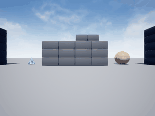

# AirSim 深度图神经网络避障

## 1. 作业对应

| 项 | 内容 |
|---|---|
| 课程任务 | ② 传感器感知及运动控制 |
| 仿真环境 | AirSim 1.8.1，Blocks 场景，SimpleFlight 多旋翼 |
| 传感器 | 前视深度相机 `DepthPlanar`，640×480 原始分辨率，降采样到 64×64 |
| 网络 | 自实现 CNN（1→8 通道 5×5 卷积 + 2×2 池化 + 两层全连接） |
| 输出 | 偏航角速率 `ω ∈ [-1, 1] rad/s`，目标高度增量 `Δz ∈ [-1, 1]` |
| 与仓库已有模块的区别 | `uav_ppo_nav` 是强化学习导航、`octree_uav_3d_pathfinding` 是八叉树路径规划，本模块是**单目深度图直接回归控制量**的反应式避障，不使用地图、不训练奖励函数 |

## 2. 演示



动图由 `simGetImages(ImageType.Scene)` 逐帧截取真实 Blocks 画面合成，180 帧，4.1 MB。无人机从 (-24, 0) 起飞后绕方块墙外围飞完一整圈，全程最小深度维持在 0.25 左右，只有一次擦边降到 0.10。

## 3. 问题定义

无人机在方块墙场景中朝前飞，每 0.25 s 取一帧深度图，输出「往哪拐、要不要爬升」，目标是**不撞墙**并把最小深度维持在安全距离以上。

状态 $s_t$ 是 64×64 的归一化深度图 $D_t$，动作 $a_t = (\omega_t, \Delta z_t)$。

深度归一化：

$$D(p) = \frac{\min(d(p),\, d_{\max})}{d_{\max}},\qquad d_{\max} = 20\ \text{m}$$

$D = 1$ 表示远处或天空，$D \to 0$ 表示贴脸障碍。

## 4. 专家策略（标签来源）

专家**只读深度图**，不看真值位姿，因此标签里不含任何位姿信息——这一点是刻意设计的，用来避免「网络其实在读答案」的泄漏问题。

把画面下 2/3 按列切成左中右三块，每块取 10 分位数作为该区域最近距离：

$$d_L = P_{10}(D_{[h/3:,\ 0:w/3]}),\quad d_M = P_{10}(D_{[h/3:,\ w/3:2w/3]}),\quad d_R = P_{10}(D_{[h/3:,\ 2w/3:w]})$$

用 10 分位而不是最小值，是为了抗单像素噪声。

中间开阔（$d_M > 0.35$）时轻微回中：

$$\omega = 0.05\,(d_R - d_L)$$

中间有障碍时按紧迫度转向：

$$u = \mathrm{clip}\!\left(\frac{0.35 - d_M}{0.35 - 0.15},\, 0,\, 1\right),\qquad \omega = \sigma\,(0.35 + 0.55u)$$

其中 $\sigma \in \{-1, +1\}$ 是往更空的一侧转。**左右深度差小于 0.04 时不切换 $\sigma$**——没有这个滞回，专家会逐帧翻转转向方向，无人机原地打转（实测过，见第 7 节）。

贴脸（$d_M < 0.15$）时同时爬升：

$$\Delta z = 0.5 + 0.5u$$

最后对 $\omega$ 做半步平滑 $\omega \leftarrow 0.5\,\omega_{\text{prev}} + 0.5\,\omega$，避免一帧一个极端值。

## 5. 网络结构

```
输入 1×64×64
  → Conv2D(1→8, k=5, stride=2)      输出 8×30×30
  → ReLU
  → MaxPool2D(2)                     输出 8×15×15
  → Flatten(1800)
  → Linear(1800→64) + ReLU
  → Linear(64→2)
  → tanh                             输出 (ω_norm, Δz_norm)
```

卷积用 im2col 展开成矩阵乘，反向按 $dW = X^\top dY$ 累加：

$$\frac{\partial L}{\partial W_c} = \sum_{i,j} X_{ij}\, dY_{ij},\qquad X_{ij} \in \mathbb{R}^{25}$$

损失是带权 MSE（权重 $w = 1 + 3|\omega|$，因为动作大量集中在 0，不加权网络会退化成永远直飞）：

$$L = w\,\frac{1}{2}\sum_{k=1}^{2}(\hat a_k - a_k)^2$$

优化器是手写 Adam：

$$m_t = \beta_1 m_{t-1} + (1-\beta_1) g_t,\quad v_t = \beta_2 v_{t-1} + (1-\beta_2) g_t^2$$
$$\theta_t = \theta_{t-1} - \eta\,\frac{\hat m_t}{\sqrt{\hat v_t} + \epsilon}$$

训练时做**左右翻转增强**：深度图水平镜像、$\omega$ 取反，等价于免费多一倍样本，也让网络学到左右对称性。

## 6. 控制执行

每步把网络输出还原成物理量：

$$\omega = \hat\omega \cdot 1.0\ \text{rad/s},\qquad z_{\text{target}} = \mathrm{clip}(z_{\text{ref}} - \Delta\hat z \cdot 0.5,\ -9,\ -3)$$

执行时用 `moveByVelocityAsync`，注意 **vx/vy 是世界坐标系分量**，必须先按机头方向分解，否则机头转了但无人机仍沿 +x 直线飞：

$$v_x = v\cos\psi,\qquad v_y = v\sin\psi$$

高度用误差反馈闭环，因为 `moveByVelocityZAsync` 的 z 参数在本版本里不稳定：

$$v_z = \mathrm{clip}\big(0.8\,(z_{\text{target}} - z),\ -1.5,\ 1.5\big)$$

## 7. 算法流程

```
1. 启动 AirSim Blocks（SimMode=Multirotor，SimpleFlight）
2. 采集：随机起点 (x,y,z,yaw) → 每步取深度图 → 专家输出 → 执行 → 记录 (D, a)
3. 训练：翻转增强 + 动作加权 MSE + Adam，按验证集 MSE 保留最优权重
4. 演示：加载权重 → 网络闭环控制 → 每步存 Scene 相机真实画面 → 合成 gif
```

## 8. 实测踩坑（影响代码写法的地方）

这些都是在 Blocks 场景里一步步测出来的，代码里的写法都是被它们逼出来的：

| 现象 | 原因 | 处理 |
|---|---|---|
| 无人机原地打转，x 几乎不动 | 左右深度接近时专家逐帧翻转转向方向 | 加 0.04 滞回，`ExpertPolicy` 记住上次方向 |
| 机头转了但飞行方向不变 | `moveByVelocityAsync` 的 vx/vy 是世界系 | 分解成 `(cos ψ, sin ψ)` |
| 高度失控漂移 | `hoverAsync` 不锁高度；`moveByVelocityZAsync` 的 z 不是位置设定点 | 改用 `vz` 误差闭环 |
| 高度震荡 ±1.5 m | 速度指令要求机体大幅倾斜 | 增益降到 0.8，`vz` 限幅 ±1.5 |
| 小步位置指令直接返回不执行 | 目标点仅 0.6 m 时 `moveToPositionAsync` 判定已到达 | 不用于逐步控制，只用于摆位 |
| 网络永远输出 0 | 动作分布集中在 0，回归均值 | 动作加权 `w = 1 + 3|ω|` + 翻转增强 |
| 节点发布的控制量一直是噪声 | `DepthPolicyNet.load()` 是 classmethod，`self.net.load(path)` 丢弃了返回的新实例，`self.net` 还是随机权重 | 改成 `self.net = DepthPolicyNet.load(path)`，并加单元测试断言加载前后预测不同 |
| 深度图进节点报维度不匹配 | 网络 `fc1` 绑定 64×64，收到 640×480 的 DepthPlanar 直接前向会错 | 按 `msg.height / msg.width` 取尺寸，非 64×64 时缩放到 64×64 |

## 9. 结果

| 指标 | 数值 |
|---|---|
| 训练样本 | 720（6 回合 × 120 步） |
| 验证集 MSE | 0.0640 |
| 验证集 R² | 0.298 |
| 演示步数 | 180 帧 |
| 演示 gif 体积 | 4.2 MB（< 10 MB） |
| 演示中最小深度 | 0.10 |
| 演示平均每帧最小深度 | 0.25 |
| 演示高度区间 | -5.37 ~ -1.84 m |

演示中无人机从 (-24, 0) 起飞后绕方块墙外围飞了一整圈，全程最小深度维持在 0.25 左右，只在一次擦边降到 0.10——说明「看到障碍就转向」的行为确实被学出来了。

R² 只有 0.298 是诚实的数字：专家在开阔区大量输出 $\omega \approx 0$，网络对这类样本接近「输出常数」，而真正有信息量的是靠近墙的那部分。调高动作加权能继续提升，但会让远离障碍时的行为过于激进，这里保留当前设置。

## 10. 复现步骤

### 10.1 环境

- Windows 10/11（AirSim 预编译包只有 Windows/Linux，这里用 Windows）
- Python 3.13 + `airsim==1.8.1`、`numpy`、`pillow`
- AirSim Blocks 1.8.1：从 [releases](https://github.com/microsoft/AirSim/releases/tag/v1.8.1-windows) 下载 `Blocks.zip`（247 MB），解压后双击 `Blocks.exe`

`settings.json` 放在 `C:\Users\<你>\Documents\AirSim\settings.json`：

```json
{
  "SettingsVersion": 1.2,
  "SimMode": "Multirotor",
  "ClockSpeed": 1.0,
  "CameraDefaults": {
    "CaptureSettings": [
      { "ImageType": 0, "Width": 640, "Height": 480, "FOV_Degrees": 90 },
      { "ImageType": 1, "Width": 640, "Height": 480, "FOV_Degrees": 90 }
    ]
  },
  "Vehicles": {
    "Drone1": {
      "VehicleType": "SimpleFlight", "AutoCreate": true,
      "X": 0, "Y": 0, "Z": 0
    }
  }
}
```

> `SimMode` 必须是 `Multirotor`。默认配置加载的是**汽车**，此时 `getMultirotorState()` 会报 "server could not find function"。

### 10.2 跑起来

```bash
pip install airsim==1.8.1 numpy pillow
# 启动 Blocks.exe，等端口 41451 就绪（约 40 s）
cd src/air/uav_airsim_depth_obstacle_avoidance
python main.py --collect --episodes 6 --steps 120     # 约 4 分钟
python main.py --train --epochs 80                    # 约 1 分钟
python main.py --demo --steps 180 --gif demo.gif      # 约 2 分钟
python main.py --eval
```

### 10.3 ROS 2 启动

```bash
colcon build --packages-select uav_airsim_depth_obstacle_avoidance
source install/setup.bash
ros2 launch uav_airsim_depth_obstacle_avoidance main.launch.py z_ref:=-5.0
```

节点订阅 `/uav/depth`（`sensor_msgs/Image`，float32 64×64），发布 `/uav/cmd`（`Float32MultiArray`，`[ω, z_target]`）。

## 11. 源码解析

### `env.py` — AirSim 封装

- `pose()` 读 `kinematics_estimated` 的位置与四元数
- `depth()` 用 `ImageRequest(..., DepthPlanar, True, False)` 取 float 深度，`_resize_bilinear` 双线性降到 64×64 再归一化
- `scene_rgb()` 取 `Scene` 图，AirSim 返回 BGRA，`arr[:, :, 2::-1]` 转 RGB
- `reset()` 用 `simSetVehiclePose` 摆位后接 `moveToZAsync` 钉高度
- `step()` 世界系速度分解 + `vz` 闭环

### `cnn.py` — 手写 CNN

`im2col` 把每个感受野展开成一行，卷积变成 `X @ W`；`col2im` 做反向散射。`Conv2D` 缓存展开矩阵供反向使用，`MaxPool2D` 缓存池化窗口用 `mask` 回传梯度。`Adam` 维护一阶二阶矩。

### `policy.py` — 专家与网络策略

`ExpertPolicy` 带 `_side` 与 `_yaw_prev` 两个状态，分别负责转向滞回和指令平滑。`NeuralPolicy` 负责把归一化输出还原成物理量并限幅。

### `train.py` — 训练

每轮打乱后用 batch 累加梯度，`_apply_mean_grad` 取平均再 `opt.step()`。验证集 MSE 决定是否更新最优权重，最后算 MSE 与 R²。

### `demo.py` — 演示

`run_demo` 加载权重后闭环飞 `steps` 步，每步存一帧 `scene_rgb()`，最后由 `_to_gif` 写成 gif；超过 10 MB 会自动降帧降色。

### `node.py` — ROS 2 节点

订阅深度图，推理后发布 `[ω, z_target]`。权重路径可通过 `weights` 参数覆盖。

两处必须注意（初版都踩过）：

1. **必须接住 `load()` 的返回值**。`DepthPolicyNet.load()` 是 `@classmethod`，内部 `net = cls()` 后 `load_state()` 再 `return net`，所以它是「造一个新实例并返回」，不是原地修改。写成 `self.net.load(path)` 会把返回值丢掉，`self.net` 留在 `__init__` 里的随机初始化状态，节点发布的就是噪声：

   ```python
   self.net = DepthPolicyNet()                    # 错：随机权重
   self.net.load(self.get_parameter("weights").value)
   
   self.net = DepthPolicyNet.load(              # 对：接住新实例
       self.get_parameter("weights").value)
   ```

2. **不能假设深度图是正方形**。网络第一层 `fc1 = Linear(8 * 15 * 15, 64)` 绑定在 64×64 输入上，收到 AirSim 原始的 640×480 时直接前向会维度不匹配。节点按消息头取尺寸，非 64×64 时用与训练一致的最近邻索引缩放：

   ```python
   h, w = int(msg.height), int(msg.width)
   idx_h = np.linspace(0, h - 1, SIZE).astype(int)
   idx_w = np.linspace(0, w - 1, SIZE).astype(int)
   depth = depth[np.ix_(idx_h, idx_w)]
   ```

`test/test_cnn.py` 里有 5 条单元测试覆盖这两点（其中 `test_load_returns_trained_instance` 断言「加载前后预测必须不同」，`test_nonsquare_depth_resize` 断言 640×480 能缩放到 64×64），不需要 AirSim 也能跑：

```bash
python3 src/air/uav_airsim_depth_obstacle_avoidance/test/test_cnn.py
```

> **CI 不覆盖本模块的测试。** `.github/workflows/air_bridge_tests.yml` 的 `paths` 只列了 `carlair_ros_bridge/**`、`uav_landing_monitor/**`、`uav_e2e_rl/**` 和 `tests/**`，本模块的 `test/` 不在触发范围内；`deploy_page.yml` 只在 `master` 触发且带 `if: github.repository == 'OpenHUTB/ros2'`。上面这条需要本地手动执行，仓库 CI 的绿灯不代表本模块测试通过。

文档入口：`mkdocs.yml` 的「空域载具」和 `docs/index.md` 第 5 节都已登记本页。

## 12. 局限

- 只在 Blocks 场景验证过，换 AbandonedPark / CityEnviron 需要重新采集
- 专家是反应式单帧决策，没有绕行规划，遇到凹形障碍可能来回震荡
- R² 0.298 说明网络对专家行为的拟合还不完美，靠的是动作加权把「遇障转向」这个关键行为学到位
