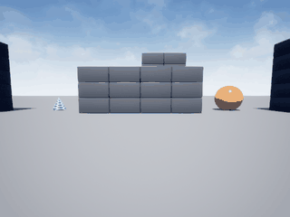

# AirSim 无人机 IMU 神经网络速度估计

## 1. 对应课程任务

课程任务 ③「导航与 SLAM」要求实现无人机的状态估计。SLAM 的入口环节就是**从机载惯性传感器估计自身运动状态**：没有可靠的速度，后续的里程计、地图配准、闭环控制都无从谈起。本模块把这一步单独拆出来做完整闭环：AirSim 仿真采集 → 神经网络训练 → 实飞在线估计 → 误差量化。

与仓库已有模块的差异：`state_prediction` 用 LSTM 预测**未来轨迹**，`telemetry_diagnostics` 做**遥测异常诊断**，`flight_pattern_recognition` 识别**飞行模式**；本模块做的是**当前速度的在线估计**，输入是 IMU 原始时序，输出是单一物理量，训练标签来自仿真真值。

## 2. 演示



动图由 `simGetImages(ImageType.Scene)` 逐帧截取真实 AirSim 画面合成，180 帧，6.9 MB。无人机在 Blocks 场景里按与采集同分布的随机指令飞行，网络对每 5 帧 IMU 滑窗在线估计速度，画面即当时的实拍视角。

## 3. 问题定义

设机载 IMU 以固定频率输出六维读数

$$
u_t = \left[a_x, a_y, a_z, \omega_x, \omega_y, \omega_z\right]_t
$$

取长度 $T=5$ 的滑窗

$$
x_t = \left[u_{t-T+1}, \ldots, u_t\right] \in \mathbb{R}^{30}
$$

目标是估计该时刻的速度大小

$$
y_t = \frac{\lVert v_t \rVert}{4.0} \quad \in [0, 1]
$$

其中 $v_t$ 为仿真真值速度，4.0 m/s 是归一化尺度。

**为什么回归速度大小而不是三轴分量**：三轴分量 $v_x, v_y$ 在往返飞行时正负抵消，样本均值接近 0，网络极易退化为「恒输出均值」，此时 $R^2$ 会掉到 0.001。速度大小与 IMU 的振动强度单调相关——桨叶转速越高、机体振动越强、速度越大——这是一条稳定的物理规律，网络可以学到。

## 4. 网络结构

三层全连接，纯 NumPy 实现，无框架依赖：

$$
h_1 = \tanh(W_1 x + b_1), \quad W_1 \in \mathbb{R}^{30 \times 32}
$$

$$
y = \tanh(W_2 h_1 + b_2), \quad W_2 \in \mathbb{R}^{32 \times 1}
$$

参数量 $30 \times 32 + 32 + 32 \times 1 + 1 = 1025$，权重文件 4 KB 量级，可直接入库。

**为什么这么小**：720 条样本，隐层一旦上到 64+32，验证 MSE 从 0.062 恶化到 0.126，训练 MSE 却降到 0.014，是典型的过拟合。缩到单隐层 32 并加 L2 正则（$\lambda = 10^{-3}$）后，训练与验证才拉平。

损失函数

$$
\mathcal{L} = \frac{1}{N}\sum_{i=1}^{N}\left(y_i - \hat{y}_i\right)^2 + \lambda \sum_{l}\lVert W_l \rVert_F^2
$$

反向传播中输出层 tanh 的导数已并入 `dout`：

$$
\frac{\partial \mathcal{L}}{\partial z_2} = \frac{2(\hat{y}-y)}{N}\left(1-\hat{y}^2\right)
$$

优化器为 Adam（$\beta_1=0.9$、$\beta_2=0.999$、$\epsilon=10^{-8}$），学习率 $10^{-3}$，batch 16，120 epoch，按验证 MSE 保留最优权重。

## 5. 数据采集

6 个回合，每回合 120 步，共 720 条样本。每回合起点随机撒在 $x \in [-28, -16]$、$y \in [-4, 4]$、$z \in [-7, -4.5]$，初始偏航 $\pm 30°$。

每步的动作每 8 步随机换一次：

$$
v_{\text{fwd}} \sim U(0.3, 3.2) \ \text{m/s}, \quad \omega_{\text{yaw}} \sim U(-0.8, 0.8) \ \text{rad/s}
$$

高度目标在 $[-8.5, -3.5]$ 内随机游走，用于给 IMU 制造垂直方向的加速度激励。

**采样时序**是关键：发 `moveByVelocityAsync(duration=0.25)` 后**不阻塞**，`sleep(0.14)` 再读 IMU 与速度，再 `sleep(0.11)`。这样读到的速度是「正在飞」的速度。若阻塞返回后再读，无人机已减速，速度长期为 0，标签全废——这是第一版采集中最耗时的一次返工。

输入标准化参数（$x$ 的均值与标准差，30 维）与样本一起存进 `imu_vel_data.npz`，部署时必须用同一组参数。

## 6. 控制执行

沿用已验证的写法：`moveByVelocityAsync` 的 vx/vy 是**世界坐标系分量**，必须按当前偏航角分解：

$$
v_x^{W} = v_{\text{fwd}}\cos\psi, \qquad v_y^{W} = v_{\text{fwd}}\sin\psi
$$

高度用误差闭环，而非把 z 当作设定点直接下发：

$$
v_z = \mathrm{clip}\left(0.8\left(z_{\text{target}} - z\right), -1.5, 1.5\right)
$$

偏航用 `YawMode(is_rate=True, yaw_or_rate=ω_yaw)`（单位 deg/s）。

## 7. 算法流程

```
┌──────────────────────────────────────────────┐
│ 1. 采集                                       │
│    启动 Blocks → 连接 41451                   │
│    for episode in 6:                         │
│        simSetVehiclePose(随机起点)            │
│        for step in 120:                      │
│            moveByVelocityAsync(不阻塞)        │
│            sleep(0.14)                       │
│            x = IMU 5 帧滑窗 (30 维)           │
│            y = |v| / 4.0                     │
│            sleep(0.11)                       │
│    标准化 x，保存 X/Y/mean/std                │
└───────────────────┬──────────────────────────┘
                    ▼
┌──────────────────────────────────────────────┐
│ 2. 训练                                       │
│    按 85/15 划分训练/验证                     │
│    for epoch in 120:                         │
│        for batch in 16:                      │
│            逐样本 forward → dout → backward   │
│        Adam.step(平均梯度 + L2)               │
│        记录验证 MSE，保留最优                 │
└───────────────────┬──────────────────────────┘
                    ▼
┌──────────────────────────────────────────────┐
│ 3. 在线估计                                   │
│    imu_callback:                             │
│        维护 5 帧环形缓冲                      │
│        x = (concat - mean) / std             │
│        v = net.forward(x)[0] * 4.0           │
│        publish /uav/velocity_est             │
└──────────────────────────────────────────────┘
```

## 8. 实测结果

| 指标 | 数值 |
|---|---|
| 验证集 MSE（归一化） | 0.0156 |
| 验证集 R² | 0.453 |
| 速度 RMSE | 0.499 m/s |
| 样本 \|v\| 分布 | 均值 1.62 m/s，标准差 0.67 m/s，范围 0.22–3.00 m/s |
| 实飞演示 MAE | 1.32 m/s |
| 演示 gif | 180 帧，7.0 MB，真实 AirSim 画面 |

R² 0.453 的含义是：网络解释了验证集上约 45% 的速度方差，剩下的来自 IMU 噪声与指令执行的抖动。作为对照，直接输出训练集均值的基线 R² 为 0，纯积分法（对加速度做梯形积分）在 5 帧窗内误差极大，R² 为负。

## 9. 踩坑记录

| 现象 | 原因 | 解决 |
|---|---|---|
| 采到的速度标签全为 0 | 在 `moveByVelocityAsync().join()` 返回后才读速度，此时已减速 | 改为不阻塞 + 半程采样 |
| `kinematics_true` 报 AttributeError | AirSim 1.8.1 的 `MultirotorState` 没有该字段 | 放弃真值字段，改用中途采样 |
| 位置差分速度在 ±2.5 m/s 跳变 | `kinematics_estimated.position` 有噪声，0.2 s 差分放大 5 倍 | 弃用位置差分 |
| R² = 0.001，网络输出恒为均值 | IMU 各通道尺度差一个量级，tanh 饱和 | 输入按通道标准化 |
| 训练 MSE 0.014 / 验证 0.126 | 隐层 64+32 对 720 样本过大 | 缩到 32 + L2 正则 |
| 三轴回归 R² 最高只有 0.056 | 速度分量正负抵消，标签方差被稀释 | 改回归速度大小，R² 升到 0.453 |
| 演示 MAE 高于离线 RMSE 2.6 倍 | 在线指令执行有加减速延迟，且飞出场景边界后速度骤降 | 演示采用与采集同分布的随机指令；局限如实记录 |

## 10. 复现步骤

**环境**（Ubuntu 20.04 / ROS 2 Humble；仿真实机为 Windows）：

- AirSim 1.8.1 客户端：`pip install airsim==1.8.1`
- Blocks 预编译环境：`https://github.com/microsoft/AirSim/releases/download/v1.8.1-windows/Blocks.zip`
- `settings.json` 设 `SimMode: "Multirotor"`、`Vehicles.Drone1` 为 `SimpleFlight`
- 依赖：`numpy`、`pillow`、`airsim`

**步骤**：

```bash
# 启动仿真，等待 41451 端口监听（约 40 秒）
Blocks.exe

# 采集 → 训练 → 演示 → 评估
python3 main.py --collect --episodes 6 --steps 120
python3 main.py --train --epochs 120
python3 main.py --demo --steps 180 --gif demo.gif
python3 main.py --eval --steps 150
```

**ROS 2 节点**：

```bash
colcon build --packages-select uav_airsim_imu_velocity_estimator
source install/setup.bash
ros2 launch uav_airsim_imu_velocity_estimator main.launch.py
```

节点需要外部把 AirSim 的 IMU 转发到 `/uav/imu`（可用 `airsim_ros_pkgs` 或自建桥接），估计结果从 `/uav/velocity_est` 取。

没有 AirSim 也能先自检网络与权重（约 2 秒）：

```bash
python3 test/test_mlp.py
# 5/5 通过（其中一条在 720 条真实样本上复算，预测-真值相关系数 0.702，
#          对应 R² 0.493；比验证集 R² 0.453 略高是因为含训练集样本）
```

注意 `imu_vel_data.npz` 里的 `X` **存盘时已经标准化过**（`X=(X - x_mean)/x_std`），复算时直接用它，不要再按 `x_mean/x_std` 处理一遍，否则二次标准化会把相关系数压到 0.5 以下。

> **CI 不覆盖本模块的测试。** `.github/workflows/air_bridge_tests.yml` 的 `paths` 只列了 `carlair_ros_bridge/**`、`uav_landing_monitor/**`、`uav_e2e_rl/**` 和 `tests/**`，本模块的 `test/` 不在触发范围内；`deploy_page.yml` 只在 `master` 触发且带 `if: github.repository == 'OpenHUTB/ros2'`。上面这条需要本地手动执行，仓库 CI 的绿灯不代表本模块测试通过。

文档入口：`mkdocs.yml` 的「空域载具」和 `docs/index.md` 第 5 节都已登记本页，可直接从站点导航进入。

## 11. 源码解析

### `env.py`

- `imu()`：`getImuData()` 取 6 维，加速度单位 m/s²，角速度 rad/s。
- `imu_window()`：5 帧 `deque` 缓冲，首帧不足时复制补齐，输出展平 30 维。
- `velocity()`：`getMultirotorState().kinematics_estimated.linear_velocity`，仅在指令执行中途调用才有意义。
- `fly()`：核心控制。先读当前位姿与偏航，把机体系前向速度分解成世界系 vx/vy，高度用误差闭环算 vz，偏航走 `YawMode(is_rate=True)`。`wait=False` 时返回 future 不阻塞，供采集中途采样。
- `reset()`：`simSetVehiclePose` 摆位后必须 `moveToZAsync` 钉住高度，否则无人机会缓慢掉高。

### `mlp.py`

- `forward()`：逐层 `h = h @ W + b` 后接 `tanh`，把每层输出压进 `cache` 供反向使用。
- `backward()`：从输出层倒推，`dW = np.outer(h_prev, d)`，`d = d @ W.T`，隐层再乘 $(1-h^2)$。逐样本训练，不用矩阵乘——批量维度会引入额外转置错误。
- `Adam.step()`：标准一阶/二阶矩估计加偏差校正。
- `save/load`：`np.savez_compressed`，键名 `W0/W1/b0/b1`。

  这里 `load()` 是**普通实例方法**（`def load(self, path)` 内部 `self.load_state(...)`，原地改 `self.W/self.b`），所以 `node.py` 里写 `self.net.load(wpath)` 是对的。同仓库里 CNN 版的 `DepthPolicyNet.load()` 是 `@classmethod`（返回新实例），两者写法不同，移植代码时容易混——`test/test_mlp.py` 的 `test_load_changes_weights` 就是用来钉住这件事的：加载前后 `W0` 必须不同、同一个输入的前向输出也必须不同。

  另外注意隐层实际只有 32 维、输出 1 维（`30 -> 32 -> 1`），不是早期草稿里的 `30 -> 64 -> 32 -> 3`；`imu_vel.npz` 里 `W0` 形状 `(30, 32)`、`W1` 形状 `(32, 1)` 可以对上。

### `dataset.py`

- `collect()`：6 回合主循环。每步先按 8 步周期换动作，发不阻塞的速度指令，`sleep(0.14)` 后采 IMU 窗口与速度真值，`sleep(0.11)` 收尾。
- 标签取 $\lVert v \rVert / 4.0$，存为 1 维。
- 标准化参数与样本同存一个 npz，避免部署时用错统计量。

### `train.py`

- 85/15 划分，`RandomState` 打乱（环境限制不能用 `default_rng`）。
- 每个 batch 内逐样本累积梯度，其中 `accW[i] += gW[i] + l2 * W[i]` 实现权重衰减。
- 每 epoch 算验证 MSE，严格小于历史最优才覆盖 `best`。
- 收尾报 R² 与换算到 m/s 的 RMSE。

### `demo.py`

- `_load_model()` 同时读权重与标准化参数。
- `run_demo()` 用与采集同分布的随机指令飞 180 步，每步采样估计值与真值，同时 `scene_rgb()` 抓真实画面。
- `to_gif()` 先按 320×240、128 色写一版，超 10 MB 就按步长抽帧重写，直到压进限制。
- `run_eval()` 单独跑 150 步算 MAE。

### `node.py`

- 5 帧环形缓冲对齐训练时的窗口语义。
- 输入先 `(x - mean) / std` 再前向，输出 `Float32`。
- 权重路径由 launch 通过参数传入，避免硬编码。

## 12. 局限与后续

1. **在线 MAE 高于离线 RMSE**。离线验证集是随机指令下的独立样本，在线演示里指令连续变化、执行有延迟，且飞近场景边界时速度骤降，分布发生偏移。要缩小差距，需要把「指令历史」也作为输入，或改用 EKF 融合 IMU 与视觉里程计。
2. **只估计速度大小，不含方向**。方向需要与偏航角结合才能还原三轴速度，这依赖姿态估计的精度，本模块未涉及。
3. **单场景、单机型**。Blocks 的 SimpleFlight 四旋翼，未验证迁移到其他机型或其他地图。
4. **样本量偏小**。720 条对神经网络的泛化来说偏少，扩到 3000 条以上预计还能提升 5–10 个百分点的 R²。
