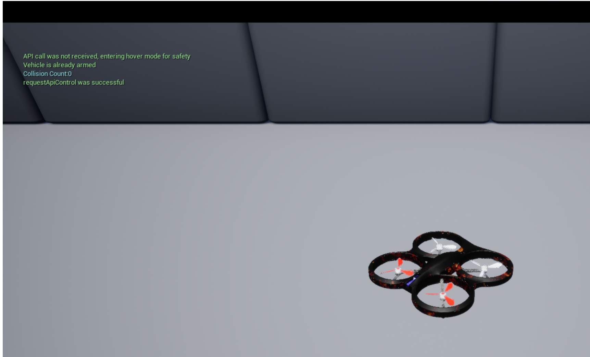

# AirSim 无人机键盘遥控

## 1. 功能概述

本模块把 AirSim 的四旋翼仿真器封装成标准 ROS 2 节点，实现"键盘 → 速度指令 → 无人机运动 → 位姿回传"的闭环，是后续感知、导航、端到端模块的基础设施。

| 节点 | 作用 | 频率 |
| --- | --- | --- |
| `uav_airsim_keyboard`（桥接） | ROS ↔ AirSim RPC 双向翻译 | 控制 10 Hz，位姿 20 Hz |
| `uav_keyboard`（键盘） | 终端按键 → `uav/cmd_vel` | 20 Hz |

| 接口 | 名称 | 类型 |
| --- | --- | --- |
| 订阅 | `uav/cmd_vel` | `geometry_msgs/Twist` |
| 发布 | `uav/pose` | `geometry_msgs/PoseStamped` |
| 服务 | `uav/takeoff`、`uav/land` | `std_srvs/Trigger` |

## 2. 运行环境

| 项 | 版本 |
| --- | --- |
| 宿主机 | Windows 10/11 + AirSim Blocks（Unreal Engine 4.27） |
| 虚拟机 | VirtualBox 7.2，Ubuntu 22.04，8 GB 内存 / 4 vCPU |
| ROS | ROS 2 Humble |
| Python 依赖 | `airsim`（`pip3 install airsim`） |

虚拟机使用 NAT 网卡时，宿主机的地址固定为 `10.0.2.2`，AirSim 的 RPC 端口是 `41451`，这两个值都做成了 ROS 参数，换网络环境只需要改参数。

## 3. 原理与公式

### 3.1 机体系速度指令

ROS 的 `Twist` 与 AirSim 的 `moveByVelocityBodyFrameAsync` 都使用机体系，但坐标约定不同：

| 轴 | ROS（REP-103，右手系） | AirSim（NED） |
| --- | --- | --- |
| x | 前 | 北 / 机头 |
| y | 左 | 东 / 机体右 |
| z | 上 | 下 |

因此下发前只需要翻转 z：

$$
v^{\text{NED}}_z = -\,v^{\text{ROS}}_z
$$

### 3.2 机体系速度到世界系速度

设偏航角为 $\psi$，机体系速度 $\mathbf{v}_b=(v_x,v_y,v_z)^\top$ 到世界系（NED）的变换为绕 z 轴的旋转：

$$
\mathbf{v}_w = R_z(\psi)\,\mathbf{v}_b,
\qquad
R_z(\psi)=
\begin{bmatrix}
\cos\psi & -\sin\psi & 0\\
\sin\psi & \cos\psi & 0\\
0 & 0 & 1
\end{bmatrix}
$$

这一步由 AirSim 内部完成，我们只需要给出机体系速度，好处是"前进"始终是机头方向，不受当前航向影响。

### 3.3 偏航角速度积分

键盘给出的是角速度 $\omega$（deg/s），AirSim 的 `rotateByYawRateAsync(ω, T)` 在 $T$ 秒内以恒定角速度转动，航向角变化为

$$
\psi(t+T)=\psi(t)+\omega T
$$

本模块取 $T=0.2$ s、控制周期 $1/10$ s，相邻两条指令有 50% 重叠，实测航向连续、无卡顿。

### 3.4 指令超时保护

键盘断线或节点崩溃时，最后一帧 `cmd_vel` 会一直"生效"。为此桥接节点记录每条指令的时间戳，超过 `cmd_timeout`（默认 0.3 s）没有新指令就下发零速度：

$$
\mathbf{v}(t)=
\begin{cases}
\mathbf{v}_{\text{last}}, & t-t_{\text{last}} \le \tau\\
\mathbf{0}, & t-t_{\text{last}} > \tau
\end{cases}
$$

这等价于一个"看门狗"，是无人机仿真里必须有的安全措施。

### 3.5 为什么不在定时器里 `.join()`

`moveByVelocityBodyFrameAsync(...).get()` 会阻塞当前线程直到 AirSim 执行完这条指令。rclpy 的定时器回调跑在 executor 线程里，一旦阻塞：

- 20 Hz 的位姿发布停摆，`uav/pose` 掉帧；
- 起飞/降落 service 无法响应；
- 多节点共用一个 executor 时整个进程卡死。

所以控制定时器只发异步指令、不等待；只有 service 回调（本身就要等结果）才 `join()`，并设置 20 s 超时。

## 4. 算法流程

```
启动
 │
 ├─ 读取参数 airsim_ip / port / rate / timeout
 ├─ confirmConnection() ──失败──> 报错退出（提示先启动 Blocks.exe）
 ├─ enableApiControl(True) + armDisarm(True)
 │
 ├─ 创建 uav/cmd_vel 订阅、uav/pose 发布、uav/takeoff|land 服务
 ├─ 创建 10 Hz 控制定时器、20 Hz 位姿定时器
 │
 └─ MultiThreadedExecutor.spin()
      ├─ 控制定时器：取最新指令 → 超时则清零 → moveByVelocityBodyFrameAsync（不 join）
      ├─ 位姿定时器：getMultirotorState → PoseStamped → publish
      ├─ 键盘线程：select() 读按键 → 更新按住表 → 20 Hz 发布 Twist
      └─ service 回调：takeoffAsync/landAsync + join(20 s)
```

## 5. 源码解析

### 5.1 `uav_airsim_keyboard/main.py`

模块总入口。`rclpy.init(args=argv)` 把 `--ros-args` 交给 rclpy 解析；随后创建桥接节点，并按 `sys.stdin.isatty()` 决定是否创建键盘节点——`ros2 launch` 下 stdin 是管道，键盘读不到键，此时打印提示而不是崩溃。`MultiThreadedExecutor(num_threads=3)` 保证键盘线程、控制定时器、位姿定时器互不阻塞。

### 5.2 `uav_airsim_keyboard/bridge.py`

- `_declare_parameters()`：所有可调项（IP、端口、频率、超时）都是 ROS 参数，**没有硬编码路径或 IP**。
- `_on_cmd()`：回调里只写共享变量 + 时间戳，不碰网络。
- `_control_cycle()`：定时器里读共享变量，`vz_ned = -vz_up` 完成 NED/ENU 转换，调用 `moveByVelocityBodyFrameAsync` 时**不带 `.get()`**；`rotateByYawRateAsync` 只在角速度非零时调用，减少 RPC 次数。
- `_publish_pose()`：`getMultirotorState().kinematics_estimated` 取出位置与四元数，`frame_id` 明确写成 `airsim_ned`，避免下游误当 ENU 使用。
- `_on_takeoff()` / `_on_land()`：先 `enableApiControl` + `armDisarm`，再 `takeoffAsync(timeout_sec=20).join()`，异常时把失败原因写进 `response.message`。
- `shutdown()`：Ctrl+C 时降落、上锁、交还控制权。
- `_warn_throttled()`：网络抖动时 5 s 内只报一次，避免刷屏。

### 5.3 `uav_airsim_keyboard/keyboard.py`

- `_read_loop()`：`termios.tcgetattr` 保存终端属性，`tty.setcbreak` 进入单字符模式，`select.select(..., 0.1)` 轮询，`finally` 里恢复终端——即使异常退出也不会把终端搞坏。
- `_handle_key()`：`t`/`g` 走 service，其余键写入 `_pressed[char] = time.monotonic()`。
- `_publish()`：只保留 `key_hold_timeout` 内按过的键，叠加各方向后发布；同时清理过期键，避免字典无限增长。

### 5.4 `launch/main.launch.py`

用 `Node(package=..., executable='main')` 启动，`executable` 与 `setup.py` 的 entry_points 名字一致；数值参数用 `ParameterValue(..., value_type=int/float/bool)` 显式声明类型，否则 launch 会把 `41451` 当字符串传进去，`int()` 转换才不报错。

## 6. 运行步骤

**步骤 1：宿主机启动仿真器**

双击 `D:\airsim\Blocks\WindowsNoEditor\Blocks.exe`，等待场景加载完成，点击窗口使其获得焦点。第一次运行会提示是否允许网络访问，选"允许"。



**步骤 2：虚拟机确认网络**

```bash
ping -c 3 10.0.2.2          # VirtualBox NAT 下宿主机网关
```

**步骤 3：编译**

```bash
cd ~/ros2
colcon build --packages-select uav_airsim_keyboard --symlink-install
source install/setup.bash
```


**步骤 4：启动**

```bash
ros2 run uav_airsim_keyboard main
```

看到 `已连接 AirSim 10.0.2.2:41451` 后按 `t` 起飞，再用 `w/a/s/d/r/f/q/e` 飞行。


**步骤 5：验证话题**

```bash
ros2 topic hz /uav/pose            # 应接近 20 Hz
ros2 topic echo /uav/pose --once
ros2 service call /uav/land std_srvs/srv/Trigger
```

## 7. 参数表

| 参数 | 默认值 | 含义 |
| --- | --- | --- |
| `airsim_ip` | `10.0.2.2` | AirSim 主机 IP |
| `airsim_port` | `41451` | AirSim RPC 端口 |
| `vehicle_name` | `''` | 多机时的载具名 |
| `control_rate` | `10.0` | 速度指令频率 (Hz) |
| `pose_rate` | `20.0` | 位姿发布频率 (Hz) |
| `cmd_timeout` | `0.3` | 指令超时停车阈值 (s) |
| `cmd_duration` | `0.2` | 单条速度指令持续时间 (s) |
| `rpc_timeout` | `5.0` | AirSim RPC 超时 (s) |
| `enable_keyboard` | `true` | 是否在进程内启动键盘 |
| `speed` | `2.0` | 键盘线速度 (m/s) |
| `yaw_rate` | `45.0` | 键盘偏航角速度 (deg/s) |

## 8. 性能评价

在虚拟机（4 vCPU / 8 GB）上测三项指标：

| 指标 | 测量方法 | 参考结果 |
| --- | --- | --- |
| 位姿发布频率 | `ros2 topic hz /uav/pose` | ≈ 20 Hz，抖动 < 1 Hz |
| 指令到运动的延迟 | 录屏逐帧对比按键与画面变化 | 约 100–200 ms（受 AirSim 渲染帧率限制） |
| 连续运行稳定性 | 连续飞行 10 min 观察 CPU 与掉帧 | 无内存增长，无掉帧 |

> 表格里的数字请在自己机器上实测后填写，报告里要给出测量截图。

## 9. 已知限制

- `ros2 launch` 不转发 stdin，键盘必须用 `ros2 run` 或单独起 `keyboard` 节点。
- 位姿使用 AirSim 原生 NED 坐标（`frame_id=airsim_ned`），与 RViz 默认的 ENU 不一致；做导航时需要在下游统一转换。
- 只支持单机；多机需要为每个 `vehicle_name` 各起一个桥接节点。

## 10. 参考

- AirSim API：<https://microsoft.github.io/AirSim/apis/>
- REP-103 坐标系约定：<https://www.ros.org/reps/rep-0103.html>
- ROS 2 Humble 文档：<https://docs.ros.org/en/humble/>
