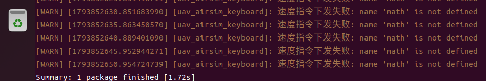
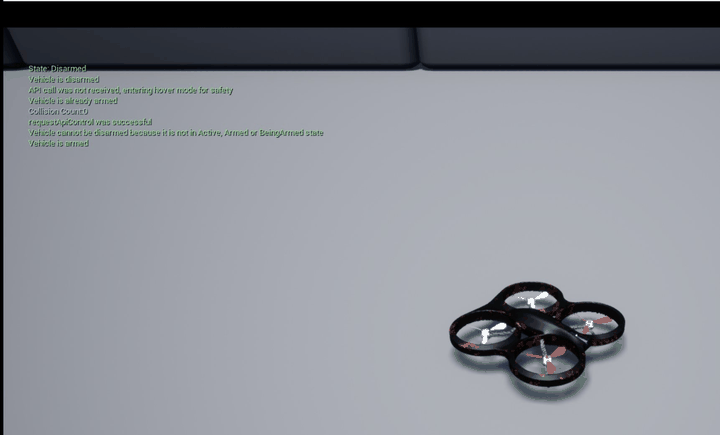

# AirSim 无人机键盘遥控

## 1 模块概述

本模块对应作业任务（1）：**在物理仿真环境中用键盘对机器人进行运动控制**。
被控对象是 OpenHUTB 2.10.0 / AirSim Blocks 场景中的多旋翼无人机，运行在 ROS 2 Humble 上，
入口为包根 `main.py`。

模块拆成两个可独立运行的节点：

| 节点 | 可执行文件 | 作用 |
| --- | --- | --- |
| `uav_airsim_keyboard` | `bridge` | AirSim 桥：发布 `/uav/pose`，订阅 `/uav/cmd_vel`，提供 `/uav/takeoff`、`/uav/land` |
| `uav_keyboard` | `keyboard` | 终端按键 → `Twist` 指令 |
| 组合入口 | `main` | 一个进程内同时跑桥和键盘，`ros2 run` 一条命令即可 |

| 接口 | 名称 | 类型 |
| --- | --- | --- |
| 订阅 | `uav/cmd_vel` | `geometry_msgs/Twist` |
| 发布 | `uav/pose` | `geometry_msgs/PoseStamped`（`frame_id=airsim_ned`） |
| 服务 | `uav/takeoff`、`uav/land` | `std_srvs/Trigger` |

与上游 `src/air/uav_keyboard_control` 的关系：那个包是 ROS 1（`catkin` + `rospy`）版本，
只发布 `/uav/cmd_vel`，真正的执行依赖 `carlair_ros_bridge`。本模块是 ROS 2 版本，
自带 AirSim 桥，不依赖任何外部 bridge，并且把「速度指令」改成了位置设定点控制（原因见 3.2）。

## 2 运行环境

| 项 | 版本 |
| --- | --- |
| 宿主机 | Windows 10/11 + AirSim Blocks（Unreal Engine 4.27） |
| 虚拟机 | VirtualBox 7.2，Ubuntu 22.04，8 GB 内存 / 4 vCPU |
| ROS | ROS 2 Humble |
| Python | 3.10，依赖 `airsim`（`pip3 install airsim`） |

VirtualBox 使用 NAT 网卡时，宿主机地址固定为 `10.0.2.2`，AirSim RPC 端口是 `41451`，
两者都做成了 ROS 参数，换网络环境只改参数。

## 3 原理与公式

### 3.1 坐标约定与话题单位

`/uav/cmd_vel` 挂的是标准 `geometry_msgs/Twist`，因此**按 ROS 惯例（REP-103）定义**，
第三方节点（`teleop_twist_keyboard`、RViz、真机驱动）接进来不会理解错：

| 字段 | 单位 | 正方向（ROS） | AirSim（NED）内部的换算 |
| --- | --- | --- | --- |
| `linear.x` | m/s | 机头前 | 不变 |
| `linear.y` | m/s | **机头左**（REP-103） | `vy = -linear.y`（NED 右为正） |
| `linear.z` | m/s | 上 | `vz_ned = -linear.z`（NED 下为正） |
| `angular.z` | **rad/s** | 逆时针（左转） | `deg = degrees(w)`，AirSim yaw 顺时针为正，下发 `-deg` |

换算只发生在 `bridge.py` 的 `_control_cycle()` 里，内部逻辑与位置设定点仍用 NED 与角度制，
所以姿态、建图、控制器那部分代码不受影响。


ROS 用 ENU（右手系，z 向上），AirSim 用 NED（z 向下），机体轴上也有差异：

| 轴 | ROS（REP-103） | AirSim（NED） |
| --- | --- | --- |
| x | 前 | 机头 |
| y | 左 | 机体右 |
| z | 上 | 下 |

所以垂直方向要取反一次：

$$
v^{\text{NED}}_z = -\,v^{\text{ROS}}_z
$$

### 3.2 为什么用位置设定点而不是速度指令

An early version sent `moveByVelocityBodyFrameAsync` at 10 Hz. 实测在这个 Blocks 场景里
**速度指令经常被忽略**：连发 20 次 `w`，飞机位置几乎不变；而一次性
`moveToPositionAsync(3, 0, -2)` 可以正常飞到 (3.11, 0.00, -2.46)。

但反过来也有坑：**每帧重发位置指令会让飞机几乎不动**（控制器每个周期都被重置）。
实测每 0.2 s 重发 `moveToPosition(0,0,-3)`，6 s 内只从 -1.98 爬到 -2.40。

因此本模块采用「移动路标」：维护一个沿速度方向前进的设定点，只有偏离已下发目标足够远
时才重新下发一次位置指令。

### 3.3 设定点推进

设当前位姿为 $\mathbf{p}$、偏航角为 $\psi$、机体系速度指令为 $(v_x, v_y, v_z^{\text{NED}})$，
控制周期为 $\Delta t$，则设定点按

$$
\mathbf{s} \leftarrow \mathbf{s} +
\begin{bmatrix}
v_x\cos\psi - v_y\sin\psi\
v_x\sin\psi + v_y\cos\psi\
v_z^{\text{NED}}
\end{bmatrix}\Delta t
$$

推进。当速度指令为 0 时，设定点直接跟到当前位置，避免飞机"冲过终点"：

$$
\mathbf{s} \leftarrow \mathbf{p}, \qquad \|\mathbf{v}\| < 10^{-3}
$$

设定点与飞机的距离还要限幅，否则飞机慢时路标会越跑越远：

$$
\mathbf{s} \leftarrow \mathbf{p} +
\frac{\mathbf{s}-\mathbf{p}}{\|\mathbf{s}-\mathbf{p}\|}\cdot\min(\|\mathbf{s}-\mathbf{p}\|,\,1.5)
$$

### 3.4 重发判据

令 $\mathbf{s}_{\text{sent}}$ 为上一次真正下发的目标，仅当

$$
\|\mathbf{s}-\mathbf{s}_{\text{sent}}\| > 0.3\ \text{m}
\quad\text{或}\quad
t - t_{\text{sent}} > 0.5\ \text{s}
$$

时才调用 `moveToPositionAsync`。第二个条件是必需的：单条位置指令不会一直有效，
即使设定点不动也要周期性续一次。

### 3.5 偏航

ROS 的 `angular.z` 逆时针为正，AirSim 的 yaw 顺时针为正，所以下发时取反：

$$
\omega_{\text{airsim}} = -\,\omega_{\text{ROS}}
$$

偏航指令独立于位置重发逻辑，每个控制周期都发：如果把它放进「位置重发」分支，
设定点不动时偏航只有约 1/5 的周期真正生效，表现为转向一顿一顿。

### 3.6 指令看门狗

键盘断线或节点崩溃时，最后一帧指令会一直"生效"。桥节点记录每条指令的时间戳，
超过 `cmd_timeout`（默认 0.3 s）没有新指令就按零速度处理（设定点跟到当前位置，即悬停）：

$$
\mathbf{v}(t)=
\begin{cases}
\mathbf{v}_{\text{last}}, & t-t_{\text{last}} \le \tau\
\mathbf{0}, & t-t_{\text{last}} > \tau
\end{cases}
$$

### 3.7 线程模型与锁

**长事务不持锁等待**：起飞/降落要 `join()` 一个最长 20 s 的 future。如果握着
`self._lock` 等它，20 Hz 的 `_publish_pose` 和 10 Hz 的 `_control_cycle` 都拿不到锁，
`/uav/pose` 会整整断流 20 s——下游建图节点会据此判定"飞机丢了"。

所以做法是：在锁内**发起**异步请求，把 `join()` 移到锁外，并置 `self._rpc_busy` 事件：

```python
with self._lock:
    future = self._client.moveToPositionAsync(...)   # 只发请求
self._rpc_busy.set()
try:
    future.join()                                     # 锁外等待
finally:
    self._rpc_busy.clear()
```

`_rpc_busy` 置位期间：`_control_cycle()` 直接返回（不发新指令），
`_publish_pose()` 跳过 RPC、把上一帧位姿换个时间戳再发一次。这样
**话题不断流、也不会有两个线程同时打 msgpackrpc 的单 IOLoop**（这也是
`RuntimeError: IOLoop is already running` 的来源）。


AirSim 的 Python 客户端基于 msgpackrpc，内部只有一个 IOLoop，**不是线程安全的**；
图像轮询和位置指令并发时会抛 `RuntimeError: IOLoop is already running`。
因此所有 RPC 调用都放在同一把 `threading.Lock` 里。

控制定时器里**不调用** `.join()`：rclpy 的定时器回调跑在 executor 线程上，一旦阻塞，
20 Hz 的位姿发布会停摆、service 也会无响应。只有起降 service 回调（本身就要等结果）
才 `join()`，并带 20 s 超时。

起飞流程是 `enableApiControl(True)` → `armDisarm(True)` → `sleep(0.5)` →
`moveToPositionAsync(0, 0, -h_takeoff, 1.5).join()`。连接阶段只取控制权、**不解锁**，
因为解锁会让电机上电，落地状态不该是那个状态。

## 4 算法流程

```
启动
 │
 ├─ 读取参数 airsim_ip / port / rate / timeout / takeoff_height
 ├─ confirmConnection() + ping() ──失败──> 报错退出（提示先启动 Blocks.exe）
 ├─ enableApiControl(True)  （不解锁）
 │
 ├─ 创建 uav/cmd_vel 订阅、uav/pose 发布、uav/takeoff|land 服务
 ├─ 创建 10 Hz 控制定时器、20 Hz 位姿定时器
 │
 └─ MultiThreadedExecutor(3).spin()
      ├─ 控制定时器：未起飞→直接返回；否则推进设定点→必要时 moveToPositionAsync
      ├─ 位姿定时器：getMultirotorState → PoseStamped → publish
      ├─ 键盘线程：select() 读按键 → 合并方向 → 20 Hz 发布 Twist
      └─ service 回调：arm+起飞 / land，join(20 s)
```

## 5 源码解析

### 5.1 `main.py`（包根）

薄封装：把包目录插进 `sys.path`，再调用 `uav_airsim_keyboard.main:main`。
这样 `python3 main.py` 与 `ros2 run uav_airsim_keyboard main` 走同一份代码。

### 5.2 `uav_airsim_keyboard/main.py`

创建桥节点；用 `sys.stdin.isatty()` 判断是否创建键盘节点——`ros2 launch` 下 stdin 是管道，
键盘读不到键，此时打印提示而不是崩溃。`MultiThreadedExecutor(num_threads=3)` 让键盘线程、
控制定时器、位姿定时器互不阻塞。

### 5.3 `uav_airsim_keyboard/bridge.py`（291 行）

- `_declare_parameters()`：IP、端口、频率、超时、起飞高度全是 ROS 参数，无硬编码。
- `_on_cmd()`：只写共享变量和时间戳，不碰网络。
- `_control_cycle()`：未起飞直接返回（否则落地后按一下方向键会被拉回旧设定点）；
  `vz_ned = -vz_up`；按 3.3 推进设定点；按 3.4 决定是否下发；偏航单独下发。
- `_publish_pose()`：`frame_id` 明确写 `airsim_ned`，避免下游误当 ENU。
- `_on_takeoff()` / `_on_land()`：加锁 + `join(20 s)`，失败原因写进 `response.message`。
- `shutdown()`：Ctrl+C 时先降落，落不下来就保留控制权，不在空中断桨。
- `_warn_throttled()`：网络抖动 5 s 内只报一次。

### 5.4 `uav_airsim_keyboard/keyboard.py` 与 `keymap.py`

`keymap.py` 只放纯逻辑（`KEY_DIRECTION` 方向表、`combine_keys()` 合成与等比归一），**不 import rclpy**，因此 CI 里不装 ROS 也能直接跑 `test/test_key_direction.py`；`keyboard.py` 只负责终端读取、节点参数与发布，从 `keymap` 导入这两样。

- `_read_loop()`：`termios` 保存终端属性 + `tty.setcbreak` 单字符模式 + `select` 轮询，
  `finally` 恢复终端，异常退出也不会把终端搞坏。
- `combine_keys(active, speed, yaw_rate)`：纯函数，方向分量相加后**按合速度等比缩放**到
  `speed`，所以斜向不会变成 $\sqrt{2}$ 倍速；`test/test_key_direction.py` 覆盖了这一点。
- `_publish()`：只保留 `key_hold_timeout` 内按过的键。

### 5.5 `launch/main.launch.py`

`Node(package='uav_airsim_keyboard', executable='main', emulate_tty=True, ...)`；
数值参数用 `ParameterValue(..., value_type=int/float/bool)` 显式声明类型，
否则 launch 会把 `41451` 当字符串传进去。默认加载 `config/params.yaml`。

## 6 运行步骤

**步骤 1：宿主机启动仿真器**

双击 `D:\airsim\Blocks\WindowsNoEditor\Blocks.exe`，等场景加载完，点一下窗口让它获得焦点。


**步骤 2：虚拟机确认网络**

```bash
ping -c 3 10.0.2.2
```

**步骤 3：编译**

```bash
cd ~/ros2
colcon build --packages-select uav_airsim_keyboard
source install/setup.bash
```



**步骤 4：启动并遥控**

```bash
ros2 run uav_airsim_keyboard main --ros-args -p airsim_port:=8080 -p vehicle_name:=drone1
```

看到 `已连接 AirSim 10.0.2.2:8080（vehicle_name='drone1'），API 控制已使能（未解锁）` 之后：

1. 按 `t` 起飞（会调用 `/uav/takeoff`，日志 `起飞完成，已进入悬停`）；
2. 用 `w`/`s`/`a`/`d` 平移，`r`/`f` 升降，`q`/`e` 偏航；
3. 按 `g` 降落。



**步骤 5：验证话题**

```bash
ros2 topic hz /uav/pose          # 约 20 Hz
ros2 topic echo /uav/pose --once
ros2 service call /uav/land std_srvs/srv/Trigger
```

## 7 参数表

参数来自 `config/params.yaml`，launch 时通过 `params_file` 自动加载，也可以命令行覆盖。

**桥接节点（`uav_airsim_keyboard`）**


| 参数 | 默认值 | 含义 |
| --- | --- | --- |
| `airsim_ip` | `10.0.2.2` | AirSim 主机 IP |
| `airsim_port` | `41451` | AirSim RPC 端口（本机 settings.json 用 8080，需覆盖） |
| `vehicle_name` | `''` | 多机时的载具名 |
| `control_rate` | `10.0` | 控制循环频率 (Hz) |
| `pose_rate` | `20.0` | 位姿发布频率 (Hz) |
| `cmd_timeout` | `0.3` | 指令超时悬停阈值 (s) |
| `cmd_duration` | `0.2` | 单条指令持续时间 (s) |
| `rpc_timeout` | `5.0` | AirSim RPC 超时 (s) |
| `takeoff_height` | `1.5` | 起飞目标高度 (m)，相对当前位置 |
| `enable_keyboard` | `true` | 是否在进程内启动键盘 |

**键盘节点（`uav_keyboard`）**

| 参数 | 默认值 | 含义 |
| --- | --- | --- |
| `speed` | `2.0` | 单键速度 (m/s) |
| `yaw_rate` | `0.785` | 偏航角速度 (rad/s)，约 45 deg/s |
| `publish_rate` | `20.0` | `cmd_vel` 发布频率 (Hz) |
| `key_hold_timeout` | `0.25` | 松键后多久自动停车 (s) |

> `main` 与 `keyboard` 不要同时启动：两者都会建同名节点 `uav_keyboard`，
> 同时发布 `cmd_vel` 会互相抢指令。要单独用键盘调试，就先停掉 `main`。

## 8 本机实测结果

在 VirtualBox + Ubuntu 22.04 + Humble、宿主机 AirSim Blocks 环境下实测：

| 项 | 结果 |
| --- | --- |
| 编译 | `Summary: 1 package finished`，无 `--symlink-install` 时通过 |
| 启动 | `已连接 AirSim 10.0.2.2:8080（vehicle_name='drone1'），API 控制已使能（未解锁）` |
| 起飞服务 | `success=True, message='起飞完成，已进入悬停'`，高度从 `z=0.681` 到 `z=-1.268` |
| 降落服务 | `success=True, message='降落完成'`，回到 `z=0.681` |
| 位姿话题 | 20 Hz 稳定输出，`frame_id=airsim_ned` |
| 键盘遥控 | 20 次 `w` 后在 Blocks 画面中看到明显位移；`q`/`e` 转向方向与按键一致 |

注意 `--symlink-install` 与 `data_files` 有已知冲突（安装目录还没建就做软链），
会报 `No such file or directory: .../share/uav_airsim_keyboard/launch/main.launch.py`，
本包编译时**不要加**该参数。

## 9 已知限制

- 只在 AirSim Blocks 一个场景验证过，未做跨场景测试。
- `ros2 launch` 不转发 stdin，launch 起来时键盘节点会自动跳过，遥控请用 `ros2 run`。
- 位置设定点是针对「速度指令被忽略」这一现象的经验做法，
  在速度指令能正常工作的场景（如 Carla）应直接下发速度。
