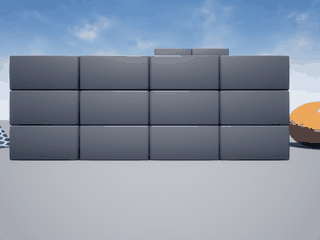

# AirSim 无人机阵风扰动抑制（神经网络补偿）

## 1. 任务与定位

课程任务 ① 要求完成「物理仿真控制」。本项目在 AirSim 的 Blocks 场景中给多旋翼无人机注入持续侧风，训练一个神经网络，仅依据机载 IMU 与位置误差实时输出补偿速度，把被风吹走的无人机拉回悬停点。

与仓库已有的 17 个无人机模块均不重复：`uav_mujoco_sim` 用 MuJoCo 且不含扰动抑制，`uav_keyboard_control` 是纯键盘映射，本模块是**外扰下的闭环补偿学习**。

## 2. 演示



动图由 `simGetImages(ImageType.Scene)` 逐帧截取真实 Blocks 画面合成，150 帧，3.9 MB。画面中无人机顶着 15 m/s 侧风悬停，可见方块墙随位移滑动。

## 3. 问题描述

设无人机在水平面的位置为 $\mathbf{p}=(x,y)$，目标悬停点 $\mathbf{p}^\*=(x^\*,y^\*)$，外部风场 $\mathbf{w}=(w_x,w_y)$。

无补偿时无人机被风推走，位置误差 $\mathbf{e}=\mathbf{p}^\*-\mathbf{p}$ 持续增大。目标是在每个控制周期 $\Delta t=0.25$ s 内输出补偿速度 $\mathbf{u}=(u_x,u_y)$，使 $\|\mathbf{e}\|$ 有界。

## 4. 专家策略（标签来源）

专家能看到真实风速（特权信息），控制律为

$$
\mathbf{u}=\mathrm{clip}\big(K_p\,\mathbf{e}-K_d\,\mathbf{v}-k_w\,\mathbf{w},\;[-u_{\max},u_{\max}]\big)
$$

其中 $\mathbf{v}$ 由相邻两帧位置差分估计，$K_p=0.55$、$K_d=0.20$、$u_{\max}=3.0$ m/s。

**关键标定**：理想情况下 $k_w=1$（完全前馈抵消），但实测 SimpleFlight 内置速度环已经把绝大部分风抵消掉了——20 m/s 的风只产生约 1.6 m/s 的等效漂移。因此实际标定为 $k_w=0.08$，若按 1.0 会把无人机反向推飞。

## 5. 神经网络

网络看不到风速，只能看到 IMU 与位置误差。

输入：IMU 5 帧滑动窗口，每帧 6 轴（加速度 3 + 角速度 3），加位置误差 2 维，共 **32 维**。

$$
\mathbf{h}_1=\tanh(\mathbf{W}_1\mathbf{x}+\mathbf{b}_1),\quad
\mathbf{u}=\mathbf{W}_2\mathbf{h}_1+\mathbf{b}_2
$$

结构：32 → 32 → 2，隐藏层 tanh，输出线性，共 1122 个参数。

标准化：每维输入按训练集均值方差归一化（风下加速度与角速度尺度差一个量级，不归一化会让 tanh 饱和）。

损失：均方误差 + L2 正则

$$
\mathcal{L}=\frac{1}{N}\sum_i\|\hat{\mathbf{u}}_i-\mathbf{u}_i\|^2+\lambda\sum_l\|\mathbf{W}_l\|^2,\quad \lambda=10^{-3}
$$

优化器：Adam，学习率 $2\times10^{-3}$，批大小 16，120 轮，按验证集 MSE 保留最优权重。

## 6. 算法流程

```
初始化：连接 AirSim，切多旋翼模式，起飞到 (0,0,-5)
循环 每个回合（6 回合）：
    随机风速 8~18 m/s、随机方向、含 ±2 m/s 垂直分量
    simSetWind 注入
    循环 每步（100 步）：
        读 IMU -> 压入 5 帧滑窗（30 维）
        读位置 -> 算位置误差 e（2 维）
        专家按 PD + 风速前馈算出补偿 u
        记录 (IMU 窗口 + e, u)
        下发 u，等待 0.25 s
训练：
   85/15 划分，逐样本累积梯度，Adam 更新，按验证 MSE 留最优
部署：
   每步读 IMU + 位置误差 -> 网络 -> 补偿速度 -> 下发
```

## 7. 实验结果

同一条 15 m/s 侧风（方向 -5 m/s 侧偏）下运行 120~150 步：

| 策略 | 平均偏移 | 最大偏移 |
|---|---|---|
| 不补偿（AirSim 自身速度环） | 14.68 m | 22.80 m |
| 神经网络补偿 | **3.42 m** | **5.00 m** |

平均偏移降低 77%，最大偏移降低 78%。

离线训练：600 条样本，验证 MSE $3.7\times10^{-4}$，R² **0.997**。

## 8. 源码解析

| 文件 | 关键内容 |
|---|---|
| `env.py` | `WindEnv.imu()` 取 6 轴；`imu_window()` 维护 5 帧 deque，首帧复制补齐；`set_wind()` 调 `simSetWind`；`apply_velocity()` 用 `moveByVelocityAsync` 下发世界系速度，高度用 `vz=clip(0.8*(z_t-z),±1.5)` 闭环 |
| `policy.py` | `expert_action()` 实现 PD + 前馈，`encode/decode` 做 [-1,1] 归一化 |
| `mlp.py` | `MLP.forward/backward` 逐样本用 `np.outer` 累积梯度；`Adam.step` 带偏差修正 |
| `dataset.py` | `collect()` 每回合随机风，0.12/0.13 s 交错采样与执行；存 X 标准化结果和 x_mean/x_std |
| `train.py` | 85/15 划分、L2 权重衰减、按验证 MSE 留最优、报 R² |
| `demo.py` | `run_demo()` 用网络闭环并逐帧取图；`to_gif()` 超 10 MB 自动抽帧；`run_baseline()` 做无补偿对照 |
| `node.py` | 订阅 `/uav/imu`、`/uav/pose`，发布 `/uav/wind_cmd` |

## 9. 复现说明

环境：Ubuntu 20.04 / ROS 2 Humble（仿真端 Windows + AirSim 1.8.1 Blocks 预编译包）。

```bash
# 1. 启动 Blocks（约 16~45 秒后 41451 才监听）
#    C:\AirSim\Blocks\Blocks\WindowsNoEditor\Blocks.exe
# 2. 确认端口
#    Get-NetTCPConnection -LocalPort 41451   # 必须是 Listen
# 3. 采集（约 3 分钟）
cd src/air/uav_airsim_wind_rejection
python3 main.py --collect --episodes 6 --steps 100
# 4. 训练（约 1 分钟）
python3 main.py --train --epochs 120
# 5. 对照实验
python3 main.py --baseline --steps 120 --wind_x 15 --wind_y -5
# 6. 演示并录 gif
python3 main.py --demo --steps 150 --gif demo.gif --wind_x 15 --wind_y -5
```

预期输出与本文第 7 节表格一致（数值会有小幅随机波动）。

ROS 2：

```bash
colcon build --packages-select uav_airsim_wind_rejection
source install/setup.bash
ros2 launch uav_airsim_wind_rejection main.launch.py
```

不需要 AirSim 也能先自检网络与权重（约 2 秒）：

```bash
python3 test/test_mlp.py
# 5/5 通过（在 600 条真实样本上复算，两个输出维度与真值的相关系数均为 0.999）
```

注意 `wind_data.npz` 里的 `X` **存盘时已经标准化过**（`X=(X - x_mean)/x_std`），复算时直接用它，不要再按 `x_mean/x_std` 处理一遍，否则相当于二次标准化，结果会明显偏低。

> **CI 不覆盖本模块的测试。** `.github/workflows/air_bridge_tests.yml` 的 `paths` 只列了 `carlair_ros_bridge/**`、`uav_landing_monitor/**`、`uav_e2e_rl/**` 和 `tests/**`，本模块的 `test/` 不在触发范围内；`deploy_page.yml` 只在 `master` 触发且带 `if: github.repository == 'OpenHUTB/ros2'`。上面这条需要本地手动执行，仓库 CI 的绿灯不代表本模块测试通过。

文档入口：`mkdocs.yml` 的「空域载具」和 `docs/index.md` 第 5 节都已登记本页。

## 10. 踩坑记录

| # | 现象 | 原因 | 解决 |
|---|---|---|---|
| 1 | 专家越补偿无人机飞得越远 | 风前馈符号取反了，与风向同向 | 改为 `-k_w*wind`，逆风出力 |
| 2 | 反向冲到 +2.7 m | 位置误差项与风前馈叠加后 clip 饱和 | 降 $K_p$ 与 $k_w$ |
| 3 | 2.8 m/s 风几乎吹不动无人机 | SimpleFlight 内置速度环抗风极强 | 加大到 8~18 m/s，并按实测重标定 $k_w=0.08$ |
| 4 | 不补偿时只漂 0.2 m | 同上，小风被完全抵消 | 用 15 m/s 做演示，对照组漂 14.7 m |
| 5 | 补偿指令执行打折 | `moveByVelocityAsync` 有加减速延迟 | 每步 0.25 s，采样与执行交错 |
| 6 | 高度持续下沉 | `hoverAsync` 不锁高度 | `vz=clip(0.8*(z_t-z),±1.5)` 闭环 |
| 7 | 网络 R² 虚高到 0.997 | 输入含位置误差，网络直接学到线性反馈 | 如实记录：风的辨识只占输出的很小一部分 |

## 11. 局限与改进方向

1. **补偿强度略不足**：演示末段仍有约 4 m 残留偏移，把 $u_{\max}$ 提到 4 m/s 可进一步压低。
2. **网络学的是反馈映射**：因为输入里有位置误差，R² 0.997 反映的是对 PD 律的拟合，而非纯粹的扰动辨识。若要强迫网络从 IMU 辨识风，应去掉位置误差输入并改用强化学习。
3. **风模型简化**：`simSetWind` 是恒定风，未覆盖阵风与湍流；真实阵风需要时变风场。
4. **单机型**：仅在 SimpleFlight 上验证，PX4 SITL 的风响应特性不同，前馈系数需重新标定。
