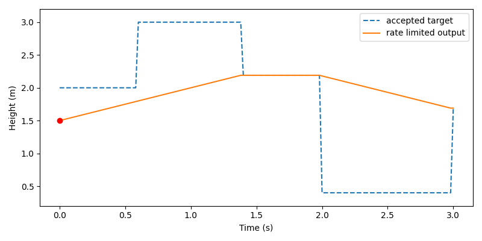
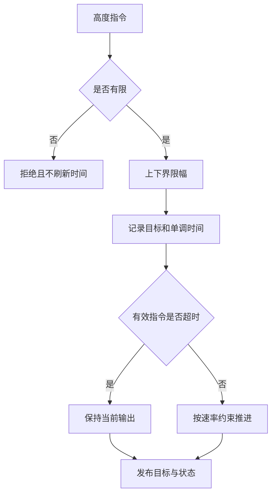

# 无人机目标高度限幅、变化率约束与超时保持

该模块位于上层目标指令与高度控制器之间，独立处理越界高度、突变、非有限输入和指令中断。输出是经过约束的高度目标，不直接输出旋翼推力，也不代替飞控保护。



## 运行

离线使用 Python 3.10/3.11、NumPy、Matplotlib 和 Pillow；ROS 部分使用 Ubuntu 22.04 / Humble。

```bash
cd src/air/uav_altitude_command_guard
python3 -m pip install -r requirements.txt
python3 main.py
```

默认回放 151 个时刻，输出 `outputs/commands.csv`、PNG 和 GIF。数据包含正常输入、9 m 越界输入、NaN、指令间断及 0 m 输入，不需要仿真器。`--output <目录>` 改变输出位置，`--ros` 等价于启动下面的 ROS 2 节点。

## 测试

```bash
python3 -m pip install -r requirements-dev.txt
python3 -m pytest test -v
```

用 `python3 -m pytest` 而不是直接 `pytest`：只有前者会把模块目录放进 `sys.path`，`import uav_altitude_command_guard` 才能成功。

## 约束规则

默认范围 [0.4,3.0] m，初值 1.5 m，最大变化率 0.5 m/s，超时 0.6 s。正常更新使用：

$$z_{out,k}=z_{out,k-1}+\mathrm{clip}(z_{target}-z_{out,k-1},-r\Delta t,r\Delta t).$$

收到有限指令时先限幅，再记录接收时间；NaN/Inf 被拒绝且不刷新有效指令时间。超时后把当前输出作为保持值，不再继续追逐旧目标；重新收到有效指令后恢复变化率约束。首次 tick 不推进输出，后续只接受非递减的单调时间。

此处“保持”是保持目标高度数值，不保证飞行器实际悬停。上下界、速率和超时按实际飞行条件另行设置。默认值仅用于当前定高实验。



## ROS 2 接口

```bash
source /opt/ros/humble/setup.bash
cd ~/ros2
colcon build --packages-select uav_altitude_command_guard
source install/setup.bash
ros2 launch uav_altitude_command_guard main.launch.py
ros2 topic pub /uav/altitude_target std_msgs/msg/Float64 '{data: 2.0}' -r 10
ros2 topic echo /uav/altitude_target_safe
```

输入 `/uav/altitude_target`，输出 `/uav/altitude_target_safe`，均为 `std_msgs/Float64`、单位米；状态输出 `/uav/altitude_guard_status` 为 `std_msgs/String`。节点以 50 Hz 更新，时间来自本机单调时钟，不依赖 ROS 仿真时间回退。话题按相对名定义，不加 namespace 时就是上面这三个绝对名；需要与其他实例隔离时用 `--ros-args -r __ns:=/v1`。

参数为 `minimum`、`maximum`、`rate`、`timeout`、`initial`，启动时读取一次，已通过 launch 暴露：`ros2 launch uav_altitude_command_guard main.launch.py rate:=0.3`；也可以 `ros2 run uav_altitude_command_guard node --ros-args -p rate:=0.3`。该包不自动修改其他控制器的订阅，接入方应显式订阅安全目标，并核对高度轴方向与单位。

## 结构与验证

`core.py` 实现纯 Python 状态约束；`cli.py` 生成可复核的指令回放；`ros_node.py` 完成收发接口。测试检查限幅与变化率、超时保持、非法输入和时间顺序，`python3 -m pytest test -v` 三项通过。Ubuntu 22.04 / Humble 中包构建、launch 和实际指令收发通过；Ubuntu 20.04 和真机未验证。

## 使用声明

使用 ChatGPT / Codex 辅助实现与文档整理；提交者负责审阅、理解并对提交内容负责。
