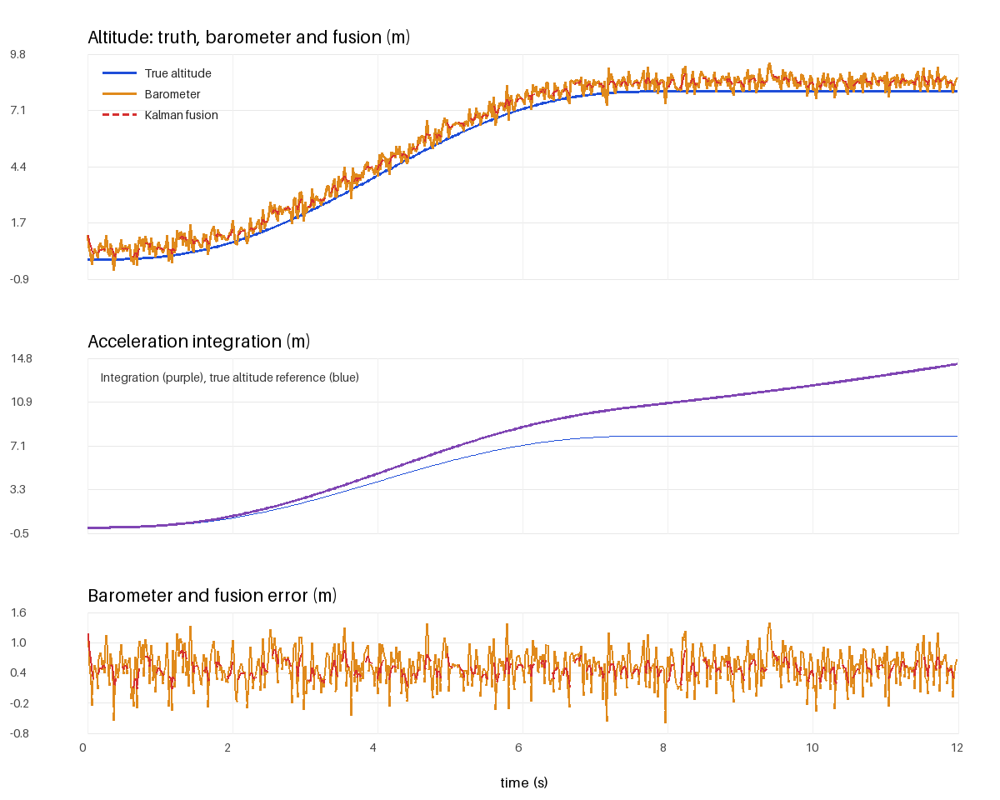

# 无人机 IMU 与气压高度融合

本实验用合成的 IMU 垂直加速度和气压高度数据演示一维卡尔曼滤波。无人机从地面
平滑上升到目标高度，比较原始气压高度、加速度积分高度和融合高度。

源码位置：`src/air/uav_altitude_sensor_fusion/`

## 实验目标

- 理解 IMU 加速度积分产生漂移；
- 理解气压高度存在偏置和噪声；
- 用一维卡尔曼滤波融合两种传感器；
- 比较融合前后的 RMSE 和最终误差；
- 提供 ROS 话题、CSV 和响应曲线。

## 融合模型

状态为：

```text
x = [altitude, vertical_velocity]
```

IMU 预测：

```text
altitude += velocity * dt + 0.5 * acceleration * dt²
velocity += acceleration * dt
```

气压计更新使用高度观测，过程噪声和气压计噪声在 `altitude_filter.py` 中作为参数。
其中 `Q=0.015/0.08` 是为本教学仿真整定的取值，不是实机标定参数；改变采样率、
加速度偏置或噪声模型后需要重新试验。

## 仿真真值

前 8 s 使用五次多项式从地面平滑起飞到 8 m：

```text
u = t / 8
altitude = 8 * (10u³ - 15u⁴ + 6u⁵)
```

因此 `t=0` 时高度、垂直速度和加速度均为 0，`t=8 s` 时速度与加速度也回到 0，
随后保持 8 m 悬停。作为“已知初始状态”的积分基线，加速度积分使用与真值相同的
初始高度和速度，避免把初速度差误算为积分漂移。

## 运行

```bash
cd ~/catkin_ws
catkin_make
source devel/setup.bash
roslaunch uav_altitude_sensor_fusion main.launch
```

纯 Python：

```bash
cd src/air/uav_altitude_sensor_fusion
python3 scripts/main.py --duration 12 --rate 50
```

## 输出

- `/uav/altitude/barometer`
- `/uav/altitude/estimate`
- `/uav/altitude/error`
- `/uav/altitude/status`

指标包括气压高度 RMSE、加速度积分 RMSE、融合 RMSE 和最终误差。



本次 50 Hz、12 s 合成数据的结果：

| 高度来源 | RMSE |
|---|---:|
| 原始气压高度 | 0.573 m |
| 加速度积分 | 2.832 m |
| 卡尔曼融合 | 0.484 m |

融合最终误差为 `0.426 m`。在初始状态一致后，加速度积分从 `24.140 m` 降至
`2.832 m`；剩余漂移主要来自未建模的 `0.08 m/s²` 加速度偏置持续累积。融合结果由
气压高度持续修正，但仍受气压计 `0.45 m` 常值偏置限制。滤波器状态不含偏置项，
因此该实验不能消除这个常值误差。

响应图上层比较真值、原始气压高度和融合高度；加速度积分单独放在中间面板，避免其
较大漂移压缩另外三条曲线；下层比较气压和融合误差。融合曲线使用较细的红色虚线，
因此气压曲线在两者接近时仍可辨认。

## 测试

catkin 自动测试：

```bash
cd ~/catkin_ws
catkin_make run_tests_uav_altitude_sensor_fusion
catkin_test_results
```

单独运行 unittest：

```bash
python3 -m unittest discover -s test -v
```

共 6 项测试，包含起飞真值边界、滤波器预测、静止偏置收敛、RMSE、融合效果相对
气压高度的改善检查，以及离线 CLI 对错误参数的拒绝。`main.py` 只在 `--ros` 分支
接收 roslaunch 附加参数，纯 Python 模式仍使用严格参数解析。

## 范围限制

当前使用合成传感器，不包含真实 IMU 温度漂移、气压计延迟或硬件故障。

## AI 使用声明

使用 DeepSeek Harness 辅助代码、测试和文档整理；算法参数、运行结果与提交内容由作者复核并负责。
