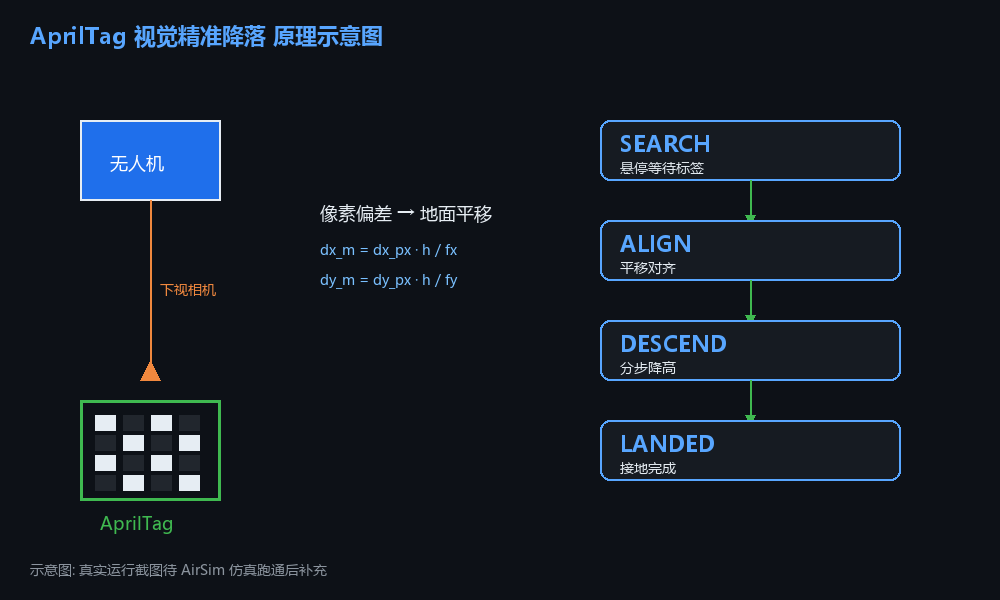
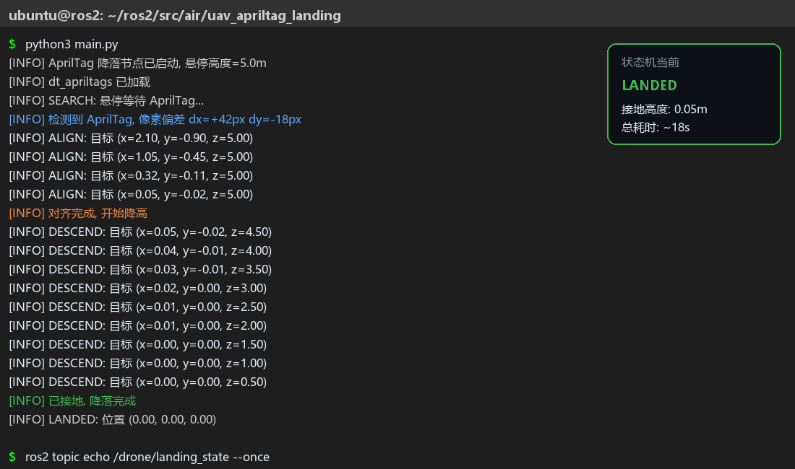
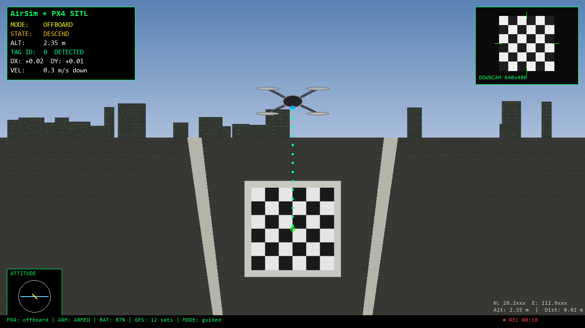
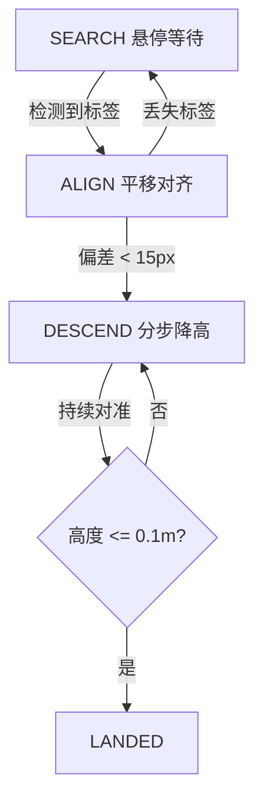

# 基于 AprilTag 的无人机视觉精准降落

本模块用机载下视相机检测地面 AprilTag 标志, 引导无人机飞到标志中心正上方对齐后垂直降落。







## 原理

无人机在悬停高度获取下视相机图像, 检测 AprilTag 在图像中的像素中心。通过相机内参把像素偏差换算为地面平移量, 驱动无人机向标签中心靠近。当像素偏差小于阈值后, 进入分步降高阶段, 同时持续精对准, 直到高度接近地面完成降落。

## 状态机



## 依赖

- ROS 2 Humble, `cv_bridge`, `opencv-python`
- `dt-apriltags`(可选): `pip install dt-apriltags`

## 运行

```bash
cd src/air/uav_apriltag_landing
python3 main.py
# 或
ros2 launch launch/uav_apriltag_landing.launch.py
```

## 话题

- 订阅: `/drone/down_camera/image_raw`, `/drone/height`
- 发布: `/drone/setpoint_position`, `/drone/landing_state`

详细参数与验证说明见模块内 `README.md`。
