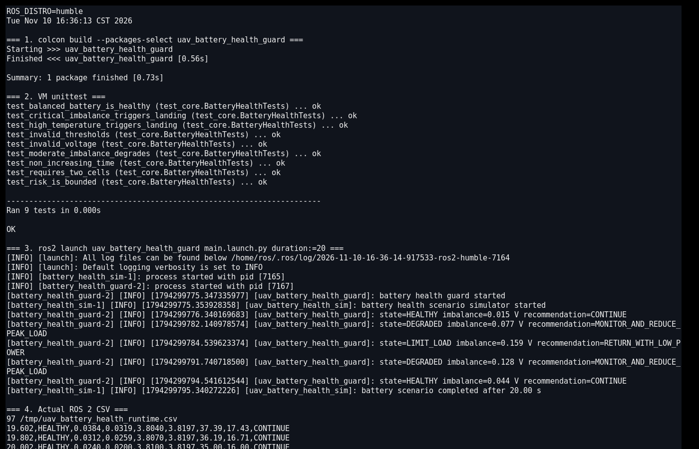
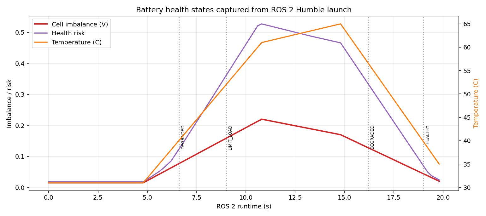

# 无人机电芯健康与不平衡预警

本项目针对多旋翼无人机多电芯动力电池，在线评估单体电压差、最低单体电压、温度、内阻和高负载压降。输出 `HEALTHY / DEGRADED / LIMIT_LOAD / LAND_NOW` 以及任务级建议。

与 `UAV mission energy budget` 的区别：

- 能量预算模块估计可用能量、续航和返航裕度；
- 本模块关注电池组内部健康与不平衡，不预测剩余航时；
- 输出用于发现弱电芯、热异常和负载能力下降。

## 1. 判定模型

单体不平衡电压：

\[
\Delta V = \max_i V_i-\min_i V_i
\]

风险综合以下分量：

\[
R=0.29R_{\mathrm{imbalance}}+0.19R_{\mathrm{weak\,cell}}
\quad +0.20R_{\mathrm{temp}}+0.16R_{\mathrm{resistance}}
\quad +0.12R_{\mathrm{low\,voltage}}+0.04R_{\mathrm{load}}
\]

任一单体低于 3.10 V、温度达到 66°C 或不平衡达到 0.24 V 时，立即进入 `LAND_NOW`。其余状态使用连续帧确认，避免负载波动造成频繁切换。

## 2. ROS 2 接口

| 话题 | 类型 | 方向 | 说明 |
|---|---|---|---|
| `/uav_battery/health_sample` | `std_msgs/String` | 输入 | 单体电压、电流、温度和估算内阻 |
| `/uav_battery/health_assessment` | `std_msgs/String` | 输出 | 不平衡、风险、最低/平均电压和状态 |
| `/uav_battery/health_advice` | `std_msgs/String` | 输出 | 继续、降低峰值负载、低功率返航或就近降落 |

## 3. 构建与运行

```bash
source /opt/ros/humble/setup.bash
colcon build --symlink-install --packages-select uav_battery_health_guard
source install/setup.bash
ros2 launch uav_battery_health_guard main.launch.py duration:=20
```

CSV 默认写入 `/tmp/uav_battery_health_runtime.csv`。

## 4. Humble 虚拟机实测

Ubuntu 22.04.5 / ROS 2 Humble 下 `colcon build` 成功，VM 内 9 项 `unittest` 全部通过。`ros2 launch` 实际启动两个节点，运行 20 秒并记录 100 条状态。

实际状态迁移：

```text
HEALTHY → DEGRADED → LIMIT_LOAD → DEGRADED → HEALTHY
```

故障段单体不平衡达到约 0.159 V，温度超过 60°C，内阻明显上升；恢复后不平衡降至约 0.02 V。

VM 内实际终端截图同时记录了 Ubuntu/ROS 版本、`colcon build`、9 项单元测试、两个节点启动、电池状态迁移和 CSV 尾部：



根据同一轮 CSV 生成的电池健康曲线：



## 5. 限制

1. 电池数据由确定性仿真生成，未连接真实 BMS 或动力电池。
2. 内阻是输入估计值，没有实现电流脉冲辨识。
3. 未建模电芯老化、温度梯度、均衡电路和充电过程。
4. 电压阈值与风险权重是示例参数，必须按具体电芯化学体系重新标定。
5. 模块不切断动力电源，也不直接触发降落；飞控必须独立执行故障保护。

## 6. 大模型使用声明

使用 OpenAI Codex 辅助完成代码、测试、文档和运行图生成；作者已逐项复核代码、参数和结果，并对提交内容、数据真实性和后续维护负责。
