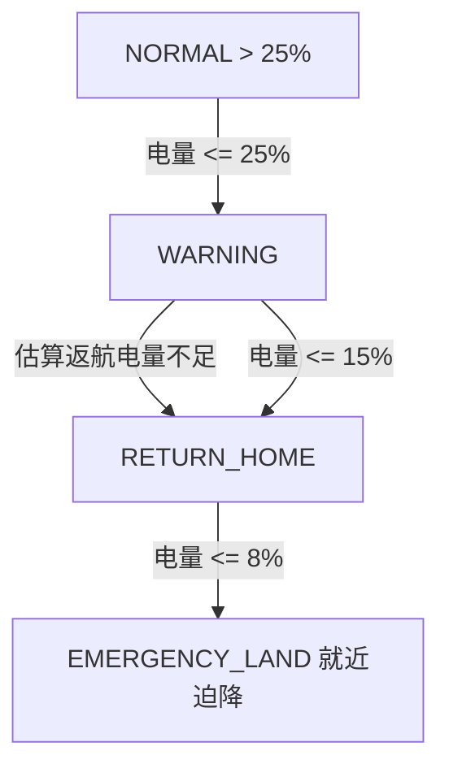

# 无人机电池电量监控与自动返航 (RTH) 迫降

按电量分级触发预警、返航、迫降, 防止低电量丢机。


## 状态机



## 仿真平台

按仓库推荐的两套底座设计, **不使用 Gazebo**: MuJoCo(`src/air/uav_mujoco_sim`, Humble, 推荐主平台)
与 AirSim(`src/air/drone_airsim_bringup`, Noetic, 跨版本需 ros1_bridge)。
模块只依赖电量与位置两条话题, 换底座时不改代码, 只改话题名参数。

## 构建与运行

```bash
colcon build --packages-select uav_battery_rth_failsafe
source install/setup.bash
ros2 run uav_battery_rth_failsafe battery_rth_node
# 或
ros2 launch uav_battery_rth_failsafe uav_battery_rth.launch.py
```

订阅 `/drone/battery`、`/drone/position`, 发布 `/drone/setpoint_position`、`/drone/failsafe_state`;
四条话题名都可用参数 `battery_topic` / `position_topic` / `setpoint_topic` / `state_topic` 覆盖。

详细参数、与 MuJoCo / AirSim 的话题映射见模块 `README.md`。
