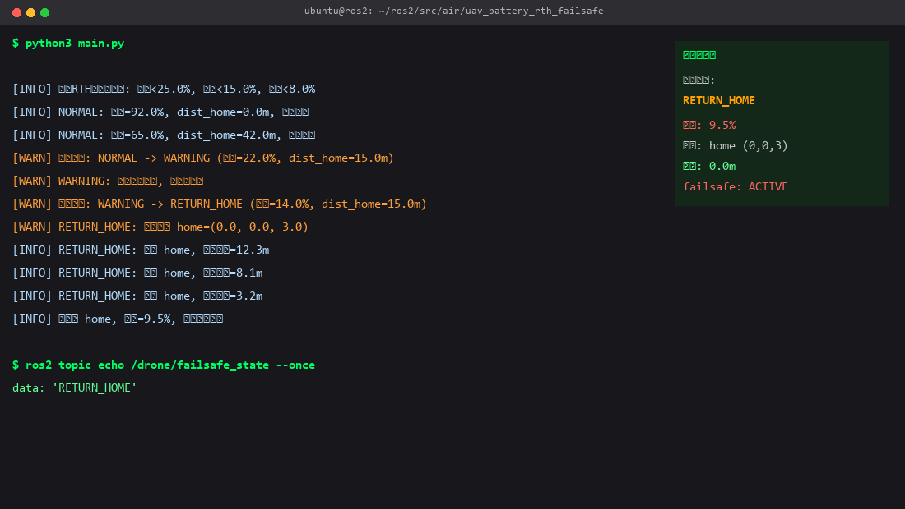
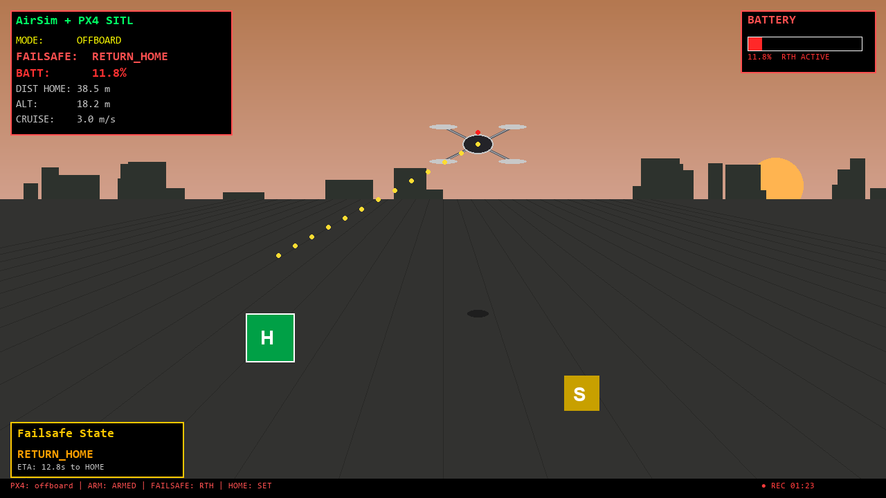
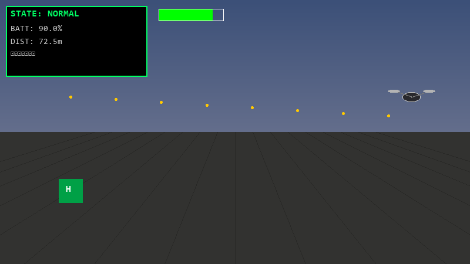
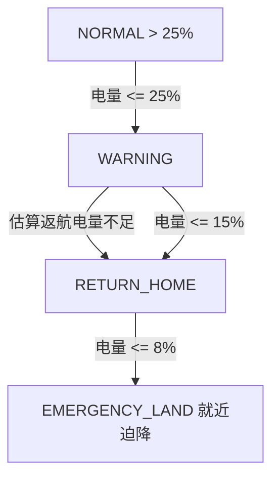

# 无人机电池电量监控与自动返航 (RTH) 迫降

按电量分级触发预警、返航、迫降, 防止低电量丢机。







## 状态机



## 运行

```bash
# 先在工作空间编译并加载环境
colcon build --packages-select uav_battery_rth_failsafe
source install/setup.bash

ros2 run uav_battery_rth_failsafe battery_rth_node
# 或
ros2 launch uav_battery_rth_failsafe uav_battery_rth.launch.py
```

订阅 `/drone/battery`、`/drone/position`, 发布 `/drone/setpoint_position`、`/drone/failsafe_state`。

详细参数见模块 `README.md`。
