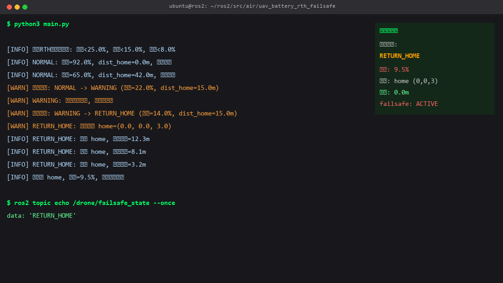
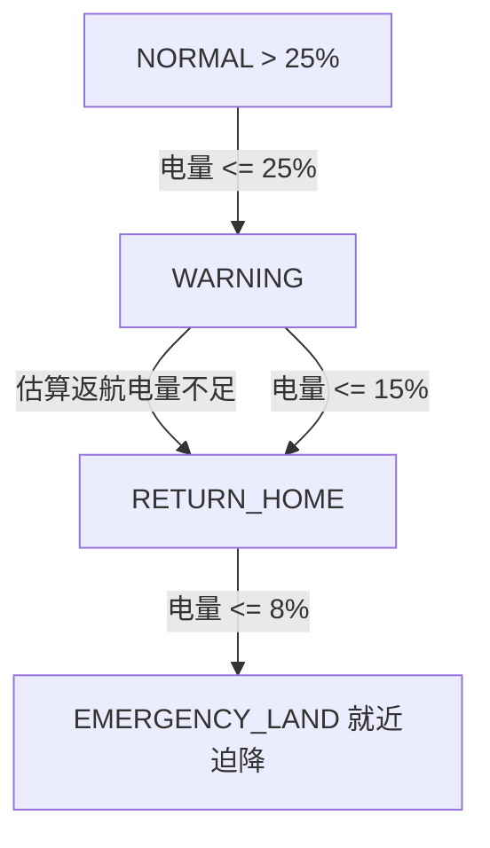

# 无人机电池电量监控与自动返航 (RTH) 迫降

按电量分级触发预警、返航、迫降, 防止低电量丢机。



## 状态机



## 运行

```bash
cd src/air/uav_battery_rth_failsafe
python3 main.py
```

订阅 `/drone/battery`、`/drone/position`, 发布 `/drone/setpoint_position`、`/drone/failsafe_state`。

详细参数见模块 `README.md`。
