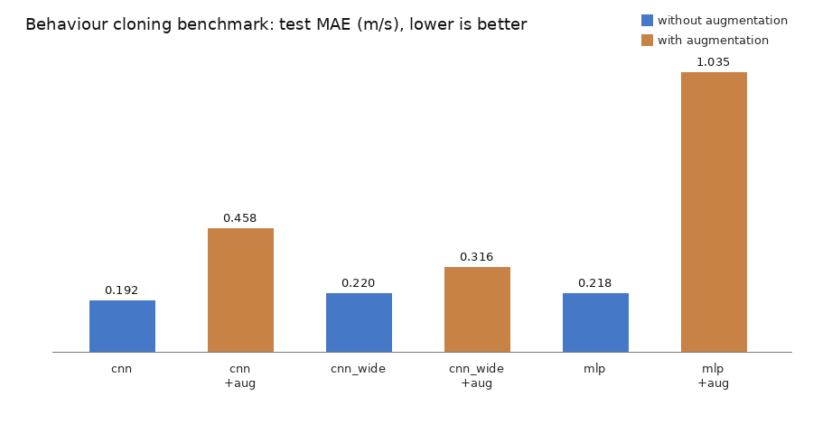

# 行为克隆模型对比基准（结构与数据增强）

本模块对应作业"其他"要求中的**同样模型不同数据结构/同样算法不同模型结构的对比实验**，
在同一份采集数据上比较 MLP、CNN、宽卷积三种网络结构，以及有无图像增强两种训练策略。
不依赖仿真器，纯训练与评估，`ros2 launch uav_bc_bench main.launch.py` 一键跑完。



## 1 模块概述

行为克隆（Behaviour Cloning, BC）把控制问题当作监督学习：给定图像与专家动作，
训练网络最小化预测动作与专家动作之间的均方误差。本模块固定数据集与训练超参，
只改变"网络结构"和"数据增强"两个变量，用同一套评估流程给出对比结论。

## 2 运行环境

* Ubuntu 22.04 + ROS 2 Humble + Python 3.10
* `numpy`、`opencv-python`、`torch`（CPU 即可）

默认数据集来自任务 2 的 `uav_depth_track_nn`：`~/.ros/uav_depth_track_nn/data/`
（`controls.csv` + `frames/*.png`），这是本模块的**首选**数据来源，二者合并时按同名包依赖说明即可。
如果想在没有仿真器、也没有那份采集数据的机器上直接跑通，用 `--synthetic 400` 生成一份
同格式的合成数据集（`output_dir/synthetic/`），不依赖任何其它 PR：

```bash
python3 -m uav_bc_bench.bench --synthetic 400 --epochs 10 --seeds 1
```

代码会自动识别 16 位深度图与 8 位彩色图。

## 3 编译与运行

```bash
cd ~/ros2
colcon build --packages-select uav_bc_bench
source install/setup.bash

ros2 launch uav_bc_bench main.launch.py epochs:=20 seeds:=2
```

跑完后在 `~/.ros/uav_bc_bench/` 下得到 `metrics.json`、`comparison.md`、`comparison.png`。

也可以脱离 ROS 直接跑：

```bash
python3 -m uav_bc_bench.bench --dataset-dir ~/.ros/uav_depth_track_nn/data \
    --output-dir ~/.ros/uav_bc_bench --epochs 20 --seeds 2
```

## 4 参数说明

| 参数 | 默认值 | 说明 |
| --- | --- | --- |
| `dataset_dir` | `~/.ros/uav_depth_track_nn/data` | 数据集目录 |
| `output_dir` | `~/.ros/uav_bc_bench` | 指标与图表输出目录 |
| `epochs` | 30 | 每个配置训练轮数 |
| `seeds` | 3 | 每个配置重复的随机种子数 |
| `structures` | `mlp,cnn,cnn_wide` | 参与对比的结构 |
| `augment` | true | 是否同时跑增强组 |
| `image_size` | 64 | 输入边长 |
| `batch_size` | 32 | 批大小 |

## 5 算法原理

### 5.1 行为克隆目标

给定数据集 $\{(I_i, a_i)\}_{i=1}^{N}$，其中 $I_i$ 是深度图，$a_i=(v_x,v_y)$ 是专家速度，
训练目标为

$$
\mathcal{L}(\theta) = \frac{1}{N}\sum_{i=1}^{N}\left\| \pi_\theta(I_i) - a_i \right\|_2^2
$$

优化器 Adam，学习率 $10^{-3}$，保存验证集最优权重。

**划分方式**：连续飞行的相邻帧高度相关，若按单帧随机打乱切分，近邻状态会同时进入
训练集与测试集，评估结果被时间泄漏抬高。因此这里按**时间顺序**切成连续三段：
前 80% 训练、中间 10% 验证、最后 10% 测试；`seed` 只用于让切点做小幅抖动，
不改动"三段连续"这一性质。

### 5.2 三种网络结构

* **mlp**：图像展平成 4096 维 → 全连接 256 → 256 → 2；
* **cnn**：Conv(16)-Pool-Conv(32)-Pool-Conv(64)-Pool → 128 → 2；
* **cnn_wide**：Conv(32)-BN-Pool-Conv(64)-BN-Pool-Conv(128)-BN-Pool → Dropout → 256 → Dropout → 2。

参数量由各层权重矩阵尺寸累加得到，例如 CNN 第一层卷积为
$16\times1\times3\times3 + 16 = 160$ 个参数，全连接层
$64\times8\times8\times128 + 128 = 524{,}416$ 个参数。

### 5.3 数据增强

训练集上按概率施加：随机裁剪 $c\sim U\{0,\dots,7\}$ 像素后缩放回原尺寸、
亮度增益 $g\sim U(0.8,1.2)$、高斯噪声 $\mathcal{N}(0,0.01^2)$：

$$
\tilde I = \mathrm{clip}\left(\mathrm{resize}(\mathrm{crop}(I, c)) \cdot g + \epsilon,\; 0,\; 1\right)
$$

## 6 源代码解析

| 文件 | 关键内容 |
| --- | --- |
| `uav_bc_bench/data.py` | 读 CSV 与图像，16 位毫米深度图转米并截断 40 m |
| `uav_bc_bench/models.py` | 三种结构、`build()`、`num_parameters()` |
| `uav_bc_bench/bench.py` | 划分、训练、评估、指标汇总、PIL 柱状图 |
| `uav_bc_bench/main.py` | ROS 2 节点：工作线程跑实验，完成后自动退出 |

## 7 对比结果（本机实测）

数据：555 个深度样本；训练 20 轮、2 个随机种子，取均值 ± 标准差。

| 结构 | 图像增强 | 参数量 | 测试 MAE (m/s) | 训练耗时 (s) |
| --- | --- | --- | --- | --- |
| cnn | 否 | 547,970 | **0.2522 ± 0.0507** | 17.8 |
| cnn_wide | 否 | 2,191,042 | 0.2618 ± 0.0556 | 47.6 |
| mlp | 否 | 1,115,138 | 0.3627 ± 0.0758 | 2.5 |
| cnn_wide | 是 | 2,191,042 | 0.5588 ± 0.0800 | 51.7 |
| cnn | 是 | 547,970 | 0.8139 ± 0.0004 | 15.2 |
| mlp | 是 | 1,115,138 | 0.9849 ± 0.0953 | 2.5 |

改为按时间连续切分后，所有配置的误差都比随机切分时高（例如 `cnn` 从 0.180 升到 0.252），
这正是时间泄漏被消除后的真实泛化水平。

## 8 结论

1. **卷积结构明显优于全连接**：CNN 的 MAE 比 MLP 低 30%（0.252 对 0.363），
   而参数量只有 MLP 的一半，说明图像的空间局部性必须由卷积先验利用。
2. **加宽模型收益很小**：`cnn_wide` 参数量是 `cnn` 的 4 倍，MAE 只从 0.2522 变到 0.2618
   （差异在标准差之内），训练耗时却增加 2.7 倍。在小数据集上，容量不是瓶颈。
3. **增强在本任务上有害**：三个结构的 MAE 全部退化 1.1~3.2 倍。
   原因是这里的增强改变了深度图的绝对数值语义——亮度增益会破坏"灰度即距离"的映射，
   随机裁剪又改变了障碍物在图像中的位置，与速度指令的对应关系不再成立。
   若要增强，应使用与传感器语义一致的方式（如深度缩放、遮挡模拟）。
