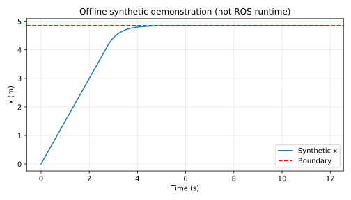

# 无人机空间围栏与速度门控

用保守可达距离约束三维速度指令，处理位姿和指令超时；只是 ROS 安全接口示例，未接入飞控。

**验证状态：已有 2026-11-04 的独立 catkin 构建、ROS Noetic 合成话题联调及退出清理日志；本轮修复偏航限幅状态并完成离线复核。另一位同学在独立 Noetic 环境复现尚未完成，真实飞行与飞控/模拟器闭环未验证。**

## 环境与依赖

核心算法与 11 项单元测试仅使用 Python 标准库；离线绘图入口需要 matplotlib，不涉及神经网络训练。
历史离线环境为 Ubuntu 24.04 / Python 3.12.14 / matplotlib 3.10.8。
历史 ROS 记录为 VirtualBox Ubuntu 20.04.6 / Python 3.8.10 / ROS Noetic，见下方原始日志；这与本轮离线文档复核、待完成的独立复测是不同验证范围。

## 离线复现

在仓库根目录执行，输出目录应不存在：

```bash
python3 -m unittest discover -s src/air/uav_box_geofence_guard/tests -v
python3 src/air/uav_box_geofence_guard/main.py --output /tmp/uav_box_geofence_guard_demo
```

第二条只生成 `samples.csv`、`metrics.json` 和 `offline_demo.svg`。`metrics.json` 的 `validation_scope` 仅描述该次离线数学演示，不代表本模块全部验证历史；图形样式可能随 matplotlib 版本变化。

## ROS 构建和运行（下方附历史实测日志）

从仓库根目录开始，在独立 catkin 工作空间中只放这个包，不把整个混合 ROS1/ROS2 仓库交给 catkin：

```bash
source /opt/ros/noetic/setup.bash
mkdir -p ~/air_course_ws/src
cp -r src/air/uav_box_geofence_guard ~/air_course_ws/src/
cd ~/air_course_ws
catkin_make
source devel/setup.bash
roslaunch uav_box_geofence_guard main.launch
```

如缺依赖，按 package.xml 使用 ROS 对应发行版安装；不要在系统 ROS 中随意混装 Python 版本。
Ctrl+C 结束本模块。话题演示不要连接实机飞控，先完成受控仿真联调。

## 算法与坐标约定

输入位姿和速度必须属于世界 ENU 坐标系：x/y 水平、z 向上。ROS frame_id 固定为 `world`。本模块不接受 AirSim 原生 NED 或机体系速度；桥接前必须显式转换。
教学围栏 x/y 为 [-5,5] 米，z 为 [0,4] 米，内部再留 0.15 米裕量。
取当前位置到六个围栏面的最小距离 d，用 `min(1.5,d/0.5)` 限制三维速度模长，各轴按同一比例缩放，偏航速度限为 1 rad/s。线速度或偏航速度任一被限幅时状态均为 LIMITED；二者均未被限幅时为 CLEAR。

这是 0.5 秒内恒速、理想运动学条件下的保守可达球约束，不是含惯性的制动距离模型。
与逐轴限幅相比，不利用某个方向更大的余量，容易在边界附近过早减速，这是安全裕量与机动性的教学取舍。

| 输入/输出 | 类型 | 含义 |
|---|---|---|
| `pose_world` | geometry_msgs/PoseStamped | 世界坐标位姿，使用位置三分量 |
| `velocity_raw` | geometry_msgs/TwistStamped | 同一世界系的速度请求 |
| `velocity_safe` | geometry_msgs/TwistStamped | 门控后的速度，不自动连接到飞控 |
| `~status` | std_msgs/String | WAITING/CLEAR/LIMITED/OUTSIDE/STALE/INVALID |

没有位姿/指令时保持零输出；任一接收间隔超过 0.3 秒则置 STALE 并停车；框架错误等同等待有效输入；非有限数值置 INVALID。
已在围栏外时零输出，须人工复位或由独立恢复流程接管，不自动飞回。

## ROS 联调操作（下方附历史实测日志）

启动后先向 `pose_world` 和 `velocity_raw` 持续发布消息。例如：

```bash
rostopic pub -r 20 /pose_world geometry_msgs/PoseStamped "{header: {frame_id: world}, pose: {position: {x: 0, y: 0, z: 2}, orientation: {w: 1}}}"
rostopic pub -r 20 /velocity_raw geometry_msgs/TwistStamped "{header: {frame_id: world}, twist: {linear: {x: 1}}}"
rostopic echo /velocity_safe
```

位姿 x 改为 4.8，输出应明显减小；停止任一发布器超过 0.3 秒，输出应为零。
上面是接口联调，不是实际飞行；固定发布位姿不会让无人机运动。

## 限制

不建模加速度、刹停惯性、风、感知误差或下游通信丢包。不根据源时间戳判断延迟，仅判断接收新鲜度，因此重放旧数据可能被视为新数据；必须在受控实验链路中使用。
不得把本示例直接当成实机唯一安全控制器，未做飞控和模拟器闭环验证。


## 本次实际结果

当前离线单元测试：**11/11 通过**（原有 8 项及新增的正偏航限幅、负偏航限幅、边界内偏航状态 3 项）。原始输出位于本模块 tests_result.txt。

```json
{
  "final_x": 4.8499999975157095,
  "boundary": 4.85,
  "limited_steps": 185,
  "validation_scope": "offline mathematical demo; ROS runtime not tested"
}
```

下面为程序实际生成的**离线合成数据/数学演示图**，不是 ROS 窗口截图或飞行记录：



指标文件：源码模块内 offline_metrics.json。逐点样本可用离线复现命令重新生成。
历史 ROS 构建与通信记录见下方补充；本轮未重新执行 ROS，仍无真实硬件和独立外部复测。

## 大模型使用声明

使用 OpenAI Codex 辅助方案设计、代码、核心测试、合成演示、文档和提交准备。仅报告实际执行结果；作者需理解、复核和补充目标环境验证，并对内容负责。


## ROS Noetic 实测补充（2026-11-04）

历史记录使用 VirtualBox Ubuntu 20.04.6、Python 3.8.10、ROS Noetic。工作目录为 `/home/ros/four_assignments_0yekhx11/ws_uav_box_geofence_guard`。

已归档的历史日志报告：离线测试、独立 catkin 构建、真实 roslaunch/话题功能及退出清理通过；launch 返回码为 0，无节点异常退出。此次文档修订只核对记录与源码哈希，不把历史日志当成本轮重跑或另一位同学的独立复测。

测试使用真实 ROS 通信发送合成输入，不是无人机飞行、真实传感器或 AirSim/Gazebo 验证。

- fresh world command preserved; yaw clamped
- near boundary x velocity <= 0.101 m/s
- outside box outputs zero
- wrong pose frame rejected
- stale input produces zero
- roslaunch remains running through functional checks

复现构建（将本模块复制到独立工作空间 src 后）：

```bash
source /opt/ros/noetic/setup.bash
catkin_make -C /path/to/workspace
source /path/to/workspace/devel/setup.bash
roslaunch uav_box_geofence_guard main.launch
```

必须检查 `devel/setup.bash` 与 `devel/lib/uav_box_geofence_guard/main.py` 存在。旧脚本曾在错误工作空间构建，旧 BUILD=PASS 无效；所链接历史记录来自修正版的独立工作空间。

原始证据：[构建](validation/build.txt)、[launch](validation/launch.log)、[ROS 测试](validation/ros_test.txt)、[结构化结果](validation/ros_result.json)、[离线测试](validation/offline.txt)、[源码 SHA256](validation/source_sha256.json)。历史哈希记录保留不变，用于标识当时的文件。在提交 2180c29 时，程序源码、测试、构建及 launch 文件已与历史记录逐项核对。本次修改 core.py 和 tests/test_core.py 后，这两个文件及 README 与历史哈希不再相同；历史 ROS 日志不能作为本次修复版本的运行证明，新版仍需独立 Noetic 复测。

仍未验证真实硬件/飞行与另一人另一台机器复测。PR 保持正式待审核状态，外部复测标为待完成，是否合并由维护者结合验证范围决定。

仓库中其他模块的 `build-and-test` 绿色检查不能证明本模块的构建或 ROS 通信通过。本模块的离线复核与历史 ROS 证据分别说明，不将二者混同为模块 CI。

独立复测请记录复测人、日期、Ubuntu/Python/ROS 版本、被测提交 SHA，以及独立工作空间的 `catkin_make`（或 `catkin build`）和 `roslaunch` 日志。按上方话题步骤确认中心指令、边界限速、围栏外零输出、错误 frame、超时停车及退出清理；完成前不勾选外部复测。使用 OpenAI Codex 辅助日志核验、文档与提交整理。

## 偏航限幅状态修复（2026-11-12）

修复了仅偏航速度被限制时仍报告 CLEAR 的问题。yaw=2 和 yaw=-2 分别输出 1 和 -1 rad/s，状态均为 LIMITED；恰好 ±1 rad/s 且线速度未限幅时仍为 CLEAR。新增测试同时覆盖纯偏航与带平移的指令。本轮未重新执行 ROS Noetic；独立复测仍待完成。
